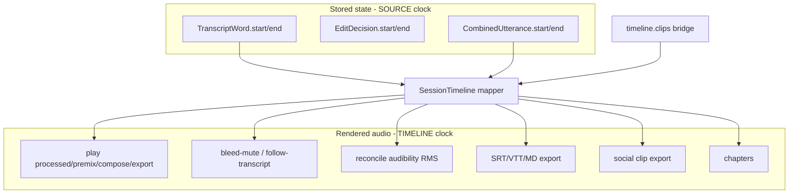

# Architecture

## Layers

```text
Adapters     CLI (Typer)    MCP (MCPServer)  GUI (FastAPI viewer)
                    \             |             /
                     \            |            /
Application              services/  (ProjectWorkspace, *Service)
                                    |
Domain                   edits/  clips/  pipeline/  engines/  ingest/
                                    |
Models                   models/  (EpisodeProject, snapshots)
```

Each layer owns one concern. Per-module ownership notes, caches and the FFmpeg pair policy live in
[layer-reference.md](layer-reference.md); frontend internals live in [gui-viewer.md](gui-viewer.md).

1. **Models** (`podcast_mcp.models`) — Pydantic episode project on disk; no I/O side effects. See [episode-format-v2.md](episode-format-v2.md).
2. **Engines** (`podcast_mcp.engines`) — FFmpeg, transcription, waveform pyramids, source and timeline mapping, render and audio audits. See [audio-engineering.md](audio-engineering.md) and [layer-reference.md](layer-reference.md#layer-items).
3. **Ingest** (`podcast_mcp.ingest`) — recorder-folder scan, `ingest.yaml` manifest, one dialogue track per speaker. See [multitrack-ingest.md](multitrack-ingest.md).
4. **Edits** (`podcast_mcp.edits`) — filler detection, tighten presets, transcript search and cuts, the inaudible-cut optimizer, clip timeline operations. See [inaudible-cuts.md](inaudible-cuts.md) and [daw-editing.md](daw-editing.md).
5. **Clips** (`podcast_mcp.clips`) — social clip candidates and WAV export.
6. **Pipeline** (`podcast_mcp.pipeline`) — registered steps, runner with `--from` / `--only`. See [pipeline.md](pipeline.md).
7. **Services** (`podcast_mcp.services`) — shared orchestration for CLI, MCP and GUI; history-wrapped mutations. See [Service contexts](#service-contexts).
8. **CLI** (`podcast_mcp.cli`) — Typer commands; while a Studio serves a project the command is handed to it, so Studio is the one writer. See [gui-integration.md](gui-integration.md).
9. **MCP** (`podcast_mcp.mcp`) — tool registration in `server.py`, handlers in `mcp/tools/`, typed parameters validated at the boundary. See [contributing.md](contributing.md) and [mcp-setup.md](mcp-setup.md).
10. **GUI** (`podcast_mcp.gui`) — HTTP/WebSocket adapter over services (`server.py` + `routes/`); never duplicates path or render logic. See [gui-integration.md](gui-integration.md) and [gui-viewer.md](gui-viewer.md).
11. **Extensions** (`podcast_mcp.extensions`) — feature registry and soft-load SPI; the FOSS `collaboration` extension. See [extensions.md](extensions.md).
12. **Relay** (`podcast_relay`) — imports `podcast_mcp.util` only; `podcast_mcp` never imports it (wire code shared with `services/collaboration/tunnel.py` lives in `util/relay_protocol/`). host-online reverse tunnel edge (`create_relay_app` includes the per-concern routers under `podcast_relay/routes/`); the host connects with `podcast tunnel`. See [host-online-relay.md](host-online-relay.md).

**Project package** (`podcast_mcp.project`): `io` (open, resolve and relocate a project), `store` (canonical load and commit, history index), `merge` (three-way merge for long-job saves), `transcript_context` (episode glossary YAML with its own writer lock) and `history/` (undo/redo, `run_mutation`, rollback). It sits beside the layers above rather than in one of them: it imports `models` and `util` (and `engines.asr_timing`, `config.defaults` for transcript-context defaults) and is imported by `engines.speaker_id`, `edits`, `pipeline`, `services` and the adapters. The package `__init__` stays empty so importing one module never loads the others.

**Config package** (`podcast_mcp.config`): `defaults` (shipped pipeline YAML defaults, effective-config merge and the user config/cache directories), `runtime` (validated host relay and object-store configuration) and `distribution` (validated public build identity). `podcast_mcp.settings` stays at the package root as the environment-variable registry. The package `__init__` stays empty, so import the submodule you need (`from podcast_mcp.config.defaults import ...`). `rerender_preview` lives in `services/pipeline/preview.py` with the other pipeline orchestration.

**Episode state:** `episode.project.json` v2 is the single source of truth. See [episode-format-v2.md](episode-format-v2.md).

### Durable storage

Host-local durable stores beyond the episode JSON (session sync sqlite, share
token registry, review sidecars) are cataloged in [persistence.md](persistence.md).
Share token algorithm (coolname, active + cooldown pools): [share-tokens.md](share-tokens.md).
**Extend an existing store** instead of inventing a parallel JSON index or DB.
Recording sessions reuse the share registry (`kind`) and prefixed session-sync
sqlite tables (`record_*`) rather than a new plane — see [recording-session.md](recording-session.md).
`TimelineService.list_clips` acquires the host-local recording-key secret from the
share registry once per call; `edits.timeline_ops.list_clips` passes it to pure
HMAC derivation in `edits.clips_ops.recording_key`. Every SQLite store (session sync, share identity, share registry, relay reports) opens through
`util/sqlite_open.open_sqlite`: WAL by way of the bounded `util/sqlite_wal.ensure_wal`
transition, then a busy timeout (5 s unless the store passes another); persistent owners
use its per-connection lifetime cleanup as described in [persistence.md](persistence.md).
Session setup retains its per-path locks and timing controls. A failed registry secret transaction closes
its connection. The process-wide getter and each registry operation recover from
durable state before token lookup, including directly injected registry owners.

### Progress

Domain code opens `progress_task` from `podcast_mcp.util.progress`; adapters bind the reporter at their choke points and attach only live sinks with `compose_progress`. The package splits by role: `protocol` (the six-method reporter and `ProgressEvent`), `task`, `sinks` (registries and the MCP and guest wraps), `reporters` and `compliance`. `util/` imports no adapter, so the CLI command wrap lives in `cli/progress.py`. Every class that implements the protocol derives from `ElapsedProgressMixin`, which holds the no-op bodies and the one heartbeat; `tests/test_progress_compliance.py` enforces that by AST. Spec and event semantics: [progress.md](progress.md).

### Service contexts

`services/support/` owns runtime/configuration diagnostics, sanitized bundles,
and explicit report submission. `services/pipeline/` owns pipeline execution,
working configuration, Analyze, and component bootstrap. Adapters and sibling
services import each context's declared symbols from
`podcast_mcp.services.support` or `podcast_mcp.services.pipeline`; focused tests
may import implementation modules. The pipeline context depends on the existing
`services.app` facade for `ProjectWorkspace`, and support reads pipeline component status
through the public facade. Neither context imports CLI, MCP, or GUI modules.
The document context splits editing by theme, each service under 40 public
methods and each module under 850 lines: `EditService` (cuts, approval
decisions, tighten proposals), `TimelineService` (clip geometry, joins, fades,
segments, chapters), `TranscriptService` (transcription, export and word
edits), `AnalysisService` (effects, loudness, bleed, audibility, reconcile and
cut-boundary previews). They share `WorkspaceService` and `CutMutatingService`
from `service_base.py`; `tests/test_module_size_budget.py` holds the budgets.
All twelve service contexts expose explicit typed names through lazy package
facades using `util/lazy_exports.py`. Importing a facade does not load its
implementation modules or optional integrations.

`tests/test_service_boundaries.py` scans production Python imports, including
nested and relative imports. It rejects external imports of implementation
modules in every service context and names absent from each facade's `__all__`.
It requires the root `services/__init__.py` to stay empty, forbids flat service
modules, and requires every context directory to be registered. All services
are barred from `gui.routes` imports.
The current narrow GUI dependencies are app GUI launch to `gui.bind` and
`gui.static_assets`, document sync projection to `gui.assembler`, and collaboration share
projection and playback to `gui.mapper` and `gui.audio`. Other service imports of CLI, MCP, or GUI
adapters are rejected.

The collaboration context owns the share and review stores: the sqlite share
registry (`share_registry.py`), review share lifecycle and sidecars
(`review_shares.py`), review mix versions (`review_versions.py`) and the share
capability ACL (`share_capabilities.py`). `edits/` is pure domain logic and
opens no sqlite, so the one former domain-to-services edge
(`review_shares` importing `share_auth`) is gone. CLI, GUI, MCP, scripts and
sibling contexts reach these names through the `podcast_mcp.services.collaboration`
facade (for example `SHARE_KIND_RECORD`, `get_share_registry`, `has_capability`,
`capabilities_for_role`, `list_shares`, `get_version`); focused tests may import
the implementation modules.
The projection guard remains in
`tests/test_import_direction.py`.

### Jobs

`services/jobs/` owns Studio's background work: one `Job` record
(`job.py`) for pipeline-slot, agent and bootstrap jobs, one `JobManager`
(`manager.py`) that starts, waits on and cancels them, and the progress
reporters that feed them (`reporter.py`). A job's `kind` selects its snapshot
shape, so the pipeline-slot and bootstrap payloads keep the keys their
consumers read. `JobCatalog` (`catalog.py`) holds job identity, live agent
claims, the bounded finished-job lookup and the download slot. The first-run
download is a `bootstrap` job on the same `JobManager` (`start_bootstrap`), in a
second slot: a download never blocks a run, and the reverse. Its snapshot keeps the
bootstrap keys the setup screen reads, a second download is refused with
`JobSlotBusyError` and the same "Another download is already running" text, and
its events use the one `JobProgressReporter`. Events go out through
the job-id-keyed hub in `events.py`. `gui/job_events.py` stays the SSE adapter:
it frames those queues for `/api/pipeline/events` and `/api/bootstrap/events`
and builds the two progress sinks `create_app` registers. `mcp/tools/pipeline.py`
and `services/remote_mcp/tools.py` import `podcast_mcp.services.jobs`, not
`gui`. Per-module detail: [layer-reference.md](layer-reference.md).

## Data flow

Raw WAV → project JSON → transcripts → edit decisions (proposals) / clip timeline (applied) → FFmpeg render → deliverables.

Cut data flow: cut operations that remove a time range route through `edits/inaudible_cuts.py` before commit (local snap + absorb). Exact selected-range Cut uses validated occurrences and canonical punches without source snapping. `strip_silence` is another exception: it rebuilds keep islands between runs of 10 ms frames under the track's voice floor (`engines/silence.quiet_intervals`) and does not call the cut optimizer. Narrative handoffs that need a beat use `edits/silence_islands.py` / `suggest_handoff_cut` and lock bounds with `use_inaudible_opt=false`. See [inaudible-cuts.md](inaudible-cuts.md).

Episode workspaces live outside this repo; the CLI accepts `--project path/to/episode.project.json`.

## Design decisions

Transcript context owns vocabulary limits and the immutable prompt/revision
snapshot returned by `TranscriptContext.transcription_vocabulary()`.
`AsrOptions.language` resolves `transcribe.language` for both the pipeline and
`TranscriptService`. `TranscriptPrecorrectService` converts context writer lock
timeouts to `TranscriptContextBusyError`; adapters handle the service error.

ASR caches are derived files, separate from canonical transcript mirrors.
`TranscriptionEngine` retains two input variants per exact job/audio family.
ASR and alignment publication share that family's `artifacts/transcript-cache-*.lock`;
inference runs outside it. The persistence contract is in [persistence.md](persistence.md).

### Narrative handoff evidence

Narrative handoff selection belongs to `AnalysisService.suggest_handoff_cut`. Omitted human selectors resolve to all dialogue IDs, including muted lanes. Explicit selectors resolve to one lane. `edits.silence_islands` accepts a track collection, samples, on a shared timeline grid and from one cache build for the selected lanes, how far the loudest lane is over its own voice floor, and reuses the silence-island retain and snap planner. Missing or incomplete evidence cannot qualify a hop as quiet. The waveform snap overlay passes its one selected lane to the same scanner.

### Timebase: source vs timeline clock

`util.media_identity.same_recording` compares canonical paths and existing physical
files, including hardlinks. Inside a `batch_scope`, each distinct resolved path uses
the first `Path.stat`. Distinct missing files prove no equivalence. Identical
missing paths preserve metadata geometry but cannot authorize an audio edit.
Exact removal geometry inventories the queried recording across every stored
placement, including another lane's primary media. A matching unclipped lane
holds because the renderer independently plays its full recording. Ordinary
point mapping retains semantic lane ownership. Transcript groups retain exact
source IDs even when their files match.
Primary placements select their own lane transcript before physical audio reuse.
Parked sources use their explicit transcript or a unique primary owner's primary
transcript. Ambiguous primary ownership refuses the trim before mutation.
Primary tightening candidates and their flank/index guards use only the primary
transcript. Foreign recording words cannot become primary cut proposals. Unclipped
peer playback with a parked source holds instead of losing its ripple clock shift.
Peer pause floors compare current placed transcript words with the surviving primary
gap on the session clock. A parked or shifted word cannot lower an unrelated solo floor.
Zero-duration transcript markers provide no peer speech span and cannot lower that floor.
Editorially ignored tokens and rendered zero-gain mute samples provide no peer turn.
Mute masks belong to each playback occurrence and are bounded before abutting clips
merge. An unmuted continuation or replay retains its own words. Positive mute fade
wings retain kept words, while a mix listening mute retains the lane's turn evidence.
The renderer and placement masks share source sample rounding and short-fade behavior.

**Native sample grid** (`engines/sample_grid.py`, #1258). Every reader that turns clips into
samples asks one function. At a reader's rate `r` a clip piece plays source samples
`[round(source_start * r), round(source_end * r))`. Its edges round in the source clock, as
the renderer's per-piece trim does, so the two pieces a split makes share one real boundary
and neither loses nor repeats a sample. Its first sample lands on timeline sample
`round(timeline_start * r)`; a piece whose timeline start meets the previous piece's end
is laid straight after it when that is within two samples, so a ripple that closed a gap
leaves no overlap and no hole, and nothing lies more than two samples from the timeline.
Where the rounding of many pieces in a row adds up past that, the next piece goes back to
its own rounded start and leaves a hole of a sample or two (on the lab tape, 15 of 381 aligned
joins and 6 of 247 Whisper joins).
`raw_samples_on_timeline` (the raw projection and the cached guard), `session_air.lane_window`
(placed playback) and the peer guard's removed-sample spans all use it, so after the same
removal they keep the same samples: a sample is removed when no remaining piece covers it.
Exactness holds at the reader's own rate; a file read at another rate rounds on the reader's
grid. Where two recordings play in one cell (an overlay), the guard reads the removed one
alone, from its file, so a retained recording's sound is never taken for removed audio and a
removed one is never hidden behind it.
Raw transcript spans remain the separate authority for room calibration and voice anchors.

Pause effects change only their owned edge. A left effect changes the outgoing
fade and preserves the clip's earlier incoming join. A right effect selects the
new incoming fade. The render cache revision includes these semantics.

`SessionAir.pause_observation` owns descriptive recording content for pause retention and finite effects. It keeps guarded removal sounds unchanged and reconciles actual kept-voice boundaries against the same recording's independent band evidence. `fillers._prepare_candidate` prepares pause proposals; `cut_safety.assess_held_pause` assesses the fixed operation at application. `cut_placement.original_pause_support` qualifies current once-only original source pieces on both sides of the final removal between complete live word images. Duration comes from their disjoint source union after exact mapping, actual-media alias checks, mute and ignored-region exclusions, simultaneous activity, registered beds, and known pad receipts. Deleted source interior can separate surviving pieces in a continuous current playback chain. Current clip fields do not prove the history of indistinguishable replacements. During proposal preparation, a shortfall tries bounded right, left, and bilateral contractions through fresh preparation and finish, preserving both hard bounds and the original decision ID. Application holds the saved edges fixed and refuses a shortfall. If no clean contraction meets the original floor, the pause holds without an automatic silence or room-tone pad. `timeline_ops.bind_pause_effects` projects the existing kernel and distinguishes authored fades from temporary split fades. `cut_application._write_source_remove` consumes the held geometry on the private candidate and assigns the bound source-keyed effects, then returns their actual footprint and pad-tile receipt for the existing edit log. No application optimizer or candidate preparation runs.

The recording measures onset and release independently. Acoustic retention filters
the complete original release-to-onset corridor with native bands, caps and frame
storage, then smooths that whole corridor. Each outer collar needs at least five
complete frames at or below the same original reach in both bands. Missing, nongrid,
nonfinite or clipped source evidence preserves that guard edge. The complete
queried guard must have one full placement and no other same-media placement
touching it, including placements on another lane or outside the query. Deleted
corridor interior and disjoint interior replay do not prevent original measurement.
They supply no retained-duration credit. Geometric retention reads no room and uses
the placement boundary only for an unknown anchor direction.

**All stored times (`TranscriptWord`, `EditDecision`, `CombinedUtterance`) are source-media seconds; `timeline.clips` is the only bridge; anything that touches rendered audio (stems, premix, mastered, export) must map through [`SessionTimeline`](../src/podcast_mcp/engines/session_timeline.py).**



`SessionTimeline` owns all clip time math (fingerprint-cached per-track index, `bisect` lookup). Repeated source spans or points over a stable project snapshot use `map_source_spans` / `sources_to_timeline` to build the clip index once (e.g. the #719 prosody overlay); individual mappings recheck clip geometry so in-place edits cannot leave stale results. `map_timeline_spans` retains paired timeline/source bounds on the originating media track. `lane_clip_spans` retains each clip and its paired bounds on the current lane. Raw audio caches use those lane placements and the renderer's `resolve_clip_audio_path` policy, decode each selected file once, sum overlaps, and leave gaps silent. If any selected media or required samples are unavailable, the lane supplies no raw acoustic evidence. The per-track index follows **originating media** (`clip.source_id` → track whose `media.path` matches, else `clip.track_id`), so a clip parked on another lane still maps on the source track; words stay on that speaker's transcript. Look up one source ID through `EpisodeProject.source_by_id()` so missing IDs consistently return `None`; batch callers may build a per-call source map. `TranscriptMatch` from `search_transcript` carries **both** clocks (`start/end` = source, `timeline_start/end` = mapped, `None` if cut away) so no caller guesses. Edit/render code that works on a clip list without a full project uses the `clip_timeline_overlap_to_source` / `clip_timeline_point_to_source` / `clip_source_to_timeline_shift` helpers in the same module (the shift helper also backs the `max_drift` diagnostic). The only other place the mapping formula appears is the `Clip.timeline_end` property. A source second means the same sample on every read path: ffmpeg reads that start past 0 seek through `MediaSeek` (`engines/media_seek.py`), which seeks to a whole second at least 0.5 s early and trims the rest by timestamp, so a window from any container (including AAC `.m4a`) matches a full decode sample for sample (#1141). Ingest consolidate writes the session placement as clip geometry (`edits/ingest_placement.py`), so `ingest verify` and pipeline `align_tracks` read raw files through those clips.
`EpisodeProject.equivalent_source_ids()` owns physical-recording alias membership, including an explicit source ID that names the primary recording (`None`). Membership does not depend on transcript presence. `SessionTimeline` owns placement geometry; an explicit source ID that cannot be resolved does not fall back to the primary recording. Staged ordinary source-aware cuts retain the selected source intent and a placement witness, which approval rechecks against current geometry.

For ripple trim geometry, `edits/ripple.py` compares timeline endpoints at 1 ns precision to decide whether a clip follows an edge. The separate 1 ms tolerance in `plan_trim` selects a moving peer; it does not change the source-to-timeline clock or widen follower membership.

Ordinary SOURCE REMOVE uses `edits/cut_placement.py` for placement assessment and `edits/cut_application.py` for completed private application. `SessionTimeline.exact_source_span` requires complete once-only source coverage, continuous timeline placement, and no overlapping unselected audio on the origin lane or its selected placements. `exact_timeline_source_span` proves the final held window back to that originating recording and forward again. `inspect_source_remove_placement` proves the original pending request's complete forward and reverse placement and canonical lane membership before acoustic assessment. Full `inspect_source_remove` assesses pause shortening and perceptibility only on the finalized window. Kernels consume that proven window without another optimizer. `origin_placement_lanes` identifies the actual lanes playing the origin in that window. Every selected placement must belong to the canonical operation: named lane for a punch, or `ripple_track_ids(project, removal.edited_track_ids)` for the actual session removal. Parked MUSIC holds with `operation_scope`; quiet parked DIALOGUE can be consumed. This geometry proof does not authorize speech: voiced parked media remains subject to fresh conservative scope checks. A stored track pause always holds.

A current implicit primary lane is eligible only with a known finite media duration and no intentional `timeline_empty` state. Before mutation the consumer proves every affected implicit lane's extent and materializes it with `track_media.full_span_clip`. It never derives extent from words, source endpoints, or project duration. Display mapping retains its broader identity and merged-interval contracts.

Generated REMOVE/MUTE decisions are explicitly pending. Coalescing partitions rows outside `merge_ids` before copying or assessment; an empty set publishes nothing. Owned pending source singleton and merged survivors get final inspection, and generated holds are counted once per group. Complete merge identity and independent-review barriers preserve other operations. Manual cuts use the same private sorted rolling-hull grouping rule as coalescing to own only the component containing the new row. Each owned existing source input is validated before widening, then the final survivor is validated before publication. Unrelated rows retain their serialized fields and relative order. Complete track/type partitioning, exact-row exclusion, identity, and review barriers remain canonical. Focus supplies a count sink even when callers omit one; its pipeline summary reports holds.

Proposal append, update and coalescing check actual final source bounds and pad before publication. A pause requires positive actual played loss that passes the existing perceptibility rule before shared twins. It retains enough qualified original quiet without adding a replacement pad. Approval rechecks each row against evolving playback; holds distinguish geometry, operation coverage, peer speech, speaker bleed and unavailable evidence. `EditService` adds the selected-batch unchanged guarantee and returns speech confirmation only after history and the registered editable/render restore both complete. UNKNOWN recovery rethrows the primary error. Automatic application has one monotonic held set. Each trial starts from the stable post-MUTE project and chooses only surviving source extents; any new hold discards that trial and restarts. Only a complete hold-free copy is adopted. Suggested approval runs on its separate preview snapshot. Exact ranges, source MUTE, SPLIT, clip-ID and explicit timeline operations retain their own contracts.

**Enforcement:** `tests/test_timebase_guards.py` fails CI if the mapping arithmetic appears outside `session_timeline.py` / `Clip.timeline_end`; `util/tool_timebase.py` + `tests/test_time_conformance.py` require every time-bearing MCP tool to declare its clock. `podcast doctor --project` and `export_qc.json` report per-track `max_drift` and flag transcript words that fall outside all clip source ranges (legacy timeline-coord words); zero-length ASR words are padded to a 1 ms span (`SessionTimeline.map_word_spans`, shared with the GUI word views; a word at a kept clip's source end maps onto that clip's last 1 ms) and counted separately as `zero_length_words` warnings, not unmapped; words that end more than 20 ms before they start are `inverted_words`, a hard issue (#621). `export_qc.json` also carries unaccepted relative align drift (`alignment`). Doctor and `export_qc.json` also flag same-media clips that overlap by more than 50 ms on the timeline (`same_source_timeline_overlaps`) as a hard issue. Same-lane pairs count for every role; cross-lane pairs count when both lanes are dialogue. Only time both clips sound counts: a clip's `mute_regions` are left out, so the lanes of a speaker split are copies only where two of them play at once (the flagged crosstalk of a `--crosstalk both` split). Each reported pair retains its clip and lane IDs in matching order. Alignment compares project-wide pairs before and after each staged dialogue-lane move, then restores the lane if the move introduces a new pair (#520). Relative align drift sampling lives in `SessionTimeline.clip_relative_drift`; `edits/align_accept_status` owns only the accept/lock policy shared by the unattended gate and export QC.

### Transcript is a derived view of audio

The per-track transcript is produced by ASR on raw audio, then kept accurate via **reconciliation** — measuring word-level RMS across all dialogue tracks and updating `suppressed`, `audibility_status`, and `dominant_track` on each `TranscriptWord`.

### Audio and transcript are separate layers

| Layer | Controls | Examples |
|-------|----------|----------|
| **Audio** | What the listener hears | Gate, denoise, gain, mute, clip edits |
| **Transcript** | What the text says | Suppression, text corrections, combined merge |

Reconciliation **reads** rendered stems (or raw audio) and updates transcript metadata. It never modifies audio waveforms.

### Why suppression does not duck audio

Bleed from another speaker is physically mixed into the same mic waveform as room tone and the primary speaker. Ducking audio during transcript suppression would create audible holes and break undo. Tune gate/FX on the audio layer; run `reconcile_transcript` afterward so the transcript reflects the new audible state.

### Automatic transcript sync

Any operation that can change what the listener hears must keep per-track transcripts aligned with audible audio. Reconciliation measures word-level RMS across dialogue tracks and updates transcript metadata (`audibility_status`, `dominant_track`, and optionally `suppressed`).

**Central hooks** (all audio edits should flow through these):

| Hook | When it runs | What happens |
|------|----------------|--------------|
| [`run_mutation`](../src/podcast_mcp/project/history/session.py) | Every `ProjectWorkspace.mutate` (cuts, FX, gain, timeline ops, etc.) | Marks stale when `audio_state_fingerprint()` changes; reconciles only if stems already match the new state (rare — follow FX/cuts with `render_preview`) |
| [`rerender_preview`](../src/podcast_mcp/services/pipeline/preview.py) | After `assemble_timeline` (+ music mix) | Auto-reconciles when `analysis.reconcile_on_render` is true (default) and `transcript_mode` is not `off` |
| [`PipelineRunner`](../src/podcast_mcp/pipeline/runner.py) | Audio-affecting pipeline steps | Marks stale; full pipeline runs `reconcile_transcript` after `render_dialogue_stems` (pass 1) and after `assemble_timeline` (pass 2) |
| [`reconcile_transcript`](../src/podcast_mcp/pipeline/steps.py) pipeline step | Pass 1 and pass 2 in ordered pipeline | Same engine as `reconcile_transcript_tool` |

Cut synchronization lives in `engines/transcript_sync.py`. It maps pre-edit clip overlaps to the selected recording transcript, retains removed word metadata in `Transcript.archived_words`, and restores fully covered source words after boundary expansion. `gui/mapper.py` projects these archived words for preview; it does not load history or mutate transcripts. Project and history serialization carry the archive with the transcript.

Implementation entry point: `maybe_auto_reconcile()` in [`edits/transcript_reconcile.py`](../src/podcast_mcp/edits/transcript_reconcile.py).

**Policy** (`analysis` in [`.agents/defaults/pipeline.yaml`](../.agents/defaults/pipeline.yaml)):

| Setting | Default | Effect |
|---------|---------|--------|
| `transcript_mode` | `reconcile` | Updates audibility metadata **and** suppresses inaudible/bleed words; rebuilds combined |
| `reconcile_on_render` | `true` | Reconcile automatically after every preview render |
| `transcript_mode: flag` | — | Tag audibility only; no suppressions (use `--dry-run` on CLI to preview without applying) |
| `transcript_mode: off` | — | Disables automatic and manual audibility reconciliation |

**Adding new audio operations:** route mutations through `ProjectWorkspace.mutate` (never bare `save()` on timeline/mix/transcript fields). If the operation renders stems, call `rerender_preview` or the `assemble_timeline` pipeline step so reconciliation sees processed audio. Do not duck or mute waveforms when suppressing transcript words.

**Manual override:** `reconcile_transcript_tool` / `podcast edit reconcile-transcript` remains available when stems are stale, you need a dry-run report, or you want to apply suppressions with confirmation.

**Operational guide:** bleed heuristics, debugging zero bleed counts, and synthetic fixture recipes — [transcript-reconcile.md](transcript-reconcile.md).

**Performance:** Word-level audibility uses `TrackRmsCache` — each processed stem is decoded once at 8 kHz mono; per-word RMS is numpy slicing (not one FFmpeg subprocess per word). Progress: [progress.md](progress.md); CLI adapter: [cli-progress.md](cli-progress.md).

### Staleness

The render status report probes each existing stem once and uses that duration
for both display and timeline-length freshness checks. A stem may be shorter
than its timeline after applied edits; an overlong stem is stale.

`audio_state_fingerprint()` hashes the dialogue tracks' render state (gain, FX chains, clips, edits, fades, mute regions) and **dialogue** envelopes; music/intro/outro envelopes are left out because reconciliation only measures dialogue (#621). Any mutation that changes it, and any pipeline step the runner runs from `AUDIO_AFFECTING_STEPS` (not `mix_with_music`; inline assembles in `ensure_current_premix` rely on the fingerprint), sets `reconciliation_stale`. With default settings, reconciliation runs automatically after `render_preview`; until then `reconciliation_status_tool` reports stale.

**Render invalidations (diagnostic):** `render.invalidations[]` is a first-class cause journal (timeline ranges for cuts; whole-track for FX/gain/mute/envelope). Appended in `run_mutation` when the audio fingerprint changes; cleared per track after a fresh stem (hash write may run in parallel workers; invalidation clears run serially on the main thread). Mutations and render snapshots in the same workspace share a process-local lock, including document submits. Stem workers render and hash one snapshot; if the live render hash or eligible track set changed during rendering, or another writer committed a project whose render hashes or track set differ from the snapshot, the new invalidation remains and the step stops before publishing track outputs. A saved volume or mute alone does not stop it, because `track_render_hash` leaves those mix-only fields out. A fresh on-demand stem clears its live diagnostic journal and persists that change only when the stored track still matches its render snapshot. Render snapshots and loads are not serialized across processes (see #213); render **writers** are (`util.project_state.render_lock`, #482: `@with_render_lock` on project-first functions, `with render_lock(project):` in services); pipeline steps mutate a private copy that is published under `project_state_lock` after the step (#357); individual commits are, via `project_commit_lock` (see below). The journal does **not** enable partial re-render — stems stay whole-artifact. ShareCut Studio hover uses these for regional bands vs header chips. Freshness booleans (`stem_is_fresh`, `needs_rerender`) remain derived from disk hashes/mtimes — the journal alone does not flip the Stale pill.

`ProjectWorkspace.reload()` avoids a second JSON parse when the project's mtime, size, and file identity match its last load. A changed file or an earlier workspace commit is loaded again before caching its revision; this is an in-process parse optimization, not a write lock. Each commit and history-index write takes `util.project_state.project_commit_lock` (file lock at `artifacts/episode.project.json.lock`), so two processes never interleave the writes of one commit. `ProjectWorkspace.transaction()` holds that lock from the reload through the commit, and `mutate()` always runs inside it, so read-modify-write is serialized across processes (#213). The outermost transaction adopts the saved project in place only when another writer committed since this workspace loaded or last committed it (unsaved edits are then dropped; adopting replaces whole sections in place, so callers re-fetch sub-objects afterwards); nested transactions do not re-read. A slow mutation holds the lock for its whole run, and a writer in another process waits 30 s, then raises `ProjectBusyError` (a fixed-message `filelock.Timeout` subclass). Every adapter maps a busy project or render lock to the same `project_busy` code at one choke point each: the document routes' own `Timeout` / sqlite-busy mapping plus an app-wide FastAPI exception handler on `Timeout` (`gui/routes/deps.py::project_busy_exception_handler`) return HTTP 503 with `X-Sharecut-Error-Code: project_busy`; the CLI's root `BusyErrorGroup` (`cli/busy.py`) prints `Error: <message>` to stderr and exits 1; MCP's `install_tool_errors` (`mcp/tool_errors.py`) returns a structured `is_error` `CallToolResult`; and guest remote MCP (`services/remote_mcp/protocol.py`) returns the same `isError` tool result, through the rule both MCP servers share (`util/tool_refusal.py`, #488, #1182). `BusyErrorGroup` is also the CLI's one choke point for a domain guard error (a `CodedError`, `ValueError` or `RuntimeError`) escaping any command, printed the same `Error: <message>` way (#773). A `CodedError` (`util/coded_error.py`: a refusal whose message is written for the caller, for example `MixUnavailableError`'s `no_mix` / `stale_mix` / `stale_master`, an unknown id, a missing project, a stale guard) keeps its code on every adapter: the CLI appends `(code <code>)`, `install_tool_errors` returns the same structured `is_error` result with that `error_code` (the only way a refusal's text reaches an MCP agent, #1178), and GUI routes that map one send `X-Sharecut-Error-Code`; `PODCAST_DEBUG=1` bypasses both cases and re-raises for the original traceback — see [setup.md § Debugging the CLI](setup.md#debugging-the-cli). Render writers wait on the separate render lock (`artifacts/render.lock`, taken before the project locks): up to 60 min in 0.5 s slices that stop for a cancelled job (`CancelledProgress`), then `RenderBusyError`, a `ProjectBusyError` subclass that every adapter maps the same way. Playback waits at most 2 s, then falls back to a segment render or the premix/stem already on disk (see [pipeline.md](pipeline.md)). See [history.md § Storage layout](history.md#storage-layout). `util.project_state.file_revision()` supplies the shared file identity used here and by render consistency checks.

**Long jobs merge their saves:** a pipeline run, `render_final`, `export_audio`, the play premix re-render (`PlayService._ensure_premix`) and `HistoryService.undo` / `redo` / `goto` with `rerender=True` keep their own workspace copy for seconds to minutes. They call `ProjectWorkspace.checkpoint()` first and `save_merged()` instead of `save()`. `save_merged()` three-way merges (base = the one read of the saved file that checkpoint() also uses to decide whether its copy is current, ours = the job copy, including unsaved edits it already had only while the file is unchanged since the workspace loaded it (if another writer committed first, checkpoint() adopts the saved file and those unsaved edits are dropped), theirs = the file now) through `project.merge.merge_project_data`: dicts merge key by key, lists of objects by `id`, else `track_id`+`parameter`, else `track_id`, and history entries are unioned. Other lists (such as transcript words) merge as one value, so both sides changing one conflicts. The merge is adopted in place so later steps see it and is recorded as an `after merging concurrent edits` history entry. If both sides changed the same value, `ProjectMergeConflict` fails the job, saves nothing and asks for a re-run (a history move's conflict says to re-render the preview instead, since the move is already saved, or to check `history_status` first when another undo or redo moved the cursor). The job's own history entries go into the same locked commit (`save_merged(history_label=...)`); rollback on failure and the undo/redo conflict (`history.lineage`) are described in [history.md § Storage layout](history.md#storage-layout). The premix hash stays truthful: it records the gains the WAV was mixed with, so a volume saved mid-mix leaves the premix stale and the next Refresh or `master_loudness` re-mixes. Refresh renders inside `mutate()`, which re-reads the saved project under the cross-process lock.

### Derived-value caches

Three idioms cache a value derived from project data; pick by how the input changes:

- **Media on disk** — `functools.lru_cache` keyed on `util.project_state.file_revision(path)` plus the other inputs (`engines/asr_silence._cached_silent_fraction`). The file identity changes when the file does.
- **Small immutable geometry** — `lru_cache` keyed on the content itself as a tuple (`engines/session_timeline._build_index` on clip keys). Building the key is cheap relative to the value.
- **Large in-memory data edited in place** — stamp against a bump-on-mutation revision and memo on the object (`Transcript.memoize_words` over `models/words_revision.py`, #729). Hashing the content would cost as much as the value. A path key is wrong here because loads and deep copies build new words without moving the revision. Memoized values must be immutable.

Never key a cache on object identity (`id()`) of mutable project data.

A process-wide memo that outlives one call and is not one of these three (an admitted binary pair, a parsed defaults file, a probe answer, the waveform index, pyramid header and PCM block LRUs) is a module-level `util.bounded_cache.BoundedCache`: a hard entry bound, its own reentrant lock (hold `cache.lock` across get, compute and put for single flight) and `clear()`. Register it in `tests/process_caches.py` ([testing.md § Host config isolation](testing.md#host-config-isolation)). Registries of live objects stay as they are: the weak-value sync store cache (`session_sync/log.py`, persistence.md) is lifetime management, not a value cache, and `SnapshotCache` bounds by bytes as well as entries.

### Transcript replacement plans

`edits/transcript_replace.py` owns literal whole-token phrase matching and an immutable source-keyed replacement plan. It fingerprints the complete candidate set and reuses `transcript_correct.correct_transcript_word` and the pure `build_phrase_replacement` policy on exact source words. Existing manual track correction keeps its current primary-view resolution. `TranscriptService.preview_transcript_replacement` returns the review data; `replace_transcript_matches` recomputes and validates it under one workspace transaction, assembles each source's replacement word list once without repeated full-list copies, rebuilds the combined transcript once, and records one undo action. The host preview route and document-command handler only parse and delegate.

### Exact-source word timing

`edits/transcript_timing.py` owns raw transcript identity, dependency guards, source bounds, overlap warnings and evidence invalidation. `services/document/transcript_timing.py` resolves the existing recording and current waveform metadata; `EditService` supplies the transaction and single history mutation. The Wordbar receives an on-demand context through a thin GUI route and saves through `SetTranscriptWordTiming`. Its raw preview is a local owned descriptor in the existing transport slice/controller, with separate source progress and no session transport publication. The shared waveform renderer accepts an explicit viewport for local source-clock editors. Existing timeline mapping and public raw/processed/mix semantics are unchanged.

### Captured fade dependencies

`edits/clip_fades.py` owns the immutable saved fade pair and its comparison.
`TimelineService.set_clip_fade` checks it under the workspace transaction before
history capture. The document payload requires the baseline. Local host MCP
can deliberately set both fades unconditionally through the same service.

### Document projection authority

`services/document_sync/projection_delta.py` compares the named projections built by `gui/assembler.py`. It emits closed section operations with bounded row, word, and text splices. It does not persist another document model. The assembler owns the dependency census for the process-local immutable snapshot cache. The cache holds at most four entries and 16 MiB, and command admission follows SQLite commit while project ownership is held.

Document ownership uses ctime-inclusive file certificates and can force a workspace reload when the ordinary `FileRevision` signature is unchanged. The opaque state token combines those certificates with the journal head and assembler dependencies. It is independent of projection scope. The atomic state endpoint and every delta expose this token, so equal sequence numbers alone never certify an unjournaled predecessor.

The frontend document authority owns the immutable server view and project generation. Pending command drafts produce the displayed view and cannot become the next delta basis. All server document input uses that authority, including detail hydration and HTTP recovery. See [session-sync.md](session-sync.md#document-plane) for recovery and retry semantics.

Held inspector trims have one detachable display layer in the existing project store. The layer retains a clean origin and accepted preview; token and document lifetime establish ownership. Transformation writers read `projectEditBasis()` before building replacements or rollback baselines. Ordinary publication and hydration retire the layer atomically. Repeats use the existing pure `trimDraft` kernel; the store does not import runtime nudge or API modules. Discard composes current pending drafts over origin. Invalid lifetime uses only ready current authority, or refuses until replacement. Release changes the layer from held to saving and freezes its exact accepted value.
Both phases expose a clean editing basis. Only matching, current ownership can
submit after boundary loading or settle the saving layer. Publication retires it
atomically, and Undo waits through boundary loading, submission, and settlement.

Host realtime delivery uses one `/api/host/ws` connection with independent session,
document and recording planes. The route owns admission and lifecycle, delegates
mutations and snapshots to services on worker threads, and serializes output through
the bounded WebSocket writer. Teardown shields finite subscription and membership
cleanup from cancellation using AnyIO.

## Persisted-format developer checks

`scripts/project_compat.py` owns the generated project/history shape lock,
release ledger, byte capture, and fixture replay policy. It uses current runtime
readers and writers without adding compatibility paths to the application.
Concrete snapshot sections come from the episode model annotations, alongside
both validation and serialization schemas. Release evidence is append-only
against the trusted Git base. See [project-format.md](project-format.md).

## Testing

Pytest runs with a **95% coverage floor** (`pyproject.toml` → `[tool.pytest.ini_options]` / `[tool.coverage.report]`). See [testing.md](testing.md).

## Agent bundle

All skills and MCP template live under `.agents/`. See [setup.md](setup.md).

## Contributing

See [contributing.md](contributing.md) for where to add new operations.

Exact selected ranges and their implementation notes are owned by [daw-editing.md](daw-editing.md#exact-selected-ranges); occurrence proxy publication by [audio-engineering.md](audio-engineering.md#occurrence-proxy-publication).
