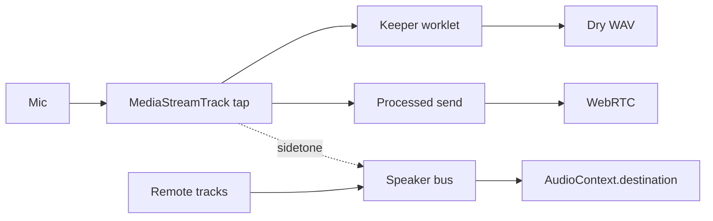
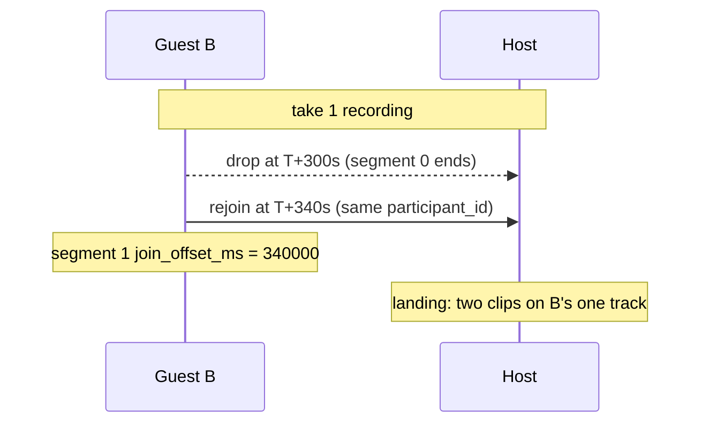
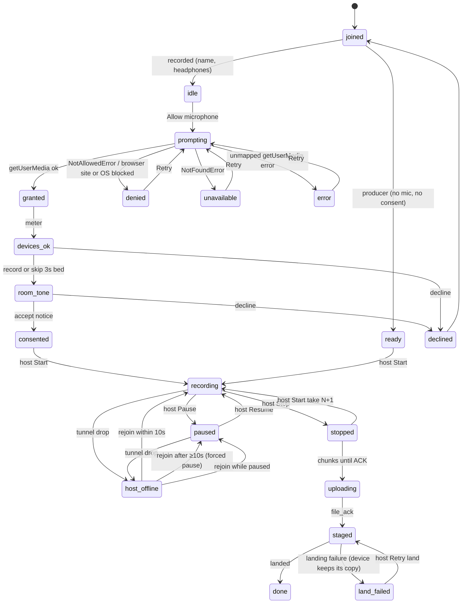

# Recording session (design)

Status: **links + lobby/consent + local keepers + mix-minus + chunk upload +
timeline landing + live comments + host live-room reconnect + room-tone beds shipped**. Owner row: [Beta plan § Journeys](../docs/beta-plan.md#journeys).
Audio-first MVP; beta still requires a **host laptop online**. Mint `/rec/`
URLs with `podcast review share --kind record` (or Share dialog / MCP
`create_record_room_tool`). `build.capture`, `build.monitor`, and `build.upload`
are on. After file ACK, keepers copy into `raw/` as one clip per segment.
Optional 3 s room-tone beds land at `raw/room-tone/{session}/{participant}.wav`
(the older `raw/room-tone/{participant}.wav` path still works for projects
that used it).

**Terminology.** In ShareCut Studio copy a participant's *keeper* is their
**full-quality recording**: the lossless WAV captured on their own device and
saved to the project during the session. Its status reads **Saving to
project…**, then **Saved to project**, per participant and per segment (a
segment is saved once the host holds the verified file, the file ACK; landing it
on the timeline is the separate **Land** step). "Keeper" stays in code, schema,
API paths, the wire `kind`, and this document's engineering sections. It never
appears in UI copy, notifications, errors, MCP tool descriptions or user docs
([Terminology](communication-philosophy.md#terminology)).

## Scope and non-goals

MVP is **audio**. Later work is on the ROADMAP — do not start it without a
leftover plan. [Follow-up](../ROADMAP.md#after-the-beta): producer push-to-talk
(`talk`), producer `control`, room text chat, Tauri native mic (cpal), host
admit, restricted record shares. [Beta recording](../docs/beta-plan.md#journeys)
remaining: video phase 2,
mic/camera grant UX, external import. Mix-minus (MM1–MM9, including the
producer bus) shipped in `feat/recording-monitor-mixminus`. Timeline landing
(one clip per segment at `join_offset_ms`, 2 s take gap, skip `ingest suggest`)
shipped in `feat/recording-landing`. Live comments shipped in
`feat/recording-producer-live-comments`. Room-tone beds shipped in
`feat/record-room-tone-bed`.

Non-goals: hosted SFU, cloud lossy backup on the relay, video MVP, external
Riverside/Zencastr/Zoom importers (those stay a parallel ROADMAP track and must
not mint `record` URLs).

## Prior art

Category SOTA is **Riverside / Zencastr / SquadCast / Descript Rooms**, not Zoom:

- Live conversation over **WebRTC** (lossy, echo-cancelled, headphones).
- Keeper stems recorded **locally per participant** as uncompressed **PCM/WAV**
  (Riverside: 16-bit linear PCM, 44.1/48 kHz), independent of the network.
- **Segment upload** during the session: each keeper segment uploads in chunks
  as soon as it closes (pause, resume, rejoin, Stop), plus a local backup if
  host/cloud disappears. Nothing streams from a segment while it is still open.
- After stop: **upload status until confirmed**, then tracks on one timeline;
  late joiners **padded at the start**.
- Join link is a **studio/room**, not a review/listen link.
- Join sheet: **name, microphone (Allow microphone, device picker, level),
  storage check and headphones** before a guest joins; the host starts the
  optional 3 s room tone from the room.
- While recording: a persistent **status pill** (`m:ss · Take N`) in the room header and the host transport chip, plus a start notification. PAUSED, saving and local capture failure remain distinct text states and alerts.
- **Live timestamped notes** are table stakes: Riverside markers (`M` key →
  dots on the editor timeline), Zencastr Footnotes (host-only), Descript Rooms
  Editor Comments (host/co-host/producer; private from guests; land in the
  project).
- **Non-recorded producer** is the premium tier at all three: Descript Control
  Room (hears all, silent unless push-to-talk, can start/stop, leaves comments;
  listed under "Not recorded"), Riverside Producer (heard by others, manages
  lobby/levels, cannot start/stop; Business plan), Riverside Audience (chat
  only). Roles are fixed once recording starts (Descript).

Naive `MediaRecorder` → WebM/Opus as the keeper is **not** what those users
download; it is at most a lossy backup. Keepers must target WAV/PCM.

**Honest gaps vs expectation:**

- Riverside is always-on cloud. ShareCut beta needs the **host laptop online**.
  Mitigation: keep recording locally + resume chunked upload; guest copy
  "Host offline: still recording locally."
- Video-first creators expect cameras on day one. **Audio-first MVP**; external
  import covers "recorded video elsewhere."
- No cloud lossy backup (relay stores nothing on disk; keeper chunks may transit
  while a share is active). Recovery = guest local files +
  rejoin on the same link.

## Vocabulary

| Term | Meaning |
|------|---------|
| **Record link** | Public URL `{base}/rec/{token}` for a record session (not `/r/{token}`). |
| **Room** | One `session_id` with a guest token and a producer token, both `{base}/rec/{token}`. |
| **Take** | One host Start → Stop. Lands sequentially on the timeline. |
| **Pause** | Host freezes the recording clock for everyone; monitor stays live; paused time collapses. |
| **Segment** | One continuous stretch of a participant's keeper; leave/rejoin/pause starts a new one → one clip each. |
| **Recording clock** vs **wall offset** | `recording_ms = wall_ms − Σ(resume − pause)`. `join_offset_ms` is always recording-clock. |
| **Participant** | Anyone in the room (guest, producer, or host-as-talent). |
| **Guest** | Recorded role: `join monitor comment`. |
| **Producer** | Listen + comment, not recorded; shown in the "Not recorded" roster group. |
| **Host** | Owns the episode; starts/stops/pauses; is also a recorded participant. |
| **Live marker (comment)** | Same `TimelineComment` as review notes. `M` posts `body` `"Marker"` — a live marker comment, **not** a `ChapterMarker` or a second type. Lands in `review.comments[]`. |
| **Full-quality recording** (code: *keeper*) | Local dry WAV per recorded participant. UI status per participant and segment: "Saving to project…", then "Saved to project". |
| **Monitor** | WebRTC send/receive graph (lossy, may use AEC). |
| **Mix-minus** | Speaker bus plays remotes only; local capture never to destination. |
| **Sidetone** | Optional 0 ms dry tap into headphones (gain-limited), never the WebRTC round-trip. |
| **Chunk** | Upload unit of a closed keeper segment (30 s of PCM, the final part shorter). |
| **ACK** | Host ingest confirmation (sha256 + byte length per chunk, then per file). |
| **Join sheet** | The guest's first view over the shared room: name, microphone, storage check, headphones, then **Join and record** (a producer sees name and **Join to listen**). |
| **Consent** | Per-person blocking step before any encoder, keeper chunk, or room-tone PUT to the host. **Join and record** sends `Consent {accepted: true}`; **Not now** sends `accepted: false` and shows the declined scrim. |
| **Recovery window** | 7 days to resume saving on the same `/rec/` link. |

## Session kind and URLs

A record session is a **second share kind**, not a review-share capability.
Public URL `{base}/rec/{token}` (review stays `/r/{token}`). Same coolname
registry with a `kind` column (`review` | `record`); same active +
cooldown pools and rate limits. No third token index. See
[share-tokens.md](share-tokens.md) § Record sessions.

One **room** has a `session_id` and **two tokens** (guest and producer), both
`kind=record` and both served at `/rec/{token}`. Caps are frozen on the token
from `RECORD_ROLE_PRESETS` (never client-chosen). Opening the guest link is how
a producer becomes recorded next take. Prefix ↔ kind is enforced: `/r/` with a
`record` row and `/rec/` with a `review` row serve the app shell, whose guest
cover says the link is invalid and to ask the host for a new link (the API stays 404;
the cover shipped in PR 2322).

Minting a new room **ends the previous one**: after the new room and its
`begin_record_session` succeed, every guest and producer token of earlier rooms
is revoked, so an old link can never admit anyone into today's room and shows
the same dead-link cover. Revoking on mint does not purge land rollbacks or the
land lock, so undo for takes already landed survives. Mints are serialized per
process, so at most one record room is usable. If an old token cannot be
revoked, the new room stays usable and the call fails with `record_stale_links`
(GUI 409, CLI and MCP refusal), carrying the new session id and links and the
old session ids still live; minting again retries the revoke, or revoke those
session ids. An old guest's open socket is closed by the periodic share
recheck (within about 5 s while active, 30 s idle), and a joined old guest also
fails `participant_active` after the remint. Re-invite (`--session-id`) only mints into the
active room. **Land before minting**: landing reads only the active room, so a
stopped, not-yet-landed take in the old room is orphaned once a new room is
minted and its guests lose upload resume on the old link. The mint guard blocks
only `recording` / `paused`; an unsaved stopped take the server can see warns instead, and
the mint stays allowed ("start anyway"). The host snapshot (`podcast record state`,
`record_state_tool`, `GET /api/record/state`) carries `unlanded_take`,
`unlanded_takes`, `unlanded_saving`, `unlanded_stalled` and `land_first_possible`:
the number of stopped, not-discarded takes of the current room with a recording not
yet on the episode; how many of those have an upload still saving or not started; how many
recordings never finished uploading (stalled); and whether a land could save
something now. A take recorded after the room's staged session was accepted or skipped
counts too (landing refuses it, so it cannot be saved into that room); 0 means the
server found no unsaved audio it can see (see Known gaps below).

Every mint (`podcast review share --kind record`, `create_record_room_tool`,
`POST /api/shares/record`) returns the same fields, describing what the mint left
behind that the server can see (recomputed after a land-first), and a plain `warning` ("1 stopped take in this
room is not saved to the episode yet, and a new room leaves it behind...", plus "still
saving", "never finished uploading" or "already accepted or skipped" when that applies).
The CLI adds a `--land-first` hint only when land-first can go ahead.
`--land-first` (CLI), `land_first` (MCP tool and route body) lands the current room's
finished recordings first, then mints; the result adds `landed_first` (the land result).
A bad `target` or `expires_at` is refused before anything lands (a `replace` target is
checked against the episode after the land, which can change its length).

"Saving" is bounded. For a guest who consented to the take the server expects one upload
per recorded segment, inferred from Pause and Resume: one, plus one per Resume (the Resume that a Stop-while-paused writes records
nothing and is not counted). A segment with no upload yet counts as saving for
`UPLOAD_GRACE_MS` (10 minutes) after Stop. An upload that has started but not finished
gets the full window from the later trusted time of Stop or its newest chunk, even when
that chunk arrived before Stop. This partial-upload rule applies to the host's recording
too. After the window it is stalled: reported ("N recordings never
finished uploading and cannot be saved") but it no longer blocks. A partial upload of a
guest the host removed is stalled at once; a removed guest with no upload row at all is not
known and is not reported. A guest who consented and never recorded (left, lost the mic)
reads as saving for the window and as stalled after it. Timestamps more than a minute in
the future are not trusted (that upload falls back to the Stop time, or reads as stalled),
so a skewed clock cannot keep a take "saving". The host is never expected to upload when
nothing has started, because a host whose mic was denied never uploads.

Land-first lands what finished (host and finished guests) and mints. Every mint that leaves
stalled audio behind that the server detected, with or without land-first, sets
`left_behind` (a count of recordings) and `left_behind_message`. `land_first_possible` is a prediction: true
when a land can save a finished recording and nothing is still saving, so it is also true
for a skipped keeper whose land then refuses ("could not be saved"). It is false when there
is nothing to save (the mint just goes ahead) and when only stalled audio is left.

Land-first refuses, mints nothing and keeps the old links when uploads are still saving
(uploads can take up to 10 minutes after Stop: wait for them to finish, or start
anyway), when the room's session was already decided and something is landable or
saving, or when the land still leaves a finished recording unsaved (a skipped keeper). On the
route that is a 400 carrying the land's own code (`record_land_refused`, or e.g.
`session_suggestion_closed`, `insert_anchor_taken`). A land that ran stays saved;
retrying is safe. `land_first` with nothing to save just mints.

Known gaps (#2416). The server infers the owed segments from Pause and Resume only. A
segment the browser opens for another reason (a consent decline and re-accept, a mic drop
and reconnect), and a host Pause/Resume whose second segment never uploads, can be missed
without a warning. A removed guest with no upload row is not reported (only a partial row
is). If an insert or replace room's staging land is undone from History, its uploads still
read as landed, so no warning appears; `podcast record land` stages it again.

Shipped record caps: `join` (be recorded), `monitor` (hear the room), `comment`
(live notes — **same create path as review comments**, kind-scoped ACL: guests
see only their own until landing). Later: `control` (start/stop/pause), `talk`
(producer push-to-talk), `video`. Roles are a **kind-scoped** map
(`RECORD_ROLE_PRESETS` in `share_capabilities.py` / `contracts/caps.json`), not
keys stuffed into review `REVIEW_ROLE_CAPABILITIES`: **guest** = `join monitor comment`;
**producer** = `monitor comment`; **host** = all.

Chunk upload is on for `join` tokens (`build.upload: true`). Producer tokens
advertise `build.upload: false` (no `join` cap). `build.capture` and
`build.monitor` are **on**: consented recorded clients write dry 48 kHz/16-bit
mono WAV keepers to origin-private OPFS (`Sharecut Recordings/…`), and the
browser mix-minus mesh plays remote tracks only. Capture and upload still
authorize `join` / `monitor` from the frozen token caps — never from
client-supplied flags. Join sheet consent/host Start, local keepers, mix-minus, and
chunk resume already ship. After ACK, landing copies assembled WAV into `raw/`
and registers clips. Live comments land in the same mutate as keepers (or on
their own if no new clips).

A crash after the guest mint and before the producer mint can leave a one-token
room. `revoke_room` / End room / `podcast review revoke-share --session-id`
still clear it.

Capture, ingest, host lobby, mix-minus graph: FOSS core. Public `/rec/` guest
routes: collaboration extension + relay allowlist, exactly like `/r/`.

Each open keeper segment writes a small OPFS metadata record before PCM capture
with its trusted `join_offset_ms` and `complete: false`. The record changes to
`complete: true` only after the WAV header and writable have closed successfully;
upload never infers completion from a WAV file alone. On rejoin, a readable
segment directory is scanned before choosing the next index; an absent
directory starts at zero, while a transient OPFS scan error stops capture
instead of reusing a path that may already contain keeper bytes. A readable
pending PCM WAV can be recovered explicitly: the client validates its fixed
48 kHz mono PCM format from the header alone, patches the header in place
(dropping at most one incomplete trailing sample, which the panel reports), and
preserves the recorded join offset before allowing upload. Recovery re-checks
that the room is stopped and capture has settled before each segment, keeps
going past a failing segment, and reports every failure together. Zero-byte,
malformed, or unplaceable files are retained for deliberate export with an
explicit loss message; bytes that an interrupted OPFS writable never committed
cannot be reconstructed. Metadata without an explicit boolean `complete` flag
is unreadable. Its WAV remains available for partial export and does not enter
automatic repair, upload, or reclaim. Keeper enumeration is capped at 1000 takes and
1000 segments per take so a stray OPFS name cannot stall the upload poll.

While a local keeper is actively writing, the browser registers a native
`beforeunload` confirmation so an accidental refresh or navigation can be
cancelled before the current WAV is abandoned. After Stop, the warning remains
until the keeper finishes saving the final WAV and metadata. The listener is
removed when capture pauses, saving finishes, errors, or unmounts; lobby and
completed-recording navigation is not blocked. Browsers only show this native
prompt after the page has received sticky user activation, and they control its
wording and whether it is displayed. This is a best-effort loss warning, not a
replacement for the OPFS recovery path.

| | Review | Record |
|--|--------|------------------|
| Prefix | `/r/{token}` | `/rec/{token}` |
| Caps | `play` `view` `comment` `reply` `action` `suggest` `edit` `mcp` | `join` `monitor` `comment`; later `control` `talk` `video` |
| Served by | Host via tunnel + collaboration extension | Same (`/rec/` + `/api/rec/` on the allowlist) |
| Registry | Coolname active + cooldown | Same pools; `kind` column |

## Roles

| | Host | Guest | Producer |
|--|------|-------|----------|
| Recorded | Yes | Yes | No |
| Hears room | Yes | Yes | Yes |
| Heard by room | Yes | Yes | No (silent MVP; `talk` later) |
| Consents | Yes | Yes | No (not recorded) |
| Start / stop / pause | Yes | No | No (`control` later) |
| Adds live comments | Yes | Yes | Yes |
| Sees live comments (pre-landing) | All | Own only | All |
| Sees saving status ("Saving to project…", "Saved to project") | All participants, per segment | Own, per segment | None (no full-quality recording) |
| Counts toward | Recorded cap (4) | Recorded cap (4) | Producer cap (2) |

Prior art: Descript Control Room (silent producer + editor comments) is the
model. Riverside's heard-by-guests producer and Descript push-to-talk are later
rows. A producer opens the **producer** `/rec/{token}` as a **receive-only**
mesh peer — no `getUserMedia`, no send track, no keeper. **Transparency is
mandatory:**
every client's roster shows a **"Not recorded"** group listing producers; the
consent copy says "producers/listeners may be present and are shown in the
roster"; a producer joining mid-take triggers the same join notification as a
guest.

When the host or a recorded guest is running or finalizing a local keeper in
the Tauri desktop shell, native window close and the macOS app menu/Cmd+Q
prompt before the keeper is lost. Host copy warns that quitting stops the room
for everyone; guest copy warns about that guest's full-quality recording. Dock Quit and
OS shutdown may bypass the app menu and remain best-effort paths.

## Two graphs

Monitor (WebRTC send/receive) and keeper (local dry WAV) are separate graphs
fed by the same `MediaStreamTrack`. Keeper = 48 kHz, 16-bit linear PCM, **mono
per participant**; 24-bit later. No AEC/NS/AGC/mix on the keeper. Chromium
guests: PCM/WAV encoder (Worklet or `extendable-media-recorder`); Tauri host:
native mic path; Safari/Firefox: documented caveat. Keeper capture, upload and
landing pass the compat core flow on Chromium and Playwright WebKit; Firefox
is not in the matrix ([testing.md § Browser acceptance
matrix](testing-ci.md#browser-acceptance-matrix)).



Keeper `getUserMedia` requests:

```json
{
  "audio": {
    "echoCancellation": false,
    "autoGainControl": false,
    "noiseSuppression": false
  }
}
```

and asserts `track.getSettings()` matches. Chromium defaults those **on** and
they run WebRTC APM on the capture track. The monitor/send path may use a
processed clone or browser AEC; the WAV tap must not.

## Mix-minus (mesh N−1)

Audio mesh for **2–4 recorded participants** plus **≤ 2 producers**
(receive-only peers), so ≤ 6 mesh peers and each recorder sends to at most 5.
No hosted SFU in FOSS. No program bus. Each listener's speaker bus plays
**only inbound remote tracks**. Local capture is never connected to `AudioContext.destination`. That *is* mix-minus; it does not need phase
inversion (OpenStudio invert-against-program-bus is for a single summed mix /
SFU). Optional **sidetone**: 0 ms dry tap, gain-limited (−12 dB default, max
0 dB), labeled in the graph — never the WebRTC round-trip. Headphones
recommended; open speakers + open mic is acoustic echo and is why the Join sheet asks for headphones,
not something mix-minus can fix.

If an SFU ever lands, server mix-minus is specified then, and MM1–MM9 bars
still apply.

**Same-room bleed is not fixed by mix-minus.** Bleed is B's voice in A's
capsule on the keeper. Mix-minus changes only what each person hears. Studio
rules: headphones; never play other local mics on speakers (that *adds*
delayed bleed into every capsule). Post stays reconcile +
[`podcast-mute-bleed`](../.agents/skills/podcast-mute-bleed/SKILL.md). A later,
separate idea is AEC-style reference cancellation (other close-mic as far-end)
on a *processed* stem — same adaptive-filter family as AEC3, not N−1 routing,
and never overwrite dry `raw/`.

## Keeper file spec

WAV 48 kHz / 16-bit / mono. Files are keyed
`{session_id}/{take_index}/{participant_id}/{segment_index}.wav`. Chunk parts
are `{session_id}/{take_index}/{participant_id}/{segment_index}.part-{NNNN}` —
**never** reuse `part-{NNNN}` across segments or takes. Host ACK is
`(session_id, take, participant, segment, part_seq)` plus sha256 and byte length.

At segment end the byte stream **freezes**; the last payload is a `final`
part. The WAV header is written only after every part for that segment is
ACK'd. Never mutate an ACK'd prefix. Mute writes zeros (see
[Mute semantics](#mute-semantics)); file length does not change. Each keeper
is tagged `session_start`, `join_offset_ms`, `sample_rate`, `samples_written`.
The complete metadata also carries `clippingRegions` (segment-relative
milliseconds, sample peak at or above -1 dBFS, merged when under 1 s apart,
at most 100 per segment; later hits that cannot merge into the last region are dropped and the metadata sets `clippingTruncated: true`, which the post-take report states); recovered crash segments may omit it.

## Mute semantics

Mute stops the monitor send **and** the keeper writes **zeros** for the muted
span. File stays continuous (no length change), so clocks still line up. No
separate "pause my recording" button in MVP. Host cannot unmute a guest. Test
MM4 asserts the monitor drop; keeper mute zeros are covered by keeper session tests.
Mute zeros never trigger the silent PCM watchdog (it is disarmed while muted).

## Progressive upload and recovery

Relay never stores audio, but keeper chunks may transit the tunnel. The full-quality recording lives on each device until
chunked upload and host ingest **ACK** (sha256 + byte length per chunk, then
per file) and confirmed timeline landing. Upload is progressive per **segment**, not per sample: a segment's
chunks are sent only after its writable closes and its metadata says
`complete: true`, so a long uninterrupted take uploads after Stop (or at the
next pause). An open segment is never read or uploaded while capture may
still be writing it. Assembled WAV lands in `artifacts/record/acked/` until landing copies it into
`raw/` and registers clips.

Guest upload operations project pre-ACK service failures through the shared
guest boundary. `RecordUploadError` is a coded `record_upload_refused` refusal,
reported as HTTP `400` with the refusal's path-free guest message and `X-Sharecut-Error-Code`.
Unmarked ingest failures return fixed HTTP `500` and log their traceback on the
host. Consent and lease checks run again after the bounded body read.
Once ingest acknowledges the file, a subsequent landing failure keeps HTTP
`200` and the ACK, with `landed=false` and `land_failed=true`. The failure mark
is scoped to the current file SHA generation. A later landing attempt can recover
the retained file. Host upload refusals retain their owner detail and HTTP `400`.

Chunks (30 s of PCM each, the final part shorter) `POST` to a **dedicated record
upload route** gated by `join` (not `edit`, not `POST …/daw/media/upload`).
Tunnel pass-through to the host only — no relay disk, no object-store
keeper backup in MVP. Stop shows a **blocking saving panel** ("Saving to project…", then "Saved to project"; host sees all
participants; guest sees own) until ACK or stall. An incomplete local segment
after capture has settled is retained for recovery and reported separately;
it cannot receive a file ACK and does not hold Leave after complete segments
are acknowledged. While Stop is still finalizing the last segment, Leave stays
held until its complete metadata lands or capture latches a failure (a latched
failure counts as settled so recovery and export appear). The panel reads "Saving to project… N of M chunks"
while finalized WAV totals are known, then "Saved to project" once the file is ACK'd. When a participant has
several segments, a list shows one "Saving to project…" or "Saved to project" line per segment. Each segment's
line appears the moment its upload starts and flips as its chunks and file ACK land (the upload hook publishes during
the pass, not once at its end); a polite, screen-reader-only live region speaks a segment starting or finishing, never
each chunk (`SaveAnnouncer`, mounted by the guest room for its own save lines and by the host stage). The visible list, the "N of M chunks" line,
and the host roster sit outside every other live region, so a moving count is never read twice; saving outcomes without
counts (failed, saved and landed, waiting to land) are their own `role="status"` lines (`UploadStatus`). Resume on the **same `/rec/` token** inside a **7-day recovery window**.
A pending segment is never uploaded automatically; the stopped panel offers
**Recover partial take** only for a validated readable segment, alongside
**Download full-quality recording** for every failure mode.
A stalled or zero-sample keeper remains in OPFS for a single ZIP download
containing every retained take and segment. Surviving files still export if a
segment is missing, and Leave is never held indefinitely by an errored upload.
Lossy host-side backup mix is **not** in audio MVP.

After a fresh status response confirms both `file_ack` and successful timeline
landing (`landed` without `land_failed`), the client may reclaim that finalized
segment's local `.wav` (`keeper/reclaim.ts`: `canReclaimKeeperSegment` policy +
`reclaimKeeperWav`). Its completion `.json` remains as a small segment
identity marker, so later takes never reuse the segment number. Reclaim
requires that marker to explicitly say `complete: true`, and that its SHA-256
and byte length match
both the local WAV and the landed host status. New finalized and recovered
segments record this fingerprint after their WAV closes, hashing the closed
file in bounded chunks with a size-aware deadline. Reclaim compares the small
metadata and host fingerprints before reading WAV content. A mismatch or complete
marker without a fingerprint retains the WAV and displays a download warning.
Complete markers without a fingerprint are reported as unverified rather than corrupt, and their retained
WAV bytes are not reread at each status poll. The warning remains visible
alongside active upload and landing errors. An unchanged file version that
failed local SHA verification is not rehashed on each poll. After three failed
deletes, cleanup waits 30 seconds before rehashing and retrying the delete.
A changed file version or host status is checked again immediately, and a
cached hash match never authorizes deletion. OPFS read errors propagate, so a
temporary storage failure cannot mark a local WAV as already reclaimed. The
explicitly complete marker still identifies a WAV that was already reclaimed. A pending `complete: false` marker, or
metadata that does not parse as a keeper record (it may be a torn pending
write), never allows a delete and never marks a missing WAV as reclaimed. Unlanded, failed, incomplete, or actively captured segments
remain available for recovery.
This local completion check still wins if a host status row unexpectedly says
`file_ack` and `landed` for a pending segment: that row cannot authorize
deleting the local WAV or hide its recovery action from the stopped panel.

A WAV that is absent but has a complete marker is **reclaimed**, not lost
(`missingKeeperWavState` in `keeper/store.ts`): upload treats it as done even
if the host row later disappears (e.g. Discard take), and **Download
full-quality recording** skips it instead of counting it as a missing segment. While a
recovery download runs, and for a grace window after it is handed to the
browser, reclaim is paused (`holdKeeperReclaim`) so the lazily read OPFS
`File`s in the archive stay readable. OPFS downloads hold a shared origin-wide
Web Lock. Opening any keeper capture stream acquires the same shared lock
before its file is created/opened, and retains it through successful close or
completed abort (including a late open after a timeout). Pending metadata
protects the post-close hashing/finalization interval. Prune and reclaim require
the exclusive lock; age/metadata checks, the pruned marker write, and removal
run inside that lock. A held candidate is never marked pruned. WAVs remain in
place when Web Locks are unavailable or rejected. `ByteSink.remove` rejects on real delete
failures; room-tone cleanup uses `removeBestEffort`. Reclaim failures are
non-fatal and leave the WAV in place; after three consecutive failures the
saving panel warns that this device's copy could not be cleared. Landing never
reports `landed` for a segment whose staged `artifacts/record/acked/` WAV is
missing unless its registered source (`rec-…` clip source or room-tone bed)
already exists in the workspace with the row's ACK'd `file_sha256` (so a
re-recorded room-tone bed never inherits the previous bed's landed state);
otherwise the row is `land_failed`, so the guest keeps its keeper and the
host sees Retry land.

The recording UI also performs an advisory one-hour mono 48 kHz PCM headroom
check where `navigator.storage.estimate()` is available
(`StorageHeadroomWarning`). Nothing renders while the estimate is pending; a
low estimate, a rejected estimate, or a missing API warns the operator in a
persistent `role="status"` region but never blocks recording by itself. The
host panel re-checks after a take stops.

```mermaid
sequenceDiagram
  participant G as Guest
  participant H as Host
  G->>H: POST chunk (token, take, participant, segment, part_seq, sha256, bytes)
  H->>H: verify bind + sha256
  H-->>G: ack
  Note over G,H: repeat until segment final
  G->>H: POST final + file hash
  H-->>G: file_ack
  H-->>G: landed or land_failed
  Note over G,H: stall: retry/backoff; rejoin same token within 7 days
```

## Clock and landing on the timeline

Host beacons `session_start` (host wall clock + monotonic) on the existing
session/presence WS. Each keeper is tagged `session_start`, `join_offset_ms`,
`sample_rate`, `samples_written`. **Happy path:** write each segment file to
`raw/` and register **one clip per segment** at
`timeline_s = take_offset_s + join_offset_ms / 1000` with
`duration_s = samples_written / sample_rate` (`take_offset_s` starts at the
session origin, see below), **without** `ingest suggest`.
Later segments are **not** padded with leading zeros in the file (that would
double-offset). In-file pad is only an optional encoding of **segment 0** when
you insist on a clip that starts at take origin.

Late-join bar (first segment of a late guest):

```text
pad_samples = round(join_offset_ms * sample_rate / 1000)
```

applies **only** when that first segment is encoded as clip@0 with leading
zeros. Default landing is clip@`join_offset_ms` with no in-file pad.

Land places clips at `join_offset_ms` from `session_start` + sample counts.
It does **not** run [`align_tracks`](../src/podcast_mcp/edits/conversation_align.py)
(no transcripts yet; bleed/VAD plans would be identity). `align_fallback`
in land JSON is a **hint** to run pipeline `align_tracks` after transcribe:
missing `session_start`, or a sample-count vs recording-clock error over
50 ms (`ALIGN_DRIFT_MS`). Isolated dry keepers are independent close-mics —
GCC-PHAT (`engines/align.py` `gcc_phat_result`) is TDOA for a shared
wideband source, not a clock-drift meter here. Land compares each recorded
participant's file duration to that segment's recording-clock span (join to
the next file-acked segment or take end), using the first pair of segments
whose recording-clock intervals overlap — not `min(segment_index)`.
`drift_ms` / per-row `duration_error_ms` is that duration error; `null` means
unknown (one recorded ACK, no overlap, or I/O), never a fail-open 0.
`confidence` stays on each `drift` row (1.0 when a span was measured).
Single-participant takes skip the check. GCC-PHAT's 0.25 peak-to-sidelobe
gate over ±1 s at 8 kHz on a 60 s window is a constant-lag TDOA helper for
shared-source tests, not rate-offset coverage (~50 ppm is ~3 ms in 60 s).
Users expect "stop → tracks on the timeline," not a 20-minute align workshop.
Video files still wait for video track ingest.

## Roster changes: join, leave, rejoin, pause, takes

```json
{
  "token": "fantastic-acoustic-whale",
  "takes": [
    {
      "take_index": 0,
      "session_start": "…",
      "pauses": [{ "pause_wall_ms": 600000, "resume_wall_ms": 900000 }],
      "participants": [
        {
          "participant_id": "p_b",
          "segments": [
            { "segment_index": 0, "join_offset_ms": 0, "samples_written": 14400000, "sha256": "…" },
            { "segment_index": 1, "join_offset_ms": 340000, "samples_written": 480000, "sha256": "…" }
          ]
        }
      ]
    }
  ]
}
```

Two clocks per take: **wall offset** (`now − session_start`) and **recording
clock** (`recording_ms = wall_ms − Σ(resume − pause)`). `join_offset_ms` is
always recording-clock.

Each participant gets a `participant_id` **minted by the host** at lobby
entry, bound to that token, and leased to one tab. The client may cache it in
`record:{token}:participant` (same token-scoped pattern as guest
`queue:{token}`) but uploads of another id, `..` segments, or a second tab
without the lease are rejected. Rejoin on the same device with a live lease
reuses the id so audio appends to the **same** track. Live `Join` commands are
keyed per WebSocket connection (`record-join:{connection_id}:{client_id}`) so a
tab reload that resends seq 1 is not collapsed as the original Join. A new device = a new
participant, but a returning person lands on their earlier track when the display name matches
(see Returning people); the host can correct it before Accept.

A participant's keeper within one take is a list of **segments**.

**Disconnect tree (host owns open/closed):**

| Event | Segment | Monitor / upload |
|-------|---------|------------------|
| Tunnel / host offline (mic still held) | **Stays open**; WAV keeps growing | Monitor ends; closed segments retry upload; the open one uploads once it closes |
| Intentional leave, tab close, or lost mic | **Ends** (file frozen, upload continues) | — |
| Host pause | **Ends** for everyone | Monitor stays live |
| Host returns after ≥ `HOST_OFFLINE_PAUSE_MS` (10 s) while REC | **Forced PAUSED** (`pause_reason: "host_reconnect"` on the `PauseEntry` and live snapshot); host must Resume | Mesh closes that peer's PC and re-offers |
| Host returns within 10 s while REC | Take stays **recording** (brief WS blip) | Mesh re-offers |
| Host returns while already PAUSED | Stay paused; do **not** stack a second pause | Mesh re-offers |
| Rejoin, segment still open, no pause in the drop window, mic never lost, ≤ 30 s | Resume **same** segment | — |
| Otherwise rejoin | **New** segment at current recording-clock `join_offset_ms` | — |

From `paused`, host-offline writes **no** PCM (clock is frozen); both PAUSED
and host-offline copy may show. Landing places one **clip per segment** on
that participant's track at `join_offset_ms`. No trailing pad.

An involuntary microphone loss is distinct from an intentional track stop: the
browser `ended` event freezes the current keeper segment and clears the live
stream. The host and guest show the persistent room alert "Your mic stopped." with a
**Reconnect mic** action; a failed retry keeps the alert. The room clock keeps
following the shared take throughout, and the alert clears only after a live
microphone stream is restored. After Stop the mic-loss alert
clears, while incomplete keeper and upload recovery remain visible. Browser
permission revocation follows the same failed/pending recovery path even when
the hook resets its `lost` flag: a missing local stream keeps the alert
during an active take. Retry is
explicit (there is no unbounded auto-retry); repeated clicks during acquisition
are ignored. If a saved or selected device is missing (NotFoundError or
OverconstrainedError on the exact deviceId), any acquisition (first open, Retry
or reconnect) tries the default available input once. The Join sheet then shows
"Your saved microphone isn't available, so the default input is in use.", the
select shows Default, and the saved `record:<token>:mic` id is reset without
re-opening the stream. The fallback is latched in `useMicStream` (exposed as `staleDeviceId`) until the saved id opens again or the guest picks another input. Turning the mic off (consent decline, full room, access ended) keeps the latch, so the dead id is never written back to storage. While latched, each acquisition enumerates inputs first: when that list is non-empty and still lacks the id, Retry or reconnect opens the default input directly (one `getUserMedia` call) and a failed Retry keeps the notice; when enumeration fails or is empty, or the device is listed again, the saved id is tried first. Blocked-permission
errors never fall back. A successful
reacquisition opens the next segment at the current recording-clock offset,
extrapolated from the last room snapshot when the stream changes. Keeper gate
transitions are applied in order so a quick reconnect cannot skip the
loss/segment close. The host record dialog reopens if necessary and stays open
while the microphone is lost. A normal unmount or application stop removes the
listener before stopping tracks and does not show the warning.

**Silent PCM watchdog.** A live track can still deliver nothing (a suspended
`AudioContext`, a hardware mute, a dead device). While local capture is active
(`recordingLocally`, not muted, room `recording`) and the keeper tap is attached, the tap is watched (a tap reopened mid-take restarts the window):
about 5 s without any PCM sample above 2^-24 (all zeros **or** no PCM at all)
shows the persistent "No sound is reaching the recorder." room alert with a
**Check mic** action for host and guest. It yields to mic-loss and keeper-error UI. It clears only on real
PCM or a successful Check mic (context `running`, track live, enabled and not
muted; the watchdog then re-arms, so still-silent input re-alarms after another
~5 s, this time with the "Still no audio" guidance until real PCM arrives). A failed check adds "Still no audio" guidance. Pause, mute, and normal
quiet input never trigger it. Host heartbeats are unchanged. The host record dialog opens once when the alert appears but, unlike mic loss, can be closed. Limitation: any sample above the floor counts as signal, so a dead input that delivers a constant DC offset or a dither floor above 2^-24 is not detected. Check mic while the tap is closed shows the "Still no audio" guidance and reopens the tap; a successful reopen clears it, and a failed one shows the keeper error. Safari's `interrupted` context state (a phone call, or another app holding audio) counts as a failed Check mic; the alarm itself does not depend on context state. A late timer tick (throttled or background tab, laptop sleep) restarts the 5 s window instead of counting the gap as silence.

If the host's microphone is denied or unavailable when an active take begins,
the record dialog opens and stays open with browser or desktop recovery copy
and Retry. The room alert ("Your mic stopped.") stays until a live stream is
restored; the transport chip uses the same capture state. Retry reacquires the mic without
deleting any keeper segment. A stopped take clears the capture warning. An
empty, zero-sample WAV cannot be acknowledged as an uploaded take.
If the host joined the take but never captured a full-quality recording, Stop shows an explicit
"No full-quality recording was captured" warning even when no mic stream was ever
available; zero upload parts are not presented as a completed host recording.
After Stop, a prior microphone-loss notice no longer holds the panel open.



**Pause / Resume is host-only.** Host Pause appends a versioned pause-log
entry `{seq, pause_wall_ms}` on the session WS: every keeper ends its current
segment (byte stream frozen, upload continues); the monitor **keeps running**
so people can talk off the record; the status pill flips to **Paused** on every
client. Host Resume appends `{seq, resume_wall_ms}`; every consented recorded
client starts a new segment whose `join_offset_ms` is the **recording-clock**
value at resume. Clients apply the log **by seq** (ignore duplicates); every
reconnect snapshots `pauses[]`. A late `pause` uses the same reconcile:
truncate/discard samples with wall time ≥ `pause_wall_ms`. Landing places
segments at recording-clock offsets, so paused time **collapses** to zero on
the timeline — no gap, no zeros written. No re-consent on resume; a guest who
arrives during a pause consents and starts on resume. Audio captured while
the host was paused is discarded; audio missed after resume is a documented
gap. Guests cannot pause. **Pause wins** over the 30 s same-segment resume: if
a pause interval intersects the drop, finalize/trim and open a new segment at
resume.

```mermaid
sequenceDiagram
  participant H as Host
  participant A as Guest A
  H->>A: pause wall_ms=600000 (recording 600s)
  Note over A: segment 0 ends; monitor still live; PAUSED
  H->>A: resume wall_ms=900000
  Note over A: segment 1 join_offset_ms = 600000
  Note over H: clips abut at 600s; no gap, no zeros
```

**Stop → Start again = takes.** The room (`session_id`) holds `takes[]`; each
take has its own `session_start`, `pauses[]`, and roster. Host Stop ends take
N (saving panel); host Start may begin take N+1 **without** re-consent for
anyone already consented **while take N is still uploading**. Manifest, ACK,
and segment rows are partitioned by `take_index` with one mutating owner per
take. Landing appends takes **sequentially** on the timeline with a fixed
**2 s** gap (`take_gap_ms`, host-editable later), tracks = **union** of
participants across takes; a participant absent from a take simply has no
clip there. Deleting a bad take before landing is refused while that take's
manifest is non-terminal; otherwise a take-tombstone aborts in-flight upload
and voids ACK. This device's copy is cleared automatically only after ACK
**and** confirmed landing. Same-room retakes are not auto-spliced into the
previous take — that is an edit.

Peer add/remove renegotiates only the affected `RTCPeerConnection`s; the
mix-minus matrix adds/removes one input with a **≤ 20 ms** gain ramp.
Recorded peers attach the local send track **before** the first offer
(`replaceTrack` on a negotiated null sender does not fire remote `ontrack`).
Inbound `Signal` frames are queued per `(from, to)` pair (up to 64, dropping
oldest ICE candidates first) and replayed once if they arrive before the mesh
subscribes. A second offer is not sent after answering when
the send track was already included. Others'
keepers are never touched by a roster change (keeper graph has no dependency
on remote tracks). Pause/Resume never touches the monitor graph. Test bar
**MM8**. Roles are frozen **on the token** for the take: a producer who wants
to be recorded waits for Stop and opens the **guest** link in the next take.

When 4 recorded participants (host included) are present, a 5th guest opening
the link sees a **full room** page (copy in [Join sheet, consent, room](#join-sheet-consent-room);
no `getUserMedia` prompt); a 3rd producer sees the same page. Host cannot
raise either cap in MVP. A participant who **declines consent** (**Not now**)
sees the room under a dim scrim reading "You're not being recorded."; **Join
recording** on the scrim works only while the room waits for a take ("You can
join after this take." otherwise), and the host may re-invite them as a
**producer** (not recorded) instead.

| | Mute | Pause | Stop / Start |
|--|------|-------|--------------|
| Who | Per person | Host, everyone | Host, new take |
| Clock | Runs | Recording clock freezes | New `session_start` |
| Bytes written | Zeros for the span | None during pause | Previous take finalised |
| Monitor | Send stops for that person | Stays live | Ends with the take |
| Status pill | Muted tile and alert | `Paused · m:ss` on every client | Saving, then `m:ss · Take N+1` |
| Timeline | Continuous file; zeros | Clips abut (paused time collapses) | Sequential takes + 2 s gap |

## Metering and clipping

**Sample peak only** (#174). ShareCut does not oversample or detect
inter-sample (true) peaks; the -1 dBFS threshold (`DEFAULT_CLIP_DB`) is headroom
for overs the meter cannot see. One threshold drives everything: the live clip indicator,
the encoder's clip regions, the room alert and tile badge, the take's jump to its first clipped span and the timeline flags.

**Own mic only.** Each recorded person (guest or host) sees only their own
meter. Nothing is added to the record wire (`services/record/signal.py`,
`hostWire.ts`, `useRecordSync` are unchanged), and remote-participant meters are
out of scope; other people's room tiles light from the monitor graph's own
analysers (`useRecordMonitor().levels`), not from anything sent over the wire.
Surfaces: the Join sheet's microphone row, the person's own room tile and the
host Record stage. The room-full Cover never calls `getUserMedia`, so it has no
meter. Producers have no meter and no clipping alert.

**Two signal paths.**

- *Monitor path* (`useInputPeakDb`, meter worklet): drives the visible meter and
  its latching clip indicator. Nothing is stored.
- *Encode path* (`keeper/pcm.ts` -> `KeeperSession`): the ground truth. It
  records segment-relative clip regions, merges hits less than 1 s apart,
  caps them at 100 per segment (a hit within 1 s of the 100th region still merges into it, so a dense burst can lengthen that region; a later hit that cannot merge is dropped and flags the segment `clippingTruncated`), and writes them into the OPFS keeper metadata
  (`clippingRegions`). Live consumers are notified when a region opens or the open region grows by 250 ms or more, so live end times lag by less than 250 ms until the segment closes. The final upload part also sends them as
  `clipping=a-b,c-d` (ms, ascending, non-overlapping). A capped segment also
  sends `clipping_truncated=true` (final part; needs `clipping`), stored as
  `record_upload_files.clipping_truncated` and landed as
  `SourceRecording.clipping_truncated`. After a segment lands, a
  replayed final part with the same `join_offset_ms` and `clipping` is a no-op
  (a lost response is retried); a different value is refused. The server stores them
  on `record_upload_files.clipping_regions`; landing writes
  `SourceRecording.clipping_regions` in source seconds. `list_clips` adds
  `ClipRow.clipping_regions`: the source regions intersected with each clip
  window, so they follow cuts and moves. `list_clips` also reports
  `ClipRow.clipping_truncated` when the clip shows source time after the last
  region, and the timeline labels that clip's last flag "later clipping not
  recorded".
  The spans are untrusted client metadata (at most 4096 chars and 100
  ascending, disjoint spans, each ending within 24 h, clamped to the file on
  landing). They only drive UI flags; do not use them to drive audio edits
  without re-checking the audio.

**Surfaces.** While a take records and the encoder has seen clipping, the
person's own tile shows a clipping badge and the room shows the alert "You're
clipping. Move back a little." (guest and host; `useTakeClipping`). The Join
sheet shows a clip indicator while the guest checks their mic. On the host
Record stage a landed take's row in the Takes tray jumps (Hear) to the earliest clipped span of anyone in the take (source -> timeline via the landed source id
`rec-{session}-{take}-{participant}-{segment}`), disabled until the take lands. The
timeline shows a `clipping` marker-lane row (one flag per region per track) and a
red tint on the affected span of each clip.

**Post-take summary.** After Stop, a take row in the Takes tray names each person
who clipped and how many times ("Jon clipped 3 times"), and the expanded row lists
the times per person ("Saved · Clipped 3 times · 02:14, 05:40, 09:02", plus "later
clipping not recorded" when a segment hit the cap). A clean take says nothing about
clipping. Nothing is held in component state, so it survives a reload during
Saving:

- *Host:* every person's spans come from the upload status rows the host already
  polls (`clipping_regions`, `join_offset_ms`, `clipping_truncated` on each segment
  row, shifted into take time), so each guest's clipping appears when their final
  part is acknowledged and the host's own is read from its OPFS keeper metadata
  at once. Until a guest's segment is acknowledged the host does not know whether
  that guest clipped. Nothing is added to the record wire.
- *Guest:* only their own clipping, read from their OPFS keeper metadata for every
  finished take (`useTakeClipping` for the current take, `usePastTakeClipping` for
  earlier ones). The guest room gets a Takes tab in its Notes rail only once one of
  their takes clipped; it lists the clipped takes with their own line and no Hear.
  A producer has none.

**Limitations.** Recovered crash segments, older clients and consolidated
sources carry no regions. A truncated clip with no
flag in its window has no timeline cue (only `list_clips` reports it).

## Room-tone countdown

Host-only `RoomToneCountdown` (payload `{}`) tells every client "capture room tone now".
It reaches the room through `POST /api/record/command`, `RecordControlService.room_tone_countdown()`,
`podcast record room-tone` and `record_room_tone_tool` (`daw.record.roomTone`, command `record.roomTone`).
Guests receive the result as the normal `Applied` snapshot; a guest sending it gets `forbidden`.

| Rule | Behavior |
|------|----------|
| When | `lobby` or `stopped`. During `recording` or `paused` it is refused with "Stop the take first". |
| Blockers | Refused only when `start_blockers` holds `no_recorder` (nothing to capture). `consent_pending` does not block. |
| Rounds | Each call sets `room_tone` to `{round, requested_wall_ms, duration_ms: 3000, participant_ids}` and bumps `round`; redo is allowed any time in `lobby`/`stopped`. |
| `participant_ids` | Consented recorded participants at request time (`take_consented_participant_ids`). Informational only: the room-tone upload still checks the participant's current consent. |
| Start | Unchanged and legal during the countdown. The command touches no take, clock, `start_blockers`, upload or landing. |
| Old snapshots | `room_tone` is optional (`null` when absent), so rows written before this command load unchanged. |

`countdown_left_ms` (0 to 3000) is derived per `RecordSessionService.snapshot()` from
`room_tone.requested_wall_ms + duration_ms` and the server clock, and is never stored.
Nothing ticks it: the `Applied` event carries it once (about 3000), and clients count down locally from it.
`participant_ids` lists only participants who have already consented, so a round requested before anyone accepts has an empty list and the late acceptors capture from the Device sheet. A round with no Start leaves the bed to land with the next land. Orchestration (auto-capture on a new
`round`, sending Start after 3 s) is client work (a consented guest's browser
captures when a new `round` names them, `useGuestRoomTone`; a round already in the
first snapshot, as for a late joiner or a reload, is not caught up, #2490), and `room_tone` stays in the snapshot after Start, so consumers
should show a countdown only while the state is `lobby` or `stopped`; this command only announces the round.

Rollback note: a build older than this command cannot replay a `RoomToneCountdown` ledger row.

## Session target

Every room has a `target`: where its session lands on the episode timeline. A room starts at `end` (the default); `start` puts the session at the front of the episode (see Sessions that start the episode below);
`insert` and `replace` stage the session as a suggestion instead of landing it (see Staged sessions below). `begin_record_session`, `ShareService.create_record_room`
(`POST /api/shares/record` `target`, `podcast review share --kind record --target`, `create_record_room_tool`
`target`) take it, and every mint states it: a remint resets the room to the target it is given (default `end`)
and never inherits the previous room's choice.

Host-only `SetTarget` (payload `{"target": {"kind": "end"}}`) changes it. It reaches the room through
`POST /api/record/command`, `RecordControlService.set_target()`, `podcast record target end` and
`record_target_tool` (`daw.record.setTarget`, command `record.setTarget`).

| Rule | Behavior |
|------|----------|
| Kinds | `end`, `start`, `insert {at_sec}` and `replace {from_sec, to_sec, track_ids}` parse and are accepted by `SetTarget`, `begin_record_session` and room mint; `start` takes no fields and needs nothing from the saved episode. `at_sec`, `from_sec` and `to_sec` are finite numbers from 0 to 1,000,000 seconds, `to_sec` is after `from_sec` and `track_ids` is not empty, or the target is `invalid_record_request`; the message names the offending field. A bare `insert` or `replace` (CLI `podcast record target insert`, MCP `record_target_tool`) cannot be built without values and is refused with "the insert target needs a time" (`invalid_record_request`); pass the JSON object form. An unknown kind or a malformed object is `invalid_record_request`. |
| Checked against the episode | At room mint and on `SetTarget` (service, WebSocket command and `POST /api/record/command` alike) a `replace` target must name tracks the episode has (`track_ids:` lists the ones it has), end inside the timeline (`to_sec:` gives the timeline length) and keep `to_sec` after `from_sec`; each refusal is `invalid_record_request`, starts with the field name and says what to change. An already-open Record service reloads the saved episode for each eligible `replace` check, using the project location bound when the service was created. `end`, `start` and `insert` changes do not load the saved episode or its history. An `insert` past the end of the timeline is allowed: it lands at the end (anchor `end`). `SetTarget` on a room that already holds a take is refused as locked before the episode is checked. |
| Lock | Refused with "the target is locked once a take has been recorded" as soon as the snapshot holds any take, including a stopped one. Discarding a take does not unlock it, so a room whose only take was discarded cannot change target. |
| Snapshot | `target` is in the host and producer snapshots (`{"kind": "end"}`; rows written before it load as `end`). Guest sockets never receive it: `filter_record_event_for_guest` drops `snapshot.target` for the guest role only. |
| Placement | `session_placement(clips, session_id, target)` in `landing_math.py` is the one place both Land and the live `timeline_start_sec` read the session origin. For `end` it is `session_origin_s`: the end of the last clip the session did not land, plus the 2 s gap (0 s in an empty project). `start` is 0 (the same 2 s take gap as `end`); `insert` starts at `at_sec` and `replace` at `from_sec`. `session_take_offsets_s` turns that origin into each take's offset for landing and the live clock: `end` takes follow each other with the 2 s gap, `insert` takes concatenate with no gap, `replace` takes are alternatives that all start at `from_sec`. |

### Session numbers and the history step

A session's number is assigned at its first land that registers a keeper clip and stored in
`editorial.record_sessions[]` (`{session_id, number, target_kind}`) in the same `record_land` mutation, so
undoing that land removes the entry and frees the number. A room that never lands a keeper (a minted room, a
room-tone-only land) takes no number. An ingested or imported episode is not a session, so the first recording is Session 1. A session whose takes are all discarded keeps its number only once it has had a first land. The number
is one past the highest stored number and one past the count of other sessions on the timeline, counting
sessions landed before numbering existed by the `rec-<session_id>-` prefix of their clips.

Each land is one `workspace.mutate` step, so one undo reverses it. The first land of a session is titled
"Added Session N" ("Added Session N at the start" for a `start` target, `session_at_start` param); a later land of the same session (a later take, a late keeper, or a session landed before numbering existed) is "Added to Session N". The
step keeps `operation: record_land` and carries `session_id`, `session_number` and `session_first` in its
params; `format_history_group_title` reads them, so the History panel shows the session title whether the
before-snapshot was recorded or deduplicated into an `after` entry. A land with no keeper clips stays
"record land".

### Sessions that start the episode

A `start` session lands directly, like `end`, but its clips take time 0 and everything already on the timeline moves later by the session's length, in the same `record_land` mutation (one undo step, "Added Session N at the start"). Nothing is staged and nothing is a Review suggestion.

| Rule | Behavior |
|------|----------|
| Length | The session's length is where its own clips (`rec-<session_id>-` sources) end, `own_extent_s` in `landing_start.py`. Takes follow each other with the 2 s gap, so a second take lands at the first take's recording length plus 2 s. There is no gap between the session's end and the episode that follows. The earliest clip is at 0 when the first participant's join offset is 0. |
| Each land | A land opens only the time its new clips add past the session's current end (`open_start_gap`), at that end. The first land opens the whole first take, a later take opens the 2 s gap and the take. Re-landing a clip that already fits opens nothing. |
| What moves | `open_session_gap` in `edits/session_gap.py` is the one shift: the same call Accept insert makes. It ripples clips on every track (a start moves music and other non-dialogue tracks too, unlike an insert, which leaves them in `unmoved_track_ids`), then moves review comments and chapters (`shift_review_anchors_for_insert`), pending edit decisions without an exact range (a timeline-timebase one moves itself, a source-timebase one moves its `source_timeline_span` placement witness, and either moves its recorded `cut_speech`), volume and other automation points, every `edit_log` record, retained-bleed alignment records, and the cached `at_sec`/`from_sec`/`to_sec` and anchor times of other pending staged sessions. Source-keyed state (cuts, mute regions, the source seconds of source-timebase decisions and of the anchors) follows its clips. The session's own live comments are not moved. Transcripts are rebuilt from the moved clips. Tracks it moved are put in the render cause journal. Accept insert goes through the same function, so it moves automation, the edit log and alignment records too. |
| Pending sessions | A pending insert or replace session finds its audio again by source second, so it keeps pointing at the same words after the shift; its cached times move with it. |
| Take back | Discarding the last take, or rolling back a stale ACK (`record_land_rollback`), of a `start` session shrinks its length; `close_start_tail` takes the freed tail back out through `close_session_gap` (ripple remove plus the same shifts, negative) and rebuilds the combined transcript. It does nothing, and the gap stays, when other audio sits in the freed span. Discarding any take that is not the session's last is refused (`take_not_last`, "Take N is not the last take of this session, which starts the episode ..."), because the hole would leave the next take overlapping; a rolled-back stale take is re-landed at the same place. |
| Pending replace | A start (or an Accept insert) that would open time inside the range a pending replace session waits to replace is refused with `pending_replace_in_the_way` ("Session N is waiting to replace ... Accept or skip that session first"); the keepers stay un-landed. |
| Undo | Undo of the land restores the project it had before, clips and all review state, and redo repeats it. The render cause journal (`render.invalidations`) is diagnostic and is extended, not restored, by every undo. |
| Several | A second `start` session lands at 0 and moves the first one (and the episode) later by its own length. |
| Not done | Join offsets stay: if nobody is in the room for the first seconds of a take, the session opens with that silence (as an `end` session does). A room created for `insert` or `replace` before a `start` session landed holds seconds of the older timeline until it first stages (the same as for any edit between mint and first land). |

### Staged sessions (insert and replace)

A session whose target is `insert` or `replace` does not land on the timeline. Land copies each keeper into `raw/`, registers its source and stages it on `editorial.session_suggestions[]`
(`{id: "ss-<session_id>", kind, session_id, session_number, at_sec | anchor, from_sec, to_sec, track_ids, takes[], room_tone[], selected_take, status}`).
Nothing else changes: no clips, no tracks (so no empty lanes), no `track.media`, no `track.room_tone`, no timeline comments, no chapters. A room-tone bed recorded in the room is copied to its `raw/room-tone/` path and held on `room_tone[]` (`track_id`, `track_label`, `source_id`, `path`, `duration_s`, `sample_rate`, `channels`) for Accept to register; a bed that lands before the session's first staged take waits for that take. Once the bed is held, its upload row is marked `landed` (the held bed stands in for the registered source, with the same file check); a bed that arrives after the suggestion was accepted or skipped is refused with `session_suggestion_closed` and its row stays unlanded. A land after Accept or Skip with nothing new is quiet. Accepting an insert suggestion places the takes; accepting a replace suggestion swaps its range for one take.

| Rule | Behavior |
|------|----------|
| Staged take | One `takes[]` entry per landed segment, keyed by `(take_index, track_id, segment_index)`: `source_id`, `track_label`, `duration_s`, `offset_s` (from the anchor, join offset included) and the take's live `comments[]`. A re-land upserts the same entry. |
| Offsets | Insert takes concatenate with no 2 s gap; `staged_span_s` (the latest `offset_s + duration_s`) is the length Accept opens. Replace takes are alternatives: every take starts at `from_sec`. The live recording clock shares `session_take_offsets_s` with landing, so the overlay agrees. |
| Comments | Live comments are held on the first staged segment of their take, with `timeline_offset_s` (the take's start relative to the anchor, without the segment's join offset) so Accept places them where an `end` land would; they stay unmarked as landed and join `project.comments` only when the suggestion is accepted. |
| Step | One `record_land` mutation per land, titled "Staged Session N" (`session_staged` param). The number is assigned at the first keeper land like any session and the `record_sessions` row keeps `target_kind` `insert` or `replace`. Undo of the staging land removes the sources, entries and number; a land after the undo stages the keepers again (their upload rows are re-landed because their sources are gone). |
| Discard | Discarding a take removes its sources and its staged takes in the same mutation; a suggestion left with no takes is removed unless it was accepted (then the discard is refused, see below). In a session that starts the episode only the last take can be discarded (`take_not_last`, discard the later takes first); discarding it gives its time back and clamps comments, chapters, automation points and pending decisions inside the removed span to the seam. |
| Skip | `podcast review skip-session-suggestion --id`, `skip_session_suggestion_tool` or `SessionSuggestionService.skip` set `status` to `skipped` in one undo step titled "Skipped Session N". A suggestion that is not `pending` is refused (`session_suggestion_not_pending`). Skipping keeps the sources registered. |
| Anchor | An insert suggestion records `anchor` (`InsertAnchor`) at its first staged land (a replace suggestion records `anchor` for the start of its range and `end_anchor` for its end, see Accept): the dialogue clip playing the insert point as `{track_id, source_id, source_sec, side, offset_s, at_sec}`, so the point follows the audio when the timeline is edited. `side` (`before`, `after`) picks the clip that starts or ends at `source_sec` when a split leaves two; a point in a gap is the end of the previous clip plus `offset_s`, and one before all audio is the start of the first clip minus the distance, with side `before`. A point at or past the end of all dialogue is `kind: end` and resolves to the end of the dialogue at Accept (a clamp, not an error). The anchor is read from the project at the first land, so edits made while the room was recording can move the point the host saw on the live clock. A second pending insert session at an identical anchor is refused when it first stages (`insert_anchor_taken`); distinct anchors have no order constraint, and Accept order decides where their audio ends up. |
| Accept | `podcast review accept-session-suggestion --id`, `accept_session_suggestion_tool` or `SessionSuggestionService.accept`, for a pending suggestion, one undo step titled "Added Session N" (`operation: accept_session_suggestion`; labels "before/after Added Session N"). It resolves the anchor (`stale_anchor` when the clip is gone, trimmed past the point, the track removed, several copies of the same audio leave the spot unclear, or a gap anchor no longer fits before the next clip, or the point moved before 0: nothing changes, record the session again), opens `staged_span_s` at that point on every dialogue track with `ripple_insert_clips` (a straddling clip splits), shifts review comments, their spans and chapters at or after the point by the span (a comment the point falls inside grows), places the staged clips through the same code as an `end` land (tracks, `track.media`, held room-tone bed as the shared source and `track.room_tone`), lands the staged live comments at the point plus the take's `timeline_offset_s` plus `recording_ms`, rebuilds the combined transcript once and marks the suggestion `accepted`; undo restores `pending`. Non-dialogue tracks (music, sfx, intro, outro) do not move, as with `insert_gap`; the result names the ones with audio after the point in `unmoved_track_ids`. Pending timeline-timebase edit decisions without an exact range move with the point when their tracks are dialogue tracks (a decision on a music or other non-dialogue track stays, like its audio); source-timebase ones follow their clips, and every `edit_log` record shifts with the point, and timeline-timebase exact ranges and applied decisions are not shifted. `insert_gap` and `move_segment` do not move edit decisions. Refused: unknown id, not pending (a second Accept included), a `take_index` on an insert (`take_not_applicable`), no recorded length (`session_suggestion_empty`), a staged track id that already names a non-dialogue track (`track_not_dialogue`), a staged recording no longer in the project (`staged_source_missing`), time opened inside the range of another pending replace session (`pending_replace_in_the_way`: accept or skip that one first). A replace then discards the staged segments (and the live comments held on them) of every take it did not place, in the same history step, so undo brings them back and `discarded_takes` in the result lists their indexes; the recordings themselves stay registered as sources and on disk, since a clip or a history step may still reference them. An insert places every take, so it discards none. A held replace (`needs_confirmation`) discards nothing. |
| Accept a replace | The same entry points with `--take N` / `take_index` and `--override-audio-checks` / `override_audio_checks`. A replace suggestion captures `anchor` (range start) and `end_anchor` (range end) at its first staged land over all dialogue clips, preferring `track_ids`: a point inside a clip is that clip's source second (`side: before`), the end may also sit on a clip's end (`side: after`), neither is ever `kind: end`, and a start or end that is in a gap (not on audio) leaves both `null`. Accept finds the range again from both anchors and refuses `stale_anchor` when either is gone, unclear or trimmed, the range collapsed, or it no longer holds the same length of audio it had when staged (anything added or taken out of it, even by a hair; a suggestion staged before this field, or over a gap, has no end anchor: record again). The take is `take_index`, else `selected_take`, else the last landed take (`take_not_found` lists the takes there are); its length is the latest `offset_s + duration_s` of that take's segments. Refused too: a track in `track_ids` the take did not record (`track_not_recorded`), a recorded or named track that is not a dialogue track (`track_not_dialogue`), and pending timeline-timebase edits inside the range (`pending_edits_in_range`: approve or reject them first). The range is removed exactly (`use_inaudible_opt` false, no snapping) on every dialogue track with one `ripple_delete` edit record whose `params.replace` is `{session_id, suggestion_id, session_number, take_index, inserted_s}`, then the take's length is opened at the range start and the take placed there, so audio after the range moves by `delta_s` (take length minus range length) on every dialogue track; a dialogue track the take did not record gets silence for that length (fill it with Adjust in Edit). Comments, their spans and chapters are mapped on the pre-edit times and never dropped: at or before the start they stay, at or after the end they move by `delta_s`, inside they go to the start (`clamped_comment_ids`), one covering the whole range covers the new audio. Pending timeline-timebase edits after the range move by `delta_s` (music-track ones stay); source-timebase proposals whose audio is gone are retired (`retired_decision_ids`). The take's live comments land at the range start plus `recording_ms`; the other takes' live comments are discarded with those takes and counted in `comments_not_placed`, and `discard_message` says so in words ("... 2 comments on them left out. Undo brings them back."); held room-tone beds are not placed for a replace (`room_tone_not_placed`). The combined transcript is rebuilt once; the replaced words are archived and the placed take is not transcribed. If the range holds speech of a dialogue track the chosen take did not record, Accept changes nothing (no history step) and returns the `cuts_other_speech` confirmation, whose message names each track by speaker with its word count and the first eight words quoted (`Replacing this range also removes 4 words from Daniela: "and I think that".`; longer spans continue after the closing quote with `…and N more` before the full stop, a track with sound but no words reads `sound from <speaker>`), and the MCP message ends with the `override_audio_checks=true` hint; repeat with `override_audio_checks` to apply it; the edit record then carries `cut_speech`, and the surface stamps who overrode; the CLI exits 1 with the message. A replace Accept while the transcript clean-up (refine) is unfinished is refused with plain copy pointing at `refine-done` or `refine-waive`. `selected_take` records the placed take; undo restores `pending`, the discarded takes and their comments, and `selected_take` as it was before (a pick made with `select-session-take`, or none). Applied `edit_log` timeline fields and non-dialogue tracks are not shifted (`unmoved_track_ids`), as for an insert. |
| Hear before Accept | `podcast review preview-session-suggestion --id [--take N] [--mode current\|suggested\|ab] [--pad S] [--gap S]`, `hear_session_suggestion_tool` or `SessionSuggestionService.preview` (and `warm`, which renders both sides ahead of the first Play; an unknown id is `session_suggestion_not_found` for both). Current is the window around the place as it is, `[start - pad, end + pad]` (an insert's point has no length, a replace's range is `from'` to `to'`); Suggested is the same window after the session is accepted, `[start - pad, start + length + pad]`, made by running the same plan and accept as Accept on a copy of the project (the speech hold overridden, because nothing is applied), so it is what Accept ships, take chosen the same way; A/B, the default mode, is Current, `--gap` of silence (0.4 s), then Suggested. The pad defaults to 1.5 s (the Review window is 3 s around the change), not the 0.5 s of a pending-edit preview, and a window is clamped at 0 and at the end of the timeline it plays. `pad_sec` must be 0 to 10 and `gap_sec` 0 to 5 (`pad_sec_invalid`, `gap_sec_invalid`; the GUI route also answers 422). Both sides are mixed at the headroom trim of the project as it is now, so their loudness is comparable; the copy never measures a trim of its own. |
| Hear before Accept: result | `{suggestion_id, kind, mode, take_index, pad_sec, wav, player, current: {wav, start_s, end_s}, suggested: {wav, start_s, end_s, delta_s}, delta_s, removed_s, span_s, speech, speech_message}`. `wav` is the file to play for the mode (the A/B file for `ab`) and `player` the command that played it (null with `--dry-run`). The side a mode does not play is null: `current` for `suggested`, `suggested` for `current`, and for `current` `delta_s`, `removed_s`, `span_s`, `speech`, `speech_message` and `take_index` are null too. `speech` is the same `cut_speech` data the replace hold shows (tracks, speakers, words) and `speech_message` its sentence; both are null for an insert or a replace that removes no other speech. `speech_message` ends with the hold's "Replace anyway to apply it; undo brings it back." A Review card that is only playing the window should print the first sentence. The GUI JSON leaves out `wav`, `player` and the per-side `wav` (the audio is at `hear-wav`). |
| Hear before Accept: cache and refusals | Nothing in the project, its history or the row changes, and it needs no `override_audio_checks`. `artifacts/play_cache` gains `session_<side>_<key>.wav` with its result in a `.json` beside it, so a second call is a file read. The key covers the row (not its pick, `selected_take`, since the chosen take is in the key), the take (Current's does not), the pad, the mix, every clip, track, source and pending edit, the transcripts, the staged recordings' size and time, the room-tone beds and a code revision (`SESSION_PREVIEW_REV`). The first preview of a project also writes the derived caches any pending-edit preview writes, which are content-addressed and not project state: stems and peaks under `artifacts/tracks`, `level_profiles` and `room_tone_pools` (from `warm`), and, when the mix has stale stems, the live project's `render.invalidations` is cleared in `episode.project.json` (history, the row, clips and edits are untouched); `warm` is the place to pay that ahead of time. It refuses what Accept refuses with the same codes (`session_suggestion_not_pending`, `stale_anchor`, `take_not_found`, `take_not_applicable`, `track_not_recorded`, `track_not_dialogue`, `pending_edits_in_range`, `staged_source_missing`, `session_suggestion_empty`, the refine gate), the take-dependent ones whether or not Current was rendered before. GUI (host only): `GET /api/session-suggestion/hear`, `GET /api/session-suggestion/hear-wav?mode=` and `POST /api/session-suggestion/warm`, all with `path`, `suggestion_id`, and optional `take_index` and `pad_sec`. |
| Take switcher: list | `podcast review session-takes --id`, `list_session_takes_tool`, `SessionSuggestionService.takes` or `GET /api/session-suggestion/takes` (host only). Reads only. `{suggestion_id, kind, status, selectable, selected_take, default_take, takes: [{take_index, duration_s, tracks: [{track_id, track_label, duration_s, segments}], word_count, speech_text, chosen, default, acceptable, refusal}]}`. `chosen` is the take a person picked (`selected_take`); `default` is the take Accept and the preview place when none is named (the pick, else the last take), taken from the same function as Accept (`_chosen_take`), so the three cannot disagree. `word_count` and `speech_text` (a snippet of at most 14 words) come from a transcript of the staged recording and are null for a take nobody has transcribed, which is not the same as zero words. A take Accept would refuse is listed with `acceptable: false` and its `refusal` `{code, message}` (for example `track_not_recorded`). `selectable` is false for an insert (no default: its takes play in order), for a session that is not pending (every take then reports `acceptable: false` with `session_suggestion_not_pending`) and for a replace with a single take. A pick whose take no longer exists (its recording was deleted) is cleared and not reported. |
| Take switcher: pick | `podcast review select-session-take --id --take N`, `select_session_take_tool`, `SessionSuggestionService.select_take` or `POST /api/session-suggestion/select-take?take_index=` (host only). Sets `selected_take` of a pending replace: one undo step titled "Chose take N for Session M" (`operation: select_session_take`). Picking the take already picked writes no step. It refuses with Accept's own words and codes: `session_suggestion_not_pending`, `take_not_found`, `take_not_applicable` (an insert), the take-dependent refusals (`track_not_recorded`, `track_not_dialogue`, `staged_source_missing`, `session_suggestion_empty`) and `stale_anchor` for a range that moved or was cut away (a range cut away entirely says so, apart from a range whose audio moved or changed). A `take_index` that is not a whole number of a staged take, a negative one included, is `take_not_found` on every surface. Nothing is rendered; the next preview and Accept follow the pick, and a pick of the take already previewed reuses its cached window. |
| After a decision | A land into an accepted or skipped suggestion is refused before anything is copied (`session_suggestion_closed`); the keepers stay un-landed and nothing changes, so record another session instead. A discard of a take an accepted suggestion placed is refused (`take_already_placed`); undo the Accept first. |
| List | `podcast review session-suggestions [--status pending|skipped|accepted]`, `list_session_suggestions_tool` and `SessionSuggestionService.list`. |
| Guests | The guest project view never carries `session_suggestions` (`sanitize_guest_project_view` strips it), so staged source ids and paths stay with the host. |
| Older builds | A build from before this field loads the project but drops `session_suggestions` on its next save, which orphans the staged sources, and it refuses an insert or replace land. Record into insert or replace targets only with a current build. |

### Returning people (which track a person lands on)

A person's recordings land on a dialogue track. The participant id is minted fresh per room (`p_<hex>`), so the track is no longer the id slug alone: `services/record/track_match.py` decides it for every recorded participant (host and guests), first hit wins:

| Step | Rule |
|------|------|
| Held | Their takes of this session are already staged or on the timeline: they stay on that track. |
| Host choice | The host moved or pinned them (below). Kept per session in `sync.db` (`record_track_choices`), host only. A choice for a track that has since been deleted is ignored (the message says so) and the person is worked out again. |
| Own track | A track with their participant-id slug already exists (the host keeps `p_host`). |
| Name | Exactly one existing dialogue track (or a track another pending session will create) has their display name, compared without case, accents or extra spaces, and nobody else in the room has that name: they are matched ("returns") and their sources are labelled with that track's label. |
| New | No track has the name, or the name is blank: a new track named after them. |
| Ambiguous | Two people in the room share a name (`duplicate_name`), or two existing tracks share it (`several_tracks`). Nothing is merged: each person gets a new track until the host picks. |

One track never carries two people: when claims collide, the stronger one keeps the track (held, then host choice, then own track, then name) and the weaker name match becomes `ambiguous` (`track_in_use`) on a new track. A track this session created itself is never a match target. Two people with one name are `ambiguous` (`duplicate_name`) even when no track has the name yet; people who were removed before their takes went in do not count, cannot claim a track, and are placed last, so a rejoiner is not flagged. Matching never moves clips already placed; it only picks the track for recordings that have not landed.

Host correction, until the session is accepted (host only; guests and share surfaces never see or change it, and the room snapshot carries nothing about it):

| Surface | Use |
|---------|-----|
| `podcast record tracks`, `record_tracks_tool`, `GET /api/record/tracks` | Per person: `status` `matched`, `new` or `ambiguous`, `track_id`, `track_label`, `reason`, a plain-words `message` and the `candidates` for an ambiguous name. |
| `podcast record assign-track --participant ID --track TRACK\|new`, `record_assign_track_tool`, `POST /api/record/assign-track` | Put a person on an existing track id, or `new`. Before landing it only stores the choice (no history step). When the person's takes are staged in a pending suggestion it re-points the staged takes, the room-tone bed, the source speaker names and, for a replace, the target `track_ids` in one undo step titled "Moved <name> to <track>" (`remap_session_track`); the staged takes (or the staged room-tone bed) then say where the person is, so nothing extra needs remembering. When a replace follows the person, the result carries a `note` saying so. The same track again changes nothing but pins the choice (a match survives a later same-named joiner; `new` dismisses an `ambiguous` flag). |

Refusals (plain words, with codes): `unknown_participant`, `unknown_track` (the message lists the tracks that can be chosen), `track_taken` (another person in the room is on it: move them first), `replace_target_track` (a replace room names that person's track; it can be moved once their takes are staged), `session_already_accepted` (the suggestion was accepted, or the recordings are already on the timeline), `session_skipped`. The GUI route answers 404 for the unknown ones and 409 for the rest. Nothing persisted in the project changed shape; the one addition is the `record_track_choices` table beside the participants in `sync.db`, created on first open (backward compatibility is not required before the first beta).

The session number is landing order, not timeline order. Sessions landed before numbering existed are numbered by their clips' `rec-<session_id>-` prefix and can read differently once staged sessions hold stored numbers.

## Live comments

**Everyone** in the room can add a timeline comment **during** REC or PAUSED
(same `comment` cap and the same create path). `M` is that path with
`body` `"Marker"` — not a chapter marker, not a second type, not a `title`
field. Typed notes use the same path with a real `body`.

```json
{
  "id": "client-generated-idempotency-key",
  "take_index": 0,
  "recording_ms": 123400,
  "pressed_wall_ms": 125000,
  "author": "p_guest_a",
  "body": "Marker"
}
```

`recording_ms` is the **host** recording clock. Clients may estimate it via
the WS clock offset (± 250 ms); the **host rewrites** it on ingest from
`pressed_wall_ms` + authoritative `pauses[]` / `session_start`. **Visibility
before landing is host-enforced** (not a client-only filter): host and
producers receive all live comments; a guest receives only their own. Session
WS must not fan out other guests' rows to a guest.

Stored in `record_live_comments` (same `sync.db`) until landing, keyed by
client idempotency `id` (`live-…`). Comment commands are also appended to the
record command log; the snapshot attaches unlanded sqlite rows. At landing each
becomes a normal `review.comments[]` entry through `add_comment` under
`ProjectWorkspace.mutate()`
(undoable) at

```text
timeline_s = take_offset_s + recording_ms / 1000
```

`take_offset_s` for a session's first take is the session origin: the end of the
last clip the session did not land itself (any track, source id not prefixed
`rec-{session_id}-`) plus the 2 s gap. It is 0:00 only for the first session of
an empty episode. Existing clips and cuts are never moved (#2287).

**No lead correction.** Do not invent `TimelineComment.title` or free-form
`metadata`. If a later PR needs the raw press, **extend** `TimelineComment` +
schema + `CommentService` first. Comments made while PAUSED land at the pause
point. Comments from a deleted take are deleted with it. After landing they
are indistinguishable from other comments (replies, action items, MCP/CLI —
see [timeline-comments.md](timeline-comments.md) and skill
[`podcast-timeline-comments`](../.agents/skills/podcast-timeline-comments/SKILL.md)).

Pending comments queue in `record:{token}:comments` with the client
idempotency `id`; host **upserts** by that key. Flush after reconnect is
exactly-once.

```mermaid
sequenceDiagram
  participant G as Guest
  participant H as Host
  G->>H: comment id=… body=Marker wall 125.0s
  H->>H: upsert; recording_ms from pressed_wall_ms + pauses[]
  H->>H: landing: add_comment under ProjectWorkspace.mutate() at take_offset + recording_ms
```

## Join sheet, consent, room

A guest opening a `/rec/` link sees the shared Record room (`system/RoomView`,
mounted by `record/GuestRoomApp.tsx`) with the **Join sheet** over it. The sheet's
title is "Join the room", or "{Names} is here" once others are in. It holds four
rows in order: **Your name**, **Microphone**, **Storage** and **Headphones**
("I'm wearing headphones"). **Join and record** stays disabled and names the first
row still open as its reason ("Add your name first", "Allow your microphone
first", "Put on headphones first", "Fix storage first"). A producer sees the name
row and **Join to listen** ("You'll listen and take notes. You won't be
recorded."); producers skip the mic, storage and headphones rows.

Device permission is an **explicit grant step**: recorded clients click **Allow
microphone**, which is the only `getUserMedia` call (`useMicPermission` →
`useMicStream`) and runs directly in that click. The sheet then shows a level fill
with clip guidance and, with several inputs, an input picker ("Can't change while a
take is running." during a take). A blocked mic reads "Microphone blocked" with
**How to allow**, which retries; a lost device reads "Your microphone isn't
available." with **Retry**. The reusable peak meter hook shares one metering
`AudioContext`, one worklet module load, and one animation-frame scheduler across
concurrent mic meters. Each mic keeps its own worklet node, peak hold, and clip
latch; the context closes when the last meter leaves. The keeper capture graph
remains separate because it owns its sample rate and recording lifetime. Each
person sees only **their own** input meter (Join sheet, own room tile, host Record
stage). It measures **sample peak only**; ShareCut does not detect inter-sample
(true) peaks (#174). Safari has no `permissions.query({name:"microphone"})`;
Chromium can pre-detect `denied`.

**Join and record is the consent.** It sends `Consent {accepted: true}`; the
sheet's **Details** disclosure says "Recording starts when {host} starts a take
and stops when the take ends. Your audio is saved on this device first, then sent
to {host}'s project. Joining means you agree to be recorded." **Not now** sends
`accepted: false` and leaves the room under the declined scrim (above). Consent
copy is product notice, not legal advice. The guest sheet appears whenever the
guest has not consented, in any room state, so a late joiner can still join; it is
not shown to a guest reloading after Stop with an unsaved local take, who sees the
room in its saving state with **Finish saving** / **Resume saving** and
**Save a copy** instead. The keeper encoder is armed on join and writes **zero
bytes** until host Start. The host **Start** is enabled when **every recorded guest
currently in the room** has consented (not every invitee, not producers; the host
auto-consents). Host Start does **not** require any room tone. Producers skip
consent, `getUserMedia` and room tone; they auto-satisfy the Start gate. Mute
writes zeros on the keeper.

Room tone is host-started only: a consented guest's browser records 3 seconds
when a new `RoomToneCountdown` round names them and uploads it as `kind=room_tone`
(see [Room-tone countdown](#room-tone-countdown)); there is no guest-side record
or skip step, and a guest who joins after the countdown is not prompted (#2490).

Before a host can Start or a recorded guest can join, the client completes an
OPFS preflight that creates, writes, closes, and removes a disposable file in
the `Sharecut Recordings/` keeper directory. The action remains disabled
while the preflight is pending or if the browser/app environment cannot provide writable OPFS; the sheet's
Storage row asks the participant to use a compatible browser and offers **Retry storage check**
(low free space adds "Low space on this device. Close other tabs.").
The host Start transport checks the same verified sink even when invoked outside
the room panel, and host capture uses that sink. A guest who leaves and rejoins
in the lobby or between takes must complete a fresh preflight and join again
before host Start. While waiting to re-consent after a stopped take, the guest
can still resume saving or download the previous full-quality recording from the room's alerts or Cover. Producers are not recorded and do not need this preflight. There is no upload-only or
alternate local sink path.

**In the room** a guest sees the status pill (`Waiting for {host} to start`,
`Quiet please · N`, `m:ss · Take N`, `Paused · m:ss`, `Saving · N%`, `Saved`,
`Reconnecting…`), a tile per person, the notes rail (a composer enabled while a take
runs; the `M` key adds a marker), Mute and Leave, and alerts in one slot: "Your mic
stopped." (**Reconnect mic**), "No sound is reaching the recorder." (**Check mic**),
"This device couldn't save the recording.", "Saving stopped." (**Resume saving**,
**Save a copy**), "We found part of your recording." (**Finish saving**),
"{Host} dropped. You're still recording on this device.", "You're clipping. Move
back a little." and "You're muted.". Hidden screen-reader lines announce
"Recording in full quality on this device.", "Hearing the room.", joins, leaves and
other people's new notes. **Leave** is held until the file ACK. Covers replace the
room for an invalid link, "The room is full" (**Try again**), "Invite link
closed", "Your recording didn't finish saving" (**Save my recording**, **Try saving
again**) and "This session has ended".

The upload route enforces consent per take, not just per participant. Each
take stores `consented_participant_ids`, captured from the currently-consented
roster at host Start and updated live by a mid-take Accept (adds the
participant to the **current** take) or Decline (removes them from the
**current** take only — earlier takes keep their recorded roster). A keeper
chunk (`kind=keeper`, the default) is accepted only when the uploader is in
that take's roster; an upload for a take that does not exist in the snapshot
is rejected. Room tone (`kind=room_tone`) keeps the existing rule: the
participant's *current* `consented is True`. Either case that fails returns
`403 consent required`. This is why a guest who rejoins between takes (whose
`consented` resets to `None`, above) can still finish uploading the take they
already consented to: the check is scoped to that take's roster, not the
participant's live consent flag. Every take requires an explicit
`consented_participant_ids` list. Snapshot parsing rejects missing or null
rosters. An empty roster authorizes no keeper uploads.

A host **RemoveParticipant** drops the target from the current take's roster,
expires that participant's record lease, and refuses the removed participant's
lease even if the expiration write was interrupted. Upload status and keeper
parts return `403 invalid lease`; removal also refuses every take and room tone
(removal is permanent). This also blocks retries for an earlier stopped take:
its historical consent roster remains stored, but the removed guest cannot
upload with the revoked lease. When those outstanding parts matter, the host
should wait for the guest's keeper upload to finish before removal. A recorded
participant who consented and then lost their
connection before Start (without being removed) is still in the new take's
roster. That way a brief network drop at Start does not cost them the take, and
they still need a valid lease to upload. The guest route checks lease and
consent again after it reads the request body and before it writes the part,
so removal or a Decline that lands mid-upload stops that chunk.
An already joined removed participant's record WebSocket closes with 4403:
inbound commands (including Signal, Heartbeat, and Comment), outbound room
events, and idle connections recheck membership. Other guests stay connected.
The browser treats a 4403 close or explicit removed-participant error as terminal
and keeps that identity on reload; it does not automatically join as a new
participant. An expired or otherwise invalid lease can rejoin with a fresh
identity, unless the token's invite is closed (below). Removal during a take stops local microphone capture and upload; the
guest can recover or download the retained full-quality recording after capture settles.
Join validates saved leases under the same room authority as removal, so a
concurrent removal cannot be misreported to the browser as lease expiry.
**Decision (#370): removal closes that invite to new identities.** When the host
removes a participant, the record token they joined through (guest or producer
link) stops minting new participant identities for that room. `Join` without a
valid lease gets `invite_closed`. The server then closes that socket with 4403, the close code every client already treats as terminal; the browser keeps the "Invite link closed" screen because the Error frame arrives first. The token keeps working for every participant
it already minted who still holds a valid lease: reconnect, reload, heartbeat,
signal, upload and keeper recovery. New people need a fresh link for the same
role the removed participant joined through. The host Record stage calls out
removals and its **Copy links…** action opens Share. The room list marks the
closed guest or producer invite, disables copying that old link, and offers
**Replace guest invite** or **Replace producer invite**. Replacement is bound
to the source token and keeps its room, role, and expiry; the server checks the
current host project and room before minting. The returned link is copied and
the room list reloads. The CLI remains available:
`podcast review share --kind record --session-id <id> --role guest` (or
`--role producer` when a producer was removed).
The rule is
derived from `participants[].removed` (never cleared within a room) and
`record_participants.token_hash` (kept by `revoke()`), both in `sync.db`, and is
checked under the room authority lock in `_join_locked`, so it survives restarts
and applies equally to direct and relayed joins. Nobody else is disconnected.

- **Security boundary:** the link is still a bearer link; the host must share the
  replacement privately. A closure applies to that token only.
- **Cost:** when several guests share one guest link, removing any one of them
  closes it for all of them. An unaffected guest who loses the saved lease (new
  device, cleared data, lease older than 7 days) cannot be told apart from the
  removed person omitting their lease, so they see a terminal "Invite link
  closed" Cover (with Save my recording and Try saving again when they hold an unsent local take) and need the
  replacement link. Guests who keep their lease are unaffected. The check only
  queries `record_participants` once the room has a removal.
- **Keeper recovery:** unaffected guests keep uploading and recovering through
  their lease; a removed participant stays refused. The stopped-take question stays
  with [#316](https://github.com/calebn/sharecut-studio/issues/316).

Host admit / waiting room is **not** in this PR (ROADMAP Follow-up).



| Situation | Copy |
|-----------|------|
| Headphones | Toggle "I'm wearing headphones"; until it is on, Join and record reads "Put on headphones first" |
| Mic grant | "Allow microphone" |
| Mic blocked | Row title "Microphone blocked", **How to allow** (retries), and "Microphone is blocked for this site. Allow it in your browser's site settings, then Retry." |
| Mic blocked in the macOS or Windows Tauri desktop app | "Microphone access is blocked by your operating system. Allow ShareCut Studio in your system microphone privacy settings, then Retry." |
| Mic permission prompt in the macOS or Windows Tauri desktop app | "Waiting for the operating system microphone permission prompt…" |
| Mic blocked in the Linux Tauri desktop app | "Microphone access is blocked in this Linux desktop window. Retry once, or open ShareCut Studio in your browser and allow microphone access there." |
| Mic permission prompt in the Linux Tauri desktop app | "Waiting for the desktop webview microphone permission prompt…" |
| No input device | "No microphone was found. Connect an input device, then Retry." |
| Invite closed | Cover "Invite link closed"; "{Host} closed this invite link. Ask for a new link."; while a full-quality WAV of the take is still on the device (read from the keeper store, so it holds after a reload; not once every segment has landed and been cleared) it adds "Your recording is safe on this device. Save it and send it to {host}, or ask for a new link." with **Save my recording** / **Try saving again** |
| Room tone (host Record stage) | "Record 3 seconds of room tone" |
| Room tone too loud | "Too loud: is something playing?" |
| Room tone saved on this device (not yet acknowledged by the host) | "Room tone saved on this device" |
| Room tone acknowledged by the host (it joins the project when the session lands) | "Room tone sent to the host" |
| Consent | Join sheet: "You'll be recorded in full quality on this device. It saves to {host}'s project when the take ends." **Join and record** / **Not now**; Details: "Recording starts when {host} starts a take and stops when the take ends. Your audio is saved on this device first, then sent to {host}'s project. Joining means you agree to be recorded." |
| Recording on device | "Recording in full quality on this device." |
| Live | Status pill `m:ss · Take N` + start notification |
| No audio | Alert "No sound is reaching the recorder." + **Check mic** |
| Paused | Status pill `Paused · m:ss` |
| Host reconnect pause | "Paused: the host was offline for {N}s. Resume when everyone is ready." (host DAW only; guests keep the Paused pill) |
| Host offline | Alert "{Host} dropped. You're still recording on this device." |
| Saving (own status) | "Saving to project… {n} of {total} chunks. Keep this tab open." Several segments add one line each: "Take 1 segment 2: Saving to project… 1 of 2 chunks". |
| Saved, not landed | "Saved to project. This device keeps its copy until the host lands it on the timeline." |
| Saved and landed | "Saved to project and on the timeline. This device's copy clears automatically." (only after ACK **and** confirmed landing) |
| Landing failed | "Saved to project, but not on the timeline yet. This device keeps its copy; ask the host to Retry land." |
| Reclaim stuck | "Saved to project, but this browser could not clear this device's copy. Free device storage manually before recording again." (after 3 consecutive failed deletes of a landed WAV) |
| Stalled | "Saving stalled. Resume saving, or download your full-quality recording." with **Resume saving** and **Download full-quality recording** |
| Storage unavailable | "This device can't store your full-quality recording. Check that this browser or app allows local storage, then retry." with **Retry storage check** |
| Host status (per participant and segment) | "Ava: Saving to project… 1 of 3 chunks", "Ava: Saved to project"; with several segments "Ava, take 1 segment 2: Saved to project"; a failed land adds "Landing failed. Use Retry land." |
| Full room | Cover "The room is full" / "Ask {host} to make space or send you a new link." with **Try again** |
| Declined | Scrim "You're not being recorded." with **Join recording** ("You can join after this take." while a take is not waiting) |

### Host Record stage

The host panel offers only actions that can succeed and says why the rest
cannot. Every button runs the same `record.*` command as the palette.

- **No room.** When `GET /api/record/state` reports no room (404), the panel
  drops any stale snapshot and shows "No record room yet. Creating one copies a
  guest link you can send." with **Create record room** (`record.createRoom`).
  It mints the guest and producer links in place, copies the guest link and
  loads the room; the same mint as Share's **Create record links**, CLI
  `podcast review share --kind record` and MCP `create_record_room_tool`.
- **One take control.** Lobby and stopped rooms show **Start**, a recording
  room **Pause**, a paused room **Resume** (`TAKE_CONTROL` in
  `record/hostControls.ts`). Pause and Resume are never shown together.
- **Start blockers.** A disabled Start lists its reasons right under it
  (`aria-describedby`): "Joining the room." (`no_recorder`: nobody recorded is
  in the room yet, so Start waits for the host's own automatic Join),
  "Waiting for {name} to accept recording.", the device storage check (with
  **Retry storage check** when it failed) and "Recording room tone. Start is
  available when it finishes."
- **Stop.** Stop sits alone at the end of the controls behind a divider and asks
  once: "Stop this take? Recording ends for everyone in the room." with **Keep
  recording** (focused) and **Stop take**. Keep returns focus to Stop. The
  palette's **Stop recording** runs without the question.
- **Saving status.** After Stop, a list names each recorded participant (never
  a producer) with "Saving to project…" or "Saved to project", one line per
  segment when a participant has several (`saveStatus.ts`).
  The host's own recording reads the same way beside it.
- **Land.** Shown once the room has a take. It is disabled with its reason beside
  it while a take is open ("Stop the take to land it on the timeline."), while
  recordings are still saving and none is ready to land ("Recordings are still
  saving to the project."),
  before anything arrived ("No recordings have reached the project yet.") and
  when everything landed ("Every take is on the timeline."). It turns into
  **Retry land** after a failed land, and also lands unlanded live comments
  once nothing is still saving; comments never override the saving reason.
  The server refuses an open take with the same reason, so every host surface
  (the `record.land` command, `POST /api/record/land`, `record_land_tool`,
  `podcast record land`) stops at one check in `RecordControlService.land`.
  `RecordTakeOpenError` carries the code `take_open`; HTTP answers 409 with
  `X-Sharecut-Error-Code: take_open`. Landing a finished take's keeper on file
  ACK calls `RecordLandingService.land` directly and still runs while a later
  take is open.
- Mute my mic, the take control, Land, the blockers and Stop stay in a sticky
  footer of the scrolling panel, so they remain in reach on a phone, with
  44 px targets on touch. **Copy links…** (open Share) sits just above it.
  After **Create record room** or the palette's **Copy guest link** the footer
  repeats the announcement ("Guest link copied") as visible text.
- If the room lookup fails, the error comes with **Check again**.
- Live comments announce what a new comment says ("Sam: Cut the cough"), never a
  count. Comments present when the panel opens and your own stay silent.

## Host offline and disconnect

Guest keeps recording locally **when the segment is still open** (tunnel/host
offline, mic held); monitor tracks end; closed segments retry upload (the
open segment waits until it closes); rejoin the same
token. Copy: "Host offline: still recording locally." Intentional leave /
lost mic uses **segments** ([Roster changes](#roster-changes-join-leave-rejoin-pause-takes)).
Producers simply lose audio and reconnect.
Guest recording setup and unexpected command failures close with `1011` and
fixed `internal error`, with the original traceback in host logs. The browser
can reconnect after this transient close. Explicit state and request refusals
send `code=invalid_state`, safe `detail`, and the domain `error_code`; they leave
the socket usable, including `project_busy` during command contention. Busy
admission or setup closes with transient `1013` and fixed busy text, allowing
reconnection. Persisted snapshot validation errors remain crashes.
Teardown cancels and awaits pumps, unsubscribes the hub, disconnects the
connection identity, and releases its admission slot under cancellation shielding.

Non-terminal record errors from the room (`forbidden`, `invalid_state`,
`rate_limited`, `join_first`, `malformed`, or an unknown code) show a persistent
alert with a **Dismiss** action under the role line; `room_full` and the
access-ended codes keep their own screens and are never dismissed. A later
non-terminal code (for example the heartbeat's `join_first` after
`room_full`) never replaces a terminal one.

On the host, every failed `record.start` / `pause` / `resume` / `stop` /
`land` command (from the keyboard, command palette or the panel buttons, which
run the same commands) is announced, stored in
`useRecordHostStore.transportError`, and shown on the Record stage, which
opens so the error is visible rather than only announced. When the panel is already open the failure is
only shown there, inside its polite live region, and not also announced, so
screen readers hear it once. Over the Share
dialog the failure is only announced and nothing is stored. The next record
command clears it, and the panel clears it whenever it closes (by any route,
including **Copy links…**) or the project changes.

If the host record WebSocket drops after it has connected, while a take is
recording or paused (`useRecordHostStore.dropped`; not before the first
connect or after an intentional teardown; a replaced socket's late close after
a project switch is ignored), the Record stage status reads
"Reconnecting…" and shows "Lost
connection to the record room. Reconnecting…". Capture-health labels (failed,
waiting for microphone, no audio) still take precedence on the chip. Pending live comments queue with
idempotency keys and upsert on reconnect.

If an OPFS write or close fails, the keeper latches a local-capture failure and
stops accepting PCM. The keeper has a single OPFS writer per segment: PCM that
arrives while a write is in flight is coalesced into the next write, so a slow
write costs one bounded write rather than one per audio chunk, and a finalize
flush is at most the in-flight write plus one coalesced write. The queue is
bounded to fifteen seconds of PCM, above the per-operation limit, so a burst
delivered after a main-thread stall (background tab, GC) does not fail a
healthy OPFS while a write that truly hangs still fails local capture instead
of retaining unbounded memory or silently dropping audio. Each OPFS open,
write, metadata commit, and the resume segment scan has a five-second
wall-clock limit; close gets five seconds plus an allowance of 1 ms per
10 KB of segment audio; the allowance covers the `createWritable()` fallback,
which commits its swap file on close, a cost that grows with segment size. A close that still lands after
its deadline leaves a complete WAV whose metadata still says `complete: false`,
which is treated like any other partial after Stop (and can be recovered).
The pending `complete: false` metadata write at segment open is bounded the
same way and always settles before the complete record is written, so it can
never overwrite it. A timed-out operation is abandoned; its late
completion cannot advance a replacement segment. Metadata that lands after its
deadline is kept, since the WAV was already closed and the pair is consistent;
this relies on segment indexes being reserved before a segment opens, so no
later segment can share that path. Timeouts are not cancellation: a truly hung
`FileSystemWritableFileStream` can keep its file lock (and one writable per
Retry) until the browser gives up, which is why Retry always moves to a new
segment path and never reopens the stuck one. The guest sees plain wording
("this device's storage couldn't keep up") for stalls; the technical detail
stays on the error's `cause`. The live pill is no longer a claim that a
durable local copy is being made. Already finalized segments remain available,
while the failed open segment is not advertised as complete; **Download
full-quality recording** still exports it, named
`full-quality-take-<take>-segment-<segment>-partial.wav` (one-based).
The same archive carries the participant's room-tone bed as `room-tone.wav` while the browser still holds it (a skipped, too-loud or already-cleared bed adds nothing and is not an error). It is not a recording: it does not count toward the downloaded, missing or expired totals, and a browser holding only the bed still reports that no full-quality recording is available (#1216).
The client offers **Retry recording** (alert "This device couldn't save the recording.") while the take is recording; during
pause or after Stop, the host must resume or start a take first. Retry waits
for the failed stream to close (bounded by the close deadline) and starts a
new segment without overwriting the failed one.
**Crash durability (#242).** Open segments are written in place by a
per-segment dedicated worker (`keeper/syncWriter.worker.ts`) through
`FileSystemSyncAccessHandle`, flushed on the first write after each 2 s interval (`KEEPER_FLUSH_INTERVAL_MS`) and on close; there is no idle timer.
A killed tab, a crash or a browser quit therefore keeps everything already
written; an OS crash loses at most about the last 2 s while audio keeps arriving (after a write pause, the unflushed tail waits for the next write or close). After Stop, reopening
the room link offers **Finish saving** (the host's save list: **Recover partial take**). Browsers without sync access
handles fall back to `createWritable()` and still lose the open segment on a
hard kill. A worker that does not report ready within 2 s, errors before ready, or whose open does not settle within 5 s (`SYNC_WRITER_OPEN_TIMEOUT_MS`) falls back to `createWritable()` for that segment only; in-place writes stay off for the tab only when the browser reports sync access handles unsupported, the worker cannot be spawned, or two starts in a row fail (a start counts as successful only once the open succeeds). A timed-out open, or a close that misses the session's close deadline, terminates the worker so its exclusive handle is released for **Recover partial take** and reclaim; after any writer failure, later writes reject at once. Closing and reopening with `keepExistingData` every N seconds was
rejected: Chrome copies the whole file into each swap file, which is O(n^2)
over a long take.

Metadata-free WAVs are eligible for cleanup seven days after their last write.
When a recording room is stopped and local capture has settled, upload polling
starts origin-wide maintenance in the background, covering previous rooms and
participants under `Sharecut Recordings/`. Status checks and uploads do not
await cleanup. Each slice handles at most 64 directory entries, replay entries,
or retries. The scanner checkpoints each handled item in
`.keeper-cleanup.json` in the OPFS root. The checkpoint contains a bounded
directory stack and retry queue instead of a full inventory. Room-tone beds and
storage probes are excluded. Unfinished scans continue on settled polls after
30 seconds. Full scans wrap hourly, even while paths are failing, so later
slices revisit earlier directories and new entries. Failed files and directory
scans remain pending, with exponential retry from 30 seconds up to 30 minutes.
Retries share the slice budget so later rooms keep advancing.
If the bounded retry queue fills, a persisted rescan deadline/backoff revisits
retained overflow paths while the normal cursor keeps moving.

A reload resumes from the saved directory path and entry count, validating the
last name. OPFS has no seekable directory iterator, so a restarted browser
replays the saved prefix in bounded slices before handling new entries. An order
change restarts that directory, and the next full wrap catches earlier
additions. Repeated browser termination during a long prefix replay can delay
cleanup. Leave a stopped room open to let successive slices reach the saved
cursor.

Maintenance writes a small per-segment `.json` pruned marker inside the deletion
lock before unlinking the WAV, so Retry/reload cannot reuse that segment index.
If removal fails, the WAV stays available for download and the marker permits
a later cleanup retry. Any existing pending, complete, empty or unreadable
metadata protects its WAV from age cleanup. Normal landed-file reclaim still
requires the host fingerprint check. Download metadata-free keepers within
seven days if recovery is needed. When a pruned slot is revisited, the upload
panel reports that its copy expired after seven days; **Download
full-quality recording** skips that slot and reports expired counts alongside any retained
copies. Neither reports an expired segment as uploaded or landed.
The retry segment uses the current recording clock so its landing offset follows
the lost span. A stopped, incomplete local `.wav` remains in OPFS for recovery
with only its pending `complete: false` `.json`; it is never given a file ACK,
landed, or reclaimed until **Recover partial take** finalizes it. Once all
complete segments are acknowledged, that retained partial no longer traps the
guest Leave button or host dialog. Repeated errors remain visible and do not
silently discard or count queued samples.
Host and guest upload polling treats capture as unsettled while a keeper Stop
or stream-loss finalization is pending; it does not mark a pending WAV
abandoned until the flush has actually settled.

On the **last** host connection drop (`disconnect` / `release_connection`)
while `state ∈ {recording, paused}`, the service stamps
`host_offline_since_wall_ms` from the observed socket close time when its last
heartbeat is fresh, or from the stale heartbeat when close detection was
delayed by at least 7.5 seconds (same sqlite `record_snapshot` row; no sidecar).
A Leave command also stamps if the field
is still empty. Host Join clears that field. If in-memory `_HOST_CONNS` is
empty on the next host Join (sidecar crash without Leave) or the last host
heartbeat is older than `HOST_OFFLINE_PAUSE_MS`, Join treats that as last-host
Leave (stamp from `host_last_beat_wall_ms` / snapshot time, or force the 10s
pause) before applying the reconnect. If the take is
still `recording` and `now − host_offline_since_wall_ms ≥ HOST_OFFLINE_PAUSE_MS`
(10 000 ms, `services/record/state.py`), the reducer appends one
`PauseEntry` with `pause_reason: "host_reconnect"` and sets live snapshot
`pause_reason` / `host_offline_gap_ms` so the host DAW can show the reconnect
copy. A blip shorter than 10 s stays `recording`. An already-paused take stays
paused (no second pause). Resume clears the live `pause_reason`. After a sidecar
restart, in-memory WebSocket maps are empty but the snapshot field (and last
host beat) survives, so the same Join rule applies. Reminting a room while
REC/PAUSED is refused under the same `SyncStore` lock as the log reset
(`RecordStateError` / HTTP 409): "A take is open (REC/PAUSED). Stop it before
minting a new room." `revoke_room` is unchanged and does not wipe sqlite;
`begin_record_session` still wipes a leftover snapshot when no usable record
share remains (revoke then remint). Stop-first is the 409 gate, not the only
wipe. Host keepers remount on an open `host_reconnect` pause generation, not on
a WS `connected` blip.

The host keeper's AudioWorklet callback also supplies a host liveness beat
while it is actively writing a recording segment. When PCM continues to reach
the keeper in a hidden or minimized window, this avoids relying only on a
background-throttled `window.setInterval`. The activity beat is sent at most
once every 5 seconds. A host timer maintains record presence in lobby and
paused states. During REC, only healthy keeper PCM can drive host heartbeats;
the timer cannot mask a missing microphone stream, stalled keeper setup, or
failed local capture. The existing local-capture failure latch stops activity
beats until Retry recording succeeds. Starting or resuming a take resets
the stored host beat baseline so a long stopped or paused interval cannot make
a brief reconnect look stale. An observed
host socket close starts the 10-second reconnect window at close time when the
last beat is fresh; a beat older than 7.5 seconds remains the outage estimate
after delayed close detection or an unobserved crash. The 7.5-second freshness
window allows jitter around the five-second heartbeat cadence. A delayed
close inside that window cannot be distinguished from a clean close, so its
offline gap may be underestimated.

## Ownership and retention

See [Progressive upload and recovery](#progressive-upload-and-recovery) for relay
store-versus-transit (nothing stored on the relay; keeper chunks may transit).
The full-quality recording lives on each device until chunked upload and host ingest ACK.
Assembled WAV is stored under
`artifacts/record/acked/` until landing writes `raw/` + clips. Guest
device keeps keepers under `Sharecut Recordings/` (OPFS, plus optional
download) until host ACK and confirmed landing, after which the client
reclaims the finalized WAV itself. Host keeps
`raw/` forever (existing rule) once landing copies files there. Beta still requires a live host; that is a
category gap — say it in lobby copy.

## Where state lives

Token metadata: share registry + `artifacts/review/shares.json` hold `kind`,
`session_id`, and role (the token itself only in the registry). Live-room state lives in existing
`artifacts/session/sync.db` via `services/record/` on a prefixed `SyncStore`
(`record_commands`, `record_snapshot`, `record_clients`) plus
`record_participants` (lease **hashes** only). All record stores share the
session-sync SQLite initializer so concurrent room startup cannot race while
switching `sync.db` into WAL mode. **No new sqlite file, no new
sidecar JSON.** Append, apply, snapshot write and the `Comment` live-comment row
are one `BEGIN IMMEDIATE` transaction on the record store's connection
(`SyncStore.append_and_apply` with its `side_effect_fn` hook), so independent
connections (other processes) serialize and a failed apply leaves no command
row; `mutate_snapshot` and `reset` are transactional too (#332).

Host-generated commands from CLI, MCP, and HTTP use
`RecordControlService.submit_host` with `client_seq=None`. The ledger allocates a
negative integer sequence for each new command inside that transaction, so
independent processes cannot reuse a process-local counter. Retrying the same
command ID with `client_seq=None` does not apply it again. Commands with an
explicit integer sequence retain their `(client_id, client_seq)` retry coordinate,
even when a retry carries a new command ID. Persisted commands always have integer
sequences. Roles and participant IDs still determine authorization and actor identity.

| Data | How |
|------|-----|
| Roster, consent, take clock, `pauses[]`, `host_offline_since_wall_ms`, `host_last_beat_wall_ms`, live `pause_reason` | `RecordSessionService` + pure `apply_record_command` reducer; hub key `record:{workspace}`. `pause_reason: "host_reconnect"` is stored on the `PauseEntry` (pause log) and mirrored on the snapshot while that pause is open. Each take also stores `consented_participant_ids` (see "Locked for the lobby PR" below). |
| WebRTC Signal | Ephemeral hub fanout (`type: "Signal"`); never written to `record_commands` |
| Host Start/Pause/Resume/Stop/RoomToneCountdown/SetTarget | HTTP `POST /api/record/command` (not the session WS; Signal burst must not block transport) |
| Participant leases | `RecordParticipantStore` (`record_participants`); Echo-only plaintext lease |
| Live comments | `record_live_comments` in the same sqlite (`sync.db`); PK `(session_id, comment_id)` |
| Local keeper WAV | Guest/host OPFS `Sharecut Recordings/{session}/{take}/{participant}/{segment}.wav` (+ `.json` tags). Not a host sidecar. |
| Room-tone bed | OPFS `Sharecut Recordings/{session}/room-tone/{participant}.wav` (local until Accept); upload `kind=room_tone` after consent (storage take `2147483647`); assembled `artifacts/record/acked/{session}/room_tone/{participant}.wav` until landing atomically copies `raw/room-tone/{session}/{participant}.wav` and sets `track.room_tone` |
| Chunk / ACK manifests | `record_upload_parts` / `record_upload_files` in the same `sync.db`; finalized file rows persist `expected_parts` and file ACK requires that count. Current clients declare it; older open tabs infer it from the final part sequence, still requiring contiguous parts and the whole-file hash. Part bytes live in `artifacts/record/uploads/`; assembled WAV in `artifacts/record/acked/` until landing copies to `raw/`. `land_failed_ns` records a failed landing attempt and keeps the staged WAV available for retry. |
| Timeline landing | `RecordLandingService` copies ACK'd WAV into `raw/`, one clip per segment at `take_offset_s + join_offset_ms/1000`, 2 s take gap. A session's first take starts where `session_placement` puts it for the room's target (`end`: the end of the last clip the session did not land itself plus the 2 s gap, 0 s in an empty project; `start` is 0 and moves the existing episode later, see Sessions that start the episode; `insert` and `replace` stage instead, see Staged sessions), so a later session lands after the existing episode (#2287) and leaves the earlier sessions' clips and cuts untouched. The first land numbers the session and titles its undo step "Added Session N" (see Session numbers and the history step). **Known limitation:** the origin is recomputed on every land, so concurrent sessions or edits that extend the episode between a session's takes can offset a later take (or a re-ACK'd segment) from the session's already-landed clips; anchoring the origin to those clips is a follow-up. `join_offset_ms` is stored on `record_upload_files`. The UI reads "Saving to project…" until the file ACK and "Saved to project" after it, and the Land control reports landed and land-failed; only confirmed `landed` permits clearing the device's copy of the keeper. Host `Retry land` reuses the existing `record.land` command. A corrupt registered raw file is replaced at a fresh path on retry, and its track media path follows the replaced source. A new clip is registered and returned only after its raw WAV matches the row's `file_sha256`; missing or mismatched raw stays land-failed. Landed and failed writes compare the expected ACK hash so a concurrent replacement remains pending. Landing publishes `landed` only after the project JSON commits; the source check, project commit, and landed-state write share the project mutation lock. The registered-source re-check and the landed mark run inside `ProjectWorkspace.transaction()`, so they are atomic against writers in other processes too (#309, #213). **Lock/latency boundary (#365):** each copied keeper and room-tone bed is hashed once before any project lock, with a stat before and after the hash. The locked section (`mutate` plus the landed marks) only stats and compares the file revision, so project mutations and snapshots wait for the registration commit, not for disk reads of large keepers (a 512 MiB keeper no longer blocks edits for its read time). Lock order: land lock (`artifacts/record/land-<session_id>.lock`) first, then the project commit lock, then sidecar locks. Land and discard also hold a per-room file lock (`artifacts/record/land-<session_id>.lock`), so a land in another process (GUI ACK auto-land vs. CLI/MCP `record land`) waits, then re-reads the saved project. The wait is bounded (`RECORD_LAND_LOCK_TIMEOUT_SEC`, 120 s); on timeout the land fails with `land in progress` and can be retried. The lock file is deleted when the room is revoked, unless a land still holds it. This relies on an OS advisory lock (`filelock`); on network or cloud-synced workspace folders (SMB, NFS, Dropbox/iCloud-style sync) such locks may not exclude across machines or processes, so run only one landing process per room there (normally the GUI). Other writers in separate processes and direct filesystem changes still need their own coordination. **Cross-plane boundary:** the `sync.db` upload row and the project JSON commit share no transaction (and landing may run in a different process from GUI ingest), so a re-ACK or revoke can land between the raw-file copy and project registration. Landing checks each item's whole-file ACK hash against the upload row again right before registering it, skipping any item whose generation has already moved on; if the row instead changes *while* the project commit is in flight, a follow-up `record_land_rollback` mutation reverts that item's source, clip, and `track.media`/`track.room_tone`, newest first, only while the project still points at the raw path it registered. A room-tone bed whose prior registration reused that same raw path is cleared rather than restored, since the stale copy already overwrote it in place. Because beds share that fixed path, the rollback first confirms the on-disk bed still hashes to the stale generation; if a newer bed has already been copied over it, the registration is kept. A newer ACK or keeper is never marked landed or land-failed by this path — it stays pending for the next `land()`. If the rollback mutation itself fails, it is logged and the land still returns its confirmed clips. Before the rollback runs, the stale item is persisted in `record_land_rollbacks` in `sync.db` (keyed by session, take, participant, segment, and stale file hash; first deferral wins; it survives a re-ACK or revoke, which rewrites or deletes the upload row). This write happens after the `record_land` commit, so a crash between that commit and the deferral still loses the rollback (the same window as before #422): the stale registration stays, and a later land neither retries it nor counts it in `deferred_rollbacks_pending`; undo the `record_land` step through history. Persisting is best effort: if the row cannot be written, the rollback still runs. If the rollback fails, a best-effort `record_land_media_repair` mutation sets `track.media` to what the rollback would leave (the prior media, else the earliest non-stale clip's source), so a later retry ends with the same media as an immediate rollback. The next `land()` (and `delete_take`, which lands too) retries the rollback at its start, after reloading the project and before planning. A deferred row is dropped without mutating when its ACK generation is current again, when the project no longer registers the stale path, or, for a bed, when the file revision changed or was never recorded; each drop is logged with its reason (a bed whose revision changed or was never recorded logs a warning, since its stale registration is kept). An unreadable row is kept, logged, backed off like a failed retry, and counted in `deferred_rollbacks_pending`. A retry that fails is logged, keeps its rows without failing the land, and backs them off exponentially (`attempts` / `retry_after_ns`: 30 s doubling to at most 30 min); a land skips rows still backing off. Land JSON reports `deferred_rollbacks_pending`: rows still deferred for the room after that land, including ones backing off or unreadable (`null` if the store cannot be read), so hosts and agents can see that a stale registration may remain. No path here marks a row landed or land-failed, and no raw file is deleted. Rows are purged when their take is discarded (the discard already removed its sources) or the room is revoked (logged with the count; the purge holds the room's land lock, so an in-flight land defers its rows before they are purged, and a purge that fails is logged with the same undo-through-history hint); a room whose links only expired keeps its rows until it is revoked. Rows of a room that is no longer active are not retried, because landing requires an active room; undo the `record_land` step through history in that case. Raw files copied under a since-superseded generation are not deleted, since project history can still reference them; only the undone project registration is undoable via the normal history stack. |

Locked for the lobby PR: roles from the token; host-only Start/Pause/Resume/Stop/RoomToneCountdown/SetTarget;
Start blocked while a connected guest has `consented is None` (pending);
`False` declined does not block. A host alone in the room can start a solo take
(intros, pickups, solo shows). The snapshot's `start_blockers` is a list of
`{"code": "no_recorder"}` (nobody recorded; the host's own Join
fixes it) or `{"code": "consent_pending", "participant_id", "display_name"}`
rows; clients word them, and a refused Start reads "cannot start: nobody has
joined the room", "cannot start: Ava has not accepted recording" or, when
every live recorded person declined (no blocker row), "cannot start: nobody has
accepted recording";
room caps 4 recorded / 2 producers; host Join auto-consents as `p_host`; no host
admit step. Each take's `consented_participant_ids` roster (set at Start,
updated by mid-take Accept/Decline) gates that take's guest keeper uploads
server-side, independent of the participant's live `consented` flag.

Room-tone raw artifact: each record session lands its room-tone bed to its
own session-qualified path, `raw/room-tone/{session}/{participant}.wav`
(`room_tone_raw_rel` in `services/record/landing.py`), and publishes it with
`copy_file_atomic` so a concurrent session landing the same participant
(most likely `p_host`, shared by every session) can never observe or copy
over a partial file. `track.room_tone` and the `room-tone-{track}` source
still mean "whichever landing committed last"; an earlier session's landed
row keeps pointing at its own verified bytes at its own path even after a
later session's landing overwrites the track/source. Projects that used the
older shared `raw/room-tone/{participant}.wav` path need no migration; that
path still resolves for their existing beds.

See [persistence.md](persistence.md) and
[session-sync.md § Recording session](session-sync.md#recording-session).

## Platform support

| Platform | Support |
|----------|---------|
| Chromium desktop | PCM/WAV keeper encoder + mix-minus mesh (`build.monitor: true`). Keeper capture → upload → landing passes the compat core flow ([testing.md § Browser acceptance matrix](testing-ci.md#browser-acceptance-matrix)). |
| Safari | WAV via Worklet only; AEC constraint caveat. Playwright WebKit passes the same core flow (keeper OPFS writer in a worker, upload, landing); Apple Safari, Private Browsing and native mic prompts are not automated. |
| Firefox | Same caveat as Safari. Not in the compat matrix, so untested. |
| Tauri host | Browser Worklet in the webview (same as Chromium). macOS and Windows install a native WebView microphone handler and use operating-system permission copy: macOS also needs `NSMicrophoneUsageDescription` + hardened-runtime `audio-input`; the handler allows **microphone only** for `http://127.0.0.1:{engine-port}` (WKWebView `requestMediaCapturePermissionForOrigin`, WebView2 `PermissionRequested`). Linux uses WebKitGTK's default prompt and points blocked users to the supported browser recording path. Full deny-by-default WebView policy is [v1](../ROADMAP.md#packaging--trust). Native cpal/coreaudio mic is [Follow-up](../ROADMAP.md#after-the-beta). |
| Mobile browsers | Join + monitor; keeper best-effort, documented. Producer role fully supported (no keeper). |

## Security and threat notes

The token **is** the capability. Monitor uses browser DTLS-SRTP
([RFC 3711](https://www.rfc-editor.org/rfc/rfc3711.html)); chunk upload is
HTTPS to the host on the **record upload route**, never the relay disk, never
object storage. No encoder, keeper chunk, or room-tone PUT before consent (lobby may
capture a 3 s bed into origin-private OPFS; Skip/Decline discards it)
(enforced by the host upload route, not only the client).
Host-minted `participant_id`; a stolen id
alone cannot upload. Reuse
[host-online-relay.md § Rate limiting](host-online-relay.md#rate-limiting).
Guest JSON has no host paths. SFrame / E2EE through an SFU
([RFC 9605](https://datatracker.ietf.org/doc/html/rfc9605)) only if an SFU
appears. A **producer token** is a silent monitor (not recorded). The mix-minus graph
plays every recorded peer on the producer's speaker bus; producers never call
`getUserMedia`, never send, and never write a keeper (`build.monitor: true`).
Keepers still write locally (`build.capture: true`) on recorded clients. Share
the producer link only with the producer. GUI mints have no expiry; prefer CLI
`--expires-at` for producer links.

## Literature and FOSS

Do **not** transcode WebRTC AEC3, libwebrtc, or RNNoise into Python/React. Use
the browser/native build or a maintained binding. Mix-minus for a mesh is a
routing matrix, not a model.

| Concern | Science / spec | FOSS to use | Do not |
|---------|----------------|-------------|--------|
| **Mix-minus / IFB (N−1)** | Broadcast foldback: each talent hears program minus self. Mesh equivalent: play only remote tracks. Phase inversion (OpenStudio) is for a **single program bus**. Reference impl of the matrix idea: [oximedia-routing mix_minus](https://docs.rs/oximedia-routing/latest/oximedia_routing/mix_minus/index.html). W3C [Web Audio](https://www.w3.org/TR/webaudio-1.1/). **Not** same-room bleed removal. | Own `mixMinus.ts` (O(N) GainNode matrix, ~20 lines). OpenStudio is a reference, not a dependency. | Invert-against-delayed-self; "DSP mix-minus" nets; N−1 to clean keepers. |
| **Acoustic echo (speakers → mic)** | Adaptive filter + residual suppression. Production FOSS: **WebRTC AEC3** (`modules/audio_processing/aec3`, 10 ms frames). Packaged as webrtc-audio-processing / Chromium APM. | Browser APM on the **monitor/send path only**. Keeper constraints all `false`; verify `getSettings()`. Headphones are the primary defense. | Python AEC; AEC/NS/AGC on the WAV tap; WASM-porting AEC3. |
| **Noise suppression (monitor)** | Valin, *A Hybrid DSP/Deep Learning Approach to Real-Time Full-Band Speech Enhancement*, MMSP 2018 ([arXiv:1709.08243](https://arxiv.org/pdf/1709.08243.pdf)); [xiph/rnnoise](https://github.com/xiph/rnnoise) BSD-3. | Post already has FFmpeg `arnndn` ([audio-engineering.md](audio-engineering.md)). Live monitor only: [jitsi/rnnoise-wasm](https://github.com/jitsi/rnnoise-wasm) in a Worklet **after** the dry tap. | RNNoise on keepers; rewriting the GRU in TS. |
| **Keeper PCM/WAV** | Linear PCM 16-bit 48 kHz. Worklet quantum 128 samples (~2.7 ms). | MIT [extendable-media-recorder](https://github.com/chrisguttandin/extendable-media-recorder) + [wav-encoder](https://github.com/chrisguttandin/extendable-media-recorder-wav-encoder), or a ~100-line owned Worklet → Int16 chunks ([wavtools](https://github.com/keithwhor/wavtools) idea). Tauri: cpal/coreaudio. | Default `MediaRecorder` Opus/WebM as primary. |
| **Live transport** | DTLS-SRTP [RFC 3711](https://www.rfc-editor.org/rfc/rfc3711.html) + [RFC 5764](https://www.rfc-editor.org/info/rfc5764). Cáceres & Chafe, *JackTrip* (ICMC 2009) is tighter than podcast talk needs. | Browser `RTCPeerConnection`; signaling on the existing session WS. NAT fallback: [coturn](https://github.com/coturn/coturn) as ops. Scale-up later: [LiveKit](https://github.com/livekit/livekit) / mediasoup — never on the guest laptop for beta. | Reimplement ICE/DTLS; JackTrip as the monitor. |
| **Clock / align** | RTP NTP ≠ shared media clock ([RFC 7273](https://datatracker.ietf.org/doc/html/rfc7273)). Sample sync without word clock drifts. Post-hoc: Knapp & Carter 1976 (**GCC-PHAT**, shared source); Clifford & Reiss JAES 2013. | `session_start` + sample counts; **pad late joiners**. Land reports sample-count vs recording-clock `drift_ms` (`null` if unknown). `align_fallback` hints pipeline [`conversation_align.py`](../src/podcast_mcp/edits/conversation_align.py) after transcribe; land does not invoke it. GCC-PHAT stays a shared-source TDOA helper (`gcc_phat_result`). | Pretend WS beacons give sample-accurate sync; GPS word clock for beta; PHAT of two dry keepers as a clock meter. |
| **Security** | SRTP confidentiality/auth/replay (RFC 3711). Hop-by-hop only; E2EE through an SFU = Insertable Streams + SFrame [RFC 9605](https://datatracker.ietf.org/doc/html/rfc9605). | Mesh MVP: browser DTLS-SRTP; HTTPS chunk upload with hash + resume; token = capability; no encoder, keeper chunk, or room-tone PUT without consent. | Home-grown RTP crypto; WAV on the relay. |
| **Fast** | Worklet off main thread; mix-minus is adds, not FFT. | WAV encode + OPFS in a worker; MM tests via `OfflineAudioContext`. | Main-thread `ScriptProcessorNode`. |

**Library policy:** prefer **use/bind** over transpile. Allowed later deps:
`extendable-media-recorder` (+ wav encoder) *or* a 100-line owned Worklet;
`@jitsi/rnnoise-wasm` on the monitor graph only; coturn as ops. Forbidden:
vendoring libwebrtc, rewriting AEC3, LiveKit in FOSS core for a 2–4 mesh.

## Test contract

Keeper capture has Vitest coverage under `gui/web/src/record/keeper/`. Mix-minus
ships `gui/web/src/audio/mixMinus.ts` + `mixMinus.test.ts` with MM1–MM9 (synthetic
tones, rendered spectra). Signaling is ephemeral (`services/record/signal.py`)
and must not appear in `record_commands`. Same as join continuity: numeric CI
bars, then a short human listen-through ([e2e-fixture-manual.md](e2e-fixture-manual.md)
pattern).
Python-side WAV assertions reuse
[`engines/audio_audit.py`](../src/podcast_mcp/engines/audio_audit.py) (`rfft`,
`measure_window_rms_db`); the live graph is Vitest next to
[`gui/web/src/audio/proxyEngine.test.ts`](../gui/web/src/audio/proxyEngine.test.ts).

**Why mix-minus is the hard one.** Electrical leak (local mic → own speakers,
or subtracting a delayed self from a program mix) is a graph bug and **must
fail CI**. Acoustic leak (speakers → room mic) is AEC on the monitor and
cannot be fully automated. The mesh rule "never play local" makes the
electrical case a **connectivity assertion**.

### Mix-minus + keeper bars (CI, `OfflineAudioContext`, synthetic tones)

Tone participants A=220 Hz, B=440 Hz, C=880 Hz, 48 kHz, −18 dBFS. No real
`getUserMedia` in unit tests.

| ID | Assertion | Bar |
|----|-----------|-----|
| MM1 | Listener A's speaker bus | 220 Hz ≤ **−50 dB** relative to A's mic tap; 440/880 within **±1.5 dB** of B/C taps. |
| MM2 | Permute for B and C | Same bars; N=2, 3, 4. |
| MM3 | Graph law | Local capture node not connected to `destination`; remote tracks are; sidetone (if present) is a labeled dry tap at documented gain. |
| MM4 | Mute B | A's bus: 440 Hz drops ≥ **40 dB**, 880 unchanged. B's keeper span during mute is **all zeros** (`keeper/session.test.ts`); file length continuous. |
| MM5 | Keeper ≠ monitor | A's WAV: 220 Hz within **3 dB** of dry tap; 440/880 ≤ **−50 dB**. |
| MM6 | No feedback | Impulse into local tap; speaker-bus energy does not grow over 1 s. |
| MM7 | Encoder does not duck monitor | Start "record": MM1 bars unchanged vs pre-roll. |
| MM8 | Roster change does not glitch | Start N=2 (A, B); add C at t=1 s; remove B at t=2 s. A's bus: 880 Hz reaches its MM1 level within **20 ms** of add, 440 Hz falls ≥ 40 dB within 20 ms of remove, 220 Hz stays ≤ −50 dB throughout; no sample-to-sample step > **−30 dBFS** at either transition (ramped, not cut). A's keeper is **bit-identical** to a run with no roster change. Pause at t=3 s / Resume at t=4 s: MM1 bars on A's bus unchanged throughout (monitor is not paused). |
| MM9 | Producer bus | Producer P joins N=3 (A, B, C): P's speaker bus has 220/440/880 each within **±1.5 dB** of the taps; P has **no** send track, **no** keeper file, and never called `getUserMedia`; A/B/C buses are unchanged vs MM1 (P adds nothing to anyone's mix). |
| INV1 | Invite closure (#370) | `tests/test_record_ws.py` `test_removed_invite_*`, `test_invite_closure_*`, `test_expired_lease_on_closed_invite_cannot_mint`, `test_join_mint_raises_invite_closed`, `test_invite_closed_closes_the_socket_with_4403`; `useRecordSync.test.ts` (terminal `invite_closed`, including the `invalid_lease` → lease-less rejoin → `invite_closed` chain) and `GuestRoomApp.test.tsx` (axe-clean). |

Ship MM1–MM9 **in the same PR as the graph** (`gui/web/src/audio/mixMinus.ts` +
`mixMinus.test.ts`). Prefer rendered spectra over `connect()` spies alone —
spies miss a second accidental connection.

### Wiring e2e (Playwright, once `/rec/` exists)

Two, then three browser contexts. Inject oscillators via a test-only
`MediaStream` hook compiled only with `VITE_SHARECUT_E2E=1`, then gated by
`?e2e=1` **and** `window.__SHARECUT_E2E` (Playwright
`addInitScript` in `e2e/record-lobby.spec.ts`; wired in `record/monitor/e2eHook.ts`).
Ordinary and release builds omit the hook and signal counter; the app build
rejects emitted assets containing their E2E markers.
Read speaker-bus and keeper-tap spectra with `page.evaluate` on exposed
AnalyserNodes when asserting MM1/MM5. Lives in `gui/web/e2e/` next to
presence-follow. Lobby e2e uses the same hook so "Hearing the
room." does not depend on ICE completing under the shared GUI server, and also
asserts inbound `Signal` frames (`window.__recordSignalCount`).

The US-1 scenario (`records a remote interview end to end (US-1)`) drives host, guest and producer through the Join sheet, Start, live comments (guest marker via `M`, guest note, producer note visible to host but not the guest), Stop, keeper upload to file ACK, host landing (ACK auto-land or Land, whichever is ready first), clips in `raw/` and on the timeline, and live comments landing as `review.comments[]`. The producer has no keeper or upload. Desktop (Tauri) recording stays manual (#193).

The US-2 scenario (`e2e/record-host-reconnect.spec.ts` › *recording survives host disconnects (US-2)*) cuts the host's session socket and the guest's record socket and HTTP together (`e2e/networkOutage.ts`). A 2 s blip stays live with no new keeper segment. A 14 s outage shows the alert "{Host} dropped. You're still recording on this device." while the guest keeper grows, refuses a remint while REC and PAUSED, and forces PAUSED with `pause_reason: "host_reconnect"` when the host returns. After Resume and Stop, every segment file-ACKs on the same `/rec/` token and lands under `raw/`. A drop closes both proxy sides at once, so the server sees a clean close with a fresh heartbeat; the stale-heartbeat and sidecar-crash branches of the Host reconnect row below stay pytest-only.

### Hard tab kill (manual, real Chrome)

1. Join and record, then Start.
2. After about 20 s, DevTools -> Application -> Storage shows `0.wav` growing and no `.crswap`.
3. Kill the tab (Task Manager -> End process), host Stop, reopen the link.
4. **Finish saving** ("We found part of your recording.") appears in the room, and the recovered WAV is about 20 s minus the last 2 s or less.

### Acoustic / golden-ear (not CI)

Headphones on; 2 then 3 people; "do I hear myself delayed?" must be **no**;
mute/unmute; host Start does not change monitor timbre; open-speaker lobby
warning appears; sidetone level sane.

Silent PCM watchdog (hardware): during a take, hardware-mute the interface or
select a silent virtual device → "No audio is reaching the recorder." within
~5 s (host and guest); a suspended `AudioContext` (block autoplay, no gesture)
also alarms and Check mic recovers it; a dithered, very quiet but live mic
never alarms over 60 s; on Safari, take a phone call or let another app grab
audio mid-take and confirm the `interrupted` state alarms and Check mic reports
it; after sleep/wake or a backgrounded tab, no alarm on a healthy mic.

### Metering and clipping (CI)

Sample-peak clip regions are covered by `keeper/pcm.test.ts`,
`keeper/clipRegions.test.ts`, `keeper/session.test.ts`,
`keeper/clipCapture.integration.test.ts` (regions equal an independent scan of
the written WAV within 1 ms), `keeper/takeClipping.test.ts`,
`upload/params.test.ts`, `tests/test_record_upload.py`,
`tests/test_record_landing.py` and `tests/test_clipping_regions.py`.

### Rest of the contract (CI when those PRs land)

| Area | How |
|------|-----|
| Consent vs Join sheet | Explicit **Allow microphone** before the meter (`useMicPermission`; one `getUserMedia` path). Join and record disabled with `aria-describedby` until the name, mic, storage and headphones rows are done. WAV tap + keeper chunks **and** room-tone PUT **zero bytes** to the host until consent (the room-tone bed is captured only after consent, on the host's countdown); Start disabled while any **recorded** in-room client lacks consent; producers skip the gate and never call `getUserMedia`. Host Start does not require any room tone. The upload route re-checks server-side: a keeper chunk requires the uploader in that take's `consented_participant_ids`, room tone requires current `consented is True`, both returning `403 consent required` (`tests/test_record_upload.py::test_guest_keeper_upload_requires_take_consent`, `::test_guest_room_tone_upload_rejected_after_decline`, `::test_guest_keeper_upload_rechecks_consent_after_body_read`). |
| Removed guest | The host stops consented take 0, starts take 1, then removes the guest. Take 0 retains its historical consent roster, but both take indices and room tone deny upload consent. The guest lease is revoked, so retrying take 0 returns `403 invalid lease`. Reducer coverage is `tests/test_record_reducer.py::test_remove_participant_revokes_stopped_and_current_take_upload_consent`; HTTP coverage is `tests/test_record_upload.py::test_removed_guest_cannot_upload_stopped_take_after_next_take_starts`. Current-take removal is covered by `::test_guest_keeper_upload_rejected_after_host_removal`. |
| Room tone | Host-started only: a consented guest's browser records 3 s keeper-constraint PCM→WAV when a new `room_tone.round` names it (`useGuestRoomTone`; a round already in the first snapshot is ignored, #2490); RMS > −35 dBFS warns "Too loud: is something playing?" and does not upload; guest PUT `kind=room_tone` only after consent (403 before consent), 403 for producer, reject > 10 s 48 kHz mono; Retry replaces the prior ACK; landing sets `track.room_tone` under the land lock; `filler_pad_mode: room_tone` prefers the bed then stem-steal; undo restores and re-lands. Producers never record it. |
| Late-join pad | Joiner at T+10 s → clip at `join_offset_ms` = 10 s ± 1 frame (default, no in-file pad). Optional origin encoding of **segment 0 only**: leading zeros 10 s ± 1 frame at 48 kHz. Later segments never padded in-file. |
| Progressive upload | Fake transport + HTTP resume; keys `(session_id, take, participant, segment, part_seq)`; chunk hashes; current clients declare `expected_parts` and older open tabs infer it at finalization; kill mid-session; resume on same token completes; incomplete/stalled and zero-sample keepers expose a ZIP of retained local segments and upload retry; host GET lists all participants and segments, and the host list reads "Saving to project… N of M chunks" while saving and "Saved to project" after the file ACK; only explicit `complete: true` segments upload, pending WAVs are never read during REC, Leave is held while Stop finalizes a lone segment, and **Recover partial take** (host + guest) patches the header once, re-polls upload, and reports failures outside the storage error channel. `useRecordUpload` publishes each segment as saving when its upload starts and again per chunk, not once per pass (gated-transport test); the live region announces starts and finishes only, and no chunk count sits inside any live region (`expectOutsideLiveRegions` in `GuestRoomApp.room.test.tsx`, `RecordStage.test.tsx`, `UploadStatus.test.tsx`). |
| Host offline | Monitor tracks end; if the segment is still open, local WAV length **keeps growing**; copy string asserted. Intentional leave / lost mic finalizes the segment; browser end-to-end in the Playwright US-2 scenario (`e2e/record-host-reconnect.spec.ts`). |
| Hard tab kill | `keeper/syncWriterProtocol.test.ts`, `syncWriterClient.test.ts`, `syncWriter.worker.test.ts`, `opfsPath.test.ts` (in-place write, 2 s flush, fallback); `keeper/session.test.ts` recoverable-after-kill case; Playwright closed-tab test in `e2e/record-lobby.spec.ts` offers **Finish saving**. |
| Silent PCM | `keeper/silenceWatchdog.test.ts`, `keeper/useKeeperCapture.test.ts`: ~5 s of zero or missing PCM while recording locally raises the no-audio alert (host and guest); quiet input, pause, and mute do not; real PCM or a successful Check mic clears it, a failed check does not; arms only once the tap is attached and re-arms when the tap reopens; a late tick restarts the window; a re-alarm after a healthy check keeps the Still no audio guidance; a suspended tap context is reported, not thrown (`keeper/graph.test.ts`). |
| Microphone loss | Test-only ended track reference: stale ended events are ignored, listeners are cleaned up, devicechange refreshes devices without declaring loss by itself, retry reacquires explicitly; the open keeper segment finalizes and the next segment resumes at the current recording-clock offset. A browser test ends the guest track before joining, shows the sheet's microphone row with **Retry microphone**, and verifies retry; no warning appears after an intentional stop. |
| Host reconnect | Last host conn drop during REC/PAUSED persists `host_offline_since_wall_ms` (Leave or last-socket pop). Join after ≥ 10 s while REC → `paused` + one `PauseEntry.pause_reason == "host_reconnect"`; Join below 10 s stays recording; already paused → no second entry; sidecar crash without Leave (empty `_HOST_CONNS`, same sqlite) still pauses; Resume clears live `pause_reason`; remint while REC/PAUSED is 409 / CLI non-zero / MCP error; landing after that pause places clips abutting. Host keeper `resetKey` follows the open host-reconnect pause seq (Vitest), not WS `connected`; the Playwright US-2 scenario (`e2e/record-host-reconnect.spec.ts`) covers the clean-close path in the browser (closed host socket → Leave, Join below and after 10 s, remint 409, Resume, landing); the sidecar crash without Leave and a socket that closes long after the network died (stale heartbeat, `HOST_HEARTBEAT_STALE_MS`) stay pytest-only (`test_restart_without_leave_still_pauses_on_host_join`, `test_delayed_host_disconnect_uses_stale_beat_for_reconnect_threshold`); land drift report after that pause in `test_land_after_host_reconnect_pause_reports_drift`. |
| Landing | After ACK: `raw/` + one clip per **segment** per track at `join_offset_ms`; happy path skips `ingest suggest`; pad math unit-tested. Sample-count vs recording-clock on first overlapping file-acked pair: `|duration_error| > 50 ms` or missing `session_start` sets `align_fallback` hint (pipeline `align_tracks` after transcribe; not run at land). Unknown overlap / one recorded ACK → `drift_ms` null. Each land re-reads the saved project under the project lock before it mutates, so overlapping lands (ACK auto-land plus Land) never drop an earlier land's clips or comments (`test_land_on_stale_workspace_keeps_earlier_land`), and a land in another process waits on `artifacts/record/land-<session_id>.lock` (`test_land_waits_for_cross_process_land_lock`, `test_land_times_out_on_held_cross_process_land_lock`, `test_discard_waits_for_cross_process_land_lock`); a failed stale-ACK rollback is deferred, repaired for `track.media`, and retried by a later land once its backoff has passed (`test_failed_keeper_rollback_is_retried_before_next_land`, `test_retried_rollback_after_media_repair_restores_prior_media`, `test_failed_deferred_retry_backs_off`, `test_unreadable_deferred_rollback_is_kept_and_reported`, `test_rollback_runs_when_deferral_cannot_be_persisted`, `test_revoke_room_purges_deferred_rollbacks`, `test_purge_waits_for_in_flight_land_lock`, `test_crash_before_deferral_leaves_stale_registration`, `test_failed_room_tone_rollback_is_retried_on_next_land`, `test_deferred_rollback_dropped_when_generation_current_again`, `test_deferred_bed_rollback_without_revision_is_dropped_with_warning`, `test_corrupt_raw_revision_does_not_block_other_deferred_rows`); browser end-to-end in the Playwright US-1 scenario (`e2e/record-lobby.spec.ts`). |
| Leave / rejoin | B leaves at T+300 s, rejoins at T+340 s (same `participant_id`): two segments, two clips on **one** track, second clip starts at 340 s ± 1 frame; no trailing pad on segment 1. A new device with the same display name returns to the same track (name match); the host can correct it. |
| Pause / Resume | Host pauses at recording 60 s (wall 60 s), resumes at wall 70 s: every participant has segment 1 ending at 60 s and segment 2 starting at recording **60 s ± 1 frame** (clips abut, no gap, no zeros); keeper bytes written during the pause = **0**; PAUSED indicator asserted on all clients; a guest joining during the pause consents and gets `join_offset_ms` = 60 s; a late `pause` (or reconnect) truncates/discards samples ≥ `pause_wall_ms` from the versioned pause log; a drop that intersects a pause does **not** resume the same segment. Guest cannot trigger pause. |
| Takes | Stop then Start: take 2 lands after take 1 + `take_gap_ms` (2 s) **even if take 1 is still uploading**; a participant absent from take 2 has no clip there; tracks = union; no re-consent prompt shown to already-consented clients; deleting take 1 is refused while its manifest is non-terminal; a tombstone voids in-flight ACK and leaves take 2 at offset 0. |
| Cap / decline | 5th guest (or 3rd producer) gets the full-room page and never calls `getUserMedia`; a client that declines consent (Not now) sees the declined scrim and cannot rejoin as a guest until the room waits for a take. |
| Producer transparency | With one producer present, every guest's roster shows a "Not recorded" group containing the producer; the consent copy contains the listeners sentence; producer joining mid-take fires the same join notification as a guest; roles cannot change during a take. |
| Live comments | Guest adds a comment (`body` `"Marker"` or a note) at host recording clock 123.4 s in take 1: after landing, `review.comments[]` has one `TimelineComment` at `123.4 s ± 0.25 s` (no lead, no `title`/`metadata`) created through `add_comment` under `ProjectWorkspace.mutate()` (undo removes it); host rewrote `recording_ms` from `pressed_wall_ms` + `pauses[]`; a comment during PAUSED lands at the pause point; before landing the host and producer lists contain it, the other guest's list does not (host-enforced); deleting take 1 deletes its comments; a comment queued while a client was disconnected upserts once on reconnect (no duplicate); browser end-to-end in the Playwright US-1 scenario (`e2e/record-lobby.spec.ts`). |

## Next PR: recording links (checklist)

Shipped in `feat/recording-links`:

- [x] `kind` column migration in `services/collaboration/share_registry.py` (`review` | `record`).
- [x] `review_version_id` sentinel `""` for record rows + `create_share`
  branches by `kind` (record shares have no review mix).
- [x] `/rec/{token}` + `/api/rec/{token}` in the collaboration extension.
- [x] Relay allowlist prefix `/rec/` and `/api/rec/`.
- [x] Prefix ↔ kind: `/r/` with a `record` row and `/rec/` with a `review` row serve the app shell with the invalid-link cover; the API stays 404.
- [x] `podcast review share --kind record` (room mint) and `--session-id --role guest|producer` (re-invite).
- [x] Kind-scoped `RECORD_ROLE_PRESETS` (`guest`, `producer`) **beside** review
  `REVIEW_ROLE_CAPABILITIES`; `record_capabilities_for_role` resolves them.
- [x] `contracts/caps.json` + `ALL_CAPABILITIES` for `join` / `monitor`;
  `comment` stays one name with kind-scoped ACL.
- [x] `shares.json` `kind` + role + `session_id`.
- [x] Docs / UX updates (this file, [share-tokens.md](share-tokens.md),
  [host-online-relay.md](host-online-relay.md), UX pack).
- [x] Tests in the `tests/test_share_registry*.py` / `tests/test_record_links.py` pattern.
- [x] Do **not** add capture, mix-minus, or upload in that PR.

Locked for this PR (also in the implementation): two API namespaces
(`/api/review/` vs `/api/rec/`); registry columns `kind`/`role`/`session_id`;
CLI stays on `podcast review share`; MCP `create_record_room_tool` /
`revoke_record_room_tool`; record
shares are **link-access only**.

## Next PR: recording lobby + consent (checklist)

Shipped in `feat/recording-lobby-consent`:

- [x] Prefixed `SyncStore` (`record_*`) + `RecordParticipantStore` leases.
- [x] Pure reducer + `RecordSessionService`; hub `record:{workspace}`.
- [x] Guest/producer `WS /api/rec/{token}/ws`; host record plane on `/api/host/ws`.
- [x] Host `GET /api/record/state` + `POST /api/record/command`; CLI/MCP twins.
- [x] Guest entry: Join sheet, shared room, declined scrim and Covers (the first lobby, consent, device check and room components were replaced by these in #2297).
- [x] Host Record stage, Stage bar live badge, Share **Open Record stage**.
- [x] Relay bridges `WS /api/rec/{token}/ws`.
- [x] Docs / UX pack / skill `podcast-record-session`.
- [x] Do **not** add keeper capture, mix-minus, or upload in this PR.

## Next PR: recording keeper capture (checklist)

Shipped in `feat/recording-keeper-capture`:

- [x] Dry keeper constraints (`echoCancellation` / `autoGainControl` / `noiseSuppression` false) and `getSettings()` warning.
- [x] Owned AudioWorklet tap → 48 kHz 16-bit mono PCM (not `MediaRecorder` Opus).
- [x] `KeeperSession` segments: lobby 0 bytes, write on REC, mute zeros, pause freeze, resume new segment, producer never writes.
- [x] OPFS backup under `Sharecut Recordings/{session}/{take}/{participant}/{segment}.wav`.
- [x] Host DAW `p_host` uses the same keeper graph (browser Worklet; Tauri cpal still deferred).
- [x] `build.capture: true`; host-offline copy while a segment is open.
- [x] Do **not** add mix-minus, chunk upload, timeline landing, or live comments in this PR.

## Shipped: recording mix-minus monitor

Shipped in `feat/recording-monitor-mixminus`:

- [x] `mixMinus.ts` GainNode matrix: remotes only to `destination`; local tap never to speakers except labeled sidetone.
- [x] MM1–MM9 Vitest bars (Offline-style rendered spectra, including producer bus + 20 ms roster ramps).
- [x] Ephemeral WebRTC `Signal` fanout on the record hub (not `record_commands`).
- [x] Mesh `RTCPeerConnection` per peer; producer recvonly / no `getUserMedia`.
- [x] Mute stops the send track and ramps that remote off the speaker bus; keeper still writes zeros.
- [x] Pause/Resume does not rebuild the monitor graph. Host-offline still ends live tracks.
- [x] `build.monitor: true`; Room/Record stage "Hearing the room."
- [x] Do **not** add chunk upload, timeline landing, or live comments in this PR.

## Shipped: recording upload + resume

Shipped in `feat/recording-upload-resume`:

- [x] Dedicated record upload route gated by `join` (`POST /api/rec/{token}/upload`); host twin `POST /api/record/upload`. Room-tone revoke is `DELETE` with `kind=room_tone`. Not `POST …/daw/media/upload`.
- [x] Keys `(session_id, take, participant, segment, part_seq)`; sha256 + byte-length ACK; final `file_sha256` writes the WAV header after all parts ACK.
- [x] Resume on the same `/rec/` token (7-day lease window); kill mid-session then complete.
- [x] Stop panel stays until file ACK; guest sees own progress, host sees all; producer never uploads.
- [x] `build.upload` follows `join` (producers stay `false`); fake-transport Vitest + pytest contract.
- [x] Do **not** add timeline landing or live comments in this PR.

## Shipped: recording timeline landing

Shipped in `feat/recording-landing`:

- [x] After file ACK, copy assembled WAV from `artifacts/record/acked/` into `raw/`.
- [x] One clip per segment per recorded participant at `timeline_s = take_offset_s + join_offset_ms / 1000` (`duration_s = samples / sample_rate`); default no in-file pad. The session's first take starts at the end of the clips the session did not land plus the 2 s gap (0:00 only for the first session of an empty episode); the room's `target` picks that rule; `start` takes 0 and moves the episode later; `insert` and `replace` stage the session as a suggestion instead.
- [x] Same `participant_id` → one track (leave/rejoin = two clips); a new device with the same name returns to the same track, and the host can correct it.
- [x] Sequential takes + 2 s `take_gap_ms` even if an earlier take is still uploading; absent participant has no clip that take.
- [x] Happy path skips `ingest suggest`; land JSON `align_fallback` when `session_start` is missing or sample-count vs recording-clock `|drift_ms| > 50 ms` (`feat/record-land-drift`). Pipeline `align_tracks` after transcribe — not invoked at land (no transcripts).
- [x] Deleting a take is refused while its upload manifest is non-terminal; a tombstone voids ACK and re-lands later takes at offset 0.
- [x] Host `POST /api/record/land`, CLI `podcast record land`, MCP `record_land_tool` (all refuse an open take).
- [x] Do **not** add live comments in this PR.

## Shipped: live comments

Shipped in `feat/recording-producer-live-comments`:

- [x] Everyone in the room can add a timeline comment during REC or PAUSED (same `comment` cap). Host does not need `comment` on the default join/monitor cap list.
- [x] `M` posts `body` `"Marker"` (guest `GuestRoomApp` window listener; host DAW listener exception while the Record stage is active — not a second DAW window listener). Typed notes use the same Comment command.
- [x] Client idempotency `id`; host rewrites `recording_ms` from `pressed_wall_ms` + `pauses[]` / `session_start`; PAUSED comments land at the pause point.
- [x] Visibility is host-enforced: host + producer see all; a guest sees only their own (WS Echo/Snapshot/Applied).
- [x] Stored in `record_live_comments` in `sync.db`; snapshot attaches unlanded rows. Landing uses `add_comment` under `ProjectWorkspace.mutate()` at `take_offset_s + recording_ms/1000` (no lead/title/metadata; `take_offset_s` includes the session origin).
- [x] Discard take deletes sqlite rows and `review.comments[]` with those ids. Reconnect queue `record:{token}:comments` upserts once.
- [x] Host agents drop the same marker with MCP `record_marker_tool` or CLI `podcast record marker [--body]`, through `RecordControlService.marker` and the host Comment command (#1140).

## Host recording over the shared socket

The host recording plane shares `/api/host/ws` with session presence and document updates. Guest and producer `/api/rec/{token}/ws` connections remain separate. The host subscribes before joining and sends its recording Echo/Snapshot before queued record events. Signals retain participant filtering and lease-key removal. Each socket has a distinct recording connection ID; closing one host tab leaves other host tabs connected. Incoming messages check for a newly active or replaced room, with a one-second retry delay after a failed join. Join, record commands, and disconnect run sequentially off the event loop, and every host frame uses the same bounded writer.

## Guest socket service work

Guest recording sockets await workspace/service setup, Join, and each subsequent room command in worker threads. Service construction starts only after concurrency admission succeeds and is covered by the admission cleanup scope. The event-loop owner updates the participant identity and sends the direct Echo and initial Snapshot before starting queued fanout. Commands remain sequential for each connection. Periodic and on-frame authorization checks run off the event loop; the final same-process removal check stays at the send boundary. Shutdown awaits room disconnect in a cancellation-shielded cleanup scope before releasing the socket's admission slot.

## Recording UI consistency checks

The Storybook recording catalog includes active and disconnected rooms, microphone
loss, room-tone progress, clipping reports, upload/retry states, and keeper
recovery. Consent checkboxes retain native sizing inside their touchable labels;
participant names and live comments wrap within the room. Initial roster hydration
stays silent, while subsequent joins and departures are announced together.
Recovery promises resumed upload only while an upload transport is available.
After access ends, recovered local audio remains downloadable and the message
asks the participant to keep a copy. See [GUI surface audit](gui-surface-audit.md)
for coverage and platform limits.

### Live take monitoring on the timeline

Keep the timeline open while recording: a labeled provisional band and a separate
recording needle show the current take, even off the Record stage or
with no saved tracks. Pause freezes the band and labels it PAUSED; Stop removes it
immediately. Land then creates the real clips through the existing document refresh.
The band represents the aggregate take clock, not participant media or a waveform.

The record snapshot derives nullable `timeline_start_sec` using Land's
`take_offsets_s` (with the same `session_placement` origin) and upload tombstones, so deleted
takes and pause spans consume exactly the same timeline space as landing. `recording_ms` and `server_time_ns`
use one wall-clock sample. The host store pairs accepted snapshots with a
monotonic receipt time; the timeline leaf projects elapsed time via
`recordingClockMs` and writes only its own geometry per frame. Missing/invalid
origin or clock samples produce no preview. New samples correct the anchor;
old or duplicate timestamped samples do not reset it.

The host store expires retained preview viewport navigation when an accepted
snapshot ends the live preview or replaces its session or take, including while
Timeline is closed. Clearing the snapshot also ends that preview lifetime.
Rejected snapshots and a socket disconnect preserve it, as do Pause and Resume
within the same take.

The preview may extend the scrollable visual canvas, including fixed-playhead
lead/end-pad geometry, but does not extend saved-media ruler/seek authority or
scroll automatically. Playback position, transport timecode, committed clips,
project revision and edit state remain independent. Recording frames do not
rerender committed track lanes.

## Docs-sync companions

This page is the owner for its docs-sync row. Also see: [Guest journeys § 6](../ux/pages/guest-journeys.md) and the [domain glossary](../ux/pages/domain-glossary.md).
