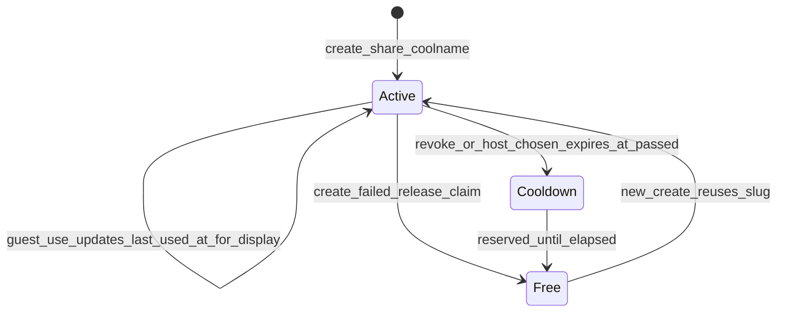

# Share tokens

Public review URLs are `{base}/r/{token}`. New tokens are **coolname** word slugs
from `coolname.generate_slug(3)` (e.g. `fantastic-acoustic-whale`, or
`spiffy-urchin-of-forgiveness` when a connector word is included).

Uniqueness and reuse are enforced by a **host sqlite registry** with two pools.
Tokens are live credentials, so only that registry stores them, outside every
project workspace. Episode-bound metadata (share `id`, capabilities, review
version, access policy, revoked state) stays in the project sidecar
`artifacts/review/shares.json`, keyed by the share `id`. See also
[persistence.md](persistence.md).

Local host and guest review media responses open the authorized file through
no-follow directory descriptors before streaming. Byte ranges, HEAD, and cache
headers use that pinned file, so a later symlink swap cannot redirect a read.
Review MP3 retries give FFmpeg a private, separate-inode clone or copy from the pinned WAV descriptor;
object-store uploads pass the pinned MP3 file object to the client. Windows has no
descriptor-relative no-follow opens, so `util/pinned_media.py` uses a weaker path-based
fallback there. The path must not traverse a symlink or junction. After opening, the
descriptor's `fstat` must report a non-zero file ID and match the path's `lstat` (same
device and inode, regular file), and the parent link check and a `realpath` comparison are
repeated. An open file cannot be deleted or renamed on Windows. A parent swapped for a
junction before the open and restored between those checks is not detected, and a
filesystem that reports no file IDs (some FAT volumes and network shares) refuses these
reads. The path must already be resolved (`Path.resolve()`, as `project.workspace_path()`
does): an unresolved spelling such as an 8.3 short name or a `subst` drive fails the
`realpath` comparison and is refused. Every other platform without the descriptor
operations fails closed. Ranged responses read with a lock-guarded seek because `os.pread`
is missing on Windows. `PinnedFileResponse` overrides Starlette's private `FileResponse`
hooks, so `starlette>=0.47.0` (and `fastapi>=0.116.1`, the first release that accepts it)
is required. In `tests/test_pinned_media.py`, a signature-drift test and a test that forbids
opening the path fail on the next incompatible change; the `pinned-media-windows` CI job
runs that file on Windows with Python 3.11 (the `requires-python` floor) and 3.12 (the
desktop sidecar's version).

## State diagram



| Pool | Guest `/r/{token}` | Mint collision? |
|------|--------------------|-----------------|
| **Active** | Usable (caps apply) | Yes — blocked |
| **Cooldown** | **404** | Yes — blocked until `reserved_until` |
| Free (absent) | 404 | May mint |

## Algorithm

| Step | Behavior |
|------|----------|
| **Mint** | `claim_with_mint_retry`: coolname slug → `claim_active` under `BEGIN IMMEDIATE`; remint on reservation race; then write project sidecar; `last_used_at = created_at` |
| **Guest use** | `lookup_share` checks the active registry row on each request, touches `last_used_at` (throttle **1 hour**), and reads the project `shares.json` row with the registry row's `id` directly for current access policy. The project JSON need not be parsed for this lookup |
| **Demote** | On revoke, or when the host-chosen `expires_at` has passed → move to cooldown with `reserved_until = now + 365d`, counted from when the link ends, not from its last use (single transaction). Idle time never demotes a link |
| **Create rollback** | Sidecar write failure → `release_claim` (delete active, **no** cooldown) so flaky disk does not burn coolnames |
| **Remint** | Allowed only if token absent from active and (absent from cooldown or `reserved_until` passed) |
| **Tunnel** | Advertise **usable** active tokens only (`list_usable_shares`) |

### Clocks

- `SHARE_COOLDOWN_DAYS = 365` (`services/collaboration/share_registry.py`): how long a slug stays reserved after its link ends. It never limits how long a live link works
- Expiry: optional ISO `expires_at` on the share row, chosen by the host (CLI `--expires-at`, MCP `expires_at`, the shares API). Unset means the link never expires
- `last_used_at`: display only ("last opened ..."), never part of usability. A link idle for years still opens
- Touch throttle: `LAST_USED_TOUCH_MIN_INTERVAL = 1h` (avoids write storms on poll)

Demotion is **lazy** (on mint / lookup). There is no background sweeper in this release.

### Decision: Share links never expire unless the host chooses an expiry

<!-- decision
id: D-share-links-never-expire
status: accepted
date: 2026-10-06
decided-by: calebn
evidence:
- #80 owner: "Links stay non-expiring with manual revoke. The per-row Extend proposal is dropped."
- #80 owner: "Share copy and docs must say this consistently."
- #1038 put the wording in docs/communication-philosophy.md (Stop sharing)
- #1101 owner: share links never expire by default; the host may opt in to an expiry date; the silent 365-day inactivity cutoff is removed, so a link never ends without the host asking
enforced-by:
- tests/test_share_registry.py::test_registry_and_sidecar_agree_on_whether_a_share_is_usable
- tests/test_share_registry.py::test_a_share_unused_for_over_a_year_keeps_its_last_used_date_for_display
- tests/test_share_registry.py::test_a_link_that_ends_after_a_long_idle_keeps_its_slug_reserved
- tests/test_share_registry.py::test_share_is_usable_until_revoked_or_expired
- docs-sync: decision-sharing
-->

A review link works until the host stops sharing it, and nothing else ends it.
Idle time never does: a link nobody opened for years still opens, and
`last_used_at` is kept only so the host can see when it was last opened. A host
may choose an expiry date when minting a link (`expires_at`). It is opt-in, and
no link gets one by default. Once it passes, the link stops working as if it
were revoked. There is no per-link Extend. Product copy says links do not
expire and calls revoking **Stop sharing**
([communication philosophy](communication-philosophy.md#terminology)). The
Share section has no expiry control (owner decision in #1027): `expires_at` stays
opt-in on the CLI and MCP, and the section shows a date only on a link that has
one. Its copy says links don't expire, and Stop sharing or End room turns them
off.

## Host registry (sqlite)

| | |
|--|--|
| Default path | `~/.podcast_mcp/share_registry.sqlite` |
| **Pin (recommended)** | `export PODCAST_SHARE_REGISTRY="$HOME/.podcast_mcp/share_registry.sqlite"` so GUI, CLI, and tunnel share one file. The path is used verbatim (no suffix rewrite), so point it at the sqlite file itself |

Tables (portable schema contract for a future relay backend):

- `active_shares(token PRIMARY KEY, id, project_workspace, review_version_id, created_at, last_used_at, expires_at, capabilities, kind, role, session_id)`; the per-workspace sidecar row also holds `follow_latest` (the link serves the active review version): `id` is the random per-share id (`EditDecision.author`); `kind` is `review` \| `record` (default `review`)
- `cooldown_shares(token PRIMARY KEY, last_used_at, reserved_until, reason, project_workspace)`
- `recording_key_secret(singleton=1, secret BLOB)`: one random 32-byte host installation secret

Access layer: `ShareRegistryProtocol` in `services/collaboration/share_registry.py` (`get_active`,
`list_active_for_workspace`, `is_reserved`, `claim_active`, `release_claim`, `upsert_active_metadata`,
`touch_last_used`, `demote_to_cooldown`, `purge_expired_cooldown`, `backup_to_new`,
`recording_key_secret`, `close`). Host backend: `SqliteShareRegistry` (WAL, `busy_timeout=5000`,
`BEGIN IMMEDIATE` on registry writes and singleton secret initialization). Wired through `services/collaboration/review_shares.py`
and `services/collaboration/share.py`. Do **not** hand-edit the DB or invent a third index.

Clip listing uses the secret once per service call to derive `rec_` identities
with versioned HMAC-SHA-256 over the resolved workspace path and normalized
workspace-relative recording path. The secret stays local to the host and never
enters project data or guest responses. A malformed stored value or storage
failure refuses listing. Registry backup preserves the identity namespace;
deleting it or replacing it with a different installation's registry resets it.
Stop all registry-owning processes before deleting or replacing the database,
then restart them. Open connections retain the old database after replacement. The feature does not change the
registry's `synchronous=NORMAL` setting. `recording_key_secret` is host-local;
a future relay backend must not expose it as a relay retrieval API.

A failed registry write closes its connection before propagating the original
error. The next registry operation opens a new connection from durable state before token
lookup or mutation. The process-wide getter also recovers the cached owner before
returning it; directly injected registry owners use the same recovery boundary.
Registry and session owners open through `util/sqlite_open.py`, which uses the bounded WAL transition in `util/sqlite_wal.py`;
normal registry writes retain the existing 5-second busy timeout.

The registry admits the complete source namespace before SQLite opens it. The
parent must be owned and private, and every ancestor must prevent ordinary accounts
from replacing its entries. Symlinks and Windows reparse points are refused.
Existing main, WAL, SHM, and journal files must have private effective permissions.
Extended POSIX ACL grants, default ACLs, and unsafe Windows inherited child grants
fail closed without repair or source replacement. Only an owned parent directory's
POSIX mode may tighten to `0700` after ACL inspection. A main, WAL, SHM, or journal
file with group or other access fails closed and is never repaired.

On POSIX and Windows hosts a privacy refusal is the coded error `registry_not_private`: the CLI, owner MCP tools and host GUI
routes report one line that names the offending path and why. A share guest never sees that line:
the error holds a second, fixed message with no path and no command ("The host's sharing
setup needs attention; ask the host to check it.", `util/registry_privacy_error.py`), and
every guest or relayed surface reports it with the same `registry_not_private` code. No message
names an account identifier (a Windows SID stays out of the line, the guest message and the
logs at default level). To recover on POSIX from a loose file or folder, run the `chmod` it
prints (`chmod 0600` for a main, WAL, SHM, or journal file, `chmod 0700` for the registry folder,
`chmod go-w` for a parent folder another user can write to); for a foreign owner, an ACL, or a
symlink it says what is wrong and offers no command, so fix it yourself or point
`PODCAST_SHARE_REGISTRY` at a registry you own. On Windows the line shows the path in double
quotes and never prints a command, because a command could widen access: it tells you to open
the registry path's Security settings and leave only your account, SYSTEM and Administrators
(an unsafe or unreadable permission entry, or no permission list), to move the registry under a
folder you own (a folder above it that another account can change, or that another account owns),
to restore your ownership (a foreign owner), to replace a junction or other reparse point with the real folder, to move
the registry to a local NTFS drive (a network share, alternate stream, other filesystem or one
without stable file identities), or to try again (the folder was replaced while it was being
checked). Pointing `PODCAST_SHARE_REGISTRY` at a registry you own is the other way out.

The review artifacts folder (`artifacts/review`, where published review mixes are staged and
promoted) is held to the same rule. On POSIX hosts a review folder that another user owns or that
group or others can write, or a staging folder that is not private, is the coded error
`review_artifacts_not_private` (`util/review_privacy_error.py`). Publishing from the CLI, an owner
MCP tool or the host GUI reports one line that names the folder and why; the fix is the `chmod go-w`
it prints for a loose review folder, `chmod 0700` for a loose staging folder, or restoring your
ownership of it (or moving the project to a folder you own) when another user owns it. A share
guest, relayed or not, reads only the fixed line "The host's review files need attention; ask the
host to check them." with the same code. Nothing is repaired automatically.

New main files are exclusively created empty with private permissions before SQLite
receives the path. New Windows directories have protected owner, SYSTEM, and
Administrators grants with `OI|CI` inheritance. SQLite children inherit the verified
private parent policy and main-file mode. Initialization, recovery, and every registry
operation inspect the current file family. Actual sidecar disappearance is allowed;
permission errors are not treated as absence. A privacy refusal before SQL leaves an
otherwise healthy connection open so refusal itself cannot checkpoint or delete an
unsafe WAL or SHM.

Overrides retain their caller-supplied path components through native admission;
symlink aliases and unsafe parent traversal are refused. Overrides require stable
trusted host ancestry. Windows source storage requires
local NTFS, just as backup publication does. These checks exclude an ordinary other
account. They do not protect against the host account or an administrator deliberately
changing trusted storage, or revoke previously obtained handles. Treat this database
as **capability-adjacent**, because tokens are capabilities.

### Backup / restore

Registry backup path refusals use `registry_backup_invalid_path` for ambiguous
Windows anchors or filenames. Backup identity guards and POSIX registry identity
checks use `registry_backup_integrity_changed`. Existing Windows ancestry replacement
refusals keep `registry_not_private`. The host sees the guarded path,
what changed and the next action. Cleanup retains substituted entries for inspection.
If a coded failure occurs after publication, the host message says where the backup
was published; inspect that path before retrying. Guests receive the same fixed
sharing-setup message as other registry refusals, without host paths or fixes.

```bash
podcast review backup-registry
# or
podcast review backup-registry --dest ~/Backups/share_registry.sqlite
```

Creates a new single SQLite file; existing destination names (including dangling
aliases and SQLite sidecar names) are refused without modification. `--dest`
requires an existing trusted private directory. It never changes that directory's
permissions. The default name includes a timestamp and random suffix; atomic
no-replace publication decides collisions.

SQLite's WAL-safe online `Connection.backup()` writes only inside a unique private
disk workspace beside the host registry. The snapshot is normalized to DELETE
journal mode, closed, and checked for leftover sidecars. A fixed-size buffer streams
its bytes through an owned private destination descriptor before no-replace atomic
publication. Source and destination can reside on different filesystems. Temporary
entries are removed on failure or cancellation only when their captured creation
identity still matches. If initial identity acquisition fails, cleanup attempts
the resource close and leaves the private unknown entry with a generic note.
Cleanup attempts each acquired resource close once, even if another close fails.
Cleanup preserves the original failure
or cancellation, and reports the first cleanup failure when the operation succeeded.
A directory durability error after publication reports an error but retains the completed backup.

Native acquisition scopes own handles, descriptors, and temporary names before
validation or descriptor conversion. A newly created source main becomes durable
authority after full source-family admission and successful close, before SQLite
opens it. Windows OWNER RIGHTS grants bind to each inspected object's trusted
owner; admission checks every existing child independently.

The publisher pins and validates directory ancestry. POSIX requires an owned `0700`
parent, `0600` files, no extended ACL grants, and no untrusted nonsticky writable
ancestors or symlinks. Windows requires trusted local NTFS ancestry without reparse
points or ambiguous names (alternate streams, reserved devices, and trailing
dot/space aliases), restrictive DACLs, and pinned native handles; private DACLs are installed
before secret writes and publication uses native no-replace rename. The focused
Windows CI job provisions a run-owned NTFS volume with an exact protected trusted
root DACL and checks the full path with production admission before running tests.
It exercises source, snapshot, stage, and published-file second-account read denial.
A proposed workflow or portable policy mock is not successful native proof. Native
macOS ACL tests do not establish Windows guarantees. Unsupported path or filesystem
security semantics fail closed. These controls exclude another ordinary account;
they do not defend against the host account or an administrator deliberately
changing its own trusted storage.

To restore, stop every registry-owning process, including GUI, tunnel, CLI, and MCP
servers. Preserve the old database together with its `-wal`, `-shm`, and `-journal`
files as one stopped set if recovery is needed. Ensure none of those old sidecars
remain at the restored database name, then install the standalone backup at
`PODCAST_SHARE_REGISTRY` (or the default path) in the private host directory. Restart
all owners. Open connections retain the old database after replacement; replacing
an inode does not revoke their database authority. Apply the same stop/restart rule
before deletion. Prefer Time Machine / restic of `~/.podcast_mcp/` in addition to
explicit backups before OS upgrades.

## Project sidecar

`artifacts/review/shares.json` — list of share rows for one episode, keyed by the
share `id`: caps, version id, `general_access` / `require_sign_in`, record `kind` /
`role` / `session_id`, revoked state and timestamps. It never holds a token, so a
copied workspace (backup, collaborator, bug report) carries no working link. Every
sidecar write drops a `token` field, and readers ignore one left in an older file.
The registry is the **global UNIQUE(token)** authority on one laptop and the only
place a token lives.

The host's share list (`ShareService.list` / `list_presented`, `GET /api/shares`,
`podcast review list-shares`) joins each row's token from the registry's active
rows for that workspace (`list_active_for_workspace`), and Copy link uses the URL
built from it. A revoked or demoted share has no active row, so it has no token or
link; the Share section lists only live links. Revoke and drop map a token to its
`id` through the registry before touching the sidecar.

## Record sessions

Removing a participant closes the record token they joined through to new
identities (`invite_closed`); existing leases keep working. When several guests
share the link, an unaffected guest who loses their lease also needs the
replacement. Re-invite by minting a replacement for the same role with
`podcast review share --kind record --session-id <id> --role guest` (or
`--role producer`).
The host Share section also identifies closed record invites, prevents copying
them for new participants, and replaces one from its source token. The new link
keeps the same room, role, and expiry; established leases on the old token keep
working.
See [recording-session.md](recording-session.md).

A second share **kind** (`review` | `record`) lives on the same coolname
registry — same active + cooldown pools and rate limits, no third token index.
Record URLs are `{base}/rec/{token}` (review stays `/r/{token}`). Registry
columns: `kind`, `role` (record role or NULL), `session_id` (NULL for review).
Sidecar rows stay in `artifacts/review/shares.json` with the same fields (no token).
Mint a room (`session_id` + guest + producer tokens) with
`podcast review share --kind record` or `POST /api/shares/record`; end it with
`podcast review revoke-share --session-id` / `POST /api/shares/rooms/{session_id}/revoke`
/ MCP `revoke_record_room_tool`. Remint is refused while the active room is
`recording` or `paused` (`RecordStateError`, HTTP 409, CLI non-zero, MCP error:
"A take is open (REC/PAUSED). Stop it before minting a new room."). Stop the
take first. A successful remint revokes every guest and producer token of the
earlier rooms (land rollbacks survive; an unlanded stopped take the server can see only warns, and
`--land-first` lands it first); a revoke
that fails raises `record_stale_links` with the new room and the old session ids. Re-invite
(`--session-id`) requires a usable room that is the active one. A crash after the guest mint can leave a one-token room;
the same revoke path still clears it. Prefix↔kind is enforced by
`lookup_share(..., kind=)`. Recorded clients (`join`) upload full-quality recording chunks on
`GET`/`POST /api/rec/{token}/upload` (lease + sha256 resume) and may
`DELETE` `kind=room_tone` to revoke an ACK'd bed; the host twin is
`/api/record/upload`. After file ACK, landing copies assembled WAV into `raw/`
and registers one clip per segment (`POST /api/record/land`,
`podcast record land`). Record rooms are **link-access only**
(`require_sign_in` is rejected); restricted (sign-in) record shares are
[Follow-up](../ROADMAP.md#after-the-beta). Decisions and capture follow-up:
[recording-session.md § Session kind and URLs](recording-session.md#session-kind-and-urls).

## Multi-host future (relay)

Today the UNIQUE allocator is **host-local**. `ShareRegistryProtocol` is ready for
a relay/HTTP adapter. When multiple laptops share one public origin, the
durable relay deployment should own the active + cooldown tables (same schema) on a
named Docker volume (or Managed Postgres later) and expose a claim API. Hosts
keep episode sidecars; they ask the relay to mint/claim. **Not implemented** —
blocked on multi-host need. See [ROADMAP.md](../ROADMAP.md) and
[persistence.md](persistence.md).

## Roles and general access

Shares have two independent axes (like Google Drive):

| Axis | Values | Default |
|------|--------|---------|
| **General access** | `link` (Anyone with the link) · `restricted` (ACL + sign-in) | `link` |
| **Role** | Viewer · Commenter · Editor, as in Google Docs | Commenter |

Each role expands to one capability set in `services/collaboration/share_capabilities.py`
(`REVIEW_ROLE_CAPABILITIES`). Viewer holds `play` and `view`. Commenter adds
`comment`, `reply`, `action` and `suggest`. Editor adds `edit`. `mcp` is an
opt-in on any role (`--with-mcp`). `review_role_for_capabilities` returns the
highest role whose whole set a share holds, else none, and the role decides the
document commands (`ROLE_DOCUMENT_COMMANDS`). Browser and share MCP always share
one capability set. See [host-online-relay.md](host-online-relay.md) § Share
capabilities.

Minting fails closed. Omitting the role mints a Commenter link. An unknown role,
an empty capability list or an unknown capability name raises and mints nothing
(`capabilities_for_role`, `normalize_capabilities`), so a typo never widens into
the default role.

### Decision: Review-link roles follow Google Docs

<!-- decision
id: D-share-roles-follow-google-docs
status: accepted
date: 2026-10-06
decided-by: calebn
evidence:
- #1038 owner review: "These follow Google Docs: a Commenter can suggest."
- #1050: "Make Commenter grant comment and suggest. Delete the standalone suggest-only level."
enforced-by:
- tests/test_share_roles.py::test_review_roles_follow_google_docs
- tests/test_guest_document_gate.py::test_each_role_runs_exactly_its_document_commands
- tests/test_guest_document_gate.py::test_a_commenter_suggests_a_cut_and_an_editor_applies_it
- tests/test_guest_document_gate.py::test_commenters_retime_only_their_own_suggestions
- docs-sync: decision-sharing
-->

A Viewer can view and play. A Commenter can also comment and suggest. An
Editor can also edit directly and approve or reject suggestions. There is no
suggest-only level: a share that holds `suggest` without the rest of the
Commenter set is a Viewer and runs no document command.

### Decision: Guest powers follow the share's capabilities

<!-- decision
id: D-guest-powers-follow-capabilities
status: accepted
date: 2026-10-06
decided-by: calebn
evidence:
- #6 owner: "`edit` guests can edit through every surface they have, including the DAW, MCP, and transcript word selection."
- #1004 owner: "if someone has edit ability, they are trusted to approve." and "the host can undo it from History."
- #1006, #1011: a 2026-10-03 Chromium run found no guest transcript Select and guest MCP cuts that only proposed; both fixed
enforced-by:
- tests/test_guest_document_gate.py::test_only_editors_decide_pending_suggestions
- tests/test_guest_document_gate.py::test_host_undoes_each_editor_mcp_change
- tests/test_guest_document_gate.py::test_selected_range_mode_follows_the_role_on_every_surface
- tests/test_selected_range.py::test_view_play_comment_guest_cannot_edit_or_suggest
- docs-sync: decision-sharing
supersedes: D-exact-range-guests-propose
-->

An Editor edits and approves, a Commenter only suggests, and a Viewer does
neither, on every surface. The role is read from the share's capabilities
(`review_role_for_capabilities`). No new permission level exists for this.

Selected-range edits (transcript words or a timeline range) follow the share's
role. No separate transcript permission exists. A share that holds no role in
full runs no document command, on the browser route and the guest MCP alike. The
guest MCP derives its tool list from the same gate: `guest_submit_document_command`
needs a command the gate allows, and the Editor tools (render preview, media
upload) need every Editor command (`edit_commands_allowed`). The browser render
preview, render job, boundary context and media upload routes call the same
`edit_commands_allowed` (through `require_share_edit`), so both surfaces refuse
everyone but an Editor.

| Role | Transcript **Select** and timed words | Range Cut / Mute (DAW, transcript, guest MCP) | Retime a pending edit | Approve / Reject pending edits |
|--------------|----------------------------------------|-----------------------------------------------|-----------------------|--------------------------------|
| Editor | Yes | **Cut** / **Mute** apply at once, one History step | Any pending edit | Any, exact range proposals included |
| Commenter | Yes | **Suggest cut** / **Suggest mute** create a pending edit for review | Only its own suggestions (pending edits its share authored) | Refused |
| Viewer, or a share with no role | No (untimed utterance text) | Refused by the document-command gate | Refused | Refused |

In ShareCut Studio an Editor link's Review queue lists the pending edits with **Cut** and **Keep** (the commands are `ApproveEdits` and `RejectEdits`). Unsure-word fixes stay host-only, and the transcript check has HTTP twins but no Editor control yet (below): a cut that covers an unsure word is shown held ("The host checks the unsure word first.") with no Cut, and while the transcript is unchecked the server refuses an Editor's Cut, which shows under Needs attention until the host, or an Editor through the check twins, checks or waives it. A Commenter or Viewer link's queue is comments only.

An Editor also edits volume envelopes as the host does: `SetEnvelope` is in
the Editor command set, and the Studio's envelope overlay, envelope inspector,
peek strip and touch create menu read `canEditEnvelopes`. Commenter and
Viewer links see envelopes view-only (owner, 2026-10-06; see
[touch-editor-decisions.md](touch-editor-decisions.md#decision-one-touch-input-grammar-for-timeline-editing)).

An Editor also writes the episode's podcast listing: `SetFeedField` and
`ClearFeedField` are in the Editor command set, limited to `item.*` keys (never
the show's `channel.*` settings) authored as a person. Commenter and Viewer links
are refused with `share_capability_required`. Any link that can view reads the
listing at `GET /api/review/{token}/feed`. See
[podcast-feed.md](podcast-feed.md#guests).

An Editor is trusted to approve: approving applies an edit. The host can
undo every change an Editor makes (applied cut or mute, approval,
rejection, retime) with one History Undo each.

One exception to that trust: an Editor's `ApproveEdits` of more than one edit never cuts a pending edit that covers an unsure transcript word (below `analysis.unsure_word_confidence`); it stays pending and is reported as held with reason `unsure_word`, whatever the payload's `skip_unsure` says. Approving one edit by name still cuts. Likewise every guest `ApplySuggestedActions` (one id or many) leaves a cut or shorten over an unsure word pending and names it in `held` and `held_unsure`, whatever the payload's `skip_unsure` says; the guest approves that one cut by name instead. There is no `apply_edit_plan` guest tool, but an Editor may submit the `ApplyEditPlan` command as the host does; a Commenter or Viewer is refused with `share_capability_required`. Guests see the `unsure` flag on words they receive but the guest MCP tools cannot mark the transcript checked; an Editor does it over HTTP (the check twins below, [gui-integration.md § Unsure words](gui-integration.md#unsure-words)).

The document-command gate (`authorize_document_command` plus
`policy.resolve_range_mode`, `policy.may_decide_exact_range` and
`policy.authorize_pending_update`) enforces the table from the share's
role, whatever the surface; the Studio reads it from `rangeEditMode` and `canRetimePendingEdit` in
`gui/web/src/shareMode.ts`, plus `canReviewPendingEdit` for Approve / Reject,
only to choose affordances. Every pending edit a guest's document command creates
records `EditDecision.author`, `share:` plus the share's opaque registry `id`
(`share_capabilities.share_author`), on the browser route and the guest MCP alike.
`create_share` mints that id at random and the registry stores it beside the
token, so nothing in the author is derived from the token and a copied project
leaks no share credential. The id belongs to one share, not its slug: revoking and
recreating a link, or a coolname recycled after cooldown, gets a new id, and the
old suggestions belong to no guest. Host and agent edits, and edits saved before
authorship, have no author and belong to no guest. A Commenter retimes only
edits whose author is its own share, and coalescing never merges pending edits
with different authors (`transcript_cuts.coalesce_edits`). Every pending-edit row
in the projection carries its `author`, the same row for every guest, and the guest
bootstrap (`GET /api/review/{token}/project`) returns the guest's own `author`.
The Studio shows Retime on a suggestion only when the two match
(`canRetimePendingEdit`), so a Commenter sees it on its own suggestions and
nowhere else. The id is random and grants nothing: every guest route and the guest
MCP look a share up by its token, never by `id`, so another guest who sees an
author learns only which suggestions came from the same share.

Guest comment and reply names are display labels only (`guest_display_name`: trimmed, no control characters or angle brackets, 40 characters, Host, Agent and DAW suffixed ` (guest)`, blank is Guest) and never feed a capability check; the action-item `by` label gets the same treatment, the three fields are capped at 200 characters on the wire, and lone surrogates and zero-width-only names are dropped. Reserved names are compared after NFKC folding and without trailing punctuation (fullwidth Ｈｏｓｔ and `Host.` are suffixed). A lookalike of Host with letters from another script (for example Cyrillic) is not caught, and a ZWJ emoji sequence in a name falls apart into its parts because zero-width format characters are stripped: names are display labels, no authorisation reads them, and without accounts a real participant's name cannot be reserved.

### Editor versus host

An Editor share link equals the host in most ways. The exceptions are written down
and kept short.

#### Decision: An Editor holds every host document command

<!-- decision
id: D-editor-equals-host-commands
status: accepted
date: 2026-10-30
decided-by: calebn
evidence:
- #2729: Editor links run every host document command
- owner, 2026-10-30: "an Editor share link is equal to the host in most ways. The exceptions are written down and kept short."
- docs/design audit editor-parity, layer 1: the Editor lacked 44 of 76 document commands
enforced-by:
- tests/test_guest_document_gate.py::test_every_document_command_is_classified
- tests/test_guest_document_gate.py::test_the_editor_holds_every_command_the_host_runs_but_the_named_host_only_ones
- tests/test_guest_document_gate.py::test_editor_parity_command_gate
- docs-sync: decision-sharing
-->

An Editor link holds every document command the host runs. The only commands it
does not hold in `EDIT_COMMANDS` are the comment commands (`AddComment`,
`UpdateComment`, `ResolveComment`, `DeleteComment`, `AddReply`, `SetActionDone`,
`AddAction`), which follow the comment capabilities, and any command named in
`HOST_ONLY_DOCUMENT_COMMANDS` in `services/document_sync/capabilities.py`. That
set holds `SetRecordSessionName` (naming a record session is the host's) and `AcceptSessionSuggestion`, `SkipSessionSuggestion` and `SelectSessionTake` (deciding a staged record session is the host's; the `session_suggestions` field of the project payload is host only and is stripped from every guest view). A test fails when a new command type is in none of the Editor,
Commenter, comment or host-only sets, so a new command cannot ship unclassified.
Commenter and Viewer commands are unchanged.

The Editor gained transcript edits and word toggles, chapters, social clips,
effects, bleed commands, the stage and text cuts, `MoveByText`,
`RippleDeleteText`, `InsertGap`, the automation commands (`ApplyAutoEdits`,
`ProposeTighten`, `ApplyEditPlan`, `ShortenWordGaps`, `StripSilence`,
`FadeJoins`, `CrossfadeJoins`, `ApplyFadeRecommendationList`) and
`RenameProject` (the audit's contested default: rename allowed, delete not).
Every edit shows in History, and the host can undo it or revoke the link at any
time. The commands that record an author (`SuggestPendingEdit`,
`EditSelectedRange`, `SplitAtTime` and `DeleteClip`) attribute it to
`share:<id>`. `ShortenWordGaps` also receives the author, but only to skip the
host's audio-check override; the override a guest turns on is attributed to
`share:<id>` by the audio check itself. The other commands record no author.

Payload guards stay. A room tone fill needs a range, a guest `ApproveEdits` of
several edits and every guest `ApplySuggestedActions` hold pending edits over
unsure words, and a guest `AddEffect` cannot carry a `model` param, because that
names a file on the host. Every `AddEffect` caller, host or guest, has its params
checked against the effect's schema in `engines/effect_filters.py`: numbers are
bounded, `equalizer` `t` is one of `q`, `h`, `o`, `s`, `k`, unknown keys are
refused, and a value that is not a number is refused as `invalid_effect_params`.
An `arnndn` `model` may not contain `,`, `;`, `[` or `]`. Effect params already
saved outside the schema now fail at render with `invalid_effect_params`; they
used to render.

Owner routes stay host-only: a relayed call to one is refused with
`authz_denied`, and the tunnel forwards only `/api/review/{token}`. An Editor
reaches project work through a share-scoped twin under
`/api/review/{token}/daw/*`. Every twin is a row in `GUEST_OWNER_ROUTES`
(`services/collaboration/guest_routes.py`: method, path, rate-limit kind and
whether it needs `PODCAST_GUEST_RENDER`; every twin needs the Editor role), and
the `guest_route(name)` dependency in `gui/routes/review_editor.py` checks the token, the rate limit and
the Editor role and returns the share's workspace. A route with no row is denied,
and a handler never takes a project path from the client. Guest request models
extend `GuestRequest`, which refuses unknown fields. A guest sees a job only
through `GUEST_JOB_VIEW` (`services/jobs/job.py`), only when it belongs to the
share's project: another project's job answers 404. An Editor may poll a render
of the same project that the host started, because host and guests share one
render lock; the view is only id, status, current, total and fixed copy. The
registry covers the HTTP twins only; the guest MCP tools are gated separately in
`remote_mcp`.

An Editor can watch and stop host work the way the host can: the project's job
status (`…/daw/pipeline/status`), one job's status, its event stream
(`…/events`) and cancel (`…/cancel`), all under `…/daw/pipeline/jobs/{job_id}`. A
job id that is unknown, belongs to another project, has no project (bootstrap,
agent) or is not a job of the kind the route serves (pipeline jobs on `…/pipeline/*`,
render previews on `…/render-preview/{job_id}`) answers the same 404 `job_not_found`
body, on status, events and cancel, through the `guest_job_route` dependency. The
event stream carries only the fixed-copy view, re-checks the job's project and the
share every few seconds, ends when the job ends, the link is revoked or expires, or
an hour passes, and allows four open streams per link. None of these routes needs
`PODCAST_GUEST_RENDER`, because they spend no host CPU; cancel in particular works
with the flag off, so the host can turn it off and still let an Editor stop a
running job.

An Editor can also start the run (`POST …/daw/pipeline/run`, **202**), with the same
steps the host can pick except export. The body is `GuestPipelineRunRequest`:
`from_step`, `only_step`, `skip_steps` (at most one per step), `force_transcribe` and
`retime_words`, and nothing else (a path, config, `use_working_set`, `unattended`,
`enabled_steps` or `overwrite_edited` is a 422; `overwrite_edited` is not offered, so a guest
run never replaces hand-edited transcripts). `export_deliverables` is never run for a guest:
naming it in `from_step` or `only_step` answers 400 `pipeline_step_not_shared`, and every
guest run skips it. The run uses the host's working-set config for the share's project, read
as a copy without staging or changing it, so a guest run does not change the staged working
set. If the host set the project to attended runs, the start answers 409 `pipeline_attended`
before any job starts; with nothing staged the run is unattended. Starting spends host CPU,
so it needs `PODCAST_GUEST_RENDER` like a render preview. Unknown step names answer the
owner's 400 codes. A busy slot, including one held by a host job, answers 409 `job_running`
with the same fixed copy as a render preview. A whisper model or a word aligner that is not
usable answers 409 `model_needed` with the guest copy before any job starts: the model
checks only read the cache and never download, so a guest cannot start a download. The
response is the same fixed-copy job view, never the job snapshot, and the new job is
reachable through the status, events and cancel twins.

An Editor can start the mastered-deliverables export (`POST …/daw/export`, **202**) and
follow it on its own twins: the project's export jobs (`…/daw/export/status`, so a reload can
find a running export) and one job under `…/daw/export/jobs/{job_id}` (status, `/events`,
`/cancel`).
The pipeline twins stay pipeline-only and the export twins serve only `export` jobs
(`GUEST_EXPORT_KINDS`), so a job of the other kind answers the same 404 `job_not_found` on
either set; the project status listing and the guest MCP render tools are unchanged. The body
is `GuestExportRequest`: `formats`, a list of one to three distinct names from `mp3`, `flac`
and `m4a`, or omitted for the host's configured formats; nothing else (a `path`, `dest`,
`output_dir`, `filename`, `ext`, `codec` or `extra_args` is a 422, and so is any other format
name). The owner route takes full format entries (`ext`, `codec`, `format`, `bitrate_kbps`,
`sample_rate`, `channels` and `extra_args`, the last passed to FFmpeg and `ext` becoming the
file suffix), so none of those can be offered; the host maps each name to a fixed entry
(`GUEST_EXPORT_FORMATS`: MP3 fixed at 128 kbps whatever the host configured, FLAC, and the
pinned M4A preset). Files always go to the project's own export folder under the project's
name.

An Editor's export is the host's export (an Editor can do what the host can on the episode),
and nothing is suppressed. It masters the project if the master is stale, then writes the
master WAV, the transcript sidecars (SRT and Markdown, and a VTT or TXT already there), the
chapters file and the feed file per the host's settings, saves the project (the feed guid and
number, the master hash and QC), and replaces same-named deliverables already in the export
folder; there is no undo and the job does not record which link started it, so the host log
carries an INFO line with the first characters of the token. Choosing `formats` replaces the
host's list for that run (a host `mp3` at 192 kbps or an `m4a` the host configured is not
rewritten and is left as it was); omitting `formats` runs the host's whole export config,
including its bitrates, sample rate, channels and extra FFmpeg arguments. Any Editor can
cancel any export of the project, including one the host started, and sees it in the
listing. Starting spends host CPU, so it needs `PODCAST_GUEST_RENDER`; the twins do not, and
cancel works with the flag off. The start never waits: a busy slot, including a mix rebuild of
the same project, answers 409 `job_running` with the fixed copy at once (the owner route
still waits for a rebuild). The job view says only running, done or failed ("Export failed", whatever the cause);
the Editor is not handed the exported files or their paths, and downloading them is a later
decision. Bounce (it names track ids, the raw stems exception) stays host-only here.

An Editor also gets twins of the transcript tab's tools, under `…/daw/transcript/`, as the
project's workspace. The rule is the same as for the rest of the Editor's powers: an Editor does
what the host does, and the exceptions are the written list below. None of these starts a job,
so none needs `PODCAST_GUEST_RENDER`. The body never names a path, and `GuestRequest` refuses any
field not listed (a 422), which is stricter than the host's routes: text fields have lengths the
host's do not, and `formats` is a closed list, so an unknown format is a 422 where the host's
route answers 400.

- Vocabulary: `GET` and `PUT …/vocabulary`. The `PUT` body is `terms`, `guest_names` (at most
  100 entries of 100 characters, counted before trimming) and `base_revision` (at most 64
  characters, required); a stale revision is 409 `vocabulary_conflict`, as for the host, and
  saving changes what the next transcription is primed with, as it does for the host. Both
  answers carry only `terms`, `guest_names`, `prompt_limit`, `revision` and
  `needs_retranscription`: the show title and the tracks with hand edits are not sent. The
  service records no author, so the host log carries an INFO line with the first characters of
  the token.
- Transcript check: `GET …/refine/status`, `POST …/refine/done` (`notes`,
  `expected_fingerprint`; 409 `transcript_changed` when the transcript no longer matches) and
  `POST …/refine/waive` (`reason`). An Editor's mark clears the host's gate exactly as the
  host's would, in every mode: the gate looks only at the status and the transcript
  fingerprint, so a pipeline run that waited on the check (the host's, or a guest's with
  `PODCAST_GUEST_RENDER`) proceeds, and so do the Editor's own gated edits. The gate file records
  who acted: the host's routes write `source: "user"`, and an Editor's write `share:` plus the
  link's registry id (the same actor string `EditDecision.author` carries), so an Editor cannot
  appear as the host or an agent, and the body has no `source`. The host UI does not show the
  actor or the note, so the host sees a cleared gate and cannot tell whose mark it is without
  opening the file or reading the status response (`source` is `share:<id>`). `notes` and `reason`
  are at most 500 characters and are stored after the fixed marker "From an Editor link: ". A
  done mark without `expected_fingerprint` is accepted, as for the host, and a repeat while done
  writes nothing. A waiver never overwrites a gate that is already clear (done or waived, by the
  host or anyone): it leaves the record as it was and answers the status. A done mark does
  replace a waiver, as the host's does. The status an Editor gets is the host's view with
  `notes` always empty (the host's free text is not shown, nor an Editor's own), a `share:`
  source shown as `guest`, and the host's `source` and `updated_at` as they are. The waive twin
  answers that status view, not the host's raw gate record.
- Read-only: `POST …/replacement-preview` (`search`, at most 200 characters and 20 words,
  `replacement`, at most 500, `match_case`) and `POST …/word-timing-context` (`target`,
  `expected_word`, strings capped at 200; 409 `transcript_timing_changed`, 404 `word_not_found`).
  Both answer what the host's routes do and write nothing; they count as reads for the rate
  limit. The preview holds the project's commit lock while it scans, which is why its search is
  shorter than the host's.
- Transcript files: `POST …/export` (`formats`, one to four distinct of `txt`, `md`, `srt` and
  `vtt`, default `md` and `srt`; `dry_run`; `with_text`) and `GET …/exports`. The files go to the
  project's own `export/` folder under the project's name, the same place as the host's, and
  replace same-named `.txt`, `.md`, `.srt` and `.vtt` files there (a host's hand-edited
  transcript with that name included): there is no backup and no undo, and an export may also
  save the project when it had to build the combined transcript. The body names no folder or
  file. The write is synchronous and takes the project's render lock for up to 30 seconds (503
  `export_busy` after that, or at once when two link-started exports are already running; 409
  `transcript_empty` when every word is cut). `dry_run` writes nothing and takes neither the lock
  nor a slot, and `with_text` adds the reading text of the transcript, which an Editor can already
  read. The host's answers name each file's absolute `path`; the twins send only an allowlist
  (`format`, `name`, `bytes`, `language`, `written`, `current`; the listing: `name`, `format`,
  `mime`, `language`, `bytes`, `modified`, `current`).

An Editor also splits a one-track recording into speaker lanes and moves a range between sibling
lanes, under `…/daw/speaker/`, as the project's workspace; the body names no path.

- Split: `POST …/speaker/split` (`track_id`, `speaker_count` 2 to 8, optional `names` and
  `enrollment`) starts the host's `split_speakers` job and answers 202 with the fixed-copy job
  view. It needs the host's `PODCAST_GUEST_RENDER` opt-in and the start rate bucket, like a
  pipeline run, and a guest split holds the host's whole job slot while it runs (a busy slot is
  409 `job_running` at once, and the host's own pipeline, export and render wait for it).
  - `names` (at most 8, 1 to 80 characters) and the keys of `enrollment` must have visible text
    and no control characters (422 otherwise). They become the lanes' labels and speaker names,
    and the first name renames the original track too; lane ids are made from them with the
    host's slug rule. Nothing else is checked: an Editor can already set these with
    `SetTrackMeta`.
  - `enrollment` maps a speaker's name to voice samples, spans of the track's source recording
    in seconds (`[start, end]`, finite, `0 <= start < end`, at most 16 per name). They are numbers
    read from the track's own media, never a file or a path. This is stricter than the host's
    route, which has no limit on seconds: overlapping or touching spans are merged, and the
    merged length may be at most 600 s per name and 1800 s in all (422 beyond), because every
    quarter second of a sample is embedded inside the one job slot. A span that starts at or after
    the track's declared length is 400 `enrollment_past_end` before any job starts (a track with
    no declared length is not checked, and a sample past the end is then a failed job).
  - A model the split needs that is not downloaded is 409 `model_needed` with fixed copy: no
    model name, size, command or path, and nothing is downloaded. Other refusals keep the host's
    status and code with fixed copy: 409 `speaker_backend_unavailable`, 400 for the split's own
    codes (`speaker_split_no_media`, `speaker_split_already_split`, `speaker_names_count_mismatch`
    and the like). The host's route also turns an uncoded `ValueError`, `FileNotFoundError`,
    `RuntimeError` or `ImportError` into 400 `speaker_split_invalid` / 409
    `speaker_split_unavailable` with the error's text; the twin does not: any uncoded error is the
    fixed 500 `internal_error`, since its text can name host paths.
- Follow it: `GET …/speaker/status`, `GET …/speaker/jobs/{job_id}`, its `/events` and
  `POST …/speaker/jobs/{job_id}/cancel` reach `split_speakers` jobs of this project only
  (`GUEST_SPEAKER_KINDS`); a job of another kind, project or id is the same 404 `job_not_found`,
  and the pipeline and export twins do not serve a split. They work with the flag off.
  - The job view says only running, done, failed or cancelled, with fixed copy ("Speaker split
    failed", whatever the cause, including a failure that only shows once the audio is read):
    the result (lanes, flagged turns) is not sent, so an Editor sees the new lanes in the
    document and the host's History holds the one undo step.
  - Cancel is scoped to the project, not the link: any Editor can stop any split, one the host
    started included, as with the pipeline and export twins. A cancel that lands while the split
    is being committed can read "cancelled" with the lanes already in place.
  - Revoking or expiring a link closes its event stream but does not stop a split already
    running; the host cancels it.
- Move: `POST …/speaker/move-lane-span` (`from_lane`, `to_lane`, `timeline_start`,
  `timeline_end`, finite, the end after the start: 422 otherwise) is synchronous and is the host's
  `SpeakerService.move_lane_span`: one undo step that mutes the range on `from_lane` and reopens
  it on `to_lane`. It needs no flag. Refusals (400, with the host's code and fixed copy): the same
  lane, lanes that are not siblings of one split, a range that does not map to one continuous
  span. The answer is an allowlist: `from_lane`, `to_lane`, `source_start`, `source_end`,
  `mute_region`, `words_moved` and `history_head_id` (the id of the host's undo step). As for the
  host's route, the timeline range is mapped to the source before the commit lock is taken, so a
  host edit landing in between can shift the range.
- Attribution: neither service records an author, so the project history does not name the Editor
  and the host cannot tell a link's split or move from its own in History (the document journal
  notes it as the agent's). The host log carries an INFO line with `share:` plus the link's id.
  This is a disclosed gap that a later change can close by giving the services an actor.

The speaker doctor (`GET /api/speaker/doctor`) has no twin: it reports the host's recognition
backend, which is host machine detail.

A refusal on these twins keeps the host route's status and code with fixed guest copy, never the
host's message, and anything else is the fixed 500. The host's routes are unchanged and a
relayed call to one is still refused.

The Editor does not get these. The exceptions below are the audit's approved
list; the routes and tools in them are not document commands, and slices after
this one decide which owner routes get a share-scoped twin.

1. Manage share links and roles, including the MCP URL. An Editor could mint
   stronger links or lock the host out.
2. Control the recording room: start, stop, end, replace invites, land or
   discard takes, assign tracks. The live session belongs to the host.
3. Delete, move or open other projects, and anything that takes a host file
   path. That is the host filesystem.
4. Online-sharing and tunnel setup, the host account, model downloads and
   settings, and API keys.
5. Publish or upload credentials and the act of publishing to a hosting
   provider. Feed values and the feed file are allowed.
6. Diagnostics bundles and agent handoff. They carry host logs and paths, and
   run code on the host.
7. Raw stems and rendering outside the project: waveform PCM and a custom
   export folder.
8. Deleting an episode. Renaming a project is allowed.

### Superseded decision: Every guest proposes exact range edits

<!-- decision
id: D-exact-range-guests-propose
status: superseded
date: 2026-10-03
decided-by: calebn
evidence:
- #532, shipped in #932: "The host applies and exports; all edit/suggest guests and supported agents propose."
superseded-by: D-guest-powers-follow-capabilities
-->

The first exact range release (#532) let only the host apply a range edit.
The decision above replaced that for `edit` guests on 2026-10-06. Agents
still propose, and export stays host-only
([daw-editing.md § Exact selected ranges](daw-editing.md#exact-selected-ranges)).

### Login policy

Production public shares are **link only**. Restricted /
`require_sign_in` minting is refused unless `PODCAST_SHARE_ACCOUNTS=1` (stub
testing). Optional provider account UI is installed and documented separately.
MCP SDK OAuth is **not** the document ACL.

## Identity (Restricted shares) — not production

Backend stubs exist under `share_auth/` and `/auth/*`, but by default `/auth` is
**not mounted** and Restricted shares cannot be minted. Leftover Restricted
tokens still 401 via `ShareIdentityMiddleware`. Escape hatch:
`PODCAST_SHARE_ACCOUNTS=1` remounts `/auth` and allows minting for tests.

Host sqlite `~/.podcast_mcp/share_identity.sqlite` (override
`PODCAST_SHARE_IDENTITY`) holds `users`, `share_acl`, sessions, magic-link tokens,
passkeys, and agent credentials when accounts are enabled. See
[persistence.md](persistence.md) and `deploy/relay/SECRETS.md`.

## Security notes

- On **link** shares the token **is** the capability set (`play` / `view` /
  `comment` / `reply` / `action` / `suggest` / `edit` / `mcp`). Treat URLs as
  secrets (forwardable, same threat model as Docs link sharing).
  `view` includes the live presence roster and canvas ghosts (cursor, selection,
  playhead, viewport). `play` is required to follow-with-audio. Anyone with
  `view` can see the host's cursor and viewport — the Share section states this.
- On **restricted** leftovers the coolname alone does not grant powers; identity
  middleware keeps them 401 until accounts ship.
- Links do not expire unless the host chose a date
  ([decision](#decision-share-links-never-expire-unless-the-host-chooses-an-expiry));
  end one with `podcast review revoke-share --token …`.
- Guest failure messages use explicit coded refusals. A refusal that names a host path gives
  a guest a fixed, path-free message (`CodedError.guest_message()`), never a partly redacted one.
  Unmarked service exceptions return fixed `internal error` while host logs keep
  the traceback. See [host-online-relay.md](host-online-relay.md#security-notes).
- Guest JSON never includes host absolute paths; episode JSON stores
  workspace-relative paths only (`workspace_dir: "."` on disk). Rate limits:
  [host-online-relay.md](host-online-relay.md) § Rate limiting.
- Coolname slugs are guessable in theory; the large namespace plus cooldown and
  rate limits are the practical controls. Do not publish token lists.
- **Tunnel binding (not the mint registry):** when a host advertises a share to the
  relay it signs an HMAC claim with its tunnel secret. The relay keeps
  `token → host_id` across disconnect so another host cannot steal an offline
  coolname. This is separate from the future relay-owned mint/claim API above.

## Operator quick path

**ShareCut Studio (host):** Menu → **Share…** (`share.manage`) lists live links, mints a coolname URL (role Viewer / Commenter / Editor, optional **Allow AI assistants (MCP)**, optional **Freeze on the current version**), and stops sharing after an in-place confirmation that names the link and the consequence. If no review mix exists, **Create review link** publishes **Share mix** first. When the project has no rendered mix to publish, the server answers `409` with `X-Sharecut-Error-Code: no_mix`, and the Share section says "This project has no mix yet. Refresh the mix to create the link." beside **Refresh mix**. If the premix is behind the project (edits, volume or mute since the last Refresh), the typed conflict offers **Refresh mix**; the section waits for the existing render job to finish successfully, then retries the captured Create review link request once. A failed or cancelled refresh leaves the recovery action available, and a second stale response requires another explicit refresh. A stale master instead explains that it must be re-mastered; preview refresh does not claim to fix it. Same `ShareService` as CLI.

CLI:

1. `export PODCAST_SHARE_REGISTRY="$HOME/.podcast_mcp/share_registry.sqlite"` (optional pin)
2. `podcast review publish-version --label "Guest pass"`
3. `podcast review share --role commenter --base-url https://share.example.com`
4. Guest opens `https://share.example.com/r/fantastic-acoustic-whale`
5. Prefer relay + `podcast tunnel` ([host-online-relay.md](host-online-relay.md))
6. Periodic: `podcast review backup-registry`
