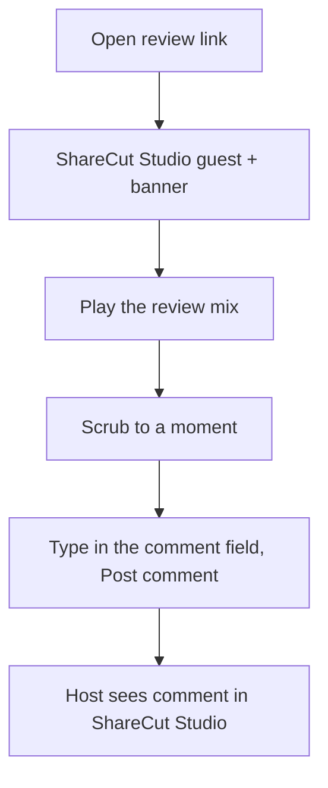
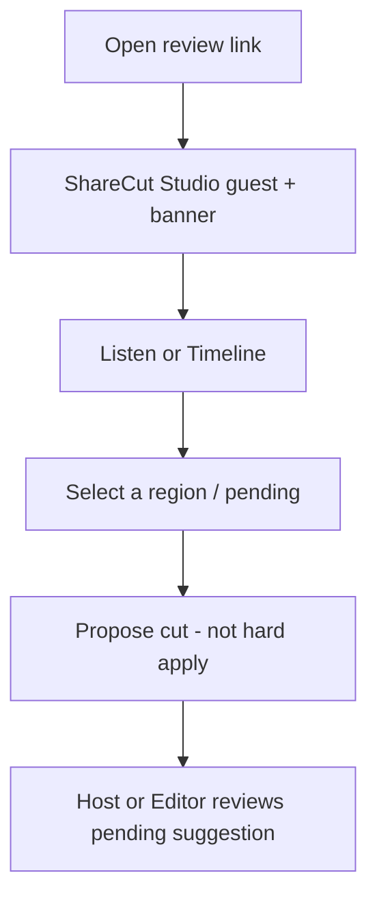
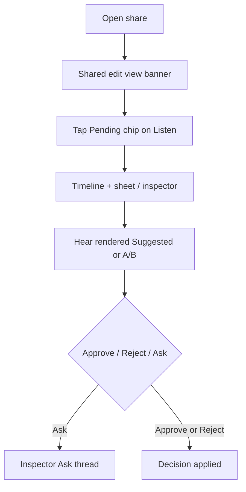
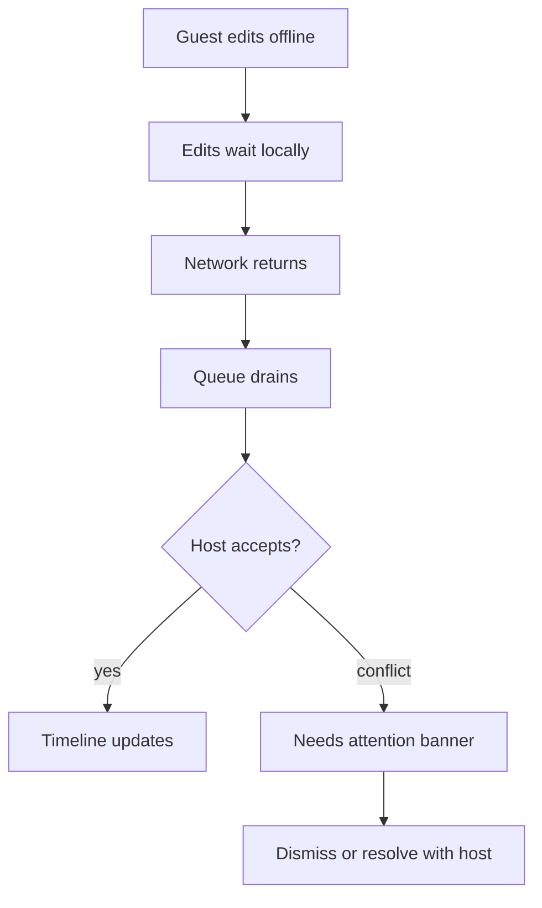
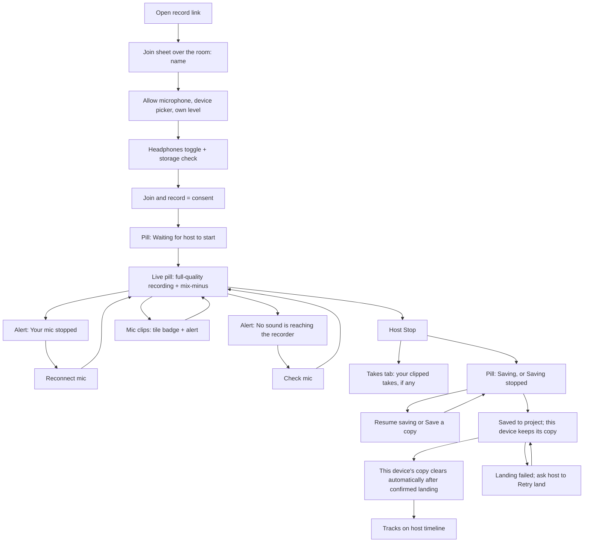
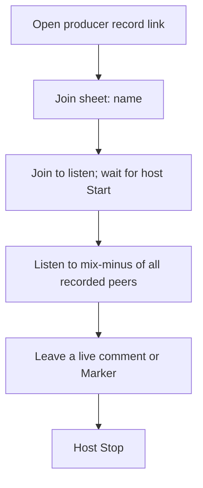

# Guest journeys — review link flows

Plain-language steps for `/r/{token}`. Public review link URLs are
`https://sharecut.studio/r/{token}`. No project JSON. Pair with
[Screens → Guest / share](#/screens).

Guest clip lists recognize clips from the same recording without exposing recording
filenames or host paths. Their opaque identities remain stable across sessions on
the same host installation. A guessed path cannot reproduce an identity without
the host's private secret.

---

## 1. Cold open → listen → comment (Commenter)

**Setup:** A Commenter link, the default role. Every review role opens ShareCut Studio; there is no separate listen page. Guest opens the link on a phone or a laptop.

1. Guest lands in ShareCut Studio under the banner "Shared comment view · You can comment and suggest edits". A line under it names the version heard: *Hearing "Rough cut". This link follows the latest version, so it can change.* (or *This link stays on this version.* on a frozen link). If the host publishes a newer cut, a following link turns amber with *The shared version changed to "Intro fix". Reload to hear it.* and a **Reload** button; a frozen link turns amber with *Newer version available: "Intro fix". Ask {host} for a new link.*, since a frozen link cannot play it. The page checks on load, every 30 seconds and when the tab returns.
2. The comment field is already on screen: docked above the mode bar in **Listen** on a phone, and at the top of the **Comments** tab, which the link opens on, on a tablet or laptop. Nothing else is open; the Inspector stays closed until the guest selects something.
   - Above the comments (Commenter and Editor links only) sits a read-only **Script** of the words heard in the mix (nothing the host cut or ignored): it labels itself *Read only · you can comment*, highlights and follows the word being played, and clicking a word moves the playhead there. Scrolling it by hand stops the following and shows **Back to playhead**, which scrolls the playing word to the middle and follows again. On a phone the Script is kept short (about a sixth of the screen height) so the comment field and **Post comment** stay in view on first load, even at 320x568; it scrolls inside. On a very short window (under 30rem tall), such as a phone in landscape or with the keyboard up, the Script is hidden so the composer keeps the room. A View-only link shows no Script, because its guests are not sent word timings; it shows the comments list as before.
3. Guest plays and scrubs, types a note and chooses **Post comment**: tap the field, type, tap **Post comment**, with no mode, menu or ruler first. The first time, a **Your name** field with **Post as Guest** appears (Enter or **Post comment** posts under the name, **Post as Guest** posts under Guest) and is not asked again; **Commenting as <name>** with its own **Change** button then sits above the field (on the phone it appears only once named; in the tablet and desktop Comments panel it is always there, and tapping **Change** before the first Post counts as naming) and the host sees the name on the comment. The **at 0:12** chip beside Post shows where it lands, the playhead (0:00 before playing) or a selected range, and pressing it changes the time (a range stays a range). After Post the field clears and a toast confirms it. On tablet and desktop the field keeps focus for the next note; on the phone the keyboard closes, because the guest goes back to listening and the keyboard would cover half the view. No Inspector opens on any screen size; the comment appears in the list and on the ruler. Replies and action-item check-offs work on the same thread; the Comments panel says "Commenting as" the guest's name, or Guest after Post as Guest.
4. After the host resolves feedback in ShareCut Studio, the guest sees its resolved state. The host can reopen a thread. Anonymous guests cannot resolve threads from the review link.
5. If the host laptop sleeps / tunnel drops, the guest sees an offline page (not a broken blank app).

A Viewer (listen-only) link shows no comment field.

An unavailable or revoked link shows an error. A share built without `view` (API only, no role mints one) opens the same kind of error: "This link does not open the project. Ask the person who shared it for a new link."

The comment fields fit narrow phones without horizontal page scrolling.

**Success:** First useful comment in under five minutes without explaining "ShareCut Studio."

---

## 2. Suggest a cut (Commenter)

Commenters and Editors turn on transcript **Select** and pick words (for
example a stray "Um."), or select a timeline passage, then choose the intended
occurrence when it repeats. A Commenter sees **Play full mix, Suggest cut,
Suggest mute, Comment, Bounce**; the suggestion leaves clips unchanged until the
host or an Editor selects the pending overlay and approves it. An Editor sees **Cut** and
**Mute** instead, and they apply at once, exactly as for the host. Either way one
History Undo restores the whole action. Disabled actions explain permissions;
Bounce is host-only. Changed selected audio requires reselection.

On a lane with multiple takes, transcript selection starts from the take shown.
Two takes can both have word zero. A session-scoped cut can still ripple across
matching timeline clips under the existing session policy.

Phone users open Timeline and arm **Select range** in the Edit corner for a touch
drag, or use numeric In/Out and lanes (on a phone or tablet the fields sit at
the top of the selection sheet, with **Cancel range selection** in that same
sheet scroll). Viewers can select a timeline range and
play a fresh full mix but cannot suggest edits, and get no transcript Select. Stale range playback asks for host Refresh; guests
receive no isolated selected-track audio through this action.

**Setup:** A Commenter link, the default role.

1. Banner reads *Shared comment view · You can comment and suggest edits*.
2. Guest can propose structural cuts; they become **pending**, not committed.
3. A Commenter retimes only its own suggestions: the drag handles and timing fields appear only on those, and the server refuses another guest's. Other guests' suggestions and host and agent pending edits show their timing read-only. Each pending edit the server suggests also carries one plain "why" sentence such as *A 2.9 s gap* or *Jon cuts off a word and says it again*; a guest's own suggestion has none. For a guest's ordinary source proposal, compare current/suggested bounds; **Use suggestion** applies them after typed timing is applied. **Snap to silence** snaps those source bounds. Exact range proposals keep their sealed timeline footprint and have no source timing controls.
4. With `play`, select **Suggested** or **A/B** and **Play around** to hear an exact range proposal in the full mix before the host or an Editor decides. The preview does not change the project.
5. Only an Editor or the host approves or rejects a proposal, exact range proposals included. A Commenter's Approve and Reject controls on an exact range proposal explain this and stay disabled.

---

## 3. Editor approves on phone

**Setup:** An Editor link.

This journey covers every pending proposal, exact selected-range proposals
included. A completed **Approve** or **Reject** from the inspector or timeline
action card offers **Undo** in the feedback toast when an edit changed, including
trusted interactive approval. A reply that changed no edits says
so without Undo. History remains the backstop.

1. **Impact is hidden** for all guests — approve from Timeline overlay / inspector.
2. Pending chip on Listen routes to Timeline (not Impact) and selects the first review-required pending.
3. Listen-first: hear Suggested (skip the pending band) or A/B before Approve. Ask lives in the pending inspector thread.

---

## 4. Offline edits → Needs attention

**Setup:** ShareCut Studio guest (`view`) loses network while editing; reconnects later.

1. Offline edits queue silently.
2. Structural ops may demote to **propose** when policy requires.
3. Conflicts surface as **Needs attention** (dismissible list, capped at 5 items
   with a trailing "+N more" once more are queued) — not a cryptic error toast.
4. If this device cannot read saved edits, **Needs attention** keeps its last
   verified values and says "Could not read saved edits on this device. Your
   saved edits have been kept." Dismiss all is unavailable until the saved
   queue and conflicts can be read.

A guest whose live connection cannot keep up reconnects through the existing
sync flow. The relay closes that connection instead of silently dropping its
updates. Other guests continue to receive updates. A blocked shared host tunnel
can require all of its guests to reconnect.

---

## 5. Host offline / revoked link

| Situation | Guest experience |
|-----------|------------------|
| Host / tunnel offline | Relay offline page — retry later. The host sees the same state in Share (“Reconnecting…” or “Not reachable online”) and in the `podcast tunnel` output |
| Host stopped sharing (or a date the host chose on the CLI passed) | Link fails to load project (treat as dead link; copy TBD). Links never expire on their own |
| Host's review folder is not private to the host's account (another owner, or writable by group or others) | Guest request fails with "The host's review files need attention; ask the host to check them." No path, command or `internal error`. The host sees the folder and fix in the CLI or the owner tools |
| Host's share registry is not private to the host's account (a loose file mode, a foreign owner, an ACL, or a symlink), or its file or directory identity changes during access | Guest request fails with "The host's sharing setup needs attention; ask the host to check it." No path, command or `internal error`. The host sees the exact path and fix in the CLI, Share, or the owner tools |
| Host's review audio is gone (the frozen mix is missing or was deleted) | Audio request fails with "This review's audio isn't available right now; ask the host to republish." Never a path or any part of a folder name. The host sees the missing file's path in the owner tools |
| Host's project file moved or was deleted | Request fails with "This link isn't available right now; ask the host to check it." Never a path or any part of a folder name |
| Any other deliberate refusal whose host message names a folder or file path | Request fails with "That didn't work; ask the host to check this episode." The guest never reads a path, or half of one |

Product still needs polished “link died” copy and a free-tier story ([Backlog](#/backlog) item 8).

---

## Quick reference

| Guest intent | Need on the token | UI |
|--------------|-------------------|-----|
| Listen + comment | Commenter (default) | ShareCut Studio guest |
| See timeline / transcript | Viewer | ShareCut Studio guest |
| Comment, propose cuts (transcript Select or timeline range) | Commenter (default) | ShareCut Studio guest |
| Apply cuts directly, approve cuts | Editor | ShareCut Studio guest (transcript Select, Timeline, inspector) |
| Hear Suggested (agent) | `play` + `view` + `mcp` | `guest_pending_preview` (optional `pad_sec`, 0 to 10 s of audio either side of the edit) → share HTTP WAV/PNG |
| Hear a span (agent) | `play` + `view` + `mcp` | `guest_audition_context` → captions + windowed hum/clip warnings; optional wave/spec |
| Join a record session | record `join` + `monitor` + `comment` | Join sheet / room (`/rec/{token}`) |
| Produce a record session | record `monitor` + `comment` | Join sheet / room (not recorded) |
| Reply / check off actions | Commenter or Editor (`reply` / `action`) | ShareCut Studio guest (same HTTP as the agent) |
| Agent tools | Any role + `mcp` (`--with-mcp`) | External client → `{base}/mcp/{token}/mcp` (SSE `notifications/progress` when `progressToken` is set + guest WS chip) |

---

Guest request failures keep host diagnostics private. Deliberate refusals show
safe detail, including the fixed host-setup line for a registry that is not private,
and a fixed line instead of a message that might name a host path.
This includes escaped Windows paths, encoded slashes, and relative or single-folder
paths. A bare filename such as `A.wav` can still appear in safe detail.
An unexpected failure shows `internal error`. A recording socket
can reconnect after a transient internal failure. A file acknowledged before
landing fails stays saved for a later landing attempt.

## 6. Join a recording session (full-quality recording + mix-minus + saving)

**Setup:** Host mints a record link (`/rec/{token}`, guest role). Guest opens it
on a laptop with headphones. Spec:
[recording-session.md](../../docs/recording-session.md).

1. Guest lands on the shared room with the **Join sheet** over it ("Join the
   room", or "Ava is here" once others are in).
2. **Your name**, then browser **Allow microphone** (explicit grant, a direct
   click), then the device picker and your own level with a clip light; nobody
   else's meter is shown. A blocked microphone reads "Microphone blocked" with
   **How to allow**, which retries; a lost device offers **Retry**. Then the
   **Storage** check and the **I'm wearing headphones** toggle. **Join and record**
   stays disabled and names the first open row ("Add your name first", "Allow your
   microphone first", "Put on headphones first", "Fix storage first").
   The desktop host's **Record room** panel also shows microphone permission
   status and **Retry** after denial. macOS and Windows point to system
   microphone privacy settings; Linux identifies its WebKit prompt and directs
   blocked users to the supported browser recording path.
3. Room tone is started by the host, not by the guest: when the host fires the
   countdown ("Quiet please · 3"), a guest who has joined records 3 seconds
   automatically and the bed is sent to the host. A guest who joins after the
   countdown sees one alert row before the next take, "Record 3 seconds of room
   tone." with **Record room tone** and **Skip** (#2490); it records the same bed
   through the same path, and it does not show during a take, after a skip, or
   after it recorded, including after a reload. Producers never record it.
4. **Join and record is the consent.** The sheet says "You'll be recorded in full
   quality on this device. It saves to Ava's project when the take ends." and its
   **Details** explain that joining means you agree to be recorded. **Not now**
   declines: the room dims under "You're not being recorded." with **Join
   recording**, available while the room waits for a take. The recorder is armed on
   joining and writes **no full-quality recording audio** until host Start. The
   room-tone upload waits for consent. The host re-checks consent server-side, per
   take: a full-quality recording chunk needs the guest in that take's
   consented roster, room tone needs current consent, and either miss returns
   `403 consent required` — never trust the client alone.
5. Host Start requires a passed device storage check for the host and
   is enabled when every **recorded guest** currently in the room has consented
   (producers skip this gate). The host's Start lists what it waits for right
   under it: "Waiting for Ava to accept recording." per guest. The host can
   start a solo take with nobody else in the room. A host
   with no room yet sees "No record room yet." with **Create record room**,
   which creates it in place and copies the guest link. A
   guest who rejoins before a new take must pass the device storage check again
   and join again. Saving and download recovery for the previous take stay
   available from the room's alerts. A failed storage check offers **Retry storage
   check**.
6. While a take is live, the guest sees the pill (`m:ss · Take N`), a tile per
   person, and hears "Recording in full quality on this device." and **Hearing the
   room.** from the screen-reader lines. Press **M** for a Marker or type a
   note (other guests in the record room never see it; after land it is an
   ordinary timeline comment on the host). The recorder notes where your mic
   clipped (sample peak) with your full-quality recording, so the flags can
   survive a reload. After Stop, if your mic clipped in a take, the room's Notes
   rail gains a **Takes** tab listing that take with "Ava clipped 2 times" and,
   expanded, the times; a clean take adds nothing, and you never see anyone
   else's clipping. While your full-quality recording is being written, a refresh
   or navigation asks for the browser's native leave confirmation; dismissing
   it keeps the guest in the live take. Browsers require prior page activation
   before they may show that prompt, and they control its wording. PAUSED does
   not show this native prompt. If the tab is closed or crashes during REC,
   audio already written stays on this device (at most the last couple of
   seconds are lost); after Stop, reopen the room link: the room shows the
   saving pill and the alert "We found part of your recording." with **Finish
   saving** (no Join sheet).
7. If the room reports a non-terminal error (for example an action that is not
   possible in the current state), a persistent alert explains it and offers
   **Dismiss**; ended and full-room Covers are unchanged, and a later room
   error never replaces the full-room Cover.
   If the saved microphone is no longer available, the Join sheet falls back to the
   default input, shows a notice, and resets the saved choice to Default.
   Retry then goes straight to the default input while the saved microphone is
   still missing, and the notice stays even if that Retry fails. Declining or
   leaving the room never restores the dead choice, and a microphone that is
   plugged back in is tried again on the next Retry.
   If the microphone ends involuntarily, your full-quality recording closes its
   current segment and the alert "Your mic stopped." offers **Reconnect mic**. The room
   clock follows the shared take while the alert shows; a failed retry keeps it
   and a live stream clears it.
   Revoking browser mic permission also shows the alert,
   even if the stream hook clears its loss flag.
   Stop clears the mic-loss alert but keeps recovery for an incomplete
   full-quality recording.
   If the microphone stays connected but about 5 seconds of silence or no
   audio reach the recorder while recording (not paused or muted), a persistent
   "No sound is reaching the recorder." alert with **Check mic** appears.
   Real audio, or a Check mic that finds a running,
   unmuted microphone, clears it. A sleeping or throttled tab restarts the
   5-second wait instead of alarming. The wait also starts only once the recorder is attached, and restarts if it reopens. Check mic with no recorder attached reopens it and says so if that fails. If the alert returns after Check mic, it adds unmute-or-reconnect guidance until audio arrives. The host can close the record dialog while the alert shows; the host's transport chip keeps the same capture state. Hardware checks for this alert are listed in the recording-session golden-ear checklist.
   Reconnect opens a new segment at the current room clock; if a selected device was
   unplugged, recovery can use the default available input. In the Join sheet,
   microphone loss disables Join and record until recovery.
   If the host microphone is denied or missing during REC, the Record room
   panel reopens and stays open with an actionable Retry. Both the panel and
   transport chip show local capture as failed, or waiting while a retry is
   acquiring the microphone. A successful Retry restores the live capture
   state without discarding existing segments of the full-quality recording.
   On rejoin, a transient storage error on this device halts capture and says
   the device can't store the recording; it never restarts at segment one and
   overwrites a kept full-quality recording.
   During a healthy host take, the persistent transport control has a red dot,
   REC, and a running clock on desktop; phone keeps the same control in a row
   above every mode body. Reduced-motion settings keep
   the dot still. The control opens the Record stage. PAUSED and local
   capture failure remain explicit states rather than a healthy REC dot.
   If the host's connection to the record room drops mid-take, the control
   reads "REC (reconnecting)" without the dot until the socket returns (not
   while the page is still making its first connection).
   After Stop, microphone loss no longer locks the host dialog. A take where
   the host never captured a full-quality recording warns "No full-quality
   recording was captured", even if the mic never became available. If a host record command (Start, Pause, Resume, Stop,
   Land) fails, the failure shows in the Record stage when it is up, is announced and kept for the stage elsewhere, and is only announced over the
   Share dialog; the stage shows it
   without announcing it a second time. Closing the panel clears it.
8. Host Stop. The host panel shows one take control (Pause while recording,
   Resume while paused) and keeps Stop alone at the end behind a divider; Stop
   asks once ("Stop this take? Recording ends for everyone in the room.",
   **Keep recording** or **Stop take**). Land stays disabled with its reason
   beside it until there is something to land. The native leave warning stays
   until your full-quality recording finishes writing its final file, then
   clears. The guest's pill reads "Saving · N%" while the file uploads and "Saved"
   once the host holds the verified file; their own tile shows the same state. The
   room asks the guest to keep the tab open (Leave is held until then). A screen
   reader hears each segment start and finish politely, not each chunk; the guest
   room shows no chunk counts. For an incomplete or stalled take the alerts offer
   **Resume saving** and **Save a copy** ("Saving stopped."), or **Finish saving**
   ("We found part of your recording."). The host's panel shows "Saving to
   project…" then "Saved to project" for every recorded participant and segment.
   Download produces one ZIP containing all
   retained segments, plus `room-tone.wav` when this device still holds
   your room-tone bed. This device's copy stays in browser storage
   (`Sharecut Recordings/`) until a fresh host status confirms the segment is
   on the timeline.
   The finalized WAV is then reclaimed only when its SHA-256 and byte length
   match both local completion metadata and the landed host status. A mismatch
   or older marker keeps this device's copy and shows a download warning alongside
   saving progress or landing errors, with one set of recovery actions. A landed
   take whose copy is still on this device does not claim it was cleared. Its
   small completion marker remains to preserve segment numbering; recovery
   downloads skip cleared segments rather than reporting them missing. If
   landing fails, the guest sees "Saved to project, but not on the timeline
   yet." and keeps this device's copy while the host uses **Retry land**. The Join sheet and host Start panel warn when browser storage
   headroom is low or cannot be estimated; this advisory never blocks recording.
   If a rejoin finds a readable pending PCM segment, the panel also offers
   **Finish saving** before saving and announces what it recovered;
   zero-byte or malformed files explain that uncommitted PCM cannot be
   reconstructed and remain available for export.
9. If the host laptop drops during REC: reconnect the same link (lease reuse);
   the full-quality recording keeps growing ("Host offline: still recording
   locally.") and segments that already closed retry saving to the project; the
   open segment saves once it closes. If the host is gone for **10 s or more**, the take is forced
   **PAUSED** when they return (host must Resume; guests see the usual PAUSED
   indicator). A shorter blip stays REC and does not restart the host's full-quality
   recording. A
   sidecar crash that never sent Leave still pauses on the next host Join.
   Reminting a new room while REC/PAUSED is refused until the take is Stopped.
   An unfinished upload counts as saving for 10 minutes after the latest trusted
   Stop or chunk time, unless the guest was removed.
   The host sees you disconnect after your last room tab closes. Closing one
   guest tab leaves another tab joined as the same guest connected.
   If the host removes a guest, that guest's live room connection closes and
   stops receiving room events or sending signal, heartbeat, and comments;
   other guests remain in the room. The browser does not auto-rejoin after a
   removal close, and a reload retains the revoked identity. The host's removal
   closes that invite link to new people ("Invite link closed"); guests who
   already joined keep their saved lease, and new people need a fresh link.
   Removal also blocks saving earlier stopped takes that are still in progress,
   even when the guest consented to those takes. Each take has an explicit
   consent roster. A guest can save a full-quality recording only for a take
   whose roster includes them. The host should wait for
   "Saved to project" before removal when those parts matter.
   Removal during REC stops microphone capture and saving, then shows the Cover
   "Your recording didn't finish saving" with **Save my recording** and **Try saving
   again** for the full-quality recording kept on this device. A naturally expired lease can start a fresh
   guest identity in the still-open room, unless someone who joined through the
   same link was removed; then the guest sees "Invite link closed" and needs a
   fresh link from the host. When that guest still holds a finished take on this
   device, the same Cover offers **Save my recording** and **Try saving again**. The Join lease check and host removal
   use one room decision so removal cannot look like ordinary lease expiry.
   The host Record stage points to Share through **Copy links…**. There the
   closed guest or producer invite cannot be copied for newcomers; **Replace
   guest invite** / **Replace producer invite** mints and copies a link for the
   same room and role. Existing valid leases on the old link continue working.
9. In the native desktop app, a host or recorded guest who closes the window
   during REC, PAUSED, or finalizing sees a role-specific confirmation. The
   host warning says closing stops the session for everyone; the guest warning
   says it can lose that guest's full-quality recording. This protects the native window
   close request while the take is still recoverable, without sending a remote
   close command. On macOS, the app menu and **Cmd+Q** use the native
   confirmation path. Dock **Quit** and OS shutdown can bypass the app menu
   and remain best-effort paths.

   If this device can't keep writing the full-quality recording, the client
   stops claiming that it is safely saved on the device, preserves finalized
   segments, and shows the alert "This device couldn't save the recording." with
   **Retry recording**.
   The host resumes or starts a take before Retry when needed. Retry starts a
   new segment only after the failed writable closes or its bounded close
   deadline passes, so the leave guard holds until then; a failed open segment
   is not treated as durable and exports as a `-partial` WAV. A storage stall
   says this device's storage couldn't keep up.
   Retry places the new segment at the current recording clock. After Stop, an incomplete segment stays on this device
   for recovery but does not hold Leave once complete segments are saved.
   A metadata-free partial is eligible for cleanup seven days after its last
   write. When a room is stopped and capture settles, background cleanup scans
   all rooms on this device, including older rooms. It does not delay saving
   or status checks. When you revisit an expired segment, the panel says its
   copy on this device expired, and the segment number remains reserved. An active
   capture or recovery download holds an origin-wide lock so cleanup cannot
   delete its WAV. If Web Locks are unavailable, cleanup leaves WAVs in place.
   Pending metadata and finalized WAVs follow their separate recovery and
   landed-file rules.

**Success:** Guest joins (consents), appears on the host roster, sees the live and paused pill, hears
the mix-minus, records a full-quality recording on their device, and sees
"Saving to project…" turn into "Saved to project" for each segment. Timeline
landing copies the saved recordings into `raw/` as one clip per segment and
reports landed or land-failed state. Only the landed state lets this device
clear its copy; a segment whose staged host copy went missing before reaching
raw/ reports land-failed (never landed), so the guest keeps the copy; `land_failed_ns`
remains in the existing upload manifest across reconnects, and Retry land does not
discard staged parts. Landing also compares
sample-count vs recording-clock duration (`drift_ms`; unknown is `null`).
`|drift| > 50 ms` or a missing `session_start` sets `align_fallback` as a
post-transcribe `align_tracks` hint. Live comments and Markers land as ordinary timeline comments.
A full-quality recording or room-tone bed that gets saved again or revoked while landing is registering it is
never reported landed; its earlier project registration is rolled back instead. If that rollback
write itself fails, it is saved and retried automatically on the next land, and the track's media is
moved off the stale file meanwhile. Overlapping lands (an ACK auto-land and a Land click) each re-read the saved project first, so neither drops the clips or live comments the other landed.

**Automated check:** the Playwright US-1 scenario (`gui/web/e2e/record-lobby.spec.ts`, "records a remote interview end to end") walks this journey in three browsers. The Playwright US-2 scenario (`gui/web/e2e/record-host-reconnect.spec.ts`) drops the host mid-take: the guest keeps recording with the alert "{Host} dropped. You're still recording on this device.", and after a long drop the take returns PAUSED until the host resumes. The full-quality recording capture → saving → landing path also runs on Chromium and Playwright WebKit in the compat core flow ([browser acceptance matrix](../../docs/testing-ci.md#browser-acceptance-matrix)); Firefox is not covered.

---

## 7. Produce a recording session (Join sheet + silent mix-minus)

**Setup:** Host mints the **producer** `/rec/{token}` for the same room
(`session_id`). Producer opens it on a laptop. Spec:
[recording-session.md](../../docs/recording-session.md).

1. Producer lands on the same room with the Join sheet (name, **Join to listen**: "You'll listen and take notes. You won't be recorded."); the Join sheet lists them as listening.
2. No `getUserMedia`, no consent, no room tone, no full-quality recording, no saving panel,
   no mic meter or clip alert.
3. Host Start does not wait on the producer.
4. During REC/PAUSED they see the tiles and pill and **Hearing the room.**
   Press **M** for a Marker comment, or type a note — the host and producer see
   all live comments; other guests do not.
5. If the host drops, they reconnect — they are not recording.

**Success:** Talent sees the producer among the people in the room; the producer never appears
as a recorded track. Live comments from the producer are visible to the host
and stay hidden from guests until landing.

---
