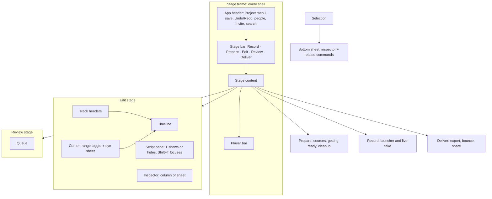
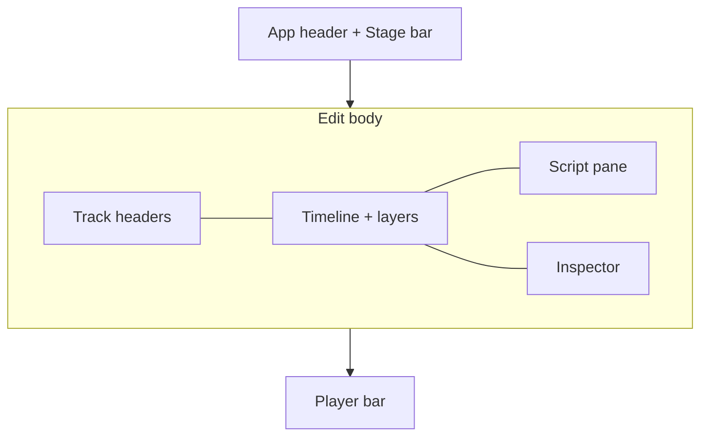
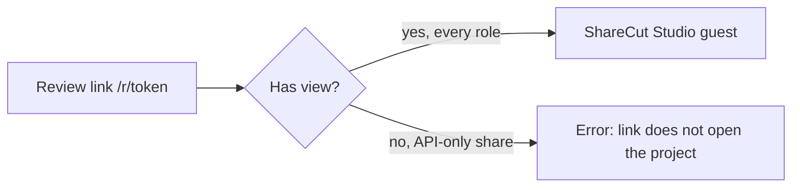

# Screen inventory — ShareCut Studio

Per-surface **display schemas**: what regions exist, what data they show, empty/loading states, and what’s out of scope. Pair with [Domain glossary](#/glossary) for field definitions.

**Breakpoints:** phone &lt;768 · tablet 768–1180 · desktop &gt;1180. Spec: [docs/gui-mobile.md](https://github.com/calebn/sharecut-studio/blob/main/docs/gui-mobile.md).

**Live reference:** [See the UI](#/demo) — screenshots + [`sharecut_ux_demo`](https://github.com/calebn/sharecut-studio/tree/main/tests/fixtures/sharecut_ux_demo) fixture.

---

## Host home (no project)

| | |
|--|--|
| **Purpose** | Start a new episode (Import audio or Record) or reopen a recent one on the host |
| **Primary actions** | **Import audio** · **Record** · recent episode cards (**Find…** when a folder moved) · **Open other…** (OS folder picker via the local engine, or a path field) · **Connect agent…** · **Models** · **Help** (create and preview a sanitized diagnostics zip; optionally submit a public report after consent, or open a prefilled GitHub issue and attach the local zip; local **Creating…** busy, not StatusBar) |
| **Data shown** | Recent episodes (name, length, last edited, the stage they open to); a path to the episode folder (Open other, browsers without a folder picker) |
| **Pinned project** | Opening `/` while a project is pinned goes straight to that project; `/?home=1` (recovery page “Choose a different project…”, Studio **New project**) shows home. Only New project unpins (a reload of `/` returns to the open project, keeping the desktop close-guard marker); if the unpin fails or takes over 10 s, Studio stays open, says so in the status line, and best-effort re-pins the open project (the server may still finish the stalled unpin late). New and Open are refused while this browser tab is recording, in a plain browser as well as the desktop app. |
| **Empty / error** | Missing OS dialog tool → keep paste field + alert; wrong filename → server error |
| **Out of scope** | Guests / share tokens; uploading project JSON as a browser File |

---

## Help report flow (Home and Studio host)

Help creates a local diagnostics ZIP, then shows its path, size, file list, and
app version before any upload. The user writes a description and, when a report
relay is configured, explicitly accepts that the description and ZIP become
public. The ZIP link lasts 30 days. Submit shows queued status, then the
published issue link and completed message when available. A submitted bundle cannot be submitted
again; creating another bundle clears the prior publication link. An uncertain
publication asks the user to check status later, and a failed publication
directs them to the local ZIP and support. Late responses from a closed or
replaced Help dialog do not restore the prior report. Open support pre-fills the GitHub bug form
with the description and version for the self-hosted/manual path; the user
attaches the local ZIP there. Guests never see these controls.

## Information architecture



The Deliver stage saves chapter edits and clip trims and removals to the project as they happen; a trim on the waveform is one save when the drag or the arrow presses end, while dragging or arrowing a chapter time or a clip In or Out field saves each step, and text typed in those fields is saved when you leave the field or the stage. A change that cannot send yet stays on the page under "Not saved yet"; one the project refuses, now or when it sends later, stays under "Could not save your changes", with a button to show the saved version. A removed clip cannot be brought back from the toast. Clip titles and approvals cannot be edited here, because the project has no command to save them; a clip shows the title and approval the project holds. Export runs on this page; there is no Export dialog. The Episode file section lists the formats the project's Pipeline settings offer (MP3, M4A, FLAC), with the ones already configured on, and says the WAV master is always written when the Pipeline tab keeps it on; it says "Loading export settings…" the first time they load and holds Export meanwhile (a later visit reloads them quietly; `Mod+Shift+E` waits for that reload), and if they cannot be loaded it says so and exports with the project's saved formats. The loudness target is one sentence ("Mastered to X LUFS, peaks under Y dBTP. Change the target in the Pipeline tab."), not a choice. The Range choice, the "Saves to" line and Reveal or Download are left out, because nothing in the project backs them. Export, the Export button and `Mod+Shift+E` (from any stage) start the real export job with the formats chosen on the page; Export is greyed with its reason in text when the command is unavailable or edits are still saving. While it runs the section shows "Exporting" with the job's step progress, elapsed time and Cancel (greyed with its reason until the job has started); leaving Deliver does not stop it, and coming back shows its progress or outcome. When it ends the section says "Exported" with the number of files written and the loudness the master measured and lists the files, or "Export failed" with the cause and Try again, or "Export cancelled" (listing any files a late cancel could not stop) with Export again. A missing model is asked for inside the page, with Download and Not now; the prompt scrolls into view and takes focus. The finished export turns to "Edited since export" when the formats, chapters, clips, the master loudness target or the project's history change after it. Export again and Try again export what the page shows now, not what the failed attempt asked for. The old dialog's Done button, the full file paths, the close-window hint and the "files are replaced only once every file is written" lead are gone: the section lists file names and says they are in export/. `Mod+Shift+E` while an export runs does nothing and says nothing; the section already shows the running export. The page does not know about exports from an earlier session, so until the first export of a session it shows no export status.

On a phone the Stage bar is the bottom tab bar, Edit shows one of Timeline or Script at a time, and the people slot shows one avatar plus a count. A Commenter share link is Review alone, with no Stage bar.

---

## Shared: App header, Stage bar and Player bar

The transport bar, status bar, Menu, View menu and bottom dock tabs of earlier releases were replaced by one frame (#2292). Each of their items has a home below.

| | |
|--|--|
| **Purpose** | Move between stages, run the one transport, and reach project-level actions |
| **App header** | Project menu (project title dropdown: Rename project (hosts; opens a name card under the title, Enter applies, Esc cancels), All projects, Settings, Connect agent, Help, Appearance System/Light/Dark; no disabled rows. New project is `Mod+N` and the palette; Open… is on Home and in the palette) · save indicator · Undo/Redo · people (avatar stack; phone: one avatar plus a count; follow/unfollow) · Invite (hosts) · search (opens the command palette, also `?`; its Gestures link opens the gestures sheet) |
| **Stage bar** | Record, Prepare, Edit, Review, Deliver on `Mod+1` to `Mod+5`; badges: Review comment count, the Record tab (nothing when idle, a count of people waiting, a red dot with the take clock during a take, **Paused**, a progress ring while saving, an amber dot for an alert, and **Reconnecting** when the host's socket drops mid-take), Prepare running or needs you, Deliver ready. Centered in the header on desktop and tablet, a bottom tab bar on a phone |
| **Player bar** | Play/Pause, Stop, time and edited length, **Hear original** (press and hold, or right-click, for Full mix · Without mix processing · Original; guests get the mix only), mix ring (**Mix out of date**, **Updating mix…** or **No mix yet**; `render.refreshMix` is in the palette and Deliver; Mod+B updates now), Solo chip, comment at the playhead. Phone: swipe up for the expanded Player with ±15 s skips |
| **Edit corner** | Range arm (touch only; there are no tool modes, Split is Mod+K or Alt-click with a mouse, and the touch Split verb arrives with the action bar), Fit, Zoom out/in, Script toggle, and the eye (View options) opening the eye sheet: layers (Pending edits, Volume envelope, Markers, Comments, Silence shading, Snap points, host-only Prosody), Waveform scale, Waveform amplitude, Track height, Fit tracks to window height. **+** under the last track: Import audio, Empty track, Add chapter (host), Record here (host; opens Record with an Insert at the playhead target) |
| **Record from Edit** | On the host, the Action bar's Record verb reads **Re-record** over words or a range that covers a span on a track and ends inside the timeline, and **Record here** on the playhead. It opens the Record stage with the session target set to Replace that selection or Insert at the playhead (shown in the target chip; over selected words, the words show under it as a script line to read). The Plus menu's Record here does the same Insert (on an empty timeline it opens Record with its default target). Nothing is sent until the room is open with no take yet; if the session is already past that point, the parked target is dropped and the session keeps the target it has. |
| **End session** | The Record stage's More sheet has **End session** (host). It stays disabled, with the reason beside it, until a running take is stopped and every take is saved and landed on the timeline. Pressing it shows “Ending this session in 10 seconds. Guest links stop working when it ends.” with **Undo**; the links are revoked only when the 10 s pass, so Undo changes nothing. Leaving Record inside the window still ends the room. |
| **Old homes** | Bounce… → Deliver and `Mod+Shift+B` · Export deliverables… → Deliver (`Mod+Shift+E`) · Share… → Invite and Deliver → Share for review · Record room… → Record · Import audio, New track → Prepare and the **+** menu · Add chapter at playhead → the **+** menu (host) and the palette · Select a range → drag an empty lane or arm Range · Audition → Hear original menu · Mix status → mix ring · Presence, People → header avatars · Theme → Project menu → Appearance · Layouts → `T` and `Shift+T` · Commands and shortcuts → search |
| **Data shown** | Playhead (timeline sec) · duration · hear mode · optional stale-render note |
| **Empty / error** | Known `?project=` but shell not yet: the frame with skeleton content, **Loading episode…**, Play/Stop focusable and showing “Loading project…”. Zero tracks after load: ingest “Drop audio files” (not the loading well), and Play/Stop show “Import audio to play.” |
| **Out of scope** | Full mixer; a free-form pipeline editor (Prepare keeps only a short Advanced step list) |

Menu panels (the Project menu, the hear menu) open below their trigger, flip above it when that side has more room, stay inside the visible screen on every shell, cap to the space on that side (`min(90dvh, var(--menu-available-height))`) and scroll so **Appearance** stays reachable on short laptop heights, including when guest/follow banners sit above the transport. That dialog searches every runnable command by name, category or shortcut (Enter runs the top match), disables a command that cannot run with its reason beside it, and explains that character keys apply when the timeline or transcript has focus.

```
┌─ Project ▾  ●  ↶ ↷ │ Record Prepare Edit Review Deliver │ ◉◉ + 🔍 ┐
│ stage content                                                    │
├─ ▶  12:34 / 58:39      Hear original   mix ring ───────────────┤
```

Bounce is a section of the Deliver stage, below Episode file, not a dialog.
It writes a quick mix to `export/bounces/` without mastering or captions.
Source is a choice of Entire mix, Selected tracks (n) or Soloed tracks (n); a
source with no tracks greys Bounce and says "Select one or more tracks first."
or "Solo one or more tracks first." Two toggles follow: Limit to session region
(greyed with "No session region set." when there is none) and Also write MP3.
A range chosen in Edit (Range actions → Bounce) is shown as "Selected range · …
This selection is fixed for this bounce." in place of the Source choice and the
region toggle, with "Bounce the whole mix instead" to let it go. `Mod+Shift+B`,
the palette and Range actions go to Deliver and put focus on Bounce; they never
start a bounce. While it runs the section shows "Bouncing" with the job's step
progress, elapsed time and Cancel (greyed with its reason until the job has
started); leaving Deliver does not stop it. It ends with "Bounced" and the file
names, "Bounce failed" with the cause and Try again, or "Bounce cancelled"
(listing any files a late cancel could not stop) with Bounce again. A missing
model is asked for inside the section. A project switch stops following the
job and returns the section to its choices. A range from Edit stays until it is
bounced or let go. Storybook: `Stages/Deliver/Bounce`.

---

## Podcast listing (Deliver section)

The Podcast listing shows the episode as a podcast app will show it, read from the feed service. Clicking a value edits it in place (Enter saves, Esc cancels) and it shows **Edited** at once; a value the service refuses goes back to the saved one with the reason in plain words under a banner, naming the field by its label (for example "hosting address must be an https address"). A setting the listing does not show in place is asked for in a small form that uses the field's label and a Yes/No choice for yes-or-no settings. **Write feed file** appears only when the file on disk is out of date. If the listing cannot be read it says "Could not load the listing" with **Try again**.

**Who sees what.** The host edits everything and also sets up or chooses the show. An Editor link opens Deliver with this listing alone, edits episode and plain show values and writes the file; the show, the show's hosting address template and local artwork read "Only the host can change this.", and the values an Editor wrote carry a **Guest** mark. A Viewer or Commenter link has no Deliver stage; the read-only listing ("This link can read the listing but not change it.") exists for links that may read it.

## Host: Share (Deliver section)

| | |
|--|--|
| **Purpose** | Manage public review links and record-room guest / producer invites for the open episode |
| **Open** | Header **Invite**, Project → Share… and the Record stage's Invite all go to Deliver's Share section (`share.manage`; collaboration extension slot `share.ui.menu`) |
| **Primary actions** | Role radios under **Anyone with the link** (Viewer / Commenter / Editor, each with a one-line description; default Commenter) · **Allow AI assistants (MCP)** with its consequence note (“Paste into an MCP client such as Claude or ChatGPT. The assistant gets this link's permissions.”) · **Create review link** (pinned footer) · **Create record links** · per review link **Copy link**, **Copy MCP URL** and **Stop sharing** · Copy guest / producer links · Replace a closed record invite · per room **Open Record stage** and **End room** |
| **Data shown** | Online sharing line at the top (when the `tunnel.status` feature is present): “Guests can open your links”, “Connecting…”, “Reconnecting… guests may see a brief interruption” with a “Trying again in N s” countdown (a still clock time under reduced motion), “Not reachable online: guests can't open links until you're back online” with a **How to fix** disclosure and guide link, or “Online sharing is off” with **How to turn it on**; no line on a local-only host; each review link named by its role (“Commenter link”) with its review mix label, “AI assistants allowed” when it has an MCP URL, when it was created and last opened, a host-chosen expiry only if one was set on the CLI or MCP, and its coolname as the address; each record room with its guest and producer links and invite closure state |
| **Empty / error** | Quiet “No review links yet.” / “No record rooms yet.” text (no field-like box), with **Create record links** under the rooms. Create publishes a **Share mix** review version if none exists (needs premix/mastered). A project with no mix yet says “This project has no mix yet. Refresh the mix to create the link.” and a stale preview gets a friendly alert; both show **Refresh mix**, and after a successful render, Create retries once. A stale master explains that a new master is needed and does not offer preview refresh. |
| **Out of scope** | Restricted ACL; expiry picker (links never expire until the host stops sharing; `expires_at` stays on the CLI and MCP); in-place review-role edit (rotate = new link + stop old); guest share-token MCP UI |

The section sits in the Deliver page body. **Create review link**, a **Copy link** for the link just created and the status line (“Review link created and copied”) sit together at the top of the section, and the page scrolls to the **Record rooms** below. On phones it is part of the same page above the sticky Export bar.

**Stop sharing** and **End room** trail their row, apart from the copy actions, and confirm in place: the row swaps its actions for the consequence (“Stop sharing this Commenter link? Anyone using it loses access.” / “End this record room? Both guest and producer links will stop working.”) with **Keep link** / **Keep room** first and focused, and the danger action last. Escape keeps the link or room (the same as **Keep**). Each record room has one room-level row: **Open Record stage**, then **End room**.

When a participant is removed, the Record stage directs the host to **Copy
links…**. Share marks the affected role's invite closed to new guests, disables
copying its old link, and offers a same-room, same-role replacement. Existing
leases remain valid. Guests never see this section (`canManageProjects` is false
on `share:{token}`).

Storybook `Stages/Deliver/Share` previews the props-only `ShareSection` with fictional links. The section holds:
the role, MCP and Freeze choices, **Create review link**, the live links with
**Copy**, **Copy MCP URL** and **Stop sharing** (confirmed in place), the online
sharing line, and record rooms. The link is made and copied from the click on
Create; if the browser refuses the copy, the row reads “Press Ctrl C” with the
whole link selected.

---

## Host: Connect agent dialog

| | |
|--|--|
| **Purpose** | Copy the local Streamable HTTP MCP URL so Cursor/Claude talk to the running DAW |
| **Open** | Project menu → **Connect agent…** (`mcp.connect`); home **Connect agent…** |
| **Primary actions** | **Copy URL** (`http://127.0.0.1:8765/mcp`) · **Copy snippet** (Cursor `mcpServers` JSON) |
| **Data shown** | Loopback MCP URL; client snippet; reminder to keep ShareCut Studio running |
| **Empty / error** | No episode open: URL still copies, tools error until a project is open |
| **Out of scope** | Writing `~/.cursor/mcp.json`; PATH-installing `podcast-mcp`; guest share-token MCP (that stays on Share…) |

Not the Share section. Guest share agents use `{base}/mcp/{token}/mcp`.

---

## Shared: Selection → Inspector / Bottom sheet

| | |
|--|--|
| **Purpose** | Modifier for whatever is selected (pending cut, clip fade, track FX, word, …) |
| **Primary actions** | Approve / Reject / Restore · Play around · param edits · Close |
| **Data shown** | Type badge · label · agent reason · source + timeline ranges · shape-specific params |
| **Phone** | Ordinary modifier sheets use half or full height. Heading, actions, fields, errors, related commands, and audition footer scroll together. Scroll to the top for Close, Expand, and Collapse. Ordinary modifiers use a taller half height. The compact inspector uses peek, half, and full heights with its header pinned outside one bounded body scroller. Feedback and fields scroll in that body. Sheets never stack. |
| **Tablet** | Ordinary sheets dock above the tabs band when the tabs are visible and scroll as on phone. Maximize timeline hides the tabs and docks the sheet above the status row. The compact inspector docks above the status row and keeps its header pinned outside the body scroller. |
| **Desktop** | Side inspector pane |
| **Empty** | “Select a clip, edit, or word” |
| **Out of scope** | Deep nested wizards; one panel per MCP tool name |

A fade gesture based on values changed by Undo or another editor saves nothing.
The current project shows "This clip changed. Nothing was saved. Adjust the fade
again." Repeat the gesture against the restored values. The inspector shows the
error inline; timeline handles and phone nudges show the same recovery in a toast.

---

## Phone — Review (the old Listen)

| | |
|--|--|
| **Purpose** | Guest-style review: play the mix, scan comments, jump from badges |
| **Primary actions** | Player scrub and ±15s · type a comment and post it · open comment · tap a Stage bar badge |
| **Always visible** | App header · Review (the host reads comments in the Queue and presses **C** to comment; a guest reads the same Queue, comments only, with the field for a Commenter) · Player bar · the five-tab Stage bar (none for a Commenter link). A comment field with the **at 0:12** chip and a **Post** send arrow |
| **Data shown** | Mix playhead · `review.comments[]` (time, body, resolved) · pending/stale badges |
| **Empty** | “No comments yet.” (the shared quiet empty state). With no tracks yet and no playback to finish, Play and Stop are unavailable (“Import audio to play.”). If the final track disappears during playback, Pause remains available |
| **Out of scope** | Multitrack waveform editing |

```
┌─ Project ▾   ●   ↶ ↷        ◉ +2 ┐
│ Comments                            │
│ ● 04:12  “level feels low”          │
│ ○ 11:02  “cut cold open?”           │
├─────────────────────────────────────┤
│ [Add a comment                    ] │
│ [at 12:34]                   [↑]    │
├─ ▶ 12:34   Hear original ───────────┤
├─ Record │ Prepare │ Edit │ Review │ Deliver ─┤
```

Hear original’s menu (Full mix / Without mix processing / Original) is on every stage; Review keeps its controls focused on playback and comments.

---

## Phone — Edit: Timeline

| | |
|--|--|
| **Purpose** | Spatial seek/edit with **a playhead that starts at 0**; drag timeline to scrub. The timeline loads with time 0 right after the track headers and the line on it, with no gap. The line shows the transport time at its place in the view, from 0 to the end even at Fit, with overlay or classic scrollbars: playback moves it right until it reaches the center and then holds it there while the timeline scrolls. Margins before 0 and after the end give a scrub the room to reach either end, and switching Listen → Timeline, fitting, or zooming from the menu or keys never moves the time. Pinch zooms anywhere on the timeline except the lane rail, and scrubbing stops at the session end: zoomed out below Fit, the lanes and ruler end there and the margin shows beyond it. |
| **Primary actions** | Scrub · Fit · layer chips · select clip/edit → sheet · drag clip · tap lane gutter → track sheet |
| **Always visible** | Player bar (comment at the playhead) · corner (Range, Fit) · eye sheet ·  sticky lane gutter (44pt lane-colored initials chip per lane, lane-colored edge, compact playback meter and clearable clip light) + waveforms whose clip labels lead with speaker or track identity and a readable duration · mode nav |
| **Data shown** | `timeline.tracks` · `timeline.clips` rectangles · overlay layers (edits/levels/markers/comments) |
| **Empty** | Loading episode: skeleton lanes in the same header/gutter grid. No tracks after load → ghost drop lane + dismissible coach (“one file per speaker”, and “One recording of everyone? Import it, then choose Split speakers.”); tracks with no clips → empty lane until Import/Replace |
| **Out of scope** | Desktop moving-playhead metaphor; dense mixer strip on narrow panes; disconnected chip strip above lanes; full-page upload card |

```
┌─ header ─────────────  [👁] ────────┐
│ Pending edits  Volume envelope  Markers  Comments │
│ ref │░░░░│░░░░░│░░░░░░░░░░░░░░░░   │
│ gue │░░░░│░░░░░░░░│░░░░░▼░░░░░░░   │  ← Ferrite gutter + CapCut ▼
│ [Range]  [Fit][−][+][👁]         │  ← corner (Undo/Redo are in the header)
├─ ▶ 12:34   Hear original ────────────┤
├─ Record │ Prepare │ Edit │ Review │ Deliver ─┤
│ ┌ sheet: track / Pending cut ── X ┐ │
│ │ Track: M/S/Volume + Track actions │ │
│ │ Clip: paired fades / transition │ │
│ │ Pending: Snap to silence + review │ │
│ └────────────────────────────────┘ │
```

Elapsed timers and clipping-report ranges switch to h:mm:ss from one hour. Recorded takes show mic clipping (sample peak) as red flags in a `clipping` marker row (one per span per track, labelled with the track; tap to select the track and seek) and a red tint on the clipped span of the clip. When the encoder hit its region cap, the clip's last flag says later clipping was not recorded. Up to 100 flags are kept per recording; a dense burst after that lengthens the last flag instead of adding one.

Lane identity is a slim sticky gutter in the same scroller as the waveforms. Tap the gutter row (› disclosure) → track sheet with **M**/**S** and the **Volume** fader (saved; host and editors; envelopes on Volume envelope). Solid M = muted in the mix; dashed = only you hear it that way (a guest's listen-only mute, or a track your solo silences). Unheard tracks go grey: row, lane, initials chip fill, clips and waveform; the chip and identity stripe are dashed when only you hear it that way. While any track is soloed, **Solo on · Clear solo** shows in the status row above every mode. Pane density uses `@container timeline` (gutter vs mid/full rail) — not viewport width alone.

---

## Phone — Edit: Script

| | |
|--|--|
| **Purpose** | Read/fix transcript; seek by word; suggest cut-away |
| **Primary actions** | Follow playhead · Correct / Select modes (hint states text-only vs audio) · double-click word or focus word + F2 → inline fix (one at a time; a pending save finishes first and the mode hint says it is saving; a late failure shows under the hint with Dismiss) · tap word → sheet · suppress / correct / ignore (Ignore strikes through and mutes at render, no cut; Restore brings it back — always visible under touch, no hover needed) · Annotate → Previous / Next low-confidence word (wraps) |
| **Data shown** | Speaker labels · `transcripts` words (text, confidence, suppressed, ignored, suspect_hallucination) · selection range |
| **Empty / loading** | No transcript yet · low-confidence chips when present |
| **Out of scope** | The Review queue and Prepare (their own stages) |

Follow playhead keeps overlapping speakers highlighted in transcript order.
Backward seeks update the active words through the same time-indexed lookup.

Annotate boundary handles keep a fixed size during a roll or trim. A floating
preview shows the time change, restored-word side, and legal limits. The glyph
follows the pointer; hold Shift for fine motion of 1 ms per CSS pixel without
jumping when Shift changes. Escape or an interrupted gesture discards the
preview. Saving blocks another drag on that handle; a failed save displays an
error. Tap or use Enter/Space to open the host precision dialog for a signed
offset, 10 ms or 1 ms nudges, and separate current/proposed affected-track audio.
It distinguishes fully restored words from partial spans, keeps an unchanged or
cancelled draft out of history, and reports an offline Apply as queued. A load
that gets no answer says "The server didn't answer. Try again.", saves
nothing, and offers **Try again** to load the controls in place. Network load
failures also offer **Try again**. Retry and **Reload boundary** keep focus in
the dialog, on progress and then the boundary control. New ripple cuts retain the removed source words for boundary previews. Expanding far
enough to restore a complete word brings its text and suppression choices back
with the audio. Partial words remain archived. Existing older cuts without a
word archive require History recovery.

When neighboring clips have a gap above the existing 50 ms abutment tolerance,
the mark explains that this pair has no roll seam and identifies the left
clip's end trim. The host precision dialog repeats that reason before its
controls. Gaps within the tolerance and overlaps continue to roll.

Timeline and transcript join rolls use the same recording limits. Rolling later
stops at the left recording's end; an unknown duration allows no later expansion.
Outer neighbors constrain the drag only when they play the right recording, so
an unrelated take does not shorten the preview. Releasing saves the previewed
offset after a fresh check that the join still matches.

Keyboard word actions: in Navigate mode, Enter on a focused timed word seeks
through its native button action. F2 opens inline correction for a hydrated
host project. F2 does nothing in Correct or Select mode, on guest shares, or
while a correction is saving. Enter retains the native Correct/Select word
action in those modes; Enter in the inline editor saves and Escape cancels.

```
┌─ header      Follow · Edit ────────┐
│ HOST                                 │
│ so we ┌were┐ talking about …         │
│ GUEST                                │
│ yeah and the ┌launch┐ …              │
├─ ▶ 12:34   Hear original ────────────┤
├─ Record │ Prepare │ Edit │ Review │ Deliver ─┤
```

---

## Phone — Mix

The Mix button on the Edit stage opens a full-height sheet for all roles. Each ordered row has lane
initials, a track name, M, S, and Volume. Hosts and editors save M and Volume;
listeners use local M and see why Volume is read-only. S is always local.
Shared playback uses Full mix, so local listen controls may not be audible.
Close or Escape returns to the Mix button; navigation or a new inspection closes Mix.
The sheet scrolls above the Player bar and tab bar, with 44px controls and growing rows
under text scaling. Swipe-to-mix is deferred.

## Phone — where the More hub went

The More hub was removed. Its destinations:

| Old destination | Now | Source |
|-----------------|-----|--------|
| Mix | Mix button on Edit: full-height track sheet; saved Volume/M and local S | Existing mix/listen state |
| Comments | Review → Comments: thread list / detail | `review.comments` |
| History | Edit → History sheet (right-click the header's Undo, or the palette): undo/redo · grouped steps (follows document snapshots) | `history` |
| Review queue | Review → Queue: pending suggestions decided one at a time or by group | `editorial.edit_decisions` |
| Pipeline | Prepare: Sources · Getting ready · Help the transcriber · Cleanup; Advanced steps behind a button | working-set config + live job |
| Commands and shortcuts | Header search | command catalog |
| Gestures | Commands and shortcuts → Gestures | static |
| Overlay legend | Eye sheet | static |

**Guest** (Commenter): Review alone, with Comments and the Overlay legend. History / Pipeline and the host queue stay host-only.

Long-lived panels are stages or sections; do not stack sheets to reach them.

---

## Tablet

| | |
|--|--|
| **Purpose** | Timeline-first with peek inspector; side inspector when wide enough |
| **Layout** | Header with the Stage bar · headers + timeline · Player bar. Ordinary modifier sheets dock above the Player bar and scroll their heading, actions, fields, errors, related commands, and audition footer together. Maximize timeline hides the tabs and docks the sheet above the status row. The compact inspector docks above the status row with a pinned header and one bounded body scroller for feedback and fields. |
| **Playhead** | Moving (desktop-like), not the phone playhead that holds the center once passed |
| **Out of scope** | Phone bottom tab bar as primary IA |

```
┌─ Header · Stage bar ────────────────────┐
│ Headers │ Timeline    ┌ peek inspector ┐│
├─────────┴─────────────┴────────────────┤
│ Player bar                             │
└────────────────────────────────────────┘
```

---

## Desktop — Edit stage



| Region | Content schema |
|--------|----------------|
| **Track headers** | Horizontal playback peak meter with a clearable clip light, retained after Pause/Stop; reduced motion freezes its bar while clip detection continues. Identity bar in the lane color · track name · stem status icon (trailing; check = up to date, refresh = stale, both with an accessible name) · M/S named "Mute/Solo `<track>`" (M solid = saved mix mute, dashed = only you; S listen-only, lit as an amber tint with dark amber text that keeps 4.5:1 over every row paint, light and dark; a track your solo silences goes grey (row, lane, clips, waveform) with a dashed identity stripe, and **Solo on · Clear solo** shows in the corner above the headers, at the ruler row) · FX badge · subtitle (role and speaker, each dropped when it repeats the name) · **Out** text readout (output gain: staging + volume + the volume envelope at the playhead, so it moves while you play or drag the playhead; silence reads −∞ dB; the phone rail hides it, and the phone Mix sheet shows **Plays at {dB}** over the fader of a track with a volume envelope); content is top-aligned, selected = neutral chip. Space/Enter on any header button (open, reorder handle, M, S, clip clear) activate that button rather than the window shortcut (play / tighten hit); Mod/Alt chords still reach the shortcut. |
| **Timeline** | Clips · body-drag move · fades/joins (fades draw as ramps over the waveform; the fade handle sits at the clip's top corner, slides inward and shows a live ms readout while dragged; trim strips on the clip edges and a zero-length fade's corner show on hover (mouse or trackpad), keyboard focus or selection; a click on a handle only selects; a trim ripples, and its drag shows that: the grabbed edge follows the pointer, a **Ripple** mark (a wave) reads "later −0.4 s", a trimmed start outlines where the clip lands, and arrows on an edited or moving-peer lane show each whole follower moving, including clips that already overlap the anchor; lanes without a moving edge show the shifted pieces left by the time splice, and the other lanes dim the span they lose; the clips slide there after save; a trim that would newly move a follower before the timeline starts is refused, keeps the last valid preview and arrows, and shows an error; drag, keyboard and strip nudge release save only the last valid value; if the project or its authoritative document changes during a held strip nudge, repeats stop, release leaves the new project in place, and the release click cannot start another nudge; a comment, metadata or other edit publication during a held strip nudge immediately removes its detachable unsaved preview while retaining the update and pending moves, including original split or deleted clip material; an unchanged pending mix leaves the hold active; a drag past the source's end stops with a bump and a note; a grab at a join rolls it; a small edit marker at the top of each join shows its type at any zoom (\| cut, ╲╱ fade, ✕ crossfade, each in its own hue), and the marker shrinks to a small tag as a crossfade draws wider and shows a label like "Crossfade 120 ms" at high zoom when it fits; joins closer than 24 px fold into a count that zooms in on tap; click a marker for a popover to switch Cut / Fade / Crossfade, edit Length and audition the join; drag the lower seam line to roll its boundary; a blending crossfade also draws a centered overlap X, with a connected endpoint grip in a reserved row below the timeline lanes; dragging saves both participating fades in one Undo step) · layer overlays · moving playhead · pinch/ctrl-wheel zoom (under the pointer; keyboard/menu zoom anchors on a visible playhead). Lanes grow to fill the stage when every track fits (72–240px, with a 104px minimum for coarse pointers) and scroll beyond that; the marker lane shows only rows with content (chapters, social, comments) and collapses to one 24px row when empty; chapter diamonds show their title, truncated before the next chapter (full title on hover) |
| **Inspector** | Track selection adds the mixer group and, with edit access, **Track actions → Smooth all joins** (applies the recommended fade at every join), and for the host **Split speakers…** beside **Replace audio…** (one recording of several people → one track per speaker: it opens Prepare at that source's split prompt, where the recording's card asks how many voices (2 to 8) and splits in place with progress and **Cancel**; each new voice is named after hearing it, and a toast offers **Undo**; if speaker recognition or its model is missing the card says so and offers the download; the action stays disabled after an edit or when the track has no audio): M/S and the saved **Volume** fader (−60 to +12 dB; double-click or **Reset** sets 0 dB; read-only without edit, with the reason shown). A clip has editable numeric **Source start** and **Source end** fields with one Apply per boundary, plus 10 ms and 100 ms nudges that respect the current source, minimum-span and neighbor limits. Pending source boundaries have 10 ms and 100 ms nudge buttons. A selected saved envelope point has 10 ms and 100 ms time nudges and ±0.5 dB level nudges. Each accepted change is one undoable edit. At an exact zero envelope level, +0.5 dB starts from the existing −60 dB floor; −0.5 dB stays at zero. Positive levels below −60 dB keep their multiplicative steps. A clip also has paired **Fade in / Fade out** sliders that preview together and commit once on release, relevant key release, or ordinary blur; each edge clamps to the track cap, clip length and remaining room at the opposite edge. **Incoming transition** describes the join from the previous clip into this one (hidden on a track's first clip), with an optional length used once and cleared. Pending timing exposes **Snap to silence** separately from Approve. Re-checking it snaps the stored bounds once. Current and suggested source bounds show endpoint shifts and a signed duration change; **Use suggestion** accepts the displayed range after typed timing is applied. Clip headings name the speaker and timeline bounds, with the ID once in details and destructive actions after editing controls. Selection modifier (same shapes as sheet): eyebrow badge, title, subtitle only when it differs, full-width fields, one section gap; the body scrolls with edge shadows · footers: **Seek** / **Play around** icon buttons (track: **Go to start** / **Preview effects at track start**); stem **Up to date / Out of date**; effect params as readable text |
| **Comments** (Review queue items) | Comment rows in the Queue (open ones undecided, resolved ones under Decided) · thread on the card · timeline seek · action items · replies · a **Your name** field in the comment field (defaults to the session display name; a guest's typed name is kept) |
| **History** (Edit sheet) | Groups · Undo/Redo · step count (“No edits yet” when empty) · diff affordances (a step that leaves the list clears its selection and diff); lists of 200+ steps render only the visible window (selected and focused steps stay mounted); list updates from Applied snapshots (SHELL project, or DETAIL/TRACKS/CLIPS/FX/ENVELOPES/MIX/COMMENTS patches) |
| **Review queue** | Pending count · group verbs (Cut all, Keep all), each asking first with the pending-edit and track counts (and how many are flagged risky), shows "Approving N edits…" in place (with elapsed time once it passes 2 s) while it runs, then answers with a toast Undo ("Applied N, held M" when blocked cuts stay pending, each named with its reason) |
| **Review Queue** (Tighten proposals) | Fillers, Pauses, Repeats, False starts and Sounds groups · per-item Cut / Keep / Lower · **Cut all N** per group with one Undo, shown as **Cutting N…** (indeterminate, elapsed time after two seconds) while it runs · **Find more** (host only; re-runs the proposal at Prepare's How tight, asks first when undecided hits would be replaced, asks to download a missing model) with a **Finding more suggestions** job row. |
| **Prepare** | Host-only stage with five parts. **Sources**: a card per imported file or session, with a drop target (Import audio, drop files anywhere) and, for one recording of several people, a split prompt (voice count, progress, name each voice, Undo toast); dropping files starts the run once the import finishes. **Getting ready**: one row per step with its state (done, running, needs you), a missing model shown as a **Get** row with byte progress and Retry; on a phone this summary comes first and opens like a disclosure. **Help the transcriber**: Terms and guest names, with **Re-transcribe** when the list changed. **Cleanup**: **How tight** (Light, Medium, Tight) and **Loudness** (Podcast −16, Broadcast −23, Streaming −14 LUFS), applied on the next run. **Advanced** opens the step list (switches for optional steps, a step's settings, Reset, Back to steps, Run from here); nothing changes while a step runs. One hand-off button goes on to the next stage: secondary, and open whenever nothing is running (also while a step needs you or failed), carrying the reason "Still getting ready" only while files are being added or the run is working; it becomes the primary button once everything is done. Cancel for a running job lives in **Advanced** only. SSE progress feeds the live headline |
| **Script** | Follow/edit (`T` shows or hides it, `Shift+T` focuses it); Follow unlocks only on wheel / touch / scrollbar / scroll-key input. Long transcripts (≥200 turns) render only nearby turns plus the active, selected and focused ones — browser find-in-page reaches only rendered turns; Annotate → Previous / Next low-confidence walkthrough. With View › Layers **Prosody** on (host), prominent words from the prosody profile render bold with a top rule (no top rule where a strike or the suspect underline already marks the word; "emphasized" for screen readers); a stale profile still marks a word a re-alignment re-timed; the timeline's own Prosody layer briefly hides after a clip edit until the refetch lands, but transcript emphasis stays; a run started from a terminal (outside the app) is picked up by toggling the Prosody layer off and back on. On the timeline, non-fresh lane labels are plain text; a single sr-only status region announces a combined summary ("Prosody: no profile on 2 tracks") instead of one per lane. |
| **Status** (Stage bar badges and Player bar) | Actionable badges (**Presence: You + N guests**, **Cut m:ss of m:ss** (dialogue source vs dialogue timeline length), pending, **Edits in removed audio (N)** (pending edits whose span was cut away), **Render: fresh/stale** from the same state as the transport pill, **Transcript: needs sync** only when stale); chips only switch tabs (when the current layout does not show that tab, they restore the default layout first); overflow-x on narrow |

In the desktop transcript, Shift-click extends a range from the original word on the same track. Shift-click on another track selects that word and starts a new range. Mouse dragging ignores other tracks and resumes when the pointer returns to its starting track.

### Script (desktop/tablet)

| Command | Key | Effect |
|---------|-----|--------|
| Show or hide Script (`view.toggleScript`) | `T` | Hides the Script pane for more lane width, or brings it back |
| Script focus (`view.scriptFocus`) | `Shift+T` | Grows the Script pane and shrinks the timeline |
| Resize Script | Divider: drag, arrows, Home/End, Enter or double-click resets | Sets the pane width; saved as a browser preference |

The old layout presets (Restore layout, Maximize timeline, Maximize transcript, Review layout) and their `Mod+1` to `Mod+4` keys were removed; those keys now go to stages. Every stage keeps the header, Player bar and banner rows in place (geometry guard: `stage/frame/StageFrame.test.tsx`).

---

## Guest / share (`/r/{token}`)

Every review role (Viewer, Commenter, Editor) holds `view`, so every role opens ShareCut Studio guest. There is one guest surface for review links.



### Which surface?

| Share setup | Surface | What the guest sees |
|-------------|---------|---------------------|
| Viewer, Commenter (default) or Editor | **ShareCut Studio guest** | Stages gated by role (a Commenter link is Review alone). Mode **banner** at top. |
| Any capability set without `view` (API only, no role mints one) | **Error screen** | "This link does not open the project." with "Ask the person who shared it for a new link." beneath it in muted text. |

Step flows: [Guest journeys](#/journeys).

### Capability → plain language

| Cap | Guest can… |
|-----|------------|
| `play` | Hear the review mix or session audio in ShareCut Studio |
| `view` | Open ShareCut Studio guest (timeline, transcript, sanitized project) |
| `comment` | Leave time-anchored comments |
| `reply` | Reply in a comment thread |
| `action` | Check off comment action items |
| `suggest` | Commenter and Editor. Propose structural cuts (pending); nudge its own suggestions; **not** hard-apply |
| `edit` | Editor only. Approve/reject pending, fades/joins, FX bypass, apply structural cuts |
| `mcp` | Connect an **external** agent at `{base}/mcp/{token}/mcp` (host Share section copies the MCP URL when the host allowed AI assistants; **no guest in-app MCP connect UI**) |

### ShareCut Studio guest chrome (when `view` is granted)

| Banner string | Role (`guest_mode`) |
|---------------|--------------|
| *Shared edit view · You can add tracks and audio* | Editor (`edit`) |
| *Shared comment view · You can comment and suggest edits* | Commenter (`comment`) |
| *Shared read-only view* | Viewer (`view`; listen + inspect, not “no audio”) |

**Approve without the queue:** the host queue is **always host-only**. Editors approve/reject from Timeline overlay + inspector (the Review badge routes to Edit).

**Playback:** prefer **proxy media** (short MP3 listen chunks, often via CDN) so ordinary listen does not pull long host WAVs through the tunnel. Fallback to WAV when proxies are unavailable.

**AI assistants (`mcp`):** Hosts copy the MCP URL from Invite (or Deliver → Share for review) after creating the link with **Allow AI assistants (MCP)**. The assistant connects through an MCP client such as Claude or ChatGPT — not a guest Settings pane. Same role as the human on that share. Listen-first Suggested is HTTP (`guest_pending_preview` / `GET …/daw/pending-preview`), not host speakers.

---

## Guest / record (`/rec/{token}`) (Join sheet + full-quality recording + mix-minus + landing + live comments shipped)

Join sheet, consent, people tiles, status pill (live, paused, saving), full-quality recording on each
participant's device, mix-minus monitor, saving to the project, timeline
landing, and live comments ship.
Spec: [recording-session.md](../../docs/recording-session.md).
Journeys: [Guest journeys § 6–7](#/journeys).

| Surface | Who | What they see |
|---------|-----|----------------|
| **Join sheet** | Guest (recorded) | Over the shared room: name, microphone (Allow microphone, device picker, own level), storage check, headphones toggle, then **Join and record** (joining is consent; **Details** carries the notice). Wait for host Start. **Shipped (no screenshot yet).** |
| **Join sheet** | Producer | Name and **Join to listen**; listed as listening and not recorded; no mic, no consent. **Shipped (no screenshot yet).** |
| **Join sheet / room / Record stage** | Recorded guest and host | **Own** peak meter (sample peak only) with a clip indicator; a clipping badge on the own tile and the alert "You're clipping. Move back a little." during a take; the host's Takes tray jumps to the first clipped span once the take lands. Producers and the Full room Cover have none. |
| **Record room** | Guest | Status pill (`m:ss · Take N`, `Paused · m:ss`, `Saving · N%`, `Saved`); mute (silence in the full-quality recording + send stops); a tile per person; notes rail; "Recording in full quality on this device." and **Hearing the room.** as screen-reader lines; then host timeline clips. **Shipped (no screenshot yet).** |
| **Record stage** | Host | Start / Pause / Resume / Stop / **Land**; a status line per recorded participant and segment ("Saving to project…", then "Saved to project"). A saved file auto-lands its clips; Land retries. **Shipped (no screenshot yet).** |
| **Record room** | Producer | Same pill and tiles, listed as not recorded; mix-minus of recorded peers; no full-quality recording, no saving status. **Shipped (no screenshot yet).** |
| **Full room** | 5th recorded or 3rd producer | Cover "The room is full" with **Try again**; never `getUserMedia`. **Shipped (no screenshot yet).** |
| **Declined** | Guest who chose Not now | The room dims under "You're not being recorded." with **Join recording** (works while the room waits for a take); host may re-invite as producer. **Shipped (no screenshot yet).** |
| **Host offline** | Recorded guest | Alert "{Host} dropped. You're still recording on this device." The full-quality recording stays open. **Shipped with full-quality recording.** |
| **Native close confirmation** | Host or recorded guest in the desktop app | During REC, PAUSED, or finalizing, closing the native window asks for confirmation. Host copy warns that the session stops for everyone; guest copy warns about the guest's full-quality recording. This is local desktop protection and sends no remote close command. The macOS app menu and **Cmd+Q** use the confirmation path; Dock **Quit** and OS shutdown remain best-effort. |

Prefix `/rec/` with a review token opens the recording invalid-link cover: “This recording link is invalid or has ended. Ask the host for a new link.” A record token on `/r/` opens the review cover: “This link is invalid or has ended. Ask the host for a new link.”

---

## Cross-cutting states

| State | Where surfaced |
|-------|----------------|
| **Pending edits** | Host Review queue · chips · edit overlay · inspector (guests: Timeline/inspector, not the queue) |
| **Mix out of date** | Stage bar badge · Player bar mix ring (reads **Mix out of date**, or **No mix yet** when nothing is rendered; the host's mix rebuilds on its own and the pill reads **Updating mix…** meanwhile; Mod+B updates it now); the mix ring’s tooltip reads **Mix out of date** or **No mix yet** (**· Refresh** only on a share that refreshes by hand). On an edit share, Refresh mix starts a host job immediately; the guest waits on token-scoped status reads, then hears the refreshed mix or sees a failure. While another render holds the lock, a rerender request plays the previous render (the audio response carries `X-Sharecut-Render-Busy: 1`, which the Player bar does not read yet; the Mix out of date chip stays because the stem was not rebuilt). |
| **Transcript stale / reconcile** | Stage bar **Reconcile** badge · Script affordances |
| **Pipeline / activity running** | Prepare lists pipeline jobs in the summary. While bounce/export/`render_preview` occupy the shared pipeline-slot, Run is disabled and Cancel is in Prepare. The Prepare badge and Player status show the most recent live job (`status-pipeline` chrome: truncated headline, dim **stale “last update Ns ago”** companion, elapsed, pulse; phone chip ellipsizes overflow). Guests also see the chip in Review (non-interactive — Prepare is host-only). Non-pipeline kinds (`agent` from in-process host MCP, `bounce`, `export`, `render_preview`, guest remote MCP) use **Activity** copy; a count badge (“2 activities”) when more than one job is live. Chip/Listen open Prepare only for slot jobs; agent chips are not a navigation target. Instant tools never flash a chip. A host job that failed for a model that is not downloaded shows **Download {model}** beside the chip (status bar, phone Listen) and under Prepare's error; it opens the model prompt only when pressed, and a failed Refresh mix resumes once after it. |
| **Loading episode** | `?project=` known, shell not yet (HTTP or document WS): DAW grid/skeleton chrome (“Loading episode…”). Distinct from zero-track ingest coach. A shell load the server never answers (30 s) shows the banner “Could not load transcript and history. The server didn't answer.” with Retry, in every browser. When the episode is already open but a warm shell reload times out while the host is busy (for example a long Approve all), the same banner row shows a polite status line—“Still loading transcript and history. The server is still working. Retrying…”—without Retry until retries are exhausted; then the failure copy and Retry return. After shell, live edits update the visible document while compatible word chips remain hydrated |
| **Result toast** | Every status message (“Reordered track”, “Removed guest”, “Mix preview refreshed”, export results) shows as one toast, centred above the Player bar on desktop and tablet. On a phone it sits just above whatever is docked at the bottom (an open sheet, the Edit tool strip, the tab bar) and below the header; on a short phone it moves above the Player's Play button, never over it. On every screen size it stays off the comment field, the **Commenting as** line and the name field: it moves above or below them, and in a window too short for a free band it covers the content above them instead. A visible compact inspector places feedback first inside the same bounded body scroller as its fields, below the pinned header. The focused or just-pressed control keeps its place when feedback arrives. At large text sizes ordinary body scroll exposes feedback or a full native label separately; field focus reveals the control and its complete label below the pinned header when it fits. Compact half and full detents keep the same outer height with or without the card. Dismiss removes it without changing detent height or lane room. One card pauses expiry while clipped and retains its remaining visible time across floating and inspector hosts. Keeping every visible control clear remains a beta requirement; screen readers hear the same words, even when the same message repeats. **Undo** appears on every edit the toast reports (delete, cut, paste, trim, fade, chapter and envelope point add, track reorder and removal, Review cuts and keeps and Apply suggested actions) and disappears once anything else moves history; while an edit is still saving it says “Undo ready after save”, and a press waits for the save and runs only if the change is still the latest step (otherwise it says nothing was undone). Dismiss closes it; it closes after 8 s of unpaused visible time. Job progress stays on the job chip, presence joins on the avatars and the Needs attention summary on its banner, so they don't toast. **Resolved comment** uses the same toast, and its Undo reopens the comment. A failure reads in an error look that names what failed and the next step. A message about a gesture, such as an armed clip, leaves when the finger lifts or the mode changes. |
| **Confirm / ask dialog** | Actions that discard work ask first in the app's own dialog (a bottom sheet on phone): the question names the target, one line gives the consequence, **Keep** comes first and focused, the action comes last (red when it discards work). Remove track, replace a track's audio, Find hits again, Apply suggested actions, and replacing hand-edited transcripts use it. When the file picker is unavailable, Open project asks for the path in the same dialog, with the error under the field. Escape closes only the dialog: the Inspector or sheet behind it stays open, and focus returns to the button that asked. There are no browser pop-ups. |
| **Offline host (relay)** | Share/tunnel offline page |
| **Offline edit queue** | Host and guest edits wait offline and drain on reconnect; guest structural ops demote to propose. Pending drag and mixer values stay visible while peer edits arrive. Replaying an older queued value does not replace a newer pending value. |
| **Offline attention** | Host pending count and host/guest conflicts appear in **Needs attention**; conflicts are dismissible |
| **Presence** | Header **avatar stack** (follow/unfollow, each avatar titled "Follow `<name>`" / "Stop following `<name>`"); ghost cursors on timeline lanes and DAW chrome (`data-presence-anchor`); unresolved anchors hidden. Follow mirrors tab/transcript/audition/selection when capable. Header avatars (names in the tooltip; the phone shows one avatar plus a count, and tapping it opens the roster sheet). Follow banner is a dedicated shell row (guest Mix / host-only tab hints). Phone Review = listen-along; phone Timeline = colored center needle (not a copied zoom window). Follower count only; followers do not broadcast a lagging playhead. Guests never draw their own cursor. Remote playhead ghosts move between presence frames at the leader’s rate, hold when paused, and clamp to the session length. Follow corrects local audio drift on a timer. Leaders send playback updates once per second and immediately on play, pause, seek, or rate changes. Invalid positions are ignored. The server drops an invalid presence playhead and keeps the last good one. Roster names (tooltip, More → People, avatars) are cleaned on the server: control characters are dropped, names are capped at 40 characters, and a guest named "Host" shows as "Host (guest)". |

---

## Wireframe coverage checklist

Use this when auditing mocks:

- [ ] Header, Stage bar and Player bar fit on ≤720px width  
- [ ] Phone Review has no Fit control  
- [ ] Sheet Close + no stacking  
- [x] Player-first footer on every modifier (pending: Current / Suggested / A/B) 
- [ ] Guest capability chrome  
- [x] Record lobby / room / full / declined (`/rec/{token}`); full-quality recording + mix-minus shipped  
- [ ] Empty comments / no transcript / no pending  

### Transcript speaker editing

Speaker labels in the transcript open a name editor for hosts and shares with the `edit` capability. Enter a new name or choose an existing speaker, then select **Save speaker** or press Enter. The change applies to every turn on that track through the same `SetTrackMeta` command as the Track inspector. It preserves source audio, word timing, and track identity. **Cancel** or Escape discards the draft. History Undo restores the previous speaker. The adjacent timecode seeks the turn. Queued saves immediately update the visible speaker labels and announce that delivery is pending. Rejected saves restore the previous view only if the originating project and optimistic snapshot are still active.

### Transcript find and replace

Hosts can open **Find and replace** in the Transcript toolbar or command palette. On desktop and tablet, the palette action reveals Transcript when the editor panels are hidden, including after reload. The panels return at their previous height and stay visible on the next reload. The transcript layout stays in place when it already shows Transcript. Running the action again closes the form.

Enter a word or phrase and its replacement, choose **Match case** if needed, then select **Preview replacements**. Search matches whole word tokens, ignores surrounding punctuation for matching, and keeps existing edge punctuation unless the replacement explicitly supplies that edge. Case matching is off by default; replacement case is exactly what the host enters. Regular expressions and partial-word replacement are not supported.

The preview lists before/after text with track, source recording, and source-media time. It searches every stored source transcript, including cut-away text. Suppressed and ignored words are skipped and cannot bridge a phrase; the preview reports their count. Unchanged replacements do not create history. Preview rows load into the list in groups of 100; **Show more replacements** reveals the next group, while **Replace all** applies the complete counted set.

Equal word counts preserve each word's source timing and audibility flags. Different word counts use manual phrase correction's timing policy: replacement words share the original phrase's outer source span. The preview warns before applying this redistribution. Source audio, clip positions, and recording identities remain unchanged.

**Replace all** is one undoable history action. The server checks the complete source-keyed candidate set, exact words, timing, and flags under the project transaction before applying anything. A stale preview changes nothing and asks for a new preview. Queued commands keep their preview token and are checked again at replay; the form reports pending delivery. **Undo replacements** appears next to the result and is disabled after a newer view arrives; History remains available to review and undo changes.

Replacement tokens must each contain a letter or number; attach punctuation to the adjacent word. When word counts differ, an explicit audibility lock anywhere in the original phrase is preserved on every replacement word.

### Selected-word timing

In Correct mode, the host word inspector includes **Adjust timing**. It expands an inline raw-source waveform with start/end handles, source-second fields and bounded preview. The same inspector content is used by the responsive transcript editor. Drag release saves once; keyboard and numeric changes require **Apply timing**. **Undo timing** closes the draft and restores the stored boundaries. See the [Wordbar guide](https://github.com/calebn/sharecut-studio/blob/main/docs/daw-editing.md#wordbar-source-timing) for source identity, warnings and audio consequences.

### Realtime connection

Studio uses one host realtime connection for collaboration, document edits and recording.
Reconnect restores each plane from its initial state. Recording roster updates apply
before following connection signals, including when guests join between paints.

Timeline fade corners and trim strips support focused Left/Right nudges, Shift for larger steps, release or blur to save one undo step, and Escape to discard the preview. A held arrow stops at the playhead, a chapter or a neighbouring edge with a bump and a spoken note; a fresh press goes past it. On touch, a second finger on the timeline cancels any one-finger edit in progress without saving it, so a pinch only zooms.

Inspector trim release keeps its preview owned while saving. Other edits use
the clean geometry, and a returned document change retires the preview atomically.
