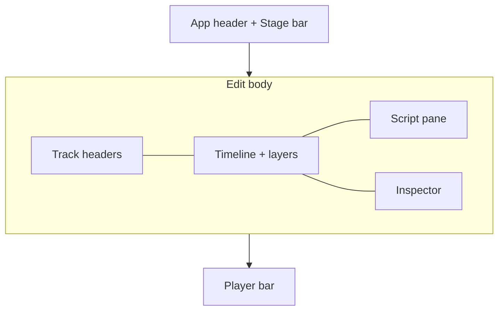

## Desktop — Edit stage

| Region | Content schema |
|--------|----------------|
| **Track headers** | `System/TrackHeader` per track (`stage/edit/TrackColumn.tsx`): avatar in the lane color whose ring shows the live playback level (frozen under reduced motion; a clipped track gets a warning ring and badge until the Track inspector's clip light is cleared, where the peak meter and Clear live) · track name · stem-out-of-date state (icon and tooltip) · M/S named "Mute/Solo `<track>`" (M solid = saved mix mute, dashed = only you; S listen-only, lit as an amber tint with dark amber text that keeps 4.5:1 over every row paint, light and dark; a track your solo silences goes grey (row, lane, clips, waveform) with a dashed identity stripe, and **Solo on · Clear solo** shows in the corner above the headers, at the ruler row) · saved volume (the Mix sheet shows **Plays at {dB}** over the fader of a track with a volume envelope); the phone rail is avatar-only (56px); selected = marked row. No touch drag to reorder: use Move up / Move down. Space/Enter on any header button (open, M, S, clip clear) activate that button rather than the window shortcut (play / tighten hit); Mod/Alt chords still reach the shortcut. |
| **Timeline** | Clips · body-drag move · fades/joins (fades draw as ramps over the waveform; the fade handle sits at the clip's top corner, slides inward and shows a live ms readout while dragged; trim strips on the clip edges and a zero-length fade's corner show on hover (mouse or trackpad), keyboard focus or selection; a click on a handle only selects; a trim ripples, and its drag shows that: the grabbed edge follows the pointer, a **Ripple** mark (a wave) reads "later −0.4 s", a trimmed start outlines where the clip lands, and arrows on an edited or moving-peer lane show each whole follower moving, including clips that already overlap the anchor; lanes without a moving edge show the shifted pieces left by the time splice, and the other lanes dim the span they lose; the clips slide there after save; a trim that would newly move a follower before the timeline starts is refused, keeps the last valid preview and arrows, and shows an error; drag, keyboard and strip nudge release save only the last valid value; if the project or its authoritative document changes during a held strip nudge, repeats stop, release leaves the new project in place, and the release click cannot start another nudge; a comment, metadata or other edit publication during a held strip nudge immediately removes its detachable unsaved preview while retaining the update and pending moves, including original split or deleted clip material; an unchanged pending mix leaves the hold active; a drag past the source's end stops with a bump and a note; a grab at a join rolls it; a small edit marker at the top of each join shows its type at any zoom (\| cut, ╲╱ fade, ✕ crossfade, each in its own hue), and the marker shrinks to a small tag as a crossfade draws wider and shows a label like "Crossfade 120 ms" at high zoom when it fits; joins closer than 24 px fold into a count that zooms in on tap; click a marker for a popover to switch Cut / Fade / Crossfade, edit Length and audition the join; drag the lower seam line to roll its boundary; a blending crossfade also draws a centered overlap X, with a connected endpoint grip in a reserved row below the timeline lanes; dragging saves both participating fades in one Undo step) · layer overlays · moving playhead · pinch/ctrl-wheel zoom (under the pointer; keyboard/menu zoom anchors on a visible playhead). Lanes grow to fill the stage when every track fits (72–240px, with a 104px minimum for coarse pointers) and scroll beyond that; the marker lane shows only rows with content (chapters, social, comments) and collapses to one 24px row when empty; chapter diamonds show their title, truncated before the next chapter (full title on hover) |
| **Inspector** | A track opens the same Inspector sheet as a clip. Its heading shows the track's avatar and its **Name** as an inline field (saved on Enter or when you leave it; Escape puts the name back; a view-only link sees plain text). The body of a voice track starts with **Person**, the avatars of the people in the episode with this track's speaker checked (picking one sends it at once; the arrows only move the ring), and **Add person** (a new name, or an existing one in any letter case picks that person; an empty name is refused with "Enter a person's name."); a music or other track has neither, and a view-only link sees the speaker as text. **Kind** follows: three icon segments (Voice, Music, Other; Music covers the music, intro and outro roles, and pressing the kind a track already has changes nothing; a view-only link sees the kind as text), **Level**, mute and solo, **Playback** with the peak meter and **Clear clip light**, **Show volume envelope**, an **Effects** section with a **Bypass** box per effect. **Remove** is on the Action bar and **Move track up / down** and **Smooth all joins** (applies the recommended fade at every join; disabled for a view-only link and refused when several tracks are selected) are in its **More**. For the host **Split speakers…** beside **Replace audio…** (one recording of several people → one track per speaker: it opens Prepare at that source's split prompt, where the recording's card asks how many voices (2 to 8) and splits in place with progress and **Cancel**; each new voice is named after hearing it, and a toast offers **Undo**; if speaker recognition or its model is missing the card says so and offers the download; the action stays disabled after an edit or when the track has no audio): **Level** is the saved volume as a Scrub field (−60 to +12 dB, steps of 0.5 dB; its reset dot sets 0 dB; read-only without edit, with the reason shown), and a refused change shows in the sheet. A clip has editable numeric **Source start** and **Source end** fields with one Apply per boundary, plus 10 ms and 100 ms nudges that respect the current source, minimum-span and neighbor limits. A pending edit's Start and End are Scrub fields that save once per commit, with no nudge buttons. A nudge that cannot run (a typed value waits for Apply, a fade at a cut or before its limit has loaded; while an edit saves the nudges refuse quietly, with no note) stays focusable and a line under the buttons says why ("Apply or clear the typed value first.", "Fades do not apply at a cut."). The track inspector's **Clear clip light** says "No clipping to clear." when the light is off. A viewer or commenter's edit-boundary mark in the Script stays focusable and, on focus or tap, shows "Boundary editing is only available to editors. Ask the host for an edit link." On a phone, a selected saved envelope point's peek strip has 10 ms and 100 ms time nudges and ±0.5 dB level nudges; its Time and Level fields are in the Inspector. Each accepted change is one undoable edit. At an exact zero envelope level, +0.5 dB starts from the existing −60 dB floor; −0.5 dB stays at zero. Positive levels below −60 dB keep their multiplicative steps. A clip also has paired **Fade in / Fade out** sliders that preview together and commit once on release, relevant key release, or ordinary blur; each edge clamps to the track cap, clip length and remaining room at the opposite edge. **Incoming transition** describes the join from the previous clip into this one (hidden on a track's first clip), with a **Transition length** field that shows the length the join holds now and applies a new one once. A suggestion opens a compact Decision card with its reason, a five-dot confidence meter and **Start** and **End** fields that snap to silence unless Alt is held as you commit. Clip headings name the speaker and timeline bounds, with the ID once in details and destructive actions after editing controls. Selection modifier (same shapes as sheet): eyebrow badge, title, subtitle only when it differs, full-width fields, one section gap; the body scrolls with edge shadows · footers: **Seek** / **Play around** icon buttons (a pending edit's Hear before, Hear after and Seek to start are on the Action bar; a track has no footer, and Go to start stays on Home); effect params as readable text |
| **Comments** (Review queue items) | Comment rows in the Queue (open ones undecided, resolved ones under Decided) · thread on the card · the host's **Resolve** verb with an Undo toast (the action-bar button, or a swipe right on a phone queue row; swipe left does nothing on a comment) · timeline seek · action items · replies · a guest-only **Your name** field that collapses to "Posting as <name> · Change name" once the browser knows the name (the host's Review comment field has none) |
| **Pickups** (Review queue items, host only) | A **Pickups** group in the Queue (filter: Suggestions), one item per staged record session that waits for a decision: “Insert Session 2 at 12:04” or “Replace 12:04–12:09 with Session 3”, and the track names. A replace with more than one take has a **take switcher** on the card: “Take 2 of 3” with **Previous** and **Next** (arrow keys while focus is in the switcher), and under it the chosen take's length, word count and first words. Choosing a take is one undo step (“Chose take N for Session M”) and Accept places that take; Before and After play it. A take the server would refuse is disabled with the reason; a refused choice (stale range, take gone) shows the reason as a toast. An insert has no switcher (its takes play in order). **Insert** or **Replace** (Enter) places it as one undo step (“Added Session N”); **Skip** (X, swipe left on a phone) leaves it out (“Skipped Session N”, sources stay registered); A and B play Before and After through the session audition. A replace that would also remove another track's speech shows “This also removes speech from Rosa. Replace anyway?” on the card with **Replace anyway**; a transcript that needs checking refuses it like a cut. **Open in Edit** puts the playhead at the session. A pickup counts in “N of M decided” and never in “saves X s”; it has no group verb. A guest never sees pickups |
| **History** (Edit sheet) | Groups · Undo/Redo · step count (“No edits yet” when empty) · diff affordances (a step that leaves the list clears its selection and diff); lists of 200+ steps render only the visible window (selected and focused steps stay mounted); list updates from Applied snapshots (SHELL project, or DETAIL/TRACKS/CLIPS/FX/ENVELOPES/MIX/COMMENTS patches) |
| **Review queue** | Pending count · group verbs (Cut all, Keep all), each asking first with the pending-edit and track counts, shows "Approving N edits…" in place (with elapsed time once it passes 2 s) while it runs, then answers with a toast Undo ("Applied N, held M" when blocked cuts stay pending, each named with its reason) |
| **Review Queue** (Tighten proposals) | Fillers, Pauses, Repeats, False starts and Sounds groups · per-item Cut / Keep / Lower · a **Cut N clean edits** row on top for the clean cuts across kinds (shown when some cuts need a listen), riskiest items first inside each group with the reason on the row · a **speaker** chip row (Everyone, then each person with their open count; shown when two or more people have edits) that narrows rows, counts, group verbs and J/K to one person · a **Sort** control (By kind, the default, or By time, one list in episode order without group verbs; J/K follow the order shown) · **Cut all N** per group, always offered whatever the cut quality (risky, repeat and restart cuts join; unsure words, blocked cuts and Keep or Lower items stay out), with one Undo, shown as **Cutting N…** (indeterminate, elapsed time after two seconds) while it runs · **Find more** (host only; re-runs the proposal at Prepare's How tight, asks first when undecided hits would be replaced, asks to download a missing model) with a **Finding more suggestions** job row. |
| **Prepare** | Host-only stage with five parts. **Sources**: a card per imported file or session, with a drop target (Import audio, drop files anywhere) and, for one recording of several people, a split prompt (voice count as a 2–8 stepper with 44px buttons, progress, name each voice, Undo toast); one audio file dropped on a card replaces its audio with an Undo toast (no question; successive replacements of that card in this tab run in request order, each successful replacement with its own Undo; several raw files, including mixed audio and non-audio, are announced and change nothing), and a grip drags a card to reorder it within its session (Move up / Move down stay in the card menu); dropping files starts the run once the import finishes. **Getting ready**: one row per step with its state (done, running, needs you), a missing model shown as a **Get** row with byte progress and Retry; on a phone this summary comes first and opens like a disclosure. **Help the transcriber**: Terms and guest names, with **Re-transcribe** when the list changed. **Cleanup**: **How tight** (Light, Medium, Tight) and **Loudness** (Podcast −16, Broadcast −23, Streaming −14 LUFS), applied on the next run. **New audio** added to a project that already ran shows its plan on the rows ("Priya only · 3 kept" on Transcribe, the only step that keeps finished tracks today; **Skip** per row for one run only, with its consequence on the row), marks the new Source card "New · not processed yet" and makes the hand-off the primary **Process new audio**; after a run the rows say "1 new · 3 reused" and one line sums up what was reused; **Run everything again** is behind the ⋯ next to Advanced. **Advanced** opens the step list (says that switches are saved with the project; switches for optional steps incl. **Apply sound actions** with "New projects start with this", a step's settings as scrub fields and a searchable Language picker, Reset, Back to steps, Run from here); nothing changes while a step runs. One hand-off button goes on to the next stage: secondary, and open whenever nothing is running (also while a step needs you or failed), carrying the reason "Still getting ready" only while files are being added or the run is working; it becomes the primary button once everything is done. Cancel for a running job lives in **Advanced** only. SSE progress feeds the live headline |
| **Script** | Follow/edit (`T` shows or hides it, `Shift+T` focuses it); While a run that makes the transcript is live on the episode, the Script header shows **Transcribing** (no percent: the backend reports per step) and Fix text, speaker rename, Find & Replace and go-to-word from Review are held; an open Fix text field closes with an announcement that the edit was not saved, and a held go-to-word runs when it ends. It ends when the Transcribe step finishes, fails, or is not part of the run (skipped or disabled). With source audio and no words, the empty Script offers **Transcribe this episode**, which opens Prepare and starts the run there (a busy job keeps you in Edit with a toast); Follow unlocks only on wheel / touch / scrollbar / scroll-key input. Long transcripts (≥200 turns) render only nearby turns plus the active, selected and focused ones — browser find-in-page reaches only rendered turns; Annotate → Previous / Next low-confidence walkthrough. With the eye popover's **Prosody** chip on (host), prominent words from the prosody profile render bold with a top rule (no top rule where a strike or the suspect underline already marks the word; "emphasized" for screen readers); a stale profile still marks a word a re-alignment re-timed; the timeline's own Prosody layer briefly hides after a clip edit until the refetch lands, but transcript emphasis stays; a run started from a terminal (outside the app) is picked up by toggling the Prosody chip off and back on. On the timeline, non-fresh lane labels are plain text; a single sr-only status region announces a combined summary ("Prosody: no profile on 2 tracks") instead of one per lane. |
| **Stage bar on Edit** | Choosing Edit again (Stage bar, Mod+3 or the palette) scrolls the Script and a scrolling Timeline to the playhead and says "Scrolled to playhead"; the Script also follows the playhead again. A phone Timeline keeps its fixed playhead and does not scroll. |
| **Status** (Stage bar badges and Player bar) | Actionable badges (**Presence: You + N guests**, **Cut m:ss of m:ss** (dialogue source vs dialogue timeline length), pending, **Render: fresh/stale** from the same state as the transport pill, **Transcript: needs sync** only when stale); chips only switch tabs (when the current layout does not show that tab, they restore the default layout first); overflow-x on narrow |

In the desktop transcript, Shift-click extends a range from the original word on the same track. Shift-click on another track selects that word and starts a new range. Mouse dragging ignores other tracks and resumes when the pointer returns to its starting track.

### Script (desktop/tablet)

| Command | Key | Effect |
|---------|-----|--------|
| Show or hide Script (`view.toggleScript`) | `T` | Hides the Script pane for more lane width, or brings it back |
| Script focus (`view.scriptFocus`) | `Shift+T` | Grows the Script pane and shrinks the timeline |
| Resize Script | Divider: drag, arrows, Home/End, Enter or double-click resets | Sets the pane width; saved as a browser preference |

The old layout presets (Restore layout, Maximize timeline, Maximize transcript, Review layout) and their `Mod+1` to `Mod+4` keys were removed; those keys now go to stages. Every stage keeps the header, Player bar and banner rows in place (geometry guard: `stage/frame/StageFrame.test.tsx`).
