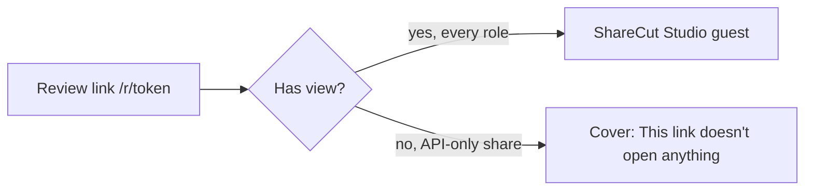

## Guest / share (`/r/{token}`)

Every review role (Viewer, Commenter, Editor) holds `view`, so every role opens ShareCut Studio guest. There is one guest surface for review links.

### Which surface?

| Share setup | Surface | What the guest sees |
|-------------|---------|---------------------|
| Viewer, Commenter (default) or Editor | **ShareCut Studio guest** | Stages gated by role (a Commenter or Viewer link is Review alone, an Editor link has Edit, Review and Deliver). Role chip in the header. |
| Any capability set without `view` (API only, no role mints one) | **Cover** | "This link doesn't open anything" with "Ask the person who sent it for a new link." beneath it. |

A review link that cannot load shows a full-page cover instead of the studio, and each cover says one plain sentence chosen from the kind of failure; the cover never shows the server's own text. This covers the failures before the studio opens; a failure after it has opened, such as the shell's document load, can still show the server's message.

| Why it did not load | Title | Sentence | Button | Tries again by itself |
|---|---|---|---|---|
| Dead, revoked or no-`view` link | This link doesn't open anything | Ask the person who sent it for a new link. | none | no |
| The host cannot be reached (a 502, 503 or 504 from the relay; the guest's own lost connection is read the same way today, and a cover of its own for it is not built) | The host's computer is asleep (a moon) | This page tries again every 30 seconds. | **Try now** | every 30 seconds |
| The host is up but busy | This link did not load | This episode is busy for a moment; this page tries again every 30 seconds. | **Retry** | every 30 seconds |
| Too many requests (429) | This link did not load | This link is busy right now; this page tries again in a moment (up to 30 seconds), in about a minute (31 to 90) or in about two minutes. | **Retry** | after the server's wait, 5 to 120 seconds, else 30 |
| Sign-in required (401) | This link did not load | This link needs a sign-in; ask the person who sent it how to sign in. | none | no |
| Access refused (403) | This link did not load | This link is only for certain people; ask the person who sent it to check it was made for you. | none | no |
| The link's project is not available (a 404 that is not a dead link) | This link did not load | This link isn't available right now; ask the person who sent it to check it. | **Retry** | no |
| A network answered with a page that is not the episode (a sign-in page on public Wi-Fi) | This link did not load | This network did not pass the page through; on public Wi-Fi, sign in to the Wi-Fi first, then try again. | **Retry** | no |
| Any other failure, such as a 500 | This link did not load | Try again, and if it keeps happening, tell the person who sent it. | **Retry** | no |
| The host does not serve review links at this address | This link did not load | This address cannot open review links; ask the person who sent it to check the link. | none | no |

Pressing **Try now** or **Retry** answers on the same button: it reads "Trying…" for the length of the attempt and at least 0.6 seconds, keeps its place, its size and its focus, and a status line beside the button (above it on a phone, below it on a larger screen, taking no room of its own) says "Trying again…", then "Still asleep." (the asleep cover) or "Still not loading." (every other cover) if the attempt fails. The page's own retries never put words on the line, and one that starts after a failed press clears it. An attempt that never answers is replaced by the page's own retry after its delay, on the covers that retry by themselves; on the others (a 500, a link that is not available right now, a network in the way) a pressed attempt still unanswered after 30 seconds stops counting as trying, so the button returns to **Retry**, the line says "Still not loading." and a press starts a new attempt. A replaced attempt stays in flight (the page keeps the newest and the two before it, and cancels the older ones and, once the episode opens, all the others), and if it answers late with the episode, that opens it, whether or not a newer attempt has failed in the meantime. The one exception is a link the newest answer found gone, which an older answer never reopens. On the loading screen a pressed **Retry** reads "Trying…" for the 4 seconds the screen waited before offering it. The cover's title is the page's heading and takes focus when the cover appears, so a screen reader reads the title and the sentence; no frame is drawn around the window. When the host cannot be reached but this browser holds a saved copy, the studio opens read-only and the Save dot shows a hollow cloud and "Saved copy · N waiting" (the comments waiting to send, left out when none; the phone shows the cloud and the count); its tooltip and screen-reader text say "Showing a saved copy because the host can't be reached. It is read-only."

Step flows: [Guest journeys](#/journeys).

### Capability → plain language

| Cap | Guest can… |
|-----|------------|
| `play` | Hear the review mix or session audio in ShareCut Studio |
| `view` | Open ShareCut Studio guest (timeline, transcript, sanitized project) |
| `comment` | Leave time-anchored comments |
| `reply` | Reply in a comment thread |
| `action` | Check off comment action items |
| `suggest` | Commenter and Editor. Propose structural cuts (pending); nudge its own suggestions; **not** hard-apply |
| `edit` | Editor only. Approve/reject pending, fades/joins, FX bypass, apply structural cuts |
| `mcp` | Connect an **external** agent at `{base}/mcp/{token}/mcp` (the host Invite sheet copies the MCP URL when the host allowed AI assistants; **no guest in-app MCP connect UI**) |

### ShareCut Studio guest chrome (when `view` is granted)

| Header role control (button accessible name) | Role (`guest_mode`) |
|---------------|--------------|
| Explain Editor role | Editor (`edit`) |
| Explain Commenter role | Commenter (`comment`) |
| Explain Viewer role | Viewer (`view`; listen + inspect, not “no audio”) |

The separate static role chip is an image whose accessible name starts with
**Editor: can edit**, **Commenter: can comment** or **Viewer: can listen**.

The automatic role hint is eligible on visits until it is dismissed for that
browser role; its appearance is not persisted. If the hint is still visible on
the first activation, that activation dismisses it. The next activation opens
the explanation dialog beside the control. After a remembered dismissal, the
first activation opens the dialog directly. Close and Escape close the dialog
and return focus to its trigger. An outside pointer press closes the dialog and
leaves the outside control's pointer behavior and click intact, including an
already-focused scrub field's uncommitted draft. It dismisses an automatic
hint while leaving focus on the outside control.

**Comment field on a phone:** on the phone layout (767 px and narrower) a Viewer or Commenter link uses the Listen layout: a Viewer link has no Comment button, no selection bar and no text field, and on a Commenter link no text field is on screen until the guest taps **Comment** in the Listen dock, which pins the time, pauses an episode that is playing, and opens the composer above the dock; **Post** or **Close** plays on if Comment paused it and nothing touched playback since, and returns focus to the Comment button. The transcript selection bar's Comment on a Commenter link also pauses an episode that is playing and opens the composer, but pins the selected range, replacing the time of text kept by Close; only on this layout does opening the composer pause. An Editor link on a phone keeps the Player bar and the always-present comment field, docked at the foot of the Review panel (inline in the card when the layout is 30rem tall or less; the keyboard does not count); the bar's Comment button, visible without a menu (also on a short landscape phone), opens the composer and leaves playback running. A landscape phone wider than 767 px uses the tablet shell. On a tablet, a desktop and for the host the field stays at the top of the card.

**Approve in the queue:** an Editor decides the suggested cuts in the Review queue with **Cut** and **Keep** (the Review badge counts them); Find more, unsure-word Fix and Resolve stay host-only. Approve and Reject also work from the Timeline overlay, and as Cut and Keep from the Action bar.

When a guest Cut finishes after the active project changes, its old refusal
does not replace feedback for the project now open. A completed Paste focuses
its lane only if the originating project is still current when the scheduled
focus runs.

**Playback:** prefer **proxy media** (short MP3 listen chunks, often via CDN) so ordinary listen does not pull long host WAVs through the tunnel. Fallback to WAV when proxies are unavailable.

**AI assistants (`mcp`):** Hosts copy the MCP URL from Invite (or Deliver → Share for review) after creating the link with **Allow AI assistants (MCP)**. The assistant connects through an MCP client such as Claude or ChatGPT — not a guest Settings pane. Same role as the human on that share. Listen-first Suggested is HTTP (`guest_pending_preview` / `GET …/daw/pending-preview`), not host speakers.
