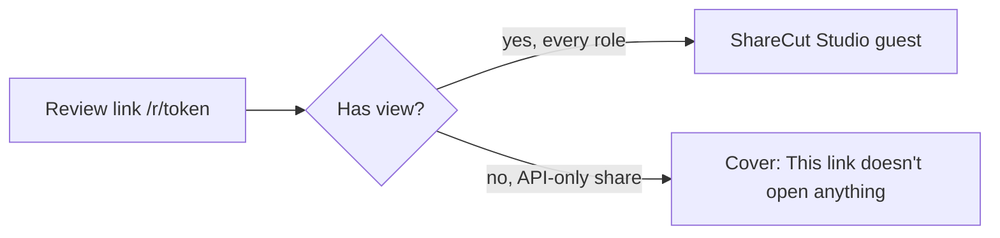

## Guest / share (`/r/{token}`)

Every review role (Viewer, Commenter, Editor) holds `view`, so every role opens ShareCut Studio guest. There is one guest surface for review links.

### Which surface?

| Share setup | Surface | What the guest sees |
|-------------|---------|---------------------|
| Viewer, Commenter (default) or Editor | **ShareCut Studio guest** | Stages gated by role (a Commenter or Viewer link is Review alone, an Editor link has Edit, Review and Deliver). Role chip in the header. |
| Any capability set without `view` (API only, no role mints one) | **Cover** | "This link doesn't open anything" with "Ask the person who sent it for a new link." beneath it. |

A dead, revoked or no-`view` link, and a host that cannot be reached with no saved copy, each show a full-page cover instead of the studio: the link covers say "This link doesn't open anything" and "Ask the person who sent it for a new link."; "The host's computer is asleep" (a moon) (a down host, or a 502, 503 or 504 from the relay) says "This page tries again every 30 seconds." and offers **Try now**; any other load failure, such as a 429 or 500, shows "This link did not load" with **Retry**. The cover takes focus when it appears. When the host cannot be reached but this browser holds a saved copy, the studio opens read-only and the Save dot shows a hollow cloud and "Saved copy · N waiting" (the comments waiting to send, left out when none; the phone shows the cloud and the count); its tooltip and screen-reader text say "Showing a saved copy because the host can't be reached. It is read-only."

Step flows: [Guest journeys](#/journeys).

### Capability → plain language

| Cap | Guest can… |
|-----|------------|
| `play` | Hear the review mix or session audio in ShareCut Studio |
| `view` | Open ShareCut Studio guest (timeline, transcript, sanitized project) |
| `comment` | Leave time-anchored comments |
| `reply` | Reply in a comment thread |
| `action` | Check off comment action items |
| `suggest` | Commenter and Editor. Propose structural cuts (pending); nudge its own suggestions; **not** hard-apply |
| `edit` | Editor only. Approve/reject pending, fades/joins, FX bypass, apply structural cuts |
| `mcp` | Connect an **external** agent at `{base}/mcp/{token}/mcp` (the host Invite sheet copies the MCP URL when the host allowed AI assistants; **no guest in-app MCP connect UI**) |

### ShareCut Studio guest chrome (when `view` is granted)

| Header role control (button accessible name) | Role (`guest_mode`) |
|---------------|--------------|
| Explain Editor role | Editor (`edit`) |
| Explain Commenter role | Commenter (`comment`) |
| Explain Viewer role | Viewer (`view`; listen + inspect, not “no audio”) |

The separate static role chip is an image whose accessible name starts with
**Editor: can edit**, **Commenter: can comment** or **Viewer: can listen**.

The automatic role hint is eligible on visits until it is dismissed for that
browser role; its appearance is not persisted. If the hint is still visible on
the first activation, that activation dismisses it. The next activation opens
the explanation dialog beside the control. After a remembered dismissal, the
first activation opens the dialog directly. Close and Escape close the dialog
and return focus to its trigger. An outside pointer press closes the dialog and
leaves the outside control's pointer behavior and click intact, including an
already-focused scrub field's uncommitted draft. It dismisses an automatic
hint while leaving focus on the outside control.

**Comment field on a phone:** on the phone layout (767 px and narrower) a Viewer or Commenter link uses the Listen layout: no text field is on screen until the guest taps **Comment** in the Listen dock, which pins the time, pauses, and opens the composer above the dock; **Post** or **Close** plays on if Comment paused it and nothing touched playback since, and returns focus to the Comment button. The transcript selection bar's Comment does the same; only on this layout does opening the composer pause. An Editor link on a phone keeps the Player bar and the always-present comment field, docked at the foot of the Review panel (inline in the card on a short window); the bar's Comment button, visible without a menu (also on a short landscape phone), opens the composer and leaves playback running. A landscape phone wider than 767 px uses the tablet shell. On a tablet, a desktop and for the host the field stays at the top of the card.

**Approve in the queue:** an Editor decides the suggested cuts in the Review queue with **Cut** and **Keep** (the Review badge counts them); Find more, unsure-word Fix and Resolve stay host-only. Approve and Reject also work from the Timeline overlay, and as Cut and Keep from the Action bar.

When a guest Cut finishes after the active project changes, its old refusal
does not replace feedback for the project now open. A completed Paste focuses
its lane only if the originating project is still current when the scheduled
focus runs.

**Playback:** prefer **proxy media** (short MP3 listen chunks, often via CDN) so ordinary listen does not pull long host WAVs through the tunnel. Fallback to WAV when proxies are unavailable.

**AI assistants (`mcp`):** Hosts copy the MCP URL from Invite (or Deliver → Share for review) after creating the link with **Allow AI assistants (MCP)**. The assistant connects through an MCP client such as Claude or ChatGPT — not a guest Settings pane. Same role as the human on that share. Listen-first Suggested is HTTP (`guest_pending_preview` / `GET …/daw/pending-preview`), not host speakers.
