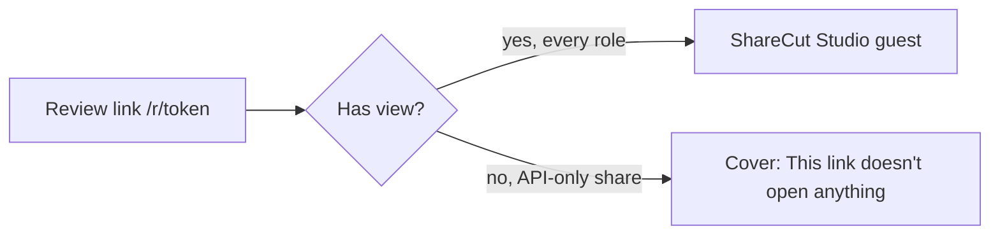

## Guest / share (`/r/{token}`)

Every review role (Viewer, Commenter, Editor) holds `view`, so every role opens ShareCut Studio guest. There is one guest surface for review links.

### Which surface?

| Share setup | Surface | What the guest sees |
|-------------|---------|---------------------|
| Viewer, Commenter (default) or Editor | **ShareCut Studio guest** | Stages gated by role (a Commenter or Viewer link is Review alone, an Editor link has Edit, Review and Deliver). Role chip in the header. |
| Any capability set without `view` (API only, no role mints one) | **Cover** | "This link doesn't open anything" with "Ask the person who sent it for a new link." beneath it. |

### While the link loads

The bar and the name hold still between the loading screen and the studio: the same bar (full width, 45 px tall on a phone, 49 px on a desktop; a window that is not a phone and is 40 rem wide or narrower, large text, gets a taller studio bar on two rows), the name in the same place and size. The version label arrives in the line under the name when the studio reads the episode.

| When | What the guest sees | What a screen reader hears |
|---|---|---|
| Before the script has loaded, on a link that has a named episode | The page itself carries the header bar with the name and a quiet "Loading…" under it, in the system's light or dark, with nothing else; when the script runs the same header is drawn again from the same name, so nothing moves and no frame is empty | "Loading <name>…" |
| The link has answered with the episode's name (or the saved copy has it) | The header with the name and a quiet "Loading…" under it, at once; the grey blocks of the guest frame from 300 ms | "Loading <name>…" |
| The name is not known yet (a link the page does not name: a link that does not open, whether unknown, malformed, turned off, expired or of the wrong kind; a restricted link; or an episode with no name) | Nothing for 300 ms, then the header bar with one grey block where the name goes, and the grey blocks; no words | "Loading the episode…" |
| Still waiting at 4 s, counted from the first screen | "Still loading…" and **Retry** under the blocks | the same line |

The page names the episode only where the browser tab already does. A link that does not open (unknown, malformed, turned off, expired or of the wrong kind), a restricted link and an episode with no name show a blank page until the script runs.

The studio then opens on the same header: "Loading…" gives way to "Shared link" and the role, then the version label. A guest's header never reads "Project"; if no name ever arrives it reads "Episode". The recording room has its own loading screen ("Joining the room…").

A review link that cannot load shows a full-page cover instead of the studio, and each cover says one plain sentence chosen from the kind of failure; the cover never shows the server's own text. This covers the failures before the studio opens. A link the host turns off while the episode is open ends on the same cover, after one more check of the link (see "A link that stops working while the episode is open" below); the studio's own first read of the episode, after the studio has opened, reads the same words for the same cause in the region where the transcript would be (see "When the studio's own load fails after it opens" below) and never shows the server's message either.

| Why it did not load | Title | Sentence | Button | Tries again by itself |
|---|---|---|---|---|
| Dead, revoked or no-`view` link, at load or turned off while the episode is open | This link doesn't open anything | Ask the person who sent it for a new link. | none (**Copy** only when the guest had typed text, see below) | no |
| The host cannot be reached (a 502, 503 or 504 from the relay, or a request that got no answer while the browser reports this device online) | The host's computer is asleep (a moon) | This page tries again every 30 seconds. | **Try now** | every 30 seconds |
| This device has no connection (the request got no answer and the browser reports it offline) | You're offline (a cloud with a slash) | This page opens the episode by itself when your connection is back. | **Try now** | by itself when the connection returns, and every 30 seconds |
| The host is up but busy | This link did not load | This episode is busy for a moment; this page tries again every 30 seconds. | **Retry** | every 30 seconds |
| Too many requests (429) | This link did not load | This link is busy right now; this page tries again in a moment (up to 30 seconds), in about a minute (31 to 90) or in about two minutes. | **Retry** | after the server's wait, 5 to 120 seconds, else 30 |
| Sign-in required (401) | This link did not load | This link needs a sign-in; ask the person who sent it how to sign in. | none | no |
| Access refused (403) | This link did not load | This link is only for certain people; ask the person who sent it to check it was made for you. | none | no |
| The link's project is not available (a 404 that is not a dead link) | This link did not load | This link isn't available right now; ask the person who sent it to check it. | **Retry** | no |
| A network answered with a page that is not the episode (a sign-in page on public Wi-Fi) | This link did not load | This network did not pass the page through; on public Wi-Fi, sign in to the Wi-Fi first, then try again. | **Retry** | no |
| Any other failure, such as a 500 | This link did not load | Try again, and if it keeps happening, tell the person who sent it. | **Retry** | no |
| The host does not serve review links at this address | This link did not load | This address cannot open review links; ask the person who sent it to check the link. | none | no |

Pressing **Try now** or **Retry** answers on the same button: it reads "Trying…" for at least 0.6 seconds, and on the covers that retry by themselves for as long as the page keeps trying after the press (on the others, until the attempt answers or 30 seconds pass), keeps its place, its size and its focus, and a status line beside the button (above it on a phone, in room the cover keeps for it so it never touches the sentence even with large text; below it on a larger screen, taking no room of its own) says "Trying again…", then "Still asleep." (the asleep cover), "Still offline." (the offline cover) or "Still not loading." (every other cover) if the attempt fails. When a different cover answers the press than the one pressed (a press on the asleep cover that finds the device offline, or the reverse, or asleep to "This link did not load"), "Still" would be false, so the line says the new cover's title as a sentence, "You're offline." or "The host's computer is asleep.", and since focus stays on the button that line is what a screen reader hears. The busy button keeps its full colour and shows the progress cursor, so "Trying…" stays readable. The page's own retries never put words on the line, and one that starts after a failed press clears it. An attempt that never answers is replaced by the page's own retry after its delay, on the covers that retry by themselves; on the others (a 500, a link that is not available right now, a network in the way) a pressed attempt still unanswered after 30 seconds stops counting as trying, so the button returns to **Retry**, the line says "Still not loading." and a press starts a new attempt. A replaced attempt stays in flight (the page keeps the newest and the two before it, and cancels the older ones and, once the episode opens, all the others), and if it answers late with the episode, that opens it, whether or not a newer attempt has failed in the meantime. The one exception is a link the newest answer found gone, which an older answer never reopens. On the loading screen a pressed **Retry** reads "Trying…" for the 4 seconds the screen waited before offering it. The cover's title is the page's heading and takes focus when the cover appears, so a screen reader reads the title and the sentence; no frame is drawn around the window. In a narrow window the cover's body starts 30% of the window's height below the logo, so the button is in thumb reach; in a window too short for that (under about 525 px tall at the default text size, such as a desktop at 200% zoom) the offset shrinks, down to nothing, so the button stays in view. When the host cannot be reached but this browser holds a saved copy, the studio opens read-only and the Save dot shows a hollow cloud and "Saved copy · N waiting" (the comments waiting to send, left out when none; the phone shows the cloud and the count); its tooltip and screen-reader text say "Showing a saved copy because the host can't be reached. It is read-only." A device that is online but cannot reach the host, and one whose browser says it is online with nothing behind it, get the asleep cover; the offline cover moves to asleep as soon as a retry fails with the browser online, and asleep moves to offline only when a retry fails with the browser offline. A saved copy opens before either.

**When the studio's own load fails after it opens.** The studio's frame is up and the first read of the episode fails: the transcript region on Review (the stage body on any other stage) shows a cover, announced as an alert, with one fixed sentence chosen from the kind of failure and none of the server's text. It uses the same sentences as the covers above for the same cause; the title is the cause's own where the page has one, else the region's.

| Why it did not load | Title | Sentence | Button | Tries again by itself |
|---|---|---|---|---|
| The host cannot be reached (502, 504, a 503 that is not busy, no answer, a read that never answers) | The host's computer is asleep | This page tries again every 30 seconds. | **Try now** | every 30 seconds |
| No answer while the browser reports this device offline | You're offline | This page opens the episode by itself when your connection is back. | **Try now** | when the connection returns, and every 30 seconds |
| The host is busy (503 `project_busy`) | The transcript didn't load (Review) or Could not load the project | This episode is busy for a moment; this page tries again every 30 seconds. | **Try again** | every 30 seconds |
| Too many requests (429) | the region's title | This link is busy right now; this page tries again in a moment (or in about a minute, in about two minutes). | **Try again** | after the server's wait, 5 to 120 seconds, else 30 |
| Sign-in required (401) | the region's title | This link needs a sign-in; ask the person who sent it how to sign in. | none | no |
| Access refused (403) | the region's title | This link is only for certain people; ask the person who sent it to check it was made for you. | none | no |
| The episode is not available (a 404 with another code, or a damaged or newer-format episode) | the region's title | This link isn't available right now; ask the person who sent it to check it. | **Try again** | no |
| A network answered with a page that is not the episode | the region's title | This network did not pass the page through; on public Wi-Fi, sign in to the Wi-Fi first, then try again. | **Try again** | no |
| The link may be gone (a 404 carrying `share_not_found`; the page is checking) | the region's title | That didn't go through. Try again in a moment. | **Try again** | no |
| Any other failure, such as a 500, a 404 with no code, or an answer the page cannot open | the region's title | Try again, and if it keeps happening, tell the person who sent it. | **Try again** | no |

The region's title is "The transcript didn't load" on Review and "Could not load the project" on the other stages. A press answers as it does on the page covers: the same button reads "Trying…" for at least 0.6 seconds and keeps its place and focus, and a status line says "Trying again…", then "Still asleep.", "Still offline." or "Still not loading.", or the new cover's title as a sentence when a different cover answers. The sentence never changes during a press. The page's own retries put no words on the line.

**A link that stops working while the episode is open.** The page replaces the studio with the dead-link cover, with the same title and sentence, only when the server answers a request for the link with the dead-link answer (a 404 carrying the code `share_not_found`) **and** one more check of the link (`GET /project`, 10 seconds) gives that same answer. It then stops all sound, stops asking the server, moves focus to the cover's title and deletes the saved copy of the episode and the audio the browser kept. Nothing else ends the session: a 404 without that code, a 403, a 5xx, a busy host, a rate limit, a lost connection, a timeout, an aborted request, and the live connection closing with `4403` (which only asks for the same check). Until the cover arrives, a failed request reads "That didn't go through. Try again in a moment." and never the server's words; the region cover reads that same sentence, with **Try again**. Queued edits and conflicts kept for the link stay as they are.

**What the guest had typed and not sent.** When the studio ends this way, a comment in the composer (or one being posted), a reply and the note on a pending edit that were typed and not sent are handed back under the sentence, in a read-only box with a heading: "Your comment was not posted", "Your reply was not posted" or "Your note was not posted" for one text, "These were not posted" for several (each as `Label:` then its text, a blank line between). The cover's one button copies the text: **Copy your comment**, **Copy your reply**, **Copy your note**, or **Copy all**; a status line says "Copied" for 3 seconds, or, when the clipboard is missing or refuses, the text is selected and the line says "Couldn't copy. The text is selected, so you can copy it by hand." The text scrolls inside its box. The button's block is pinned to the bottom of the screen at every width, so the button is always in view; with room to spare it sits where it would anyway, and it moves only once the page has to scroll. It is 48 px tall on a touch screen and the height of any other cover button with a mouse. On a short window (a phone held sideways, 30rem tall or less) the logo and the large symbol are left out, the spaces shrink and a touch button follows the window's height (never under 44 px down to a window 340 px tall), so the title, the sentence, the heading and the text are on screen with the button; with the text at 200% the title is on screen above the button, and the rest is reached by scrolling the page, nothing staying under the button. A cover with nothing unsent has no box, no button and no status line. The name field, find fields and transcript fixes are not handed back; unsent text does not survive a reload. This addition to the spec's cover is on the spec-deviation list.

A saved copy that cannot be read after the first load failed (the browser refuses its storage) counts as no saved copy: the guest gets the cover for the original failure, never the host's Home.

Step flows: [Guest journeys](#/journeys).

### Capability → plain language

| Cap | Guest can… |
|-----|------------|
| `play` | Hear the review mix or session audio in ShareCut Studio |
| `view` | Open ShareCut Studio guest (timeline, transcript, sanitized project) |
| `comment` | Leave time-anchored comments |
| `reply` | Reply in a comment thread |
| `action` | Check off comment action items |
| `suggest` | Commenter and Editor. Propose structural cuts (pending); nudge its own suggestions; **not** hard-apply |
| `edit` | Editor only. Approve/reject pending, fades/joins, FX bypass, apply structural cuts |
| `mcp` | Connect an **external** agent at `{base}/mcp/{token}/mcp` (the host Invite sheet copies the MCP URL when the host allowed AI assistants; **no guest in-app MCP connect UI**) |

### ShareCut Studio guest chrome (when `view` is granted)

| Header role control (button accessible name) | Role (`guest_mode`) |
|---------------|--------------|
| Explain Editor role | Editor (`edit`) |
| Explain Commenter role | Commenter (`comment`) |
| Explain Viewer role | Viewer (`view`; listen + inspect, not “no audio”) |

The separate static role chip is an image whose accessible name starts with
**Editor: can edit**, **Commenter: can comment** or **Viewer: can listen**.
The button is as big as its chip (24 px tall). It presses over 44 px on a touch
screen or in a header 40 rem wide or narrower, and over 32 px otherwise: an area
that reaches up over the name, which is not pressable, and at most a hairline
down, never under the bar. The New version pill and the folded version line
press over the same size; their areas grow toward the start of the line, so they
never reach the Role button's area.

The automatic role hint is eligible on visits until it is dismissed for that
browser role; its appearance is not persisted. If the hint is still visible on
the first activation, that activation dismisses it. The next activation opens
the explanation dialog beside the control. After a remembered dismissal, the
first activation opens the dialog directly. Close and Escape close the dialog
and return focus to its trigger. An outside pointer press closes the dialog and
leaves the outside control's pointer behavior and click intact, including an
already-focused scrub field's uncommitted draft. It dismisses an automatic
hint while leaving focus on the outside control.

A press on the hint itself, on its sentence or its padding, closes it and
records it as seen. It moves no focus. It closes when the press ends, so
nothing under the hint is pressed.

The next key press anywhere closes the hint and still does its own job (`L`
plays, a typed character lands). Escape always closes it. Shift, Control, Alt
and Meta alone do not, and neither does Tab, so Tab still reaches the Dismiss
button. Enter or Space on Dismiss closes the hint and focuses the role button.
On the role button they only dismiss it, and the next press opens the dialog.

The sentence is said once, through the page's status region, when the hint
appears. It is not said again on a re-render, on dismissal or when the dialog
opens. A returning guest hears nothing.

On a touch screen the hint is 44 px tall at the default text size. It hangs 3 px
under the header bar, so it ends above the first line of the transcript at 390
and 320 px wide. At larger text it grows with its text and may reach that line.
On a desktop it is 40 px tall.

A saved copy opened offline shows no hint and writes no flag. The copy opens
read-only, so the link's role is not known there, and the header shows no role
chip on it. The next load that reaches the server shows the link's own role and
its hint once. A saved copy that is already open does not change until it is
reloaded.

In a private window, or with browser storage blocked, nothing can remember the
dismissal, so the hint returns on the next load.

**Comment field on a phone:** on the phone layout (767 px and narrower) a Viewer or Commenter link uses the Listen layout: a Viewer link has no Comment button, no selection bar and no text field, and on a Commenter link no text field is on screen until the guest taps **Comment** in the Listen dock, which pins the time, pauses an episode that is playing, and opens the composer above the dock; **Post** or **Close** plays on if Comment paused it and nothing touched playback since, and returns focus to the Comment button. The transcript selection bar's Comment on a Commenter link also pauses an episode that is playing and opens the composer, but pins the selected range, replacing the time of text kept by Close; only on this layout does opening the composer pause. An Editor link on a phone keeps the Player bar and the always-present comment field, docked at the foot of the Review panel (inline in the card when the layout is 30rem tall or less; the keyboard does not count); the bar's Comment button, visible without a menu (also on a short landscape phone), opens the composer and leaves playback running. A landscape phone wider than 767 px uses the tablet shell. On a tablet, a desktop and for the host the field stays at the top of the card.

**Undo and Redo on an Editor link:** an Editor's Undo and Redo, in the header, the palette, Mod+Z and Mod+Shift+Z, and the phone's two-finger tap, take back only the Editor's own latest step and bring back only a step they undid. When the latest change is the host's, another guest's, or a comment or decision by someone else, the controls are disabled, a key press is not sent, and the page says "There is nothing of yours to undo." (Redo: "There is nothing of yours to redo."). The longer server sentences ("The latest change is someone else's." and "Redo brings back only what you undid.") appear only when a press that was sent is refused, for instance when the host edited since the page last heard. A refusal is told once in words and never lands in Needs attention as a conflict. Header, palette and keys agree because they read one answer built from the same information. A flag is only as fresh as the last update the page received, and the server's sentence corrects a stale one. A Viewer or Commenter link has no Undo or Redo ("Undo needs Editor access").

**Approve in the queue:** an Editor decides the suggested cuts in the Review queue with **Cut** and **Keep** (the Review badge counts them); Find more, unsure-word Fix and Resolve stay host-only. Approve and Reject also work from the Timeline overlay, and as Cut and Keep from the Action bar.

When a guest Cut finishes after the active project changes, its old refusal
does not replace feedback for the project now open. A completed Paste focuses
its lane only if the originating project is still current when the scheduled
focus runs.

**Playback:** prefer **proxy media** (short MP3 listen chunks, often via CDN) so ordinary listen does not pull long host WAVs through the tunnel. Fallback to WAV when proxies are unavailable.

**AI assistants (`mcp`):** Hosts copy the MCP URL from Invite (or Deliver → Share for review) after creating the link with **Allow AI assistants (MCP)**. The assistant connects through an MCP client such as Claude or ChatGPT — not a guest Settings pane. Same role as the human on that share. Listen-first Suggested is HTTP (`guest_pending_preview` / `GET …/daw/pending-preview`), not host speakers.
