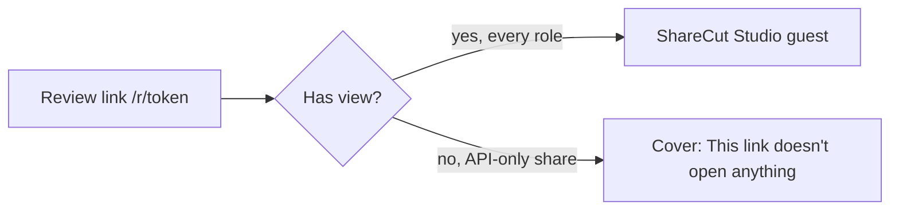

## Guest / share (`/r/{token}`)

Every review role (Viewer, Commenter, Editor) holds `view`, so every role opens ShareCut Studio guest. There is one guest surface for review links.

### Which surface?

| Share setup | Surface | What the guest sees |
|-------------|---------|---------------------|
| Viewer, Commenter (default) or Editor | **ShareCut Studio guest** | Stages gated by role (a Commenter or Viewer link is Review alone, an Editor link has Edit, Review and Deliver). Role chip in the header, except on a saved copy, which does not know the link's role and shows none. |
| Any capability set without `view` (API only, no role mints one) | **Cover** | "This link doesn't open anything" with "Ask the person who sent it for a new link." beneath it. |

### While the link loads

The bar and the name hold still between the loading screen and the studio: the same bar (full width, 45 px tall on a phone, 49 px on a desktop; a window that is not a phone and is 40 rem wide or narrower, large text, gets a taller studio bar on two rows), the name in the same place and size. The version label arrives in the line under the name when the studio reads the episode.

| When | What the guest sees | What a screen reader hears |
|---|---|---|
| Before the script has loaded, on a link that has a named episode | The page itself carries the header bar with the name and a quiet "Loading…" under it, in the system's light or dark, with nothing else; when the script runs the same header is drawn again from the same name, so nothing moves and no frame is empty | "Loading <name>…" |
| The link has answered with the episode's name (or the saved copy has it) | The header with the name and a quiet "Loading…" under it, at once; the grey blocks of the guest frame from 300 ms | "Loading <name>…" |
| The name is not known yet (a link the page does not name: a link that does not open, whether unknown, malformed, turned off, expired or of the wrong kind; a restricted link; or an episode with no name) | Nothing for 300 ms, then the header bar with one grey block where the name goes, and the grey blocks; no words | "Loading the episode…" |
| Still waiting at 4 s, counted from the first screen | "Still loading…" and **Retry** under the blocks | the same line |

The page names the episode only where the browser tab already does. A link that does not open (unknown, malformed, turned off, expired or of the wrong kind), a restricted link and an episode with no name show a blank page until the script runs.

The studio then opens on the same header: "Loading…" gives way to "Shared link" and the role, then the version label. A guest's header never reads "Project"; if no name ever arrives it reads "Episode". The recording room has its own loading screen ("Joining the room…").

A review link that cannot load shows a full-page cover instead of the studio, and each cover says one plain sentence chosen from the kind of failure; the cover never shows the server's own text. This covers the failures before the studio opens. A link the host turns off while the episode is open ends on the same cover, after one more check of the link (see "A link that stops working while the episode is open" below); the studio's own first read of the episode, after the studio has opened, reads the same words for the same cause in the region where the transcript would be (see "When the studio's own load fails after it opens" below) and never shows the server's message either.

| Why it did not load | Title | Sentence | Button | Tries again by itself |
|---|---|---|---|---|
| Dead, revoked or no-`view` link, at load or turned off while the episode is open | This link doesn't open anything | Ask the person who sent it for a new link. | none (**Copy** only when the guest had typed text, see below) | no |
| The host cannot be reached (a 502, 503 or 504 from the relay, or a request that got no answer while the browser reports this device online) | The host's computer is asleep (a moon) | This page tries again every 30 seconds. | **Try now** | every 30 seconds |
| This device has no connection (the request got no answer and the browser reports it offline) | You're offline (a cloud with a slash) | This page opens the episode by itself when your connection is back. | **Try now** | by itself when the connection returns, and every 30 seconds |
| The host is up but busy | This link did not load | This episode is busy for a moment; this page tries again every 30 seconds. | **Retry** | every 30 seconds |
| Too many requests (429) | This link did not load | This link is busy right now; this page tries again in a moment (up to 30 seconds), in about a minute (31 to 90) or in about two minutes. | **Retry** | after the server's wait, 5 to 120 seconds, else 30 |
| Sign-in required (401) | This link did not load | This link needs a sign-in; ask the person who sent it how to sign in. | none | no |
| Access refused (403) | This link did not load | This link is only for certain people; ask the person who sent it to check it was made for you. | none | no |
| The link's project is not available (a 404 that is not a dead link) | This link did not load | This link isn't available right now; ask the person who sent it to check it. | **Retry** | no |
| A network answered with a page that is not the episode (a sign-in page on public Wi-Fi) | This link did not load | This network did not pass the page through; on public Wi-Fi, sign in to the Wi-Fi first, then try again. | **Retry** | no |
| Any other failure, such as a 500 | This link did not load | Try again, and if it keeps happening, tell the person who sent it. | **Retry** | no |
| The host does not serve review links at this address | This link did not load | This address cannot open review links; ask the person who sent it to check the link. | none | no |

Pressing **Try now** or **Retry** answers on the same button: it reads "Trying…" for at least 0.6 seconds, and on the covers that retry by themselves for as long as the page keeps trying after the press (on the others, until the attempt answers or 30 seconds pass), keeps its place, its size and its focus, and a status line beside the button (above it on a phone, in room the cover keeps for it so it never touches the sentence even with large text; below it on a larger screen, taking no room of its own) says "Trying again…", then "Still asleep." (the asleep cover), "Still offline." (the offline cover) or "Still not loading." (every other cover) if the attempt fails. When a different cover answers the press than the one pressed (a press on the asleep cover that finds the device offline, or the reverse, or asleep to "This link did not load"), "Still" would be false, so the line says the new cover's title as a sentence, "You're offline." or "The host's computer is asleep.", and since focus stays on the button that line is what a screen reader hears. The busy button keeps its full colour and shows the progress cursor, so "Trying…" stays readable. The page's own retries never put words on the line, and one that starts after a failed press clears it. An attempt that never answers is replaced by the page's own retry after its delay, on the covers that retry by themselves; on the others (a 500, a link that is not available right now, a network in the way) a pressed attempt still unanswered after 30 seconds stops counting as trying, so the button returns to **Retry**, the line says "Still not loading." and a press starts a new attempt. A replaced attempt stays in flight (the page keeps the newest and the two before it, and cancels the older ones and, once the episode opens, all the others), and if it answers late with the episode, that opens it, whether or not a newer attempt has failed in the meantime. The one exception is a link the newest answer found gone, which an older answer never reopens. On the loading screen a pressed **Retry** reads "Trying…" for the 4 seconds the screen waited before offering it. The cover's title is the page's heading and takes focus when the cover appears, so a screen reader reads the title and the sentence; no frame is drawn around the window. In a narrow window the cover's body starts 30% of the window's height below the logo, so the button is in thumb reach; in a window too short for that (under about 525 px tall at the default text size, such as a desktop at 200% zoom) the offset shrinks, down to nothing, so the button stays in view. When the host cannot be reached but this browser holds a saved copy, the studio opens read-only and the Save dot shows a hollow cloud and "Saved copy · N waiting" (the comments waiting to send, left out when none; the phone shows the cloud and the count); its tooltip and screen-reader text say "Showing a saved copy because the host can't be reached. It is read-only." A device that is online but cannot reach the host, and one whose browser says it is online with nothing behind it, get the asleep cover; the offline cover moves to asleep as soon as a retry fails with the browser online, and asleep moves to offline only when a retry fails with the browser offline. A saved copy opens before either.

**When the studio's own load fails after it opens.** The studio's frame is up and the first read of the episode fails: the transcript region on Review (the stage body on any other stage) shows a cover, announced as an alert, with one fixed sentence chosen from the kind of failure and none of the server's text. It uses the same sentences as the covers above for the same cause; the title is the cause's own where the page has one, else the region's.

| Why it did not load | Title | Sentence | Button | Tries again by itself |
|---|---|---|---|---|
| The host cannot be reached (502, 504, a 503 that is not busy, no answer, a read that never answers) | The host's computer is asleep | This page tries again every 30 seconds. | **Try now** | every 30 seconds |
| No answer while the browser reports this device offline | You're offline | This page opens the episode by itself when your connection is back. | **Try now** | when the connection returns, and every 30 seconds |
| The host is busy (503 `project_busy`) | The transcript didn't load (Review) or Could not load the project | This episode is busy for a moment; this page tries again every 30 seconds. | **Try again** | every 30 seconds |
| Too many requests (429) | the region's title | This link is busy right now; this page tries again in a moment (or in about a minute, in about two minutes). | **Try again** | after the server's wait, 5 to 120 seconds, else 30 |
| Sign-in required (401) | the region's title | This link needs a sign-in; ask the person who sent it how to sign in. | none | no |
| Access refused (403) | the region's title | This link is only for certain people; ask the person who sent it to check it was made for you. | none | no |
| The episode is not available (a 404 with another code, or a damaged or newer-format episode) | the region's title | This link isn't available right now; ask the person who sent it to check it. | **Try again** | no |
| A network answered with a page that is not the episode | the region's title | This network did not pass the page through; on public Wi-Fi, sign in to the Wi-Fi first, then try again. | **Try again** | no |
| The link may be gone (a 404 carrying `share_not_found`; the page is checking) | the region's title | That didn't go through. Try again in a moment. | **Try again** | no |
| Any other failure, such as a 500, a 404 with no code, or an answer the page cannot open | the region's title | Try again, and if it keeps happening, tell the person who sent it. | **Try again** | no |

The region's title is "The transcript didn't load" on Review and "Could not load the project" on the other stages. A press answers as it does on the page covers: the same button reads "Trying…" for at least 0.6 seconds and keeps its place and focus, and a status line says "Trying again…", then "Still asleep.", "Still offline." or "Still not loading.", or the new cover's title as a sentence when a different cover answers. The sentence never changes during a press. The page's own retries put no words on the line.

**A link that stops working while the episode is open.** The page replaces the studio with the dead-link cover, with the same title and sentence, only when the server answers a request for the link with the dead-link answer (a 404 carrying the code `share_not_found`) **and** one more check of the link (`GET /project`, 10 seconds) gives that same answer. It then stops all sound, stops asking the server, moves focus to the cover's title and deletes the saved copy of the episode and the audio the browser kept. While the live episode is open, a 404 without that code, a 403, a 5xx, a busy host, a rate limit, a lost connection, a timeout and an aborted request leave the studio open. A `4403` close of the live connection asks for the same check. Until the cover arrives, a failed request reads "That didn't go through. Try again in a moment." and never the server's words; the region cover reads that same sentence, with **Try again**. Queued edits and conflicts kept for the link stay as they are.

**What the guest had typed and not sent.** When the studio ends this way, a comment in the composer (or one being posted), a reply and the note on a pending edit that were typed and not sent are handed back under the sentence, in a read-only box with a heading: "Your comment was not posted", "Your reply was not posted" or "Your note was not posted" for one text, "These were not posted" for several (each as `Label:` then its text, a blank line between). The cover's one button copies the text: **Copy your comment**, **Copy your reply**, **Copy your note**, or **Copy all**; a status line says "Copied" for 3 seconds, or, when the clipboard is missing or refuses, the text is selected and the line says "Couldn't copy. The text is selected, so you can copy it by hand." The text scrolls inside its box. The button's block is pinned to the bottom of the screen at every width, so the button is always in view; with room to spare it sits where it would anyway, and it moves only once the page has to scroll. It is 48 px tall on a touch screen and the height of any other cover button with a mouse. On a short window (a phone held sideways, 30rem tall or less) the logo and the large symbol are left out, the spaces shrink and a touch button follows the window's height (never under 44 px down to a window 340 px tall), so the title, the sentence, the heading and the text are on screen with the button; with the text at 200% the title is on screen above the button, and the rest is reached by scrolling the page, nothing staying under the button. A cover with nothing unsent has no box, no button and no status line. The name field, find fields and transcript fixes are not handed back; unsent text does not survive a reload. This addition to the spec's cover is on the spec-deviation list.

**The host or the device stops answering while the episode is open.** The save light and one status sentence say so, and nothing else on the page changes: playback, the transcript and what the guest typed stay where they are.

| What the page found | The light says | The one status sentence |
|---|---|---|
| The host did not answer 2 requests for the link in a row (a refused or lost connection, a request that timed out, or a relay answering 502, 504 or a 503 that does not say the host is busy), and the browser reports this device online | "Can't reach the host" (a cloud with a slash) | Can't reach the host. This page keeps trying. |
| The browser reports this device offline and one request got no answer | "You're offline" (a cloud with a slash) | You're offline. This page keeps trying. |

- Any other answer from the host counts as reaching it, a 403, a 404, a 429, a 500 or a busy 503 included. A relay answering 502, 504 or a 503 that does not say the host is busy is no answer from the host. A request the page cancelled itself counts as neither. Only the guest's own requests for the link count, never the audio, which the player judges itself.
- The light shows the words with " · N waiting" when edits wait to be sent. On a phone it shows the cloud and the count, and the sentence stays in the light's title and for assistive technology. The sentence is one live region and carries the count (for example "Can't reach the host, 2 waiting. This page keeps trying."), so it is said again when the count changes.
- The saved copy indicator includes the date Studio last saved the episode when the browser has that date. Compact headers show “Saved copy” beside the cloud icon and include the date in the spoken status. The live episode uses its live save status once the host answers. On an offline reopen, Studio can use the saved episode and its cached playback for seven days from the save time. An expired or undated copy requires a connection to the host. If the saved audio uses the older format, the episode still opens and a notice under the header says “Reconnect for audio” beside **Retry**. Playback needs current audio information from the host.

- While the page is away the light never shows "Saving" or "Saved" and the page says neither: the check that runs every 30 seconds does not show as a save. A Saved copy light and an unreadable queue keep their own words.
- **Not kept on this device (#3891 slice 6).** A guest whose browser will not keep the saved copy or the edits waiting to send (it refuses the database, or the device has no room) sees the light read "Not kept on this device" (a slashed cloud; the phone shows "Not kept" beside it), never "Saved" and never "Save failed". Its title and the text for assistive technology say why, in one sentence: "Your browser isn't letting this page keep a saved copy. The page still works while the host answers. If the host stops, what you write here is lost when you close the page." or "This device has no room to keep a saved copy. The page still works while the host answers. If the host stops, what you write here is lost when you close the page." The sentence ends with what the guest stands to lose (what they write is lost if they close the page before the host answers). The same sentence is said once through the status line, however many writes fail; a refused write is held, so a read that works (the page reads its saved edits every 2 seconds) does not clear it, and only a write that works, or a reload, does. It is said again only after the failure has cleared and come back. The light is not an alert and offers no Retry, because nothing the guest can press fixes it. It comes after "Can't reach the host" (and "You're offline"), "Saving" and "Saved edits could not be read", and ahead of "Saved copy" (the saved copy shown while a reload cannot reach the host), "N waiting" and "Saved". A host never sees it: a host that cannot read its own queue keeps "Save failed" and **Retry**. A guest whose database opened but held damaged data keeps "Saved edits could not be read". A failure that is not clearly "blocked" or "full" is said only when it happens twice in a row.
- **Settings that are not kept.** A browser that refuses to store the guest's settings (the role hint closes and cannot be remembered) says once, in the status line only, "This browser isn't keeping your settings. They reset when you reload." The light stays "Saved".
- The page asks again by itself (at once when it turns away, then every 5 seconds while away, and at once when the browser reports the connection back). The first answer ends it: the light returns to "Saved" (or "N waiting" when edits wait), the page sends what waited, and the status line reads "Saved" once. Nothing else is announced.

**A saved copy that leaves itself.** A page that opened on the saved copy asks the host again every 30 seconds, when the browser reports the connection back, when the host answers after being away, and when **Try now** is pressed. The first answer with the episode replaces the saved copy with the live episode in the same studio, with no reload: the cover goes, the light reads "Saved", the role chip, the hint and the transcript appear, and anything the guest typed stays. An offline attempt, a server failure or a 403 without a host access denial leaves the saved copy open. If the host refuses the episode read with a 403 carrying `share_acl_denied` or `share_token_mismatch`, the page checks the same endpoint once more, with a 10-second limit. A repeated access denial closes the studio, shows the existing cover for a restricted link and removes the saved copy and audio. The cover lets the guest copy any unsent text. A successful check opens the live episode. An attempt answered with the dead-link answer (a 404 carrying `share_not_found`) deletes the saved copy and the audio at once, and the confirming check described above then ends the session with the dead-link cover. On the first load, a 403 with either access-denial code removes the saved copy and audio and shows the restricted cover before the studio opens. A signal that the host is back while an attempt is pending starts one more attempt when the pending one has settled.

A saved copy that cannot be read after the first load failed (the browser refuses its storage) counts as no saved copy: the guest gets the cover for the original failure, never the host's Home. When the browser refuses the database itself, the asleep or offline cover adds one sentence under its own: "Your browser isn't letting this page keep a saved copy. The page still works while the host answers. If the host stops, what you write here is lost when you close the page." A device that was full on an earlier visit cannot be told on a reload (a copy that was never written looks the same as one that never fitted), so that cover stays plain.

**Where this lives in code (SCR-GUEST-OFFLINE).** The offline screens are `stage/frame/StatusCovers.tsx` (`GuestPageCover`, the asleep, offline and other covers), `stage/hosts/HostBody.tsx` (`LoadFailureCover`, the studio's own load failure), `review/ReviewQueue.tsx` (the Needs attention group and its conflict rows, CMP-GUEST-CONFLICT) and `system/SaveIndicator.tsx` (the light, including "Not kept on this device"); what a device keeps and refuses is `state/storageHealth.ts`. Stories: `Stages/Frame/StatusCover` (HostAsleep, HostAsleepPressed, YouAreOffline, YouAreOfflinePressed, and HostAsleepLargeText, YouAreOfflineLargeText and HostAsleepBrowserKeepsNoCopy for large text and a browser that keeps no copy), `Stages/Review/Queue` (GuestConflicts, GuestConflictsLargeText320, GuestConflictsLargeText390, GuestSavedEditsUnreadable), `System/SaveIndicator` (UnkeptBlocked, UnkeptFull) and the guest stage in `stages/guest/GuestReview.stories.tsx`. The names `GuestAttentionBannerView` and its four stories no longer exist. At large text the Listen dock wraps Comment under Play and grows, and the sheets rest on the dock's measured height (`system/Player.tsx`); a dock that would take more than 40% of the frame folds to the one-row dock instead (`stage/frame/useShortFrame.ts`), so a sheet keeps room for a conflict row; the Needs attention head wraps and **Dismiss all** is 44 px tall for every pointer.

Step flows: [Guest journeys](#/journeys).

### Capability → plain language

| Cap | Guest can… |
|-----|------------|
| `play` | Hear the review mix or session audio in ShareCut Studio |
| `view` | Open ShareCut Studio guest (timeline, transcript, sanitized project) |
| `comment` | Leave time-anchored comments |
| `reply` | Reply in a comment thread |
| `action` | Check off comment action items |
| `suggest` | Commenter and Editor. Propose structural cuts (pending); nudge its own suggestions; **not** hard-apply |
| `edit` | Editor only. Approve/reject pending, fades/joins, FX bypass, apply structural cuts |
| `mcp` | Connect an **external** agent at `{base}/mcp/{token}/mcp` (the host Invite sheet copies the MCP URL when the host allowed AI assistants; **no guest in-app MCP connect UI**) |

### ShareCut Studio guest chrome (when `view` is granted)

| Header role control (button accessible name) | Role (`guest_mode`) |
|---------------|--------------|
| Explain Editor role | Editor (`edit`) |
| Explain Commenter role | Commenter (`comment`) |
| Explain Viewer role | Viewer (`view`; listen + inspect, not “no audio”) |

The separate static role chip is an image whose accessible name starts with
**Editor: can edit**, **Commenter: can comment** or **Viewer: can listen**.
The button is as big as its chip (24 px tall). It presses over 44 px on a touch
screen or in a header 40 rem wide or narrower, and over 32 px otherwise: an area
that reaches up over the name, which is not pressable, and at most a hairline
down, never under the bar. The New version pill and the folded version line
press over the same size; their areas grow toward the start of the line, so they
never reach the Role button's area.

The automatic role hint is eligible on visits until it is dismissed for that
browser role; its appearance is not persisted. If the hint is still visible on
the first activation, that activation dismisses it. The next activation opens
the explanation dialog beside the control. After a remembered dismissal, the
first activation opens the dialog directly. Close and Escape close the dialog
and return focus to its trigger. An outside pointer press closes the dialog and
leaves the outside control's pointer behavior and click intact, including an
already-focused scrub field's uncommitted draft. It dismisses an automatic
hint while leaving focus on the outside control.

A press on the hint itself, on its sentence or its padding, closes it and
records it as seen. It moves no focus. It closes when the press ends, so
nothing under the hint is pressed.

A key pressed while focus is outside the tip and the Role button closes the
hint and still does its own job (`L` plays, a typed character lands). With
focus on the role button or the Dismiss button, a letter or arrow key leaves it
up. Shift, Control, Alt and Meta alone do not close it, and neither does Tab, so
Tab still reaches the Dismiss button. Escape closes it from either place, except
while a toast is up and focus is not in a field: that Escape closes the toast
and leaves the hint. Enter or Space on Dismiss closes the hint and focuses the
role button. On the role button they only dismiss it, and the next press opens
the dialog.

The sentence is said once, through the page's status region, when the hint
appears. It is not said again on a re-render, on dismissal or when the dialog
opens. A returning guest hears nothing.

On a touch screen the hint is 44 px tall at the default text size. It hangs 3 px
under the header bar, so it ends above the first line of the transcript at 390
and 320 px wide. At larger text it grows with its text and may reach that line.
On a desktop it is 40 px tall.

A saved copy opened offline shows no hint and writes no flag. The copy opens
read-only, so the link's role is not known there, and the header shows no role
chip on it. The next load that reaches the server shows the link's own role and
its hint once. A saved copy that is already open becomes the live episode by itself
when a retry reaches the host (see "A saved copy that leaves itself"); the
role chip and the hint then appear once, as on a load that reached the server.

In a private window, or with browser storage blocked, nothing can remember the
dismissal, so the hint returns on the next load.

**The Editor's reminder.** After an edit an Editor link applies (never one that
was held, refused or only queued, and not Undo or Redo) the same bubble carries
"You changed the host's episode, and everyone sees it. Undo takes back only your
own step." It waits behind the first-visit sentence and is spoken once, after the
edit's own status line, through the page's status region. It is raised after
each applied edit until it has been dismissed once for that link in that browser,
so a tab closed with it up sees it again after the next edit. The browser
remembers the dismissal under a digest of the link, never the link itself.

**"Someone left."** When another person's presence leaves the page, the status
region says "Someone left" to the host and to an Editor on the Edit timeline (the other roles do not mount the announcer). It is skipped while a role or reminder
bubble is up, and it is never queued.

**The guest palette.** On a guest link the command palette lists only what the
role can run: the host-only, Project and Record rows are gone for every guest;
a Viewer or Commenter also has no Go to Edit or Go to Deliver rows, no lane, zoom, mute,
solo or Script rows (the link has no timeline), and no Select a range, which
would arm a range nothing visible follows. A Viewer has no Add comment or
Comment on range either. An Editor keeps Select a range and the Edit rows. A row
that depends on state stays, greyed with its reason: a range row says "Choose a
range" until one is selected. A Viewer lists Play range only. A Commenter lists
Play range, Cut, Mute and Comment on range, and chooses the range by selecting
words in the Review Script. A Viewer has no way to choose one, so its Play range
stays greyed.

**Q.** On a tablet or desktop Review page, an unshifted Q with no field focused
and no dialog open focuses the comment field of a Commenter or Editor link and
types the letter. Shift, Control, Command and Alt with Q do nothing; neither
does Q for a Viewer, on a phone or on the Edit stage.

**Escape and the toast.** While a toast is up and focus is not in a field,
Escape closes the newest toast and nothing else the Escape would not already
close (a selection and Follow end first). With focus on the toast's Dismiss
button, Escape closes it. A dismissed Undo toast loses its button; for an edit, Undo in
the header still takes the step back, but for the host's Stop sharing and End room the toast is the only Undo (End room waits until no take can be lost, so a guest is never cut mid-take by it).

**Comment field on a phone:** on the phone layout (767 px and narrower) a Viewer or Commenter link uses the Listen layout: a Viewer link has no Comment button, no selection bar and no text field, and on a Commenter link **Comment** in the Listen dock or transcript selection bar opens the field above the dock and pauses an episode that is playing. The dock pins the playhead for a fresh draft and keeps the pin when reopening held text. **Post** or **Close** plays on if Comment paused it and nothing touched playback since, and returns focus to the Comment button. **Pause and return** while the field is open cancels that automatic resumption. The transcript selection bar pins the selected range and replaces the pin of text kept by **Close**. Opening the composer pauses playback only in this layout. An Editor link on a phone keeps the Player bar and the always-present comment field, docked at the foot of the Review panel (inline in the card when the layout is 30rem tall or less; the keyboard does not count); the bar's Comment button, visible without a menu (also on a short landscape phone), opens the composer and leaves playback running. A landscape phone wider than 767 px uses the tablet shell. A comment closed in Listen keeps its text and pin in the wider field. With no selected range, clearing that text in the wider field returns the chip to the playhead. Undoing the clear restores the original pin. Back in Listen, that draft waits for the guest to tap Comment. On tablet and desktop Commenter or Editor links, the field stays above the Review card. In the host's Review queue, the field appears above the card when opened.

**A comment or reply typed while the host cannot be reached (#3891):** a Commenter or Editor link keeps it instead of refusing it with "Couldn't reach the server". Post clears the field and says, in the status line, "Comment kept. It sends when the host is back." (the host stopped answering), "Comment kept. It sends when you're back online." (this device is offline) or "Comment kept. It sends when you can reach the host." (the page cannot tell); a reply says "Reply kept." the same way. The comment shows in the Review list at its time, with the guest's name and "Waiting to send" on its row and under its name on its card (a kept reply sits in its comment's thread with the same words), then "Sending…" while a send is on its way, and becomes the real comment in place, without the card leaving the screen. The header light reads "N waiting" for it (the count only), and Needs attention counts it in words ("1 comment waiting to send", "2 comments and 1 reply waiting to send"). The one verb on a waiting comment or reply is **Don't send**, a 44 px link button that takes it out and says "Comment not sent" with **Undo** ("Comment put back"); it is disabled while "Sending…", with "It's on its way, so it can't be called back." beside it, because that send may land. Taking a comment out takes the replies waiting on it too and says so ("Comment and 1 reply not sent", Undo "Comment and 1 reply put back"); the keyboard stays on the stage. A post made while older ones wait waits behind them. While the page knows the host is away, the 30-second check makes no real send, so "Sending…" is not up for half of every minute, and the first answer from the host sends what waited. There is no Edit on it. It survives a reload and is sent, in the order written (the guest's queued edits go first and the comments after them, so a comment typed before a queued cut is sent after it), when the host answers (or the device comes back, or within 30 seconds), once even if an earlier send landed and its answer was lost. When the host refuses it for good (the link no longer allows comments or replies, or the words are longer than 8,000 characters) it leaves the list and Needs attention hands it back: "Your comment at 0:12 was not posted" (a reply: "Your reply was not posted"), the reason, the words as typed in a selectable block, **Copy**, **Dismiss** and, for a comment while the comment field is empty, **Put it back**, which puts the words and their time back in the field (a time and tracks, not the edit it asked about). Either one takes the row out, and the keyboard goes to the next row, or to the comment field after Put it back. A reply whose comment was never posted is returned with "The comment it answers was not posted.", and one whose comment is gone from the project with "The comment it answers is gone.". A refusal that arrives while the guest is on another part of the page is said once through the status line as the Needs attention summary ("Needs attention. 1 not posted"). A link the host turned off ends through the cover above, whose box lists these words too, and the saved copy and these kept and returned words are cleared from the device once the cover shows (on the next open too, for a link that was off before the page loaded). Checking off an action item is not kept: it still says it could not reach the server.

**An Editor's edit waiting to send (#3891).** The save light shows how many changes are waiting. The Review queue and its announcement call the edit “waiting to send” while the app keeps it for automatic replay. A refusal has a separate row with the host's reason.

**Undo and Redo on an Editor link:** an Editor's Undo and Redo, in the Player on a phone or in the header on a tablet or desktop, in the palette, and through Mod+Z, Mod+Shift+Z and the phone's history gestures, take back only the Editor's own latest step and bring back only a step they undid. When the latest change is the host's, another guest's, or a comment or decision by someone else, the controls are disabled, a key press is not sent, and the page says "There is nothing of yours to undo." (Redo: "There is nothing of yours to redo."). The longer server sentences ("The latest change is someone else's." and "Redo brings back only what you undid.") appear only when a press that was sent is refused, for instance when the host edited since the page last heard. A refusal is told once in words and never lands in Needs attention as a conflict. The history pair, palette and keys agree because they read one answer built from the same information. A flag is only as fresh as the last update the page received, and the server's sentence corrects a stale one. A Viewer or Commenter link has no Undo or Redo ("Undo needs Editor access").

**Approve in the queue:** an Editor decides the suggested cuts in the Review queue with **Cut** and **Keep** (the Review badge counts them); Find more, unsure-word Fix and Resolve stay host-only. Cut and Keep on the Action bar decide a cut, shorten or lower suggestion; Approve and Reject on the Action bar decide a split, an exact range or a suggestion with no accept action (an exact range's would show disabled with a visible note for anyone who may not decide it, but a Commenter or Viewer link is Review alone and never reaches the bar).

**Hand edits on an Editor link:** an Editor selects words or a range and presses **Cut**, or **Mute** in More, and the edit applies on the host's episode; the toast reads "Cut "uncle" · 0.3 s · 1 more" or "Range mute applied. Use Undo to restore it." with Undo, which takes back only the Editor's own step. **Fix text** (bar, F2, double-tap) and **Find and replace** work as for the host; a Commenter or Viewer link has neither. On a cut seam, **Keep** puts back an approved cut, and on a cut the Editor made with the bar it is disabled with "This cut can't be put back on its own. Undo takes back your own latest change; for anything else, ask the host." When the server holds an edit, the page says so in one sentence that names whose cut it was and why ("Reference's cut at 0:02.5 was not applied because that part of the recording is no longer in one piece on the timeline. Nothing was changed. Select it again to try another cut."); it is not filed under Needs attention as it happens (only a command replayed after an offline spell is) and never names a file, a check or a setting.

**Clear selection in the Review Script.** While a Commenter or Editor link has words selected in the Script, **Clear selection** shows in the Script header, on a phone too. It clears the selection and sends no cut, comment or suggestion. Focus returns to the selected word. Escape does the same. A Viewer link cannot select, so it has no such button. On a phone the header holds only the Follow pin and this button, with no label because the Role chip says what the link allows, so no line moves when a selection starts or clears.

Hold messages and held rows use short labels. An oversized edit label reads as
"That edit". A long speaker or track name uses "someone else" or "Another track",
while the refusal still explains the hold and what to try next.

When a guest Cut finishes after the active project changes, its old refusal
does not replace feedback for the project now open. A completed Paste focuses
its lane only if the originating project is still current when the scheduled
focus runs.

**Playback:** prefer **proxy media** (short MP3 listen chunks, often via CDN) so ordinary listen does not pull long host WAVs through the tunnel. Fallback to WAV when proxies are unavailable.

**AI assistants (`mcp`):** Hosts copy the MCP URL from Invite (or Deliver → Share for review) after creating the link with **Allow AI assistants (MCP)**. The assistant connects through an MCP client such as Claude or ChatGPT — not a guest Settings pane. Same role as the human on that share. Listen-first Suggested is HTTP (`guest_pending_preview` / `GET …/daw/pending-preview`), not host speakers.
