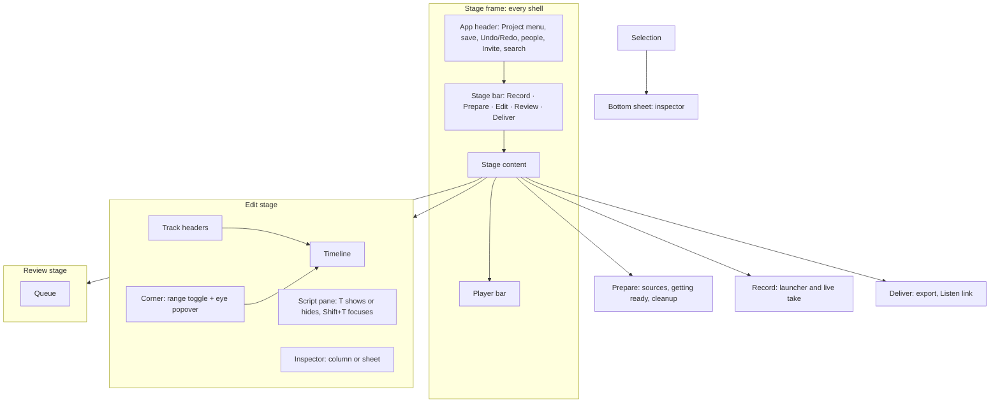

## Information architecture

The Deliver stage saves chapter edits and clip trims and removals to the project as they happen; a trim on the waveform is one save when the drag or the arrow presses end (dragging an In handle snaps to the nearest word start and an Out handle to the nearest word end, from the project transcript's aligned word timings, skipping cut, suppressed and ignored words; hold Alt to move freely, and the arrow keys always move freely; a project with no transcript words moves freely, and the strip shows the episode waveform from the rendered stems, a flat line only while it loads or when no stem is built), a chapter time is a Scrub field (seconds, `s`): a drag shows the time live and saves once on release, snapping to the nearest sentence start found in the transcript's word timings (the first word and every word after one that ends in `.`, `?`, `!` or `…`, optionally followed by a closing quote or bracket, starts a sentence, so an abbreviation such as "Mr." makes a false start; Alt does not free a chapter drag; with no transcript words it moves freely), while the arrow keys step 0.1 s (Shift 1 s, Alt 0.01 s) and a typed value (`312.4` or `5:12.4`) are never snapped, Enter, leaving the field or leaving the stage saves and Escape drops the typed text; a clip card's In and Out fields, each with a visible In or Out label, are the same Scrub field (seconds, `s`, two decimals, from 0 to the episode length): a drag shows the number live and saves once on release, leaving a field you did not change saves nothing, each arrow press saves a 0.1 s step, and a typed value (`312.4` or `5:12.4`) is saved on Enter, on leaving the field and on leaving the stage, while Escape drops it; a typed number outside the range is refused with the range, and the clip keeps at least a second between In and Out. The Episode file Part In and Out are the same Scrub field (Home and End jump to the ends). A change that cannot send yet stays on the page under "Not saved yet"; one the project refuses, now or when it sends later, stays under "Could not save your changes", with a button to show the saved version. Removing a clip saves at once (`DeleteSocialClip`) and its toast offers Undo, which takes that removal back through project history (`UndoHistory` with the head the removal left), so the clip returns with its id, bounds, title and approval; if history has moved on since, the undo is refused and the page shows "Could not save your changes" and the saved version. A clip's title and approval are saved too (`UpdateSocialClipDetails`, host only): a title is saved when you press Enter or leave the field (not on every keystroke) and Approve is one save; the page holds what you typed until the save is acknowledged, and a refused or failed save shows under "Could not save your changes" like a trim. An approved clip shows "Approved" and an Unapprove button; Unapprove is one save (`approved: false`) that puts the clip back in review, out of the default export, and focus moves to that clip's Approve button. Find clips (the empty state's link and the section action) runs `ProposeSocialClips` (host only): approved and manually added clips stay and the rest are replaced, the button reads unavailable with "Finding clips…" while it runs, and the new clips appear when the project refreshes; a failed run shows under "Could not save your changes", and offline it is queued like any Deliver save. Export runs on this page; there is no Export dialog. The Episode file section lists the formats the project's Pipeline settings offer (MP3, M4A, FLAC), with the ones already configured on, and says WAV is written when the project's export settings keep it on; it says "Loading export settings…" while each visit loads them. Export and the Podcast listing's export repair are unavailable until the load settles. `Mod+E` waits for the same load. If the load fails, the page reports the problem and uses the last loaded settings or the project's defaults. The Loudness group starts on Project default, which uses the project master settings. Podcast −16, Broadcast −23 and Streaming −14 select a one-off audio export without changing those settings. The Range choice and the "Saves to" line are left out, because nothing in the project backs them. Export, the Export button and `Mod+E` (from any stage) start the real export job with the formats chosen on the page; Export is greyed with its reason in text when the command is unavailable, when edits are still saving or waiting to send, or when a change the project refused is still on the page ("Show the saved version" clears it); a `Mod+E` press made while a change is refused or waiting to send is dropped, not held. While it runs the section shows "Exporting" with the job's step progress, elapsed time and Cancel (greyed with its reason until the job has started); leaving Deliver does not stop it, and coming back shows its progress or outcome. When it ends the section says "Exported" with the number of files written and the loudness the master measured, or "Export failed" with the cause and Try again, or "Export cancelled" (listing any files a late cancel could not stop) with Export again. A missing model is asked for inside the page, with Download and Not now; the prompt scrolls into view and takes focus. The finished export shows "Export is out of date" when the selected formats or applicable loudness settings change. Edit-only changes to chapters, approved clips, or the edit history show "Edited since export". That stale row has a quiet "Export again" button that starts the same export as Export (greyed with the same reason). Export again and Try again export what the page shows now, not what the failed attempt asked for. While Export is greyed they are greyed too, with the same reason, and the failed row stays. The old dialog's Done button, the full file paths, the close-window hint and the "files are replaced only once every file is written" lead are gone: the section lists file names and says they are in export/. `Mod+E` while an export runs does nothing and says nothing; the section already shows the running export. The page does not know about exports from an earlier session, so until the first export of a session it shows no export status. Export stays the only filled button; there is no "Download all". When Readiness has open Review items (suggestions, comments, unsure words), a secondary Review hand-off ("Review 3 open items") sits in the foot of the stage, bottom right on desktop and full width above the player on a phone; it opens Review on the first open kind and is not shown while Deliver loads, when only the mix or peaks are open, or when nothing is open. For Project default, every file in the export folder is one row in the section that owns it (audio and chapters under Episode file, transcript files under Transcript, the feed file under Podcast listing) with its name, what it is, its size and one quiet action: Reveal in the desktop app, Download in a browser. Rows come from the folder, not the last job, so they stay after a failed or cancelled export, say "Edited since export" for transcripts, chapters and the feed when they are older than the last edit (canonical audio is not judged; an audio row marked out of date by the producer says "Export is out of date" without attributing it to an edit), and are disabled with "Exporting now. Download when it finishes." while an export writes. An Editor share link gets a Files section at the top of its Deliver page, grouped Audio, Transcript, Chapters and Feed; Viewer and Commenter links see nothing.

A named loudness export includes audio only. Its result lists only the files that
export produced, with Download in a browser or Reveal in the desktop app.
The file actions wait for the current inventory. A loading, failed or incomplete
listing says what happened and offers Refresh files when another read can help.
A failed named export shows its cause and does not substitute Project default
files. A late cancellation lists files only when the export published them.
The result keeps its submitted loudness and measured level when you choose the
next target. Project default restores the standard export, including available
captions and transcript. The Podcast listing's export repair always uses Project
default. A named variant leaves the shared master and Listen link unchanged.

On a phone the Stage bar is the bottom tab bar, Edit shows one of Timeline or Script at a time, and the people slot shows one avatar plus a count. A Commenter or Viewer share link is Review alone, with no Stage bar, and an Editor link has three stages.
